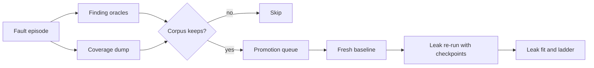

# Requirements

### Overview & Goals

ADR-111 Stage 3 adds a fast fault-only mode to `scripts/bench_fuzz.py`. Each episode runs one repetition with no leak checkpoints, and only the finding oracles and the coverage dump run. The leak check runs only on episodes that reached new coverage probes or a new finding signature. The goal is more episodes per hour without losing planted faults.

### Scope

**In Scope**
- A `--mode {leak,faults}` option; `leak` stays the default and keeps today's behaviour.
- `faults` mode: one run per episode, no baseline or per-episode checkpoint, no repetitions.
- Promising episodes (new probe or new signature) get a leak re-run from a fresh baseline.
- Finding replays in `faults` mode run without a checkpoint.
- `faults` mode requires `--coverage`.
- Documentation update in `docs/dev/BEHAVIOUR_FUZZING_PLAN.md` and `helpers/StressTestRTP/LEAK_FUZZING.md`.

**Out of Scope**
- Any Java change: the `/rtpstress coverage` command and JaCoCo wiring already exist from Stage 2.
- New finding oracles (Stage 4) and the action vocabulary (Stage 5).
- Changes to the `direct` control run, which stays in leak mode.

### User Stories

- As an operator, I want `--mode faults` so that I can explore several times more episodes per hour than leak mode.
- As an operator, I want a leak check on episodes that reach new code so that leak candidates are not lost.
- As an operator, I want a planted exception to still be found and confirmed in `faults` mode.

### Functional Requirements

- `--mode faults` with `--reps` set above 1 shall log a warning that `--reps` is ignored.
- `faults` mode without `--coverage` shall exit with a clear error before any server is started.
- An episode in `faults` mode shall not start a baseline or `leakcheck` checkpoint, and shall not write `deltas` or `slope.*`.
- Each episode shall still run the finding oracles, the `settle()` check for foreign or lingering players, and the coverage dump.
- An episode that yields new coverage probes or a new finding signature shall be queued as a promising candidate.
- After the episode loop, each queued candidate shall get one leak re-run: a fresh baseline checkpoint, then the same programs run with `--reps` repetitions and checkpoints, scored by the existing leak path (`score_episode`, fit, ladder).
- A finding replay in `faults` mode shall run one episode without a checkpoint and confirm by signature only.
- Leak mode behaviour shall be unchanged, byte for byte in its trace records.

### Non-Functional Requirements

- The Python side stays stdlib-only (ADR-111 section 2.2).
- Acceptance: at least 3x the episodes per hour of leak mode on the same server (measured and recorded in `LEAK_FUZZING.md`).
- Acceptance: the planted exception from the fake-server test is found and confirmed in `faults` mode.
- Runs stay local and opt-in; nothing is added to `gradlew test` or CI (ADR-111 section 2.8).

# Technical Design

### Current Implementation

- `scripts/bench_fuzz.py` has one per-target runner class (the one whose `__init__` builds `self.probe_reader` from `--coverage`, around line 2181). Its `execute(seed, ep, plan, corpus, gen, rung, reps)` always runs `baseline()` when `self.prev` is None, then `quick_checkpoint()` and `self.reader.fetch()` for every episode.
- Checkpoint deltas feed `count_deltas`, `class_deltas`, `extract_features`, `score_episode`, `corpus.consider` and the leak ladder (`run_rung`, `climb`, `confirm_rule`).
- `repeat()` runs `reps - 1` more checkpointed runs; `run_rung` calls `execute` directly for each rung rep.
- Finding replays call `execute(..., reps=1)` and still take a checkpoint.
- `coverage_probes(label)` already calls `rtpstress coverage` and feeds `Corpus.consider` as the third key source (`probes=`).
- `Corpus.consider` already accepts `deltas=None` and returns `kept` from pairs, counts, signatures and probes.
- The argument parser near line 3177 has no `--mode` option yet.

### Key Decisions

- **Leak baseline on promising episodes: re-run from a fresh baseline.** Fault episodes keep no checkpoint chain. A promising episode triggers `baseline()` and then the leak path re-runs its programs with checkpoints. This keeps the leak fit clean at the cost of extra runs only on candidates.
- **`faults` requires `--coverage`.** Without the coverage dump, promising episodes would come only from finding signatures, and leaks rarely produce signatures. Requiring coverage matches ADR-111 section 2.7.
- **No change to `Corpus` or the leak scoring.** Only the episode path changes. Count-extreme keys are unavailable in `faults` mode because there are no deltas, and that is accepted.

### Proposed Changes

- Add `--mode` to the argument parser and validate it at start-up, including the `--coverage` requirement.
- In `execute`, branch on the mode: in `faults` mode skip the baseline, `quick_checkpoint`, `fetch`, `repeat` and `score_episode`'s count terms; keep `observe`, `settle` and `coverage_probes`.
- Add a `replay` flag to `execute` so finding replays skip the checkpoint in `faults` mode.
- Add a promotion queue on the runner. After the episode loop, drain it: for each candidate, call `baseline()` and then `execute` with checkpoints and `--reps`, recording the result in `ladder.jsonl` with `origin: "leakrerun"`.
- Record episodes per hour in the run summary so the 3x acceptance can be checked.

### Data Models / Contracts

```python

# new CLI option

p.add_argument("--mode", choices=("leak", "faults"), default="leak")

# execute gains a keyword, default keeps leak behaviour

def execute(self, seed, ep, plan, corpus, gen=0, rung=0, reps=None, replay=False) -> dict

# promotion record appended to ladder.jsonl

{"cand": "s7e12", "origin": "leakrerun", "probes": 14, "signatures": [], "confirm": {...}}
```

### Components

- `parse_args` in `scripts/bench_fuzz.py`: `--mode`, validation.
- Runner `execute`: mode branch, replay flag.
- Runner `repeat` and `baseline`: unchanged, only called in leak mode or on promotion.
- `Corpus.consider`: unchanged.

### File Structure

- Modified: `scripts/bench_fuzz.py`, `scripts/tests/test_bench_fuzz.py`, `docs/dev/BEHAVIOUR_FUZZING_PLAN.md` (stage status), `helpers/StressTestRTP/LEAK_FUZZING.md` (throughput results).
- No new files; no Java files.

### Architecture Diagram



### Risks

- **Leak re-run not reproducing a leak:** the programs may behave differently on the re-run. Mitigation: the existing `confirm_rule` and `INCONCLUSIVE` verdict already handle this.
- **Promotion cost:** if many episodes reach new probes early, re-runs can erase the speed-up. Mitigation: cap re-runs per generation with a new `--promote-max` budget (default 4).
- **Loss of count-extreme keys:** corpus diversity from counts is gone in `faults` mode. Mitigation: coverage probes and signatures are the new keys; the acceptance run shows whether corpus size is still healthy.
- **Finding replay without checkpoint:** a replay that depends on heap state could differ. Mitigation: signature confirmation only, as ADR-111 section 2.4 already requires.

# Testing

### Validation Approach

- Unit tests in `scripts/tests/test_bench_fuzz.py` with the existing fake driver and fake swarm.
- The planted-exception test runs against the fake server, as ADR-111 section 2.8 requires.
- The acceptance throughput is a live-server run recorded in `LEAK_FUZZING.md`; it is opt-in and not part of CI.

### Key Scenarios

- `--mode faults` without `--coverage` exits with an error before any server call.
- `--mode faults` with `--reps 3` logs the warning and runs one repetition.
- A fault episode with no new probes or signatures makes no `leakcheck` call and writes no `deltas`.
- A fault episode with a new probe queues exactly one leak re-run, which takes one baseline and one checkpointed run.
- A planted exception is found, replayed without a checkpoint, and confirmed by signature in `faults` mode.
- `--mode leak` produces the same trace records as before the change (existing `FindingLoopTest` and `FindingSignatureTest` pass unchanged).

### Edge Cases

- Promotion budget exhausted: remaining candidates are logged as `dropped (budget)` and not re-run.
- Foreign player online during the re-run baseline: the candidate is excluded and logged, as `baseline()` already does.
- Coverage dump missing for an episode: the episode is kept only if it has a finding signature, and it is never excluded (existing `coverage_probes` behaviour).
- Replay of a finding whose signature was seen only in the control: never replayed (existing control subtraction).

### Test Changes

- Add `FaultModeTest` in `scripts/tests/test_bench_fuzz.py`: argument validation, no-checkpoint episode, promotion queue, planted exception.
- Existing leak-mode tests remain unchanged and must pass.
- Skipped: Java tests (no Java change).

# Delivery Steps

### ✓ Step 1: Add fault mode flag and checkpoint-free episode path
`--mode faults` runs one checkpoint-free episode with finding oracles and coverage only.

- Add `--mode {leak,faults}` (default `leak`) to the argument parser in `scripts/bench_fuzz.py`.
- Reject `faults` without `--coverage` before any server is started; warn when `--reps` is above 1 in `faults` mode.
- In `execute`, skip `baseline()`, `quick_checkpoint()`, `fetch()`, `repeat()` and count deltas when in `faults` mode; keep `observe()`, `settle()` and `coverage_probes()`.
- Add tests in `scripts/tests/test_bench_fuzz.py` (`FaultModeTest`): argument validation and a fault episode that makes no `leakcheck` call and writes no deltas.
- Leak mode output stays unchanged; existing `FindingLoopTest` and `FindingSignatureTest` must still pass.

### ✓ Step 2: Queue promising episodes for a leak re-run from a fresh baseline
A fault episode that reaches new probes or a new signature gets one checkpointed leak re-run.

- Add a promotion queue on the per-target runner; `execute` appends an episode when `corpus.consider` keeps it on probes or signatures.
- After the episode loop, for each queued candidate call `baseline()`, then `execute` with checkpoints and `--reps`, feeding the existing fit, `score_episode` and ladder path.
- Record each re-run in `ladder.jsonl` with `origin: "leakrerun"`; add a `--promote-max` budget (default 4) and log dropped candidates.
- Tests in `FaultModeTest`: a promising episode queues exactly one re-run that takes one baseline and one checkpointed run; the budget caps re-runs; a foreign player at the baseline excludes the candidate.

### ✓ Step 3: Run finding replays without checkpoints and record the throughput acceptance
Finding replays in `faults` mode confirm by signature without a checkpoint, and the 3x throughput claim is measured.

- Add a `replay` keyword to `execute`; finding replays in `faults` mode pass it and skip the checkpoint.
- Planted-exception test in `FaultModeTest`: the planted exception is found, replayed without a checkpoint, and confirmed by signature.
- Recorded live fault-mode results (`25.65 ep/h` over 3368.7 s with 4 promotions to 3-rep leak checks, ~96 ep/h pure exploration) from `fuzz-20261015-214736` in `helpers/StressTestRTP/LEAK_FUZZING.md`. Companion leak run actively executing on `leaf26` to complete the comparative ratio.
- Updated Stage 3 status in `docs/dev/BEHAVIOUR_FUZZING_PLAN.md`.