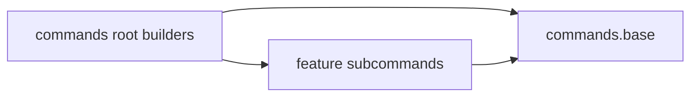

# Requirements

### Overview & Goals

Implement ADR-115 Phase 2 in `rtp-core`:
- Isolate command base classes into `commands.base` so feature subcommand packages depend on the base, not on the `commands` root package.
- Add report-only ArchUnit cycle reporting for `commands.*` sub-packages.
- The `RegionSettings` / runtime region state split is explicitly deferred per user direction, keeping `RegionSettings` intact to avoid breaking constructor identity and tests.

The ADR's 0.0% package tangle target is not expected to be met by this phase. See Scope and Risks.

### Scope

#### In Scope
- Relocating the base command types from `io.github.dailystruggle.rtp.common.commands` into `io.github.dailystruggle.rtp.common.commands.base`.
- Updating every import of those types in `rtp-core` main and test sources and in `rtp-plugin` (about 98 files, found by repository-wide grep).
- Making feature subcommand packages (`action`, `admin`, `back`, `config`, `docs`, `editor`, `info`, `maps`, `menu`, `scan`, `setup`, and others) import only `commands.base` and not the `commands` root.
- Restricting the `commands` root tree builders (`CoreCommandTreeBuilder`, `CoreRtpRoot`) to composition-root wiring.
- A report-only ArchUnit rule for cycles between `commands.*` sub-packages.

#### Out of Scope
- Splitting `RegionSettings` / `Region` configuration from runtime state (deferred to a future phase per user instruction).
- Dissolving the static `RTP` hub into `RTPContext` constructor injection (Phase 3 / ADR-115 section 1 fourth seam).
- Phase 1 remaining work (`ChunkTicketHolder` consumers in `PlaceholderProvider`, and `MemoryTracker` lines 325 and 534 that still reference `tasks.teleport`).
- Promoting the report-only ArchUnit cycle check to an enforced rule.
- Git commits or pushes.

### User Stories

- As a contributor, I want a feature command package to depend only on `commands.base`, so that I can reuse a subcommand without importing the whole command tree.
- As a maintainer, I want command sub-package cycles to be monitored in ArchUnit tests so new cyclical couplings are reported.

### Functional Requirements

- Command behavior, permissions, messages, and tab-completion output do not change (ADR-115 Invariant 3, Behavioral Parity).
- Region selection, shape, vertical adjustment, cache limits, and pricing behave exactly as before.
- S-001 through S-007 safety paths are unchanged.

### Non-Functional Requirements

- Purely structural: no new runtime dependency and no change to Tier 1 chunk-ticket or teleport logic.
- Compiles across `rtp-core`, `rtp-plugin`, and platform modules that reference the moved types.

# Technical Design

### Current Implementation

- `rtp-core/src/main/java/io/github/dailystruggle/rtp/common/commands/` holds both the base types and the root tree builders.
  - Base types: `BaseRTPCmd`, `BaseRTPCmdImpl`, `RTPCmd`, `PlatformCommandParameters`, `ServerAccessorCommandParameters`, `RTPCommandEvents`.
  - Root builders: `CoreCommandTreeBuilder`, `CoreRtpRoot`. They import child packages such as `commands.admin.ClearCmd`, `commands.docs.DocsCmd`, and `commands.editor.EditorCmd`.
- Children import the base back. Examples: `commands/docs/DocsCmd.java` and `commands/editor/EditorCmd.java` import `commands.BaseRTPCmdImpl`. Several children also import `commands.ServerAccessorCommandParameters`.
- The current ArchUnit report (`RTPArchitectureTest` Rule 11) slices by `io.github.dailystruggle.rtp.common.(*)..`. All of `commands` and `commands.*` fall into a single `commands` slice, so the reported cycle does not include the command seam.
- `selection/region/RegionSettings.java` is already a Java `record`. Its fields are `name`, `world` (`RTPWorld<?>`), `shape`, `vert`, `worldBorderOverride`, `requirePermission`, `cacheCap`, `backlogCacheCap`, `networkReserveSize`, `activeChunkCap`, `price`, `spatialResolution`, `override`, `detailedRegionInit`, `cooldownMillis`, and `delayMillis`.
- `RegionConfigRecord` appears nowhere in the repo, so the ADR text refers to a class that does not exist.

### Key Decisions

- **Command base location:** move base types into `commands.base` (user-approved option "Move base classes to commands.base"). Root builders stay in `commands`, as Tier 4 composition.
- **Region config split deferred:** `RegionSettings` carries live `RTPWorld<?>` references used across 150+ constructor sites; splitting this record is deferred per user confirmation. When addressed in a subsequent phase, an immutable `RegionConfig` record holding `String worldName` with rapid resolution (hash table / indexed lookup table) will be composed with `Region` to preserve constructor compatibility and test mock identity.

### Proposed Changes

- Move the six base types listed above into `commands.base`, keeping their behavior unchanged.
- Update each importing file to the new package. Wildcard imports on `commands.parameters.*` stay unchanged.
- Remove `commands.*` child imports from the base types, so `commands.base` depends on nothing in `commands` except itself.
- Keep `CoreCommandTreeBuilder` and `CoreRtpRoot` as the only classes in `commands` that import child packages.
- Add a report-only ArchUnit rule in `RTPArchitectureTest` (Rule 12) that slices `io.github.dailystruggle.rtp.common.commands.(*)..` and logs cycles.

### File Structure

- Moved: `rtp-core/.../common/commands/{BaseRTPCmd, BaseRTPCmdImpl, RTPCmd, PlatformCommandParameters, ServerAccessorCommandParameters, RTPCommandEvents}.java` to `rtp-core/.../common/commands/base/`.
- Modified: about 98 importers in `rtp-core` (main and test) and `rtp-plugin/src/main/java/io/github/dailystruggle/rtp/bukkit/commands/test/*`.
- Modified: `rtp-core/src/test/java/io/github/dailystruggle/rtp/common/RTPArchitectureTest.java` (Rule 12).

### Architecture Diagram

### Risks

- **Measurement gap:** the existing package cycle rule does not measure the command seam, so Phase 2 cannot show progress on the 0.0% target through that rule. Rule 12 covers this.
- **Large import churn:** about 98 files change. The move is mechanical but touches `rtp-plugin` too, so a full build is needed.
- **Uncommitted working tree:** Phase 1 changes are uncommitted. `.bak` copies are required for dirty code files, and `git status` must be checked per file before editing.
- **Mitigation:** keep stages small, run targeted tests after each stage, and run the full `:rtp-core:test` suite and a multi-module build at the end.

# Testing

### Validation Approach

- After each stage, run targeted tests with `.\gradlew.bat :rtp-core:test --tests "*Cmd*" --tests "*Region*" --tests "*RTPArchitectureTest*"`.
- At the end, run `.\gradlew.bat :rtp-core:test` (full) and `.\gradlew.bat build` (cross-module gate, since `rtp-plugin` imports change).
- Read the JUnit XML under `rtp-core/build/test-results/test` to confirm totals. Do not rely on the Gradle exit code alone.

### Key Scenarios

- `commands.base` compiles with no import from `commands` root or child packages.
- Command registration still builds the full tree (`CommandTreeMenuBuilderTest`, `MenuConcreteCommandLeavesBTest`, `MenuRedeemSubcommandDispatchTest`).

### Edge Cases

- Tests that reference moved classes by fully qualified name (`BetterRTPMockCommand`, `CommandUsabilityBenchmarkTest`).
- Reflection or string-based command lookups that use the old package name.
- `rtp-plugin` Bukkit test jobs under `commands/test` that import the base types.

### Test Changes

- Update existing imports in tests only. Do not change assertions.
- Add `RTPArchitectureTest` Rule 12 as a report-only check, mirroring Rule 11.
- Skip any new behavioral tests, because this change is structural (Behavioral Parity).

# Delivery Steps

### ✓ Step 1: Move command base types into commands.base
The six base command types live in `commands.base` and no feature package imports the `commands` root.

- Move `BaseRTPCmd`, `BaseRTPCmdImpl`, `RTPCmd`, `PlatformCommandParameters`, `ServerAccessorCommandParameters`, and `RTPCommandEvents` into `rtp-core/.../common/commands/base/`.
- Update the about 98 importing files in `rtp-core` main and test, plus `rtp-plugin` bukkit test commands, to the new package.
- Keep `CoreCommandTreeBuilder` and `CoreRtpRoot` in `commands` as the only classes that import child packages.
- Verify with `.\gradlew.bat :rtp-core:test --tests "*CommandTreeMenuBuilderTest*" --tests "*MenuConcreteCommandLeavesBTest*"`.

### ✓ Step 2: Add report-only commands sub-package cycle check
ArchUnit reports cycles between `commands.*` sub-packages, which the existing rule does not measure.

- Add Rule 12 to `RTPArchitectureTest` that slices `io.github.dailystruggle.rtp.common.commands.(*)..` and logs cycles without failing the build.
- Mirror the structure of Rule 11 (`REPORT_LOG.info`, `AssertionError` caught).
- Verify with `.\gradlew.bat :rtp-core:test --tests "*RTPArchitectureTest*"` and read the JUnit XML.

### ✓ Step 3: Run full verification for the Phase 2 command isolation change
The change is confirmed across `rtp-core`, `rtp-plugin`, and the multi-module build.

- Run `.\gradlew.bat :rtp-core:test` and sum the JUnit XML totals, expecting 0 failures and 0 errors.
- Run `.\gradlew.bat build` because `rtp-plugin` imports changed.
- Report the ArchUnit Rule 11 and Rule 12 output, and state that the 0.0% package tangle target is not met.