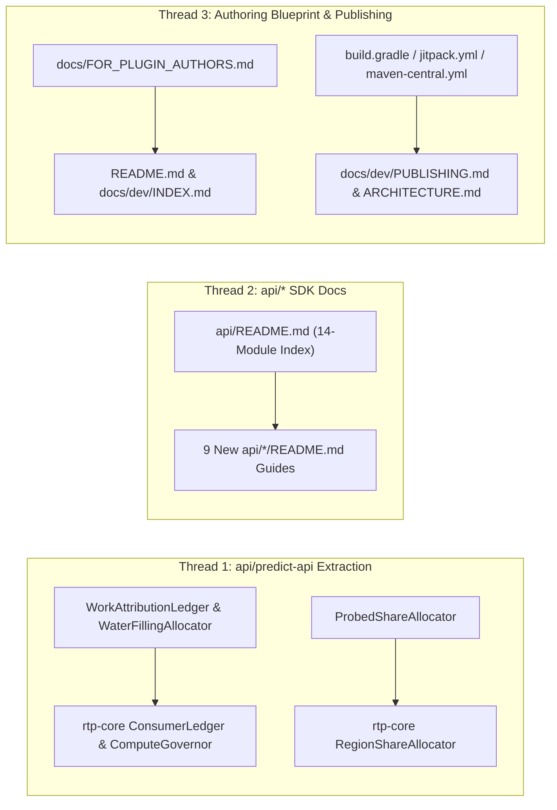

# Requirements

### Overview & Goals
Represent the repository accurately as both **LeafRTP** and a **general-purpose Multi-Platform Minecraft Plugin & Mod SDK + Authoring Toolchain** (`api/*`, `platforms/*`, `scripts/*`, `devstack/*`), partitioned into **three parallel, strictly non-overlapping worker threads**:

1. **Thread 1 — Promote Generic Fair-Attribution & Folia Share-Allocation Primitives to `api/predict-api`:**
   - Extract the RTP-independent algorithms from `ADR-124` (`WaterFillingAllocator`, `WorkAttributionLedger`) and `ADR-123` (`ProbedShareAllocator`) into `api/predict-api` (`io.github.dailystruggle.rtp.common.predict`) so any standalone plugin (`OnePlayerSleep`, `TreeGen`, etc.) can consume them without depending on `rtp-core`.
2. **Thread 2 — Complete the `api/*` Standalone SDK Catalog (`api/README.md` + 9 Missing Module `README.md`s):**
   - Create `api/README.md` indexing all 14 standalone Java 17 MIT libraries and write standalone `README.md` documentation for the 9 currently undocumented `api/*` modules (`anvil-api`, `config-bit-api`, `maps-api`, `menu-api`, `predict-api`, `server-api`, `tags-api`, `units-api`, `yaml-api`).
3. **Thread 3 — Authoring Blueprint (`docs/FOR_PLUGIN_AUTHORS.md`), Repo Front-Door & Maven/JitPack SDK Closure Sync:**
   - Create `docs/FOR_PLUGIN_AUTHORS.md` showing how to build a new multi-loader plugin/mod on top of the 14 `api/*` modules, Folia regional budgeting, BIT (`PBIT`/`CBIT`/`IBIT`), and the shared toolchain (`bench_fuzz.py --mode server`, Discord FTS5 triage bot, web editor generator, storefront builder).
   - Update `README.md`, `docs/dev/ARCHITECTURE.md`, `docs/dev/INDEX.md`, and synchronize the 14-module `api/*` publication closure across `build.gradle`, `jitpack.yml`, `Jenkinsfile`, `.github/workflows/maven-central.yml`, and `docs/dev/PUBLISHING.md`.

### Scope

#### In Scope
- **Thread 1 (`api/predict-api` & `rtp-core/.../governor`):**
  - Pure Java 17 `WaterFillingAllocator`, `WorkAttributionLedger` (bucket-keyed $n_b$ + per-actor dual-EWMA $a_p$), and `ProbedShareAllocator` (per-group $S_k$, steering weights $w_k, w'_k$, lending pool $\Pi$ and loans $e_k$, Jain's index $J$, bystander exposure $E$) in `api/predict-api`.
  - Refactoring `ConsumerLedger`, `RegionShareAllocator`, and `ComputeGovernor` in `rtp-core` to delegate to `api/predict-api` while keeping all existing public signatures and tests green.
- **Thread 2 (`api/README.md` & `api/*/README.md`):**
  - Top-level `api/README.md` SDK overview + dependency matrix + Maven Central / JitPack coordinates.
  - Per-module `README.md` files for `anvil-api`, `config-bit-api`, `maps-api`, `menu-api`, `predict-api`, `server-api`, `tags-api`, `units-api`, and `yaml-api`.
- **Thread 3 (`docs/FOR_PLUGIN_AUTHORS.md`, `README.md`, `docs/dev/*`, Publishing Closure):**
  - New `docs/FOR_PLUGIN_AUTHORS.md` guide covering project skeleton, `api/*` wiring, Folia scheduling, BIT/CBIT registration, and `scripts/*` toolchain reuse.
  - Updating `README.md`, `docs/dev/ARCHITECTURE.md`, `docs/dev/INDEX.md`, and `docs/dev/PUBLISHING.md`.
  - Adding missing `api/*` modules (`:tags-api`, `:anvil-api`, `:predict-api`, `:config-bit-api`, `:menu-api`) to `jitpack.yml`, `Jenkinsfile`, `.github/workflows/maven-central.yml`, and `build.gradle` (`publishedModulePaths`).

#### Out of Scope
- Modifying any files in `api/bit-api/**`, `docs/dev/bit-codes.lock`, `platforms/**`, `addons/**`, or `scripts/bench_fuzz*.py` (leaving active BIT and fuzzer work completely untouched).

### Functional Requirements
1. **Zero-Dependency SDK Purity (`REQ-PRED-NF-002`):** `api/predict-api` classes depend only on `java..` and `io.github.dailystruggle.rtp.common.predict..`, enforced by `PredictApiBoundaryArchTest`.
2. **100% `api/*` Module Documentation Coverage:** All 14 modules under `api/` have a standalone `README.md` and are indexed in `api/README.md`.
3. **Consistent Maven/JitPack SDK Publication Closure:** All 14 `api/*` modules are present in `build.gradle` (`publishedModulePaths`), `jitpack.yml`, `Jenkinsfile`, `.github/workflows/maven-central.yml`, and `docs/dev/PUBLISHING.md`.

# Technical Design

### Current Implementation
- **`api/*` Modules (14 total):**
  - `anvil-api`, `bit-api`, `bstats-api`, `commands-api`, `config-bit-api`, `effects-api`, `maps-api`, `menu-api`, `metrics-api`, `predict-api`, `server-api`, `tags-api`, `units-api`, `yaml-api`.
  - Only 5 of the 14 (`bit-api`, `bstats-api`, `commands-api`, `effects-api`, `metrics-api`) currently have a `README.md`, and there is no `api/README.md`.
- **Control Primitives in `rtp-core` vs `api/predict-api`:**
  - `ConsumerLedger`, `RegionShareAllocator`, and `ComputeGovernor.computeWaterFilling` live in `rtp-core/.../common/governor/` even though their underlying math and data structures have zero RTP or platform dependencies.
- **Publication Closure Drift:**
  - `build.gradle` (`publishedModulePaths`) includes `:anvil-api`, `:predict-api`, `:config-bit-api`, and `:menu-api`, but omits `:tags-api`.
  - `jitpack.yml`, `Jenkinsfile`, `.github/workflows/maven-central.yml`, and `docs/dev/PUBLISHING.md` still list an older subset of modules and omit `:anvil-api`, `:predict-api`, `:config-bit-api`, `:menu-api`, and `:tags-api`.

### Key Decisions
1. **Strict 3-Way File Partitioning:**
   - **Thread 1** owns `api/predict-api/src/**` and `rtp-core/src/*/java/io/github/dailystruggle/rtp/common/governor/**`.
   - **Thread 2** owns `api/README.md` and `api/*/README.md`.
   - **Thread 3** owns `docs/FOR_PLUGIN_AUTHORS.md`, `README.md`, `docs/dev/{ARCHITECTURE,INDEX,PUBLISHING}.md`, `build.gradle`, `jitpack.yml`, `Jenkinsfile`, and `.github/workflows/maven-central.yml`.
2. **Facade Delegation in `rtp-core`:**
   - `ConsumerLedger` and `RegionShareAllocator` remain in `io.github.dailystruggle.rtp.common.governor` as thin type-compatible facades delegating to `WorkAttributionLedger`, `WaterFillingAllocator`, and `ProbedShareAllocator` in `api/predict-api`, ensuring zero breaking changes for `rtp-core` callers and existing tests.

### Architecture Diagram


### File Structure

| Worker Thread | Exclusive File Scope |
|---|---|
| **Thread 1 (SDK Control Primitives)** | **New:** `api/predict-api/src/main/java/io/github/dailystruggle/rtp/common/predict/WaterFillingAllocator.java`, `WorkAttributionLedger.java`, `ProbedShareAllocator.java`, `api/predict-api/src/test/java/io/github/dailystruggle/rtp/common/predict/WaterFillingAllocatorTest.java`, `WorkAttributionLedgerTest.java`, `ProbedShareAllocatorTest.java`<br>**Modified:** `rtp-core/src/main/java/io/github/dailystruggle/rtp/common/governor/ConsumerLedger.java`, `RegionShareAllocator.java`, `ComputeGovernor.java` |
| **Thread 2 (`api/*` SDK READMEs)** | **New:** `api/README.md`, `api/anvil-api/README.md`, `api/config-bit-api/README.md`, `api/maps-api/README.md`, `api/menu-api/README.md`, `api/predict-api/README.md`, `api/server-api/README.md`, `api/tags-api/README.md`, `api/units-api/README.md`, `api/yaml-api/README.md` |
| **Thread 3 (Repo Docs & Publishing Sync)** | **New:** `docs/FOR_PLUGIN_AUTHORS.md`<br>**Modified:** `README.md`, `docs/dev/ARCHITECTURE.md`, `docs/dev/INDEX.md`, `docs/dev/PUBLISHING.md`, `build.gradle`, `jitpack.yml`, `Jenkinsfile`, `.github/workflows/maven-central.yml` |

# Worker Kickstart Prompts

### Copy-Pasteable Worker Prompts (3 Non-Overlapping Threads)

---

#### Prompt 1 — Thread 1: Extract Generic Fair-Attribution & Folia Share Primitives into `api/predict-api`

```markdown
## Task: Promote Generic Water-Filling, Work Attribution & Probed Share Allocators to `api/predict-api` (`ADR-087`, `ADR-115`, `ADR-123`, `ADR-124`)

Extract the plugin-agnostic control and attribution algorithms from `rtp-core/.../common/governor` into `api/predict-api` (`io.github.dailystruggle.rtp.common.predict`) so any standalone plugin or mod (`OnePlayerSleep`, `TreeGen`, etc.) can use fair per-player work attribution, max-min water-filling, and Folia probed regional share allocation without depending on `rtp-core`.

### Strict Scope & Merge-Safety Boundaries
- **Touch ONLY:**
  - New file: `api/predict-api/src/main/java/io/github/dailystruggle/rtp/common/predict/WaterFillingAllocator.java`
  - New file: `api/predict-api/src/main/java/io/github/dailystruggle/rtp/common/predict/WorkAttributionLedger.java`
  - New file: `api/predict-api/src/main/java/io/github/dailystruggle/rtp/common/predict/ProbedShareAllocator.java`
  - New test file: `api/predict-api/src/test/java/io/github/dailystruggle/rtp/common/predict/WaterFillingAllocatorTest.java`
  - New test file: `api/predict-api/src/test/java/io/github/dailystruggle/rtp/common/predict/WorkAttributionLedgerTest.java`
  - New test file: `api/predict-api/src/test/java/io/github/dailystruggle/rtp/common/predict/ProbedShareAllocatorTest.java`
  - `rtp-core/src/main/java/io/github/dailystruggle/rtp/common/governor/ConsumerLedger.java`
  - `rtp-core/src/main/java/io/github/dailystruggle/rtp/common/governor/RegionShareAllocator.java`
  - `rtp-core/src/main/java/io/github/dailystruggle/rtp/common/governor/ComputeGovernor.java`
- **Do NOT touch:** Any `README.md`, `build.gradle`, `docs/**`, `api/bit-api/**`, `platforms/**`, or `addons/**`.

### Requirements

1. **`WaterFillingAllocator` (`api/predict-api`):**
   - Pure Java 17 utility in `io.github.dailystruggle.rtp.common.predict` with zero external dependencies (`PredictApiBoundaryArchTest` must pass):
     - `allocateRates(Map<String, Double> demands, Map<String, Integer> weights, double totalBudget)`: weighted max-min water-filling ($x_b = \min(\bar d_b, w_b \cdot \theta)$, $\sum_b x_b = \min(B, \sum_b \bar d_b)$).
     - `normalizeShares(Map<String, Double> allocations)`: computes normalized $[0.0, 1.0]$ shares across buckets.
     - `jainsFairnessIndex(Collection<Double> values)`: computes Jain's fairness index $J = (\sum x_k)^2 / (K \sum x_k^2) \in [0, 1]$.

2. **`WorkAttributionLedger` (`api/predict-api`):**
   - Generic, lock-free 4096-entry LRU attribution ledger in `io.github.dailystruggle.rtp.common.predict`:
     - Tracks distinct active consumers per named bucket/scope ($n_b \ge 1$) over a configurable window (default 10 minutes) and per-actor dual-EWMA (30 s and 10 min half-lives) attributed cost $a_p = \tfrac{1}{2}(a_p^{30\text{s}} + a_p^{10\text{min}})$ in ms/min with 30-minute idle expiry.
     - Provides `recordConsumption(String bucketId, UUID actorId, double unitCostNanos, long nowNanos)`, `distinctConsumers(String bucketId, long nowNanos)`, `recordActorCharge(UUID actorId, long costNanos, long nowNanos)`, `topConsumers(int limit, long nowNanos)`, `costP99MsPerMin(long nowNanos)`, `activeActorCount(long nowNanos)`, and `reset()`.

3. **`ProbedShareAllocator` (`api/predict-api`):**
   - Generic, lock-free Folia/multi-group probed share, steering, and idle-thread lending allocator in `io.github.dailystruggle.rtp.common.predict`:
     - Implements per-group AIMD limiters starting at $S_{\text{cfg}} / 2$, contribution-gated breach cuts ($\ge \max(0.5\text{ ms}, S_{\text{cfg}} / 10)$), population-aware recovery ($P_k > 1$ waits 60 s after breach and grows at $1/4$ rate), split/merge state transfer, steering weights $w_k$ and $w'_k = w_k / (1 + P_k / 4)$, lending pool $\Pi = S_{\text{cfg}} \cdot \min(K, \Theta)$ and loans $e_k$, Jain's index $J$, and bystander exposure $E$.

4. **Delegate from `rtp-core` (`ConsumerLedger`, `RegionShareAllocator`, `ComputeGovernor`):**
   - Refactor `ConsumerLedger`, `RegionShareAllocator`, and `ComputeGovernor.computeWaterFilling(...)` to delegate to `WorkAttributionLedger`, `WaterFillingAllocator`, and `ProbedShareAllocator` while keeping all existing `rtp-core` method signatures, record types, and behavior 100% backward-compatible.

### Verification Gates
1. `./gradlew :predict-api:test :rtp-core:test --tests "*ConsumerLedgerTest*" --tests "*RegionShareAllocatorTest*" --tests "*ComputeGovernorTest*" --tests "*HotBudgetAllocatorTest*"`
2. Verify `PredictApiBoundaryArchTest` passes and zero process-scaffolding comments (`Step`, `Phase`, `Slice`) exist in added lines.
```

---

#### Prompt 2 — Thread 2: Create `api/README.md` SDK Catalog & Complete All 9 Missing `api/*/README.md` Guides

```markdown
## Task: Document the 14-Module `api/*` Standalone Plugin & Mod SDK (`api/README.md` + 9 Module `README.md`s)

Create the top-level `api/README.md` catalog and add standalone library `README.md` files for the 9 currently undocumented `api/*` modules so every module in `api/` is documented for reuse in any Minecraft plugin or mod outside `LeafRTP`.

### Strict Scope & Merge-Safety Boundaries
- **Touch ONLY:**
  - New file: `api/README.md`
  - New file: `api/anvil-api/README.md`
  - New file: `api/config-bit-api/README.md`
  - New file: `api/maps-api/README.md`
  - New file: `api/menu-api/README.md`
  - New file: `api/predict-api/README.md`
  - New file: `api/server-api/README.md`
  - New file: `api/tags-api/README.md`
  - New file: `api/units-api/README.md`
  - New file: `api/yaml-api/README.md`
- **Do NOT touch:** Existing `api/{bit-api,bstats-api,commands-api,effects-api,metrics-api}/README.md`, any `.java` or `.gradle` files, root `README.md`, or `docs/**`.

### Requirements

1. **Top-Level `api/README.md` (LeafCraft Multi-Platform Plugin & Mod SDK Catalog):**
   - Present the 14 standalone Java 17 MIT libraries under `api/` grouped by capability:
     - **Server & Lifecycle Foundation:** `server-api`, `units-api`, `tags-api`
     - **Configuration & Self-Testing:** `yaml-api`, `bit-api`, `config-bit-api`
     - **Commands, Menus & Player UX:** `commands-api`, `menu-api`, `effects-api`, `maps-api`
     - **Stochastic Control, Telemetry & World I/O:** `predict-api`, `metrics-api`, `bstats-api`, `anvil-api`
   - Include a table with each module's Maven coordinate (`io.github.dailystruggle:<module>:<version>` / `com.github.DailyStruggle.RTP:<module>:<tag>`), inter-module dependencies, and a 1-line summary linking to `<module>/README.md`.
   - Document the shared architectural guarantees across all `api/*` modules: Java 17 bytecode baseline, zero `rtp-core` dependencies, zero raw thread creation (`F-001`), and platform neutrality.

2. **Per-Module `README.md` Files (9 Modules):**
   - Match the concise, high-signal technical style of `api/bit-api/README.md`. For each module, cover:
     - **Purpose & Scope** (what problem it solves for any plugin/mod and what dependencies it has, if any).
     - **Gradle Dependency Snippet** (Maven Central `io.github.dailystruggle:<module>` and JitPack `com.github.DailyStruggle.RTP:<module>`).
     - **Core Types & Contracts** (referencing the actual public classes/interfaces in `<module>/src/main/java`):
       - `anvil-api`: `RegionFileReader`, `RegionFormatRegistry`, `AnvilRegionReader`, `ChunkSectionData`, off-tick `.mca` / custom format decoding (`ADR-016`, `ADR-077`).
       - `config-bit-api`: `DirectiveConfigCheck`, `CrossFileRefCheck`, `DistanceConstraintCheck`, `LocaleKeyParityCheck` (`ADR-064`, `ADR-121`).
       - `maps-api`: `MapCanvasRenderer`, `HeatmapPalette`, `MermaidChartRenderer` (`ADR-046`).
       - `menu-api`: `MenuDescriptor`, `MenuRenderer`, `MenuRendererProvider`, `MenuRendererDiscovery`, `MenuAction` (`PromptAnvilInput`, book/chat/GUI rendering, token redemption; `ADR-035`, `ADR-044`, `ADR-048`).
       - `predict-api`: `EwmaEstimator`, `BernoulliEstimator`, `EwmaLinearFit`, `AimdLimiter`, `BudgetPacer`, `ComparativeCostGovernor`, plus fair work attribution (`WorkAttributionLedger`, `WaterFillingAllocator`) and Folia share allocation (`ProbedShareAllocator`) (`ADR-087`, `ADR-109`, `ADR-114`, `ADR-123`, `ADR-124`).
       - `server-api`: `ServerAccessor`, `ServerAccessors`, `PlatformFamily`, `TaskScheduler`, `TaskHandle` (`ADR-113`, `ADR-116`).
       - `tags-api`: `TagResolver`, block and biome JSON tag resolution (`ADR-017`).
       - `units-api`: `TimeParser`, `DistanceParser`, `ByteSizeParser` (`ADR-113`).
       - `yaml-api`: `YamlFile`, comment-preserving YAML parser/writer and schema migration substrate (`ADR-025`, `ADR-042`).

### Verification Gates
1. Run `python3 scripts/check-mojibake.py` to verify UTF-8 encoding hygiene across all new markdown files.
2. Verify every class name and relative link cited in `api/README.md` and `api/*/README.md` exists in the repository.
```

---

#### Prompt 3 — Thread 3: Create `docs/FOR_PLUGIN_AUTHORS.md`, Update Repo Front-Door & Sync 14-Module Maven/JitPack Publishing

```markdown
## Task: Create `docs/FOR_PLUGIN_AUTHORS.md`, Update Repo Docs (`README.md`, `ARCHITECTURE.md`, `INDEX.md`) & Sync 14-Module `api/*` Publishing Closure

Make the repository clearly represent both **LeafRTP** and the reusable **LeafCraft Multi-Platform Plugin & Mod SDK + Authoring Toolchain**, and synchronize the Maven Central / JitPack / Jenkins publication closure so all 14 `api/*` modules are published.

### Strict Scope & Merge-Safety Boundaries
- **Touch ONLY:**
  - New file: `docs/FOR_PLUGIN_AUTHORS.md`
  - `README.md`
  - `docs/dev/ARCHITECTURE.md`
  - `docs/dev/INDEX.md`
  - `docs/dev/PUBLISHING.md`
  - `build.gradle` (**ONLY** add `':tags-api'` to `publishedModulePaths` around line 533 and update the closure comment)
  - `jitpack.yml`
  - `Jenkinsfile`
  - `.github/workflows/maven-central.yml`
- **Do NOT touch:** `api/**`, `rtp-core/**`, `platforms/**`, `addons/**`, or `scripts/**`.

### Requirements

1. **Create `docs/FOR_PLUGIN_AUTHORS.md` (Reusable Plugin & Mod Authoring Blueprint):**
   - Explain how ~80% of this repository is a general-purpose multi-loader plugin/mod SDK and authoring toolchain designed for building new projects (e.g., `OnePlayerSleep`, `TreeGen`) across **Paper, Spigot, Folia, Fabric, and NeoForge**.
   - Structure the guide into 5 actionable sections:
     1. **The 14 Standalone `api/*` SDK Libraries:** Table mapping common plugin problems (commands, comment-preserving YAML + locale parity, book/GUI/anvil menus, PBIT/CBIT/IBIT self-testing + live JaCoCo coverage, Folia scheduling, adaptive AIMD/water-filling governors, off-tick `.mca` Anvil reading, effects, maps, metrics) to the corresponding `io.github.dailystruggle:<module>` artifact and [`api/README.md`](../api/README.md).
     2. **5-File Starter Skeleton for a New Plugin:** Concrete architecture blueprint (`MyPlugin`, `*Keys` config enum + `config-bit-api`, `*BitCodes` + `PlatformHookBitComponent` CBIT sensors instead of blanket catches, `commands-api` tree + `menu-api` setup wizard, and `ServerAccessor` + `TaskScheduler`).
     3. **Folia & Adaptive Background Governance Out of the Box:** How to wire `predict-api` (`AimdLimiter`, `WaterFillingAllocator`, `WorkAttributionLedger`, `ProbedShareAllocator`) + `EntitySchedulerSampler` + `RegionThreadBudget` so any plugin doing background world/chunk/entity work is Folia-safe and self-throttling on Day 1.
     4. **Multi-Version Carrier Pattern & Day-0 Qualification (`26.x` Drops):** How the carrier pattern (`platforms/*`) + `/plugin test all` + `api-compat` + `bit-codes.lock` qualifies new Minecraft drops in minutes without manual clicking.
     5. **Shared Authoring, Fuzzing & Support Toolchain (`scripts/*` & `devstack/*`):** How to point `scripts/bench_fuzz.py --mode server` (`ADR-125`), `scripts/discord/` (multi-project `#support` Forum + SQLite FTS5 + `BIT_CODES` triage bot), `scripts/generate_web_editor.py`, `scripts/release/build_front_pages.py`, and `devstack/` at a new plugin.

2. **Update `README.md`, `docs/dev/ARCHITECTURE.md` & `docs/dev/INDEX.md`:**
   - In `README.md`:
     - Under `### Building an addon` (around line 200), add a companion subsection `### Reusing the multi-platform SDK (`api/*`) & toolchain` linking to [`docs/FOR_PLUGIN_AUTHORS.md`](docs/FOR_PLUGIN_AUTHORS.md) and [`api/README.md`](api/README.md).
     - In `<details><summary>Repository layout</summary>` (lines 215-225), update the `commands-api/, effects-api/` row to `api/* (14 modules)` covering `server-api`, `commands-api`, `yaml-api`, `config-bit-api`, `menu-api`, `bit-api`, `predict-api`, `anvil-api`, `effects-api`, `maps-api`, `metrics-api`, `bstats-api`, `tags-api`, `units-api`, and add `scripts/` (whole-server fuzzer, web-editor generator, storefront builder, Discord support bot).
     - In `## Documentation` table (lines 234-240), add row: `| Build a standalone plugin/mod with the LeafCraft SDK | [FOR_PLUGIN_AUTHORS.md](docs/FOR_PLUGIN_AUTHORS.md) |`.
   - In `docs/dev/ARCHITECTURE.md` and `docs/dev/INDEX.md`:
     - Link `docs/FOR_PLUGIN_AUTHORS.md` and `api/README.md` in the task router and module breakdown.

3. **Synchronize the 14-Module `api/*` Publication Closure (`build.gradle`, `jitpack.yml`, `Jenkinsfile`, `.github/workflows/maven-central.yml`, `docs/dev/PUBLISHING.md`):**
   - Add `':tags-api'` to `publishedModulePaths` in `build.gradle` so all 14 `api/*` modules are in `publishedModulePaths`.
   - Update `jitpack.yml`, `Jenkinsfile` (`PUBLISH_TASKS`), `.github/workflows/maven-central.yml` (`paths` and `Sign + stage` task list), and `docs/dev/PUBLISHING.md` so the published task lists include all 14 `api/*` modules (`:anvil-api`, `:bit-api`, `:bstats-api`, `:commands-api`, `:config-bit-api`, `:effects-api`, `:maps-api`, `:menu-api`, `:metrics-api`, `:predict-api`, `:server-api`, `:tags-api`, `:units-api`, `:yaml-api`) alongside `:rtp-proxy:rtp-proxy-common`, `:rtp-api`, and `:rtp-core`.

### Verification Gates
1. `./gradlew -PexcludeJdk25 :tags-api:publishToMavenLocal :predict-api:publishToMavenLocal :config-bit-api:publishToMavenLocal :menu-api:publishToMavenLocal :anvil-api:publishToMavenLocal`
2. `python3 scripts/check-mojibake.py` and `python3 scripts/release/build_front_pages.py --check`
```

# Testing

### Validation Approach
Each worker thread has independent, self-contained verification gates:
- **Thread 1:** Unit, property, and ArchUnit boundary tests (`:predict-api:test` including `PredictApiBoundaryArchTest`, plus `:rtp-core:test` governor/attribution suites).
- **Thread 2:** Markdown encoding verification (`python3 scripts/check-mojibake.py`) and symbol/link accuracy against `api/*/src/main/java`.
- **Thread 3:** Gradle local Maven publication smoke test (`publishToMavenLocal` across the newly added `api/*` closure modules) and repository doc/encoding checks.

### Key Scenarios
1. **`PredictApiBoundaryArchTest` (`api/predict-api`):** Verifies `WaterFillingAllocator`, `WorkAttributionLedger`, and `ProbedShareAllocator` have zero dependencies outside `java..` and `io.github.dailystruggle.rtp.common.predict..`.
2. **Backward-Compatible `rtp-core` Delegation:** Existing `ConsumerLedgerTest`, `RegionShareAllocatorTest`, `ComputeGovernorTest`, and `HotBudgetAllocatorTest` pass without modification.
3. **Maven Publication Closure Parity:** Every module in `api/*` (all 14 modules) is listed identically in `build.gradle` (`publishedModulePaths`), `jitpack.yml`, `Jenkinsfile`, `.github/workflows/maven-central.yml`, and `docs/dev/PUBLISHING.md`.

# Delivery Steps

### Step 1: Stage 1: Promote generic fair-attribution and Folia share-allocation primitives to api/predict-api (Thread 1)
`WaterFillingAllocator`, `WorkAttributionLedger`, and `ProbedShareAllocator` live in `api/predict-api` with zero platform or `rtp-core` dependencies, and `rtp-core` delegates to them.

- Create `WaterFillingAllocator`, `WorkAttributionLedger`, and `ProbedShareAllocator` in `api/predict-api/src/main/java/io/github/dailystruggle/rtp/common/predict/`.
- Refactor `ConsumerLedger`, `RegionShareAllocator`, and `ComputeGovernor` in `rtp-core` to delegate to the new `api/predict-api` classes while preserving all existing signatures.
- Add unit tests in `api/predict-api/src/test/java/io/github/dailystruggle/rtp/common/predict/` and verify `PredictApiBoundaryArchTest` and `:rtp-core:test` pass.

### Step 2: Stage 2: Create api/README.md catalog and 9 missing api/*/README.md module guides (Thread 2)
All 14 standalone modules under `api/` have individual `README.md` documentation and are indexed in `api/README.md`.

- Create `api/README.md` cataloging all 14 `api/*` modules by capability with Maven Central and JitPack coordinates and architectural guarantees.
- Create standalone `README.md` guides for `anvil-api`, `config-bit-api`, `maps-api`, `menu-api`, `predict-api`, `server-api`, `tags-api`, `units-api`, and `yaml-api`.

### Step 3: Stage 3: Add docs/FOR_PLUGIN_AUTHORS.md, update repo docs, and synchronize 14-module Maven/JitPack publishing (Thread 3)
The repository documents how to build standalone plugins/mods with the `api/*` SDK and authoring toolchain, and all 14 `api/*` modules are wired across Maven/JitPack publishing configs.

- Create `docs/FOR_PLUGIN_AUTHORS.md` detailing the 14 `api/*` libraries, 5-file plugin starter skeleton, Folia/governor integration, Day-0 version qualification, and `scripts/*` toolchain reuse.
- Update `README.md`, `docs/dev/ARCHITECTURE.md`, and `docs/dev/INDEX.md` to reference `docs/FOR_PLUGIN_AUTHORS.md`, `api/README.md`, and the full `api/*` + `scripts/*` layout.
- Add `:tags-api` to `publishedModulePaths` in `build.gradle` and synchronize `jitpack.yml`, `Jenkinsfile`, `.github/workflows/maven-central.yml`, and `docs/dev/PUBLISHING.md` across all 14 `api/*` modules.