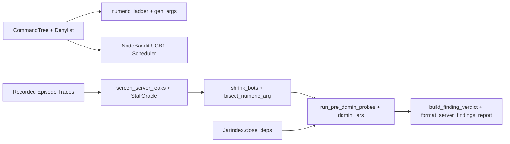

# Requirements

### Overview & Goals
Complete the offline, deterministic Python algorithmic and trace-evaluation library components of `ADR-125` in `scripts/bench_fuzz_server.py` and `scripts/tests/test_bench_fuzz.py` while preserving the verified `PASSIVE_ONLY` live CLI behavior of `scripts/bench_fuzz.py --mode server`. By implementing Brigadier schema value sampling (`numeric_ladder`, `gen_args`), tier-stratified UCB1 scheduling (`NodeBandit`), callback-driven parameter threshold bisection (`bisect_numeric_arg`), dependency-closed jar delta debugging (`run_pre_ddmin_probes`, `ddmin_jars`), and offline trace evaluation (`evaluate_server_trace`, `build_finding_verdict`), all analytical, reduction, and attribution algorithms from `ADR-125` are available as pure stdlib functions tested via in-memory callbacks without sending active commands to a live server or creating synthetic faulty Gradle plugins.

### Scope

#### Already Implemented (Baseline in Working Tree)
- `docs/adr/ADR-125-whole-server-discovery-fuzzing.md`, `docs/adr/README.md`, and `docs/dev/INDEX.md` updated to `Accepted`.
- `devstack/clients/bench-swarm.js`: read-only `discover` control op (`runFuzzDiscover`), `serializeCommandPacket`, and `attachProtocolTelemetry` (`tick_gap` and `window` events); `Swarm.discover` in `scripts/bench_fuzz.py`.
- `scripts/bench_fuzz_server.py`: `Denylist`, `CommandTree`, `merge_command_trees`, `PlatformProfile` (`paper`, `fabric`, `neoforge`), `JcmdObserver` (with `[start_ms, end_ms]` exclusion windows), `JarIndex` (with `.class` ownership and transitive `close_deps`), `screen_server_leaks`, `StallOracle`, and the passive `ServerRun` CLI audit.
- `scripts/tests/test_bench_fuzz.py`: 197 passing tests covering `CommandTreeAndDenylistTest`, `JcmdAndStallOracleTest`, `JarIndexAndLeakScreenTest`, and `ServerModePassiveAuditTest`.

#### In Scope (Offline & Callback-Driven Library Completion in `scripts/bench_fuzz_server.py`)
- **Brigadier schema value sampler (`numeric_ladder`, `gen_args`) in `scripts/bench_fuzz_server.py`:**
  - Pure, deterministic functions that take a `CommandNode` from `commands.json` and a seeded `random.Random` to sample representative values from declared Brigadier parser bounds (`min`, `-1`, `0`, `1`, `16`, `64`, `256`, `1024`, clamped cap `4096`, `max`, plus uniform draws within bounds) and format schema-valid command strings for `bool`, strings, selectors, coordinates, and cached completion lists while enforcing `Denylist`.
- **Tier-stratified UCB1 coverage scheduler (`NodeBandit`) in `scripts/bench_fuzz_server.py`:**
  - Pure deterministic UCB1 scheduler data structure over `(node_id, scenario_kind)` pairs stratified by `min_tier` (`default` vs `op` with configurable `default_budget_share=0.75`) and updated from coverage novelty and telemetry observation deltas.
- **Callback-driven parameter bisection (`bisect_numeric_arg`) and dependency-closed jar `ddmin` (`run_pre_ddmin_probes`, `ddmin_jars`) in `scripts/bench_fuzz_server.py`:**
  - `bisect_numeric_arg(program, node, predicate_fn)`: binary-searches numeric argument tokens between a baseline passing bound and a failing bound using an injected pure `predicate_fn(candidate_program) -> bool` callback (matching `bf.ddmin` and `bf.shrink_bots` in `scripts/bench_fuzz.py`).
  - `run_pre_ddmin_probes(candidate_jars, probe_fn, finding_k=3, finding_n=3)` and `ddmin_jars(candidate_jars, jar_index, probe_fn, finding_k=3, finding_n=3, max_probes=32)`: evaluate an injected `probe_fn(active_jars) -> tuple[int, bool]` callback across the full set, the empty candidate set (`prerequisites_only` -> `"server"`), and dependency-closed subsets (`jar_index.close_deps(subset)`), treating subsets with unloaded jars (`all_loaded=False`) as unresolved.
- **Offline trace evaluation & structured verdict formatting (`build_finding_verdict`, `format_server_findings_report`, `evaluate_server_trace`) in `scripts/bench_fuzz_server.py`:**
  - Offline evaluator that accepts recorded baseline + episode telemetry dicts, a `CommandTree`, a `JarIndex`, and an optional injected `probe_fn` callback, runs `screen_server_leaks` and `StallOracle`, applies `bf.shrink_bots` + `bisect_numeric_arg` + `run_pre_ddmin_probes` + `ddmin_jars` when callbacks are supplied, and formats `operator_mitigation` (`canonical_node`, `aliases`, `min_tier`, `bisected_bound`) and `author_reproducer` (`oracle`, `blamed_jars`, `first_suspect`, `evidence`, `shrunk_program`, `reproduction`) blocks.
- **Unit tests, documentation sync, and `.bak` cleanup:**
  - Fix the Gitar review finding in `JarIndexAndLeakScreenTest.test_bonferroni_leak_screen_against_baseline` (`scripts/tests/test_bench_fuzz.py:4131-4134`) by constructing a 12-episode `small_records` set with 6 leak episodes (`ep % 2 == 0`) and asserting that the `queue` features pass `min_feature_episodes=4` (`small["features_tested"] >= 4`) and are rejected specifically by the `1/924` hypergeometric tail vs Bonferroni `p_crit` comparison.
  - Add `BoundaryLadderAndSchemaGenTest`, `TierStratifiedBanditTest`, `NumericBisectAndJarDdminTest`, and `OfflineTraceEvaluationTest` in `scripts/tests/test_bench_fuzz.py`.
  - Document the offline trace-evaluation and callback-driven attribution helpers in `docs/dev/WHOLE_SERVER_FUZZING.md` and remove leftover `scripts/**/*.bak` files.

#### Out of Scope
- Active command execution, `tab_complete` probing, window-click packet transmission, or RCON `op` privilege escalation against a live server (`ServerRun` and `validate_server_mode_args` remain strictly `passive_only`, keeping all `ServerModePassiveAuditTest` checks intact).
- Creating synthetic stalling or leaking Gradle plugin/mod fixtures (`FuzzFixturePaper`, `FuzzFixtureFabric`).
- Modifying `ADR-111` target mode (`--mode leak` and `--mode faults` remain unchanged).

### User Stories
- **As a server administrator or developer inspecting offline telemetry traces**, I want deterministic Python helpers in `scripts/bench_fuzz_server.py` to evaluate recorded `GC.class_histogram` and `update_time` episode records against a baseline and format `operator_mitigation` metadata (canonical command node, aliases, `min_tier`, and bisected parameter bound), so I can identify which command configuration to review.
- **As a maintainer testing `ADR-125` reduction and attribution logic in CI**, I want pure callback-driven implementations of `gen_args`, `NodeBandit`, `bisect_numeric_arg`, `run_pre_ddmin_probes`, and `ddmin_jars` verified by `scripts/tests/test_bench_fuzz.py`, so parameter reduction and dependency-closed jar `ddmin` are unit-tested without running a live server.

### Functional Requirements
1. **Preserve Passive Live CLI (`ServerRun` & `validate_server_mode_args`):** Live `--mode server` CLI execution shall remain strictly `passive_only` and preserve all existing validations and tests in `ServerModePassiveAuditTest`.
2. **Brigadier Schema Sampler (`numeric_ladder`, `gen_args`):**
   - Sample wide numeric Brigadier bounds using the ladder `min`, `-1`, `0`, `1`, `16`, `64`, `256`, `1024`, clamped cap (`4096`), `max`, plus uniform draws within bounds.
   - Format argument tokens for `brigadier:bool`, `brigadier:string`, entity/player selectors, coordinates, and cached completion candidates, rejecting any path that matches `Denylist`.
3. **Tier-Stratified UCB1 Scheduler (`NodeBandit`):**
   - Allocate primary selection share (default `0.75` when both `default` and `op` tiers are present in a `CommandTree`) to `default`-visible nodes via UCB1 over `(node_id, scenario_kind)` arms.
4. **Callback-Driven Reduction & Attribution (`bisect_numeric_arg`, `run_pre_ddmin_probes`, `ddmin_jars`):**
   - `bisect_numeric_arg` shall binary-search a numeric ladder argument using an injected `predicate_fn(program) -> bool` callback while enforcing `Denylist`.
   - `run_pre_ddmin_probes` and `ddmin_jars` shall evaluate an injected `probe_fn(active_jars) -> tuple[int, bool]` callback across the full set, the empty candidate set (`prerequisites_only` -> `"server"`), and dependency-closed subsets (`jar_index.close_deps(subset)`).
5. **Structured Offline Verdict Formatting (`build_finding_verdict`, `evaluate_server_trace`):**
   - Format `operator_mitigation` and `author_reproducer` dictionaries from offline oracle correlations and callback-driven `ddmin_jars` outcomes.

### Non-Functional Requirements
- **Zero third-party Python dependencies:** `scripts/bench_fuzz_server.py` shall use Python 3.12+ stdlib only.
- **Zero hardcoded plugin/class names:** No oracle, score term, generator rule, or built-in denylist entry shall name any plugin, mod, fixture, or Java class.

# Technical Design

### Current Implementation
- `scripts/bench_fuzz.py` (3,730 lines) provides `ddmin(items, test)`, `shrink_bots(bots, test, ...)`, `rng_for`, `Corpus`, `ServerLogOracle`, `Swarm.discover`, and `--mode server` CLI dispatch.
- `scripts/bench_fuzz_server.py` (3,844 lines) implements `Denylist`, `CommandTree`, `merge_command_trees`, `PlatformProfile`, `JcmdObserver`, `JarIndex` (including `close_deps`), `screen_server_leaks`, `StallOracle`, and the passive `ServerRun` CLI runner.
- `scripts/tests/test_bench_fuzz.py` (5,406 lines, 197 passing tests) covers `CommandTreeAndDenylistTest`, `JcmdAndStallOracleTest`, `JarIndexAndLeakScreenTest`, and `ServerModePassiveAuditTest`.

### Key Decisions
1. **Pure Callback-Driven Library Architecture in `scripts/bench_fuzz_server.py`:**
   - Keep `ServerRun` and `validate_server_mode_args` untouched in their verified `passive_only` mode so live CLI safety invariants and `ServerModePassiveAuditTest` remain 100% intact.
   - Implement `numeric_ladder`, `gen_args`, `NodeBandit`, `bisect_numeric_arg`, `run_pre_ddmin_probes`, `ddmin_jars`, `build_finding_verdict`, `format_server_findings_report`, and `evaluate_server_trace` as pure, deterministic, callback-driven functions and classes in `scripts/bench_fuzz_server.py` (matching `bf.ddmin` and `bf.shrink_bots` in `scripts/bench_fuzz.py`).
2. **Dependency-Closed Delta Debugging via Injected Probe Callbacks:**
   - `ddmin_jars` accepts `probe_fn: Callable[[list[str]], tuple[int, bool] | int]` where each tested subset `S` is expanded to `closed = jar_index.close_deps(S)` before calling `probe_fn(closed)`. If `all_loaded` is `False`, the probe returns `False` (unresolved); otherwise it checks `repro_count >= finding_k`.

### Proposed Changes

#### 1. `scripts/bench_fuzz_server.py`
- **Brigadier Schema Sampler (`numeric_ladder`, `gen_args`, `format_node_command`):**
  - `numeric_ladder(lo, hi, is_float=False, cap=4096)`: returns deduplicated sorted boundary values `[lo, -1, 0, 1, 16, 64, 256, 1024, min(hi, cap), hi]` clamped to `[lo, hi]`.
  - `gen_args(node, tree, rng, *, denylist=None, completions=None, bot_names=None, cap=4096)`: walks the `CommandNode` path in `tree`, sampling each argument node from cached `completions` (if present) or parser-specific rules (`brigadier:integer`, `brigadier:long`, `brigadier:float`, `brigadier:double`, `brigadier:bool`, `brigadier:string`, entity/player selectors, block/vec3 coordinates) and verifying the resulting command is not blocked by `denylist`.
- **Tier-Stratified UCB1 Scheduler (`NodeBandit`, `SCENARIO_SHAPES`):**
  - `SCENARIO_SHAPES = ("quit_lt1s", "quit_delay", "rejoin", "repeat", "concurrent", "window_click")`.
  - `NodeBandit(tree, *, tiers=("default",), default_budget_share=0.75, c=1.414, rng=None)`: maintains arm statistics `(pulls, total_score, novelty_hits)` per `(node_id, shape)`. When both `default` and `op` tiers are present, selects the `default` stratum with probability `default_budget_share` (or deterministic quota) and selects within the stratum via UCB1 (`mean_score + c * sqrt(ln(total_pulls) / pulls)`).
- **Callback-Driven Parameter Bisection & Jar `ddmin` (`bisect_numeric_arg`, `run_pre_ddmin_probes`, `ddmin_jars`):**
  - `bisect_numeric_arg(program, node, predicate_fn, *, denylist=None, passing_value=None)`: locates the numeric token corresponding to `node` in `program`'s `cmd` action, verifies `passing_value` (defaulting to `max(lo, min(hi, 1))` or `lo`) returns `False` under `predicate_fn`, and binary-searches `[passing_val, failing_val]` to find the minimal value where `predicate_fn` returns `True`, returning `(minimized_program, bisected_bound_str)`.
  - `run_pre_ddmin_probes(candidate_jars, probe_fn, *, finding_k=3, finding_n=3)`:
    1. Calls `probe_fn(list(candidate_jars))` (full set). If hits `< finding_k`, returns `{"status": "not_reproducible_after_restart", "full_hits": hits, "prereq_hits": 0}`.
    2. Calls `probe_fn([])` (prerequisites only). If hits `>= finding_k`, returns `{"status": "server", "full_hits": full_hits, "prereq_hits": hits, "blamed_jars": []}`.
    3. Otherwise returns `{"status": "proceed_to_ddmin", "full_hits": full_hits, "prereq_hits": hits}`.
  - `ddmin_jars(candidate_jars, jar_index, probe_fn, *, finding_k=3, finding_n=3, max_probes=32, first_suspect=None)`: runs `run_pre_ddmin_probes` first, then wraps `bf.ddmin` over `candidate_jars` with memoized `jar_index.close_deps(subset)` closure and `max_probes` budget tracking, returning `attribution_status` (`"confirmed"`, `"server"`, `"unconfirmed"`, or `"not_reproducible_after_restart"`) and `blamed_jars`.
- **Offline Trace Evaluator & Report Formatters (`build_finding_verdict`, `format_server_findings_report`, `evaluate_server_trace`):**
  - `build_finding_verdict(...)`: constructs a finding dict with `operator_mitigation` (`canonical_node`, `aliases`, `min_tier`, `bisected_bound`) and `author_reproducer` (`oracle`, `blamed_jars`, `first_suspect`, `evidence`, `shrunk_program`, `reproduction`, `replay_cmd`).
  - `evaluate_server_trace(records, baseline_records, tree, jar_index, profile, ...)`: screens `records` against `baseline_records` using `screen_server_leaks` and `StallOracle`, optionally runs `bf.shrink_bots`, `bisect_numeric_arg`, and `ddmin_jars` via injected callbacks, and returns a complete verdict dict and formatted report string.

### Data Models / Contracts

```python

# scripts/bench_fuzz_server.py

SCENARIO_SHAPES: tuple[str, ...] = (
    "quit_lt1s",
    "quit_delay",
    "rejoin",
    "repeat",
    "concurrent",
    "window_click",
)

def numeric_ladder(
    lo: int | float | None,
    hi: int | float | None,
    *,
    is_float: bool = False,
    cap: int | float = 4096,
) -> list[int | float]: ...

def gen_args(
    node: CommandNode,
    tree: CommandTree,
    rng: Any,
    *,
    denylist: Denylist | None = None,
    completions: dict[str, list[str]] | None = None,
    bot_names: list[str] | None = None,
    cap: int | float = 4096,
) -> str: ...

def bisect_numeric_arg(
    program: list[dict[str, Any]],
    node: CommandNode,
    predicate_fn: Callable[[list[dict[str, Any]]], bool],
    *,
    denylist: Denylist | None = None,
    passing_value: int | float | None = None,
) -> tuple[list[dict[str, Any]], str | None]: ...

def run_pre_ddmin_probes(
    candidate_jars: Iterable[str],
    probe_fn: Callable[[list[str]], tuple[int, bool] | int],
    *,
    finding_k: int = 3,
    finding_n: int = 3,
) -> dict[str, Any]: ...

def ddmin_jars(
    candidate_jars: Iterable[str],
    jar_index: JarIndex,
    probe_fn: Callable[[list[str]], tuple[int, bool] | int],
    *,
    finding_k: int = 3,
    finding_n: int = 3,
    max_probes: int = 32,
    first_suspect: str | None = None,
) -> dict[str, Any]: ...
```

### File Structure
- `scripts/bench_fuzz_server.py` (modified — add `numeric_ladder`, `gen_args`, `NodeBandit`, `bisect_numeric_arg`, `run_pre_ddmin_probes`, `ddmin_jars`, `build_finding_verdict`, `format_server_findings_report`, `evaluate_server_trace`)
- `scripts/tests/test_bench_fuzz.py` (modified — add `BoundaryLadderAndSchemaGenTest`, `TierStratifiedBanditTest`, `NumericBisectAndJarDdminTest`, `OfflineTraceEvaluationTest`)
- `docs/dev/WHOLE_SERVER_FUZZING.md` (modified — document the implemented offline schema, reduction, and callback-driven attribution library functions alongside the passive CLI audit)
- `scripts/*.bak` and `scripts/tests/*.bak` (deleted — clean up stale backup files from earlier passes)

### Architecture Diagram



### Risks
- **Denylist violation during numeric bisection or argument sampling:** Replacing an argument token could accidentally construct a denied command if not checked. **Mitigation:** Both `gen_args` and `bisect_numeric_arg` validate every candidate command string against `Denylist.is_command_line_denied` before returning or probing it.
- **Broken jar subsets during `ddmin_jars`:** Testing a subset of jars without its hard dependencies causes dependent plugins not to load, producing false negatives. **Mitigation:** `ddmin_jars` closes every candidate subset via `jar_index.close_deps(subset)` before calling `probe_fn` and treats `all_loaded=False` as non-reproducing (`False`).
- **Breaking existing passive CLI tests:** Changing `ServerRun` or `validate_server_mode_args` could break `ServerModePassiveAuditTest`. **Mitigation:** Keep `ServerRun` and `validate_server_mode_args` unchanged and provide `evaluate_server_trace` as an explicit offline trace-evaluation entry point.

# Testing

### Validation Approach
1. **Unit & Callback-Driven Pipeline Gate (`scripts/tests/test_bench_fuzz.py`):**
   - Validate all new functions and classes (`numeric_ladder`, `gen_args`, `NodeBandit`, `bisect_numeric_arg`, `run_pre_ddmin_probes`, `ddmin_jars`, `build_finding_verdict`, `evaluate_server_trace`) using deterministic in-memory unit tests in `scripts/tests/test_bench_fuzz.py` via `python3 -m unittest discover -s scripts/tests -p "test_bench_fuzz.py"`.
2. **Repository Hygiene & Gate Checks:**
   - Remove stale `scripts/*.bak` and `scripts/tests/*.bak` files, run `python3 scripts/check-mojibake.py`, and run `python3 scripts/agent-gate.py --dry-run`.

### Key Scenarios
- **Boundary-Ladder Sampling & Schema Formatting (`BoundaryLadderAndSchemaGenTest`):**
  - Verify `numeric_ladder` with `lo=1, hi=2147483647` produces `[1, 16, 64, 256, 1024, 4096, 2147483647]` and `gen_args` samples ladder values as well as uniform values within bounds, booleans, strings, selectors (`{self}` / peer bot), coordinates, and cached completions while rejecting denied commands.
- **Tier-Stratified UCB1 Scheduling (`TierStratifiedBanditTest`):**
  - With 5 `default` nodes and 50 `op`-only nodes, verify `default` nodes receive ~75% of pulls under `default_budget_share=0.75` and 100% under `tiers=("default",)`.
- **Numeric Threshold Bisection (`NumericBisectAndJarDdminTest`):**
  - Verify `bisect_numeric_arg` binary-searches a failing `scan 256` command down to the exact threshold `scan 49` (`radius >= 49`) in `O(log N)` callback invocations while respecting `Denylist`.
- **Pre-`ddmin` Guardrails & Dependency-Closed Jar `ddmin` (`NumericBisectAndJarDdminTest`):**
  - Verify `run_pre_ddmin_probes` marks a finding that fails the full-set probe as `not_reproducible_after_restart`, and marks a finding that reproduces on the empty candidate set (prerequisites only) as `server` without blaming any jar or running `ddmin`.
  - Verify `ddmin_jars` isolates a single jar or a 2-jar interaction among 8 candidate jars in `O(log n)` probes, closes subsets under `JarIndex.close_deps` (`PluginB` depends on `PluginA`), treats `all_loaded=False` as non-reproducing, and falls back to `INCONCLUSIVE` / `unconfirmed` (`first_suspect`) when `max_probes` is exhausted.
- **End-to-End Offline Trace Evaluation (`OfflineTraceEvaluationTest`):**
  - Feed recorded baseline and episode telemetry dicts into `evaluate_server_trace` with an in-memory `probe_fn` callback; verify leak correlation screening, stall attribution, `shrink_bots` + `bisect_numeric_arg`, `ddmin_jars`, and formatted `operator_mitigation` and `author_reproducer` sections in the resulting verdict and report text.

### Edge Cases
- **Denied command during bisection or shrinking:** Verify `bisect_numeric_arg` never probes a command string that matches `Denylist`.
- **Unloaded jar in subset probe:** Verify `ddmin_jars` treats `(repro_count=3, all_loaded=False)` as not reproducing so broken dependency subsets are never misclassified.

### Test Changes
- Fix `JarIndexAndLeakScreenTest.test_bonferroni_leak_screen_against_baseline` (`scripts/tests/test_bench_fuzz.py:4131-4134`) so `small_records` has 6 leak episodes out of 12 (`ep % 2 == 0`), proving `_hypergeom_upper_tail` (`1/924`) is reached (`small["features_tested"] >= 4`) and rejected by the Bonferroni threshold rather than `min_feature_episodes=4` filtering.
- Extend `scripts/tests/test_bench_fuzz.py` with:
  - `BoundaryLadderAndSchemaGenTest`
  - `TierStratifiedBanditTest`
  - `NumericBisectAndJarDdminTest`
  - `OfflineTraceEvaluationTest`

# Delivery Steps

### * Step 1: Stage 1: Implement Brigadier schema value sampler (numeric_ladder, gen_args), tier-stratified NodeBandit, and Gitar leak-screen test fix
`scripts/bench_fuzz_server.py` provides pure deterministic Brigadier schema sampling (`numeric_ladder`, `gen_args`) and tier-stratified UCB1 scheduling (`NodeBandit`), and `JarIndexAndLeakScreenTest` tests the exact 6-of-12 (`1/924`) hypergeometric tail against Bonferroni.

- Fix `JarIndexAndLeakScreenTest.test_bonferroni_leak_screen_against_baseline` in `scripts/tests/test_bench_fuzz.py:4131-4134` by building a 12-episode `small_records` fixture with 6 leak arms (`ep % 2 == 0`) and asserting `small["features_tested"] >= 4` and `small["correlations"] == []`.
- Implement `numeric_ladder(lo, hi, *, is_float=False, cap=4096)` and `gen_args(node, tree, rng, *, denylist=None, completions=None, bot_names=None, cap=4096)` in `scripts/bench_fuzz_server.py` supporting `brigadier:integer`, `brigadier:long`, `brigadier:float`, `brigadier:double`, `brigadier:bool`, `brigadier:string`, entity/player selectors, relative coordinates, and cached completion lists while enforcing `Denylist`.
- Implement `SCENARIO_SHAPES` and `NodeBandit` in `scripts/bench_fuzz_server.py` with UCB1 arm selection stratified by `min_tier` (`default_budget_share=0.75`) and updated from coverage novelty and observation scores.
- Add `BoundaryLadderAndSchemaGenTest` and `TierStratifiedBanditTest` in `scripts/tests/test_bench_fuzz.py` and run `python3 -m unittest scripts.tests.test_bench_fuzz.JarIndexAndLeakScreenTest scripts.tests.test_bench_fuzz.BoundaryLadderAndSchemaGenTest scripts.tests.test_bench_fuzz.TierStratifiedBanditTest -v`.

### * Step 2: Stage 2: Implement callback-driven numeric bisection (bisect_numeric_arg), pre-ddmin probes, and dependency-closed ddmin_jars in bench_fuzz_server.py
`scripts/bench_fuzz_server.py` provides pure callback-driven parameter threshold bisection (`bisect_numeric_arg`), pre-`ddmin` guardrails (`run_pre_ddmin_probes`), and dependency-closed jar delta debugging (`ddmin_jars`), verified by `NumericBisectAndJarDdminTest`.

- Implement `bisect_numeric_arg(program, node, predicate_fn, *, denylist=None, passing_value=None)` in `scripts/bench_fuzz_server.py` to binary-search numeric ladder arguments between a passing baseline value and a failing value using an injected `predicate_fn` callback while enforcing `Denylist`.
- Implement `run_pre_ddmin_probes(candidate_jars, probe_fn, *, finding_k=3, finding_n=3)` (checking full candidate set first, then empty candidate set / prerequisites-only -> `server`) and `ddmin_jars(candidate_jars, jar_index, probe_fn, *, finding_k=3, finding_n=3, max_probes=32, first_suspect=None)` closing candidate subsets under `jar_index.close_deps(subset)` and treating unloaded jars (`all_loaded=False`) as non-reproducing.
- Add `NumericBisectAndJarDdminTest` in `scripts/tests/test_bench_fuzz.py` and run `python3 -m unittest scripts.tests.test_bench_fuzz.NumericBisectAndJarDdminTest -v`.

### * Step 3: Stage 3: Implement offline trace evaluation (evaluate_server_trace), structured verdict formatters, doc sync, and .bak cleanup
`scripts/bench_fuzz_server.py` evaluates recorded episode traces end-to-end (`evaluate_server_trace`) and formats `operator_mitigation` and `author_reproducer` reports while keeping live `--mode server` CLI execution in `passive_only` mode.

- Implement `build_finding_verdict`, `format_server_findings_report`, and `evaluate_server_trace` in `scripts/bench_fuzz_server.py` combining `screen_server_leaks`, `StallOracle`, `bf.shrink_bots`, `bisect_numeric_arg`, `run_pre_ddmin_probes`, and `ddmin_jars` over recorded episode dicts and injected callbacks, while leaving `ServerRun` and `validate_server_mode_args` unchanged.
- Add `OfflineTraceEvaluationTest` in `scripts/tests/test_bench_fuzz.py` verifying end-to-end offline trace screening, parameter bisection, prerequisite-only `server` classification, dependency-closed jar `ddmin`, and `operator_mitigation` / `author_reproducer` output.
- Update `docs/dev/WHOLE_SERVER_FUZZING.md` to document the implemented offline schema, reduction, and callback-driven attribution helpers, remove stale `scripts/*.bak` and `scripts/tests/*.bak` files, and run `python3 -m unittest discover -s scripts/tests -p "test_bench_fuzz.py"`, `python3 scripts/check-mojibake.py`, and `python3 scripts/agent-gate.py --dry-run`.