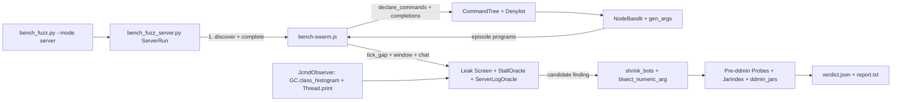

# Requirements

### Overview & Goals
Implement `ADR-125` (*Whole-Server Discovery Fuzzing: Protocol Discovery, Agentless Observation, Attribution After Detection*) so server administrators and plugin developers can run `scripts/bench_fuzz.py --mode server` against a disposable copy of a Paper or Fabric server to automatically discover player-reachable and admin commands, detect memory leaks, uncaught exceptions, and main-thread tick stalls without prior target metadata, isolate the responsible plugin/mod jar(s) via delta debugging (`ddmin`), and emit actionable mitigation and bug-report artifacts.

### Scope

#### In Scope
- **Approval & status update for `ADR-125`:** Transition `docs/adr/ADR-125-whole-server-discovery-fuzzing.md` and `docs/adr/README.md` from `Proposed` to `Accepted` under Rule D-005.
- **Protocol discovery & telemetry in `devstack/clients/bench-swarm.js`:**
  - `discover` control operation that logs in one bot per permission tier (`default`, `op`), captures the login `declare_commands` Brigadier graph, and returns the serialized node tree.
  - `complete` control operation that probes `tab_complete` for driver-filtered argument nodes and returns completion candidates.
  - Protocol-level `open_window`, `window_click`, and `close_window` handling so inventory GUIs opened by commands are explored even in lean mode.
  - `update_time` and `keep_alive` gap reporting (`tick_gap` events) for the stall oracle.
- **Server-mode subsystem in `scripts/bench_fuzz_server.py` + `scripts/bench_fuzz.py`:**
  - CLI `--mode server` validation (forbidding `--cmd`, `--names`, `--jars`, `--plugin-packages`; adding `--profile`, `--tiers`, `--deny`, `--stall-ms`, `--pid-file`, `--container`, `--default-budget-share`).
  - Multi-tier Brigadier tree merging (`commands.json`), minimum visible tier tracking (`default` before `op`), namespace alias folding (`betterrtp:rtp` <-> `rtp`), redirect cycle cutting, and `DEFAULT_DENYLIST` + `--deny` enforcement.
  - Boundary-ladder numeric argument generator (`min`, `-1`, `0`, `1`, `16`, `64`, `256`, `1024`, clamped cap, `max`, plus uniform draws) and parser-aware generators for `bool`, strings, selectors (`{self}` / other bot), coordinates, and cached tab completions.
  - Tier-stratified UCB1 bandit over `(command node, follow-up shape)` arms (`quit_lt1s`, `quit_delay`, `rejoin`, `repeat`, `concurrent`, `window_click`).
  - Agentless `JcmdObserver` (`GC.class_histogram` and `Thread.print`, local PID or `docker exec <container> jcmd 1 ...`) with optional `StressTestRTP` fallback when `/rtpstress` answers over RCON.
  - Bonferroni-corrected per-feature class leak screen (`node`, `node x follow_up`, `departures`) and dual-signal stall oracle (acute single gap `> p99 + --stall-ms` and sustained episode-wide tick interval inflation during `repeat` / `concurrent` arms, minus GC/dump/restart windows).
  - Numeric argument bisection during shrinking, `JarIndex` archive scanner (`.class` ownership + hard dependencies from `plugin.yml`, `paper-plugin.yml`, `fabric.mod.json`, `neoforge.mods.toml`), pre-`ddmin` probes (full set, then prerequisites-only), and dependency-closed jar `ddmin`.
  - Dual-purpose verdict output (`operator_mitigation` and `author_reproducer`) in `verdict.json` and `report.txt`.
- **Verification & Planted-Bug Fixtures:**
  - Unit and fake-server planted-bug tests in `scripts/tests/test_bench_fuzz.py` (ADR-125 section 2.7 gate).
  - Standalone planted-bug Gradle helper modules `helpers/FuzzFixturePaper` and `helpers/FuzzFixtureFabric` implementing `/ff:queue <n>` (quit-before-timer session retention) and `/ff:scan <radius>` (radius-gated main-thread stall).

#### Out of Scope
- Modifying `ADR-111` target mode (`--mode leak` and `--mode faults` remain unchanged).
- Building the `ADR-122` Fabric/NeoForge `StressTestRTP` carriers (server mode uses host `jcmd` agentlessly).
- Automatic restoration of mutated world or config files between full runs (`scripts/bench_setup.py` disposable copies bound side effects).

### User Stories
- **As a server administrator preparing a pre-release server**, I want to run `bench_fuzz.py --mode server` with `--tiers default` (or `default,op`) without manually listing every plugin command, so I can catch and block or remove plugins that let players trigger lag spikes or memory leaks before launch.
- **As a server administrator triaging a failure**, I want `report.txt` and `verdict.json` to show the exact command node, aliases, minimum reproducing permission tier (`default` vs `op`), and bisected numeric argument threshold, so I can immediately block or restrict the command in `commands.yml` or `LuckPerms` if I cannot remove the jar right away.
- **As a plugin or mod author receiving a bug report**, I want a minimal shrunk bot program, the blamed jar set confirmed by `ddmin`, the leaked class slope or main-thread stack frame, and a one-line `--replay` command, so I can reproduce and fix the issue quickly.

### Functional Requirements
1. **Target-Free CLI (`ADR-125` 2.1, 2.2):** `--mode server` shall accept `--server-dir`, `--host`, `--port`, `--password`, `--profile` (`paper`|`fabric`|`neoforge`), `--tiers` (`default`, `op`), `--deny`, `--stall-ms`, `--pid-file`, `--container`, and budget flags, and shall reject `--cmd`, `--names`, `--jars`, and `--plugin-packages`.
2. **Permission Tier Preservation (`ADR-125` 2.5):** Server mode shall never execute `LuckPerms` group grants (`lp group default permission set ...`). Default-tier bots join with the server's existing default permissions; op-tier bots are granted `op <name>` over RCON before joining and `deop <name>` at episode end and driver exit (`atexit` / signal handlers).
3. **Protocol Discovery & Denylist (`ADR-125` 2.3, 2.5):**
   - Capture `declare_commands` per active tier, fold `namespace:cmd` and `cmd` when their subtrees match, cut redirect cycles, and write `commands.json` with per-node `tiers` and `min_tier`.
   - Enforce built-in denylist entries (`stop`, `restart`, `op`, `deop`, `ban*`, `pardon*`, `whitelist`, `save-off`, `kill <entity>`, `execute`, `reload confirm`, `kick`, `difficulty`, `gamerule`, `tick freeze`, `tick unfreeze`, `tick rate`, `tick sprint`, `tick step`) plus `--deny` across discovery, tab-completion probing, generation, mutation, shrinking, and replay.
4. **Stratified Bandit & Argument Ladder (`ADR-125` 2.3):**
   - Allocate primary episode share (default 75% when both `default` and `op` are active) to `default`-visible nodes via UCB1 over `(node, follow_up)` arms (`quit_lt1s`, `quit_delay`, `rejoin`, `repeat`, `concurrent`, `window_click`).
   - Sample wide numeric Brigadier bounds using the ladder `min`, `-1`, `0`, `1`, `16`, `64`, `256`, `1024`, clamped cap (`4096`), `max`, plus uniform draws within bounds.
5. **Oracles & Attribution (`ADR-125` 2.4, 2.6):**
   - Run the same-seed vanilla baseline with only prerequisite jars enabled before full-set exploration.
   - Screen post-GC class growth against `node`, `node x follow_up`, and `departures` with Bonferroni correction over `classes x features`.
   - Score acute `update_time` gaps (`> baseline_p99 + --stall-ms`) and sustained episode-wide `update_time` interval inflation during `repeat` / `concurrent` arms (excluding driver GC/dump/restart windows), capturing `jcmd <pid> Thread.print` main-thread frames.
   - Shrink reproduced findings (`shrink_bots`), bisect numeric ladder arguments to the minimal failing threshold, run the two pre-`ddmin` probes (full set, then prerequisites-only), and run dependency-closed jar `ddmin` over non-prerequisite jars.
6. **Resolution Output (`ADR-125` 2.4):** Emit both `operator_mitigation` and `author_reproducer` sections in `verdict.json` and `report.txt`.

### Non-Functional Requirements
- **Zero third-party Python dependencies:** `scripts/bench_fuzz.py` and `scripts/bench_fuzz_server.py` shall use Python 3.12+ stdlib only (`zipfile`, `subprocess`, `json`, `math`, `statistics`, etc.).
- **Zero hardcoded plugin/class names:** No oracle, score term, generator rule, or built-in denylist entry shall name any plugin, mod, fixture, or Java class.

# Technical Design

### Current Implementation
- `scripts/bench_fuzz.py` (3,676 lines) implements `ADR-111` target mode (`--mode leak` and `--mode faults`). It relies on per-target CLI knowledge (`DEFAULT_CMDS`, `--cmd`, `--jars`, `--names`, `--plugin-packages`), isolates one target jar at a time via `FuzzDriver.set_jars`, mutates `LuckPerms` group `default` via `PermissionGrant`, reads histograms from `StressTestRTP` CSV/files via `RunsReader`, and attributes `ServerLogOracle` stack traces via package prefixes (`PLUGIN_PACKAGES`).
- `devstack/clients/bench-swarm.js` (1,062 lines) runs Mineflayer bots in `--fuzz-control` mode supporting `ping`, `stop`, and `episode` ops with actions `rtp`, `rtp2`, `wait`, `move`, `quit`, `rejoin`, `die`, and `cmd`. It disables Mineflayer's `inventory` plugin in `LEAN_DISABLED` and does not capture `declare_commands`, `open_window`, or `update_time` packets.
- `scripts/bench_overnight.py` provides RCON client helpers (`rcon`, `Driver.cmd`, `Driver.restart`, `Driver.wait_up`, `Driver.wait_down`) and `OFF_SUFFIX = ".off"` jar toggling.
- `scripts/bench_leakcheck.py` provides `HISTO_LINE` and `GC_FILLER` regexes for parsing HotSpot `GC.class_histogram` output.

### Key Decisions
1. **Sibling Server-Mode Module (`scripts/bench_fuzz_server.py`):**
   - Place all `ADR-125` server-mode classes (`PlatformProfile`, `CommandTree`, `Denylist`, `NodeBandit`, `JcmdObserver`, `StallOracle`, `JarIndex`, `ServerRun`) in `scripts/bench_fuzz_server.py` and import it from `scripts/bench_fuzz.py`. This keeps `bench_fuzz.py` manageable while reusing shared primitives (`rng_for`, `bot_name`, `Corpus`, `ServerLogOracle`, `Swarm`, `ddmin`, `shrink_bots`, `ridge_fit`).
2. **Driver-Filtered Two-Step Discovery (`discover` + `complete` ops):**
   - `bench-swarm.js` implements a `discover` op that logs in one bot per tier, captures the raw `declare_commands` packet from `bot._client`, serialises the Brigadier graph, emits `{ev: "commands", tier, nodes, rootIndex}`, and disconnects.
   - `bench_fuzz_server.py` merges the tier trees, folds namespace aliases, cuts redirect cycles, and applies `Denylist` *before* sending a `complete` op to `bench-swarm.js` for non-denied argument nodes that support tab suggestions. This guarantees denied commands are never probed and bounds discovery time on 40-plugin servers.
3. **Protocol-Level Window Exploration in Lean Mode:**
   - Rather than enabling Mineflayer's heavy `inventory` plugin, `bench-swarm.js` listens directly to `bot._client.on('open_window', ...)` in fuzz mode, records the active `{windowId, stateId, slotCount}`, emits `{ev: "window", ...}`, and supports `window_click` (`bot._client.write('window_click', ...)`) and `close_window` (`bot._client.write('close_window', ...)`) actions in `runFuzzProgram`.
4. **Standalone Planted-Bug Gradle Fixtures (`helpers/FuzzFixturePaper` & `helpers/FuzzFixtureFabric`):**
   - Add two lightweight leaf helper projects under `helpers/` with neutral command namespace `ff` (`/ff:queue <n>` and `/ff:scan <radius>`), isolated from `rtp-core` and `rtp-api` so `scripts/ci-scope.py` classifies them under the `helpers` leaf set.

### Proposed Changes

#### 1. `devstack/clients/bench-swarm.js`
- **`discover` and `complete` control operations:**
  - In `handleFuzzLine`, add `case 'discover':` and `case 'complete':`.
  - `runFuzzDiscover(sock, req)` connects a single bot (`req.bot`), hooks `bot._client.once('declare_commands', (packet) => ...)` before `spawn`, serialises each Brigadier node (`flags`, `kind`, `name`, `parser`, `properties`, `children`, `redirect`, `executable`, `suggestionType`), emits `{ev: "commands", id: req.id, tier: req.tier, rootIndex: packet.rootIndex, nodes}`, and disconnects.
  - `runFuzzComplete(sock, req)` connects a single bot, sends `tab_complete` packets for each prefix in `req.prefixes` (using `bot._client.write('tab_complete', { text, assumeCommand: false, lookedAtBlock: undefined })` or `bot.tabComplete(prefix)`), collects matches with a per-probe timeout, emits `{ev: "completions", id: req.id, results: {prefix: matches}}`, and disconnects.
- **Protocol-level window & tick-gap handling in `fuzzConnect` / `runFuzzProgram`:**
  - Attach `bot._client.on('update_time', () => ...)` and `bot._client.on('keep_alive', () => ...)` in `fuzzConnect`. When time since the previous `update_time` packet is measured (after spawn), emit `{ev: "tick_gap", bot: conn.username, ms: gapMs, keepalive_ms: lastKeepAliveDelayMs}`.
  - Attach `bot._client.on('open_window', (pkt) => ...)` in `fuzzConnect` to store `conn.openWindow = { windowId: pkt.windowId, slots: pkt.slotCount || 27 }` and emit `{ev: "window", bot: conn.username, window_id: pkt.windowId, title: reasonText(pkt.windowTitle)}`.
  - Add `'window_click'` and `'close_window'` to `FUZZ_ACTIONS` and `parseAction` (`slot`, `mode`, `button`), writing raw `window_click` and `close_window` packets via `bot._client.write(...)`.

#### 2. `scripts/bench_fuzz_server.py` & `scripts/bench_fuzz.py`
- **Tree Merge, Alias Folding & Denylist (`CommandTree`, `Denylist`):**
  - Merge per-tier node graphs into canonical paths; fold `plugin:cmd` into `cmd` (recording `aliases: ["cmd", "plugin:cmd"]`) when their child/parser structures match; break redirect cycles via visited-node tracking; assign `tiers` (`["default", "op"]` or `["op"]`) and `min_tier` (`"default"` if `"default"` in `tiers` else `"op"`).
  - Match denylist patterns `root [subpath] [<argkind>]` after alias folding (`DEFAULT_DENYLIST` + `--deny`).
- **Argument Generator & Numeric Bisection (`gen_args`, `bisect_numeric_arg`):**
  - For `brigadier:integer`, `brigadier:long`, `brigadier:float`, `brigadier:double`: build candidate ladder `[lo, -1, 0, 1, 16, 64, 256, 1024, min(hi, 4096), hi]` filtered to `[lo, hi]` plus uniform draws within `[lo, min(hi, 4096)]`.
  - During shrinking, if a reproduced shrunk program contains a `cmd` action built from a node with a numeric argument `v`, binary-search the ladder/integer range between a passing baseline value (e.g. `0` or `1`) and `v` using the finding replay probe to record `bisected_bound` (e.g. `radius >= 49`).
- **Tier-Stratified Bandit (`NodeBandit`):**
  - Arms are `(node_path, follow_up)` where `follow_up` is in `("quit_lt1s", "quit_delay", "rejoin", "repeat", "concurrent", "window_click")`.
  - Stratify episode selection: when both `default` and `op` tiers are enabled, draw from `default`-visible arms with probability `--default-budget-share` (default `0.75`) and `op`-only arms with `0.25`. Within each stratum, select via UCB1 (`mean_reward + c * sqrt(ln(total_pulls) / pulls)`).
- **Observation & Oracles (`JcmdObserver`, `StallOracle`, `screen_server_leaks`):**
  - `JcmdObserver`: resolves JVM PID from `--pid-file`, `jcmd -l` matching the server jar, or `docker exec <container> jcmd 1 ...`. Parses `GC.class_histogram` using `lc.HISTO_LINE` / `lc.GC_FILLER`. Records wall-clock `[t_start, t_end]` windows for every `GC.class_histogram`, `Thread.print`, and server restart so `StallOracle` excludes overlapping `tick_gap` intervals.
  - `StallOracle`: compares non-overlapping episode `tick_gap` values against vanilla baseline `p99 + --stall-ms` (acute spike) and compares episode `mean` / `p95` during `repeat` and `concurrent` arms against baseline interval statistics (sustained tick inflation). Triggers `JcmdObserver.thread_print()` when elevated gaps occur and extracts the top main-thread frame that is neither JDK (`java.*`, `jdk.*`, `sun.*`) nor server/loader code (`net.minecraft.*`, `io.papermc.*`, `org.bukkit.*`, `org.spigotmc.*`, `net.fabricmc.*`).
  - `screen_server_leaks`: fits per-class post-GC deltas against episode feature counts (`node:<id>`, `arm:<id>:<shape>`, `departures`), applying Bonferroni threshold `NormalDist().inv_cdf(1 - 0.025 / max(1, n_classes * n_features))` and subtracting vanilla baseline fits.
- **Jar Index & Attribution (`JarIndex`, `run_pre_ddmin_probes`, `ddmin_jars`):**
  - `JarIndex`: scans `*.jar` in the profile's jar folder (`plugins/` or `mods/`) via `zipfile.ZipFile`, mapping internal `.class` paths to jar filenames and reading hard dependencies (`depend` in `plugin.yml`, `server` dependencies with `required: true` in `paper-plugin.yml`, `depends` in `fabric.mod.json`, and `[[dependencies.*]]` in `META-INF/neoforge.mods.toml`).
  - Pre-`ddmin` probe 1 restarts with all jars and replays `--finding-n` times (requires `>= --finding-k` hits).
  - Pre-`ddmin` probe 2 restarts with prerequisite jars only and replays `--finding-n` times (if `>= --finding-k` hits, labels finding `server` and skips `ddmin`).
  - `ddmin_jars` wraps `bf.ddmin` over candidate jars, expanding each tested subset via `JarIndex.close_deps(subset)` + prerequisite jars, restarting the server, verifying every jar in the subset loaded, and replaying `--finding-n` times.

### Data Models / Contracts

```python

# scripts/bench_fuzz_server.py

@dataclass(frozen=True)
class PlatformProfile:
    name: str                        # "paper" | "fabric" | "neoforge"
    jar_subdir: str                  # "plugins" | "mods"
    prereq_prefixes: tuple[str, ...] # e.g. ("viaversion", "viabackwards") or ("fabric-api", "fabricloader")
    server_frame_prefixes: tuple[str, ...]
    loaded_check_cmd: str            # "plugins" | "fabric mods"

@dataclass
class CommandNode:
    node_id: str                     # canonical path, e.g. "rtp" or "ff:scan <radius>"
    aliases: list[str]               # e.g. ["rtp", "betterrtp:rtp"]
    kind: str                        # "root" | "literal" | "argument"
    parser: str | None               # e.g. "brigadier:integer"
    properties: dict                 # e.g. {"min": 1, "max": 256}
    executable: bool
    tiers: list[str]                 # ["default", "op"]
    min_tier: str                    # "default" | "op"
    children: list[str]
    completions: list[str]

# Verdict finding schema addition in verdict.json:

# {

# "oracle": "leak" | "stall" | "log",

# "signature": "...",

# "reproduced": true, "k": 3, "n": 3,

# "attribution_status": "confirmed" | "server" | "unconfirmed" | "not_reproducible_after_restart",

# "blamed_jars": ["BetterRTP-3.6.13.jar"],

# "first_suspect": "BetterRTP-3.6.13.jar",

# "operator_mitigation": {

# "canonical_node": "rtp",

# "aliases": ["rtp", "betterrtp:rtp"],

# "min_tier": "default",

# "bisected_bound": null

# },

# "author_reproducer": {

# "oracle": "leak",

# "blamed_jars": ["BetterRTP-3.6.13.jar"],

# "evidence": "+1800.0 AdvancementProgress per rtp x quit_lt1s",

# "shrunk_program": [{"name": "fz_0", "program": [{"a": "cmd", "cmd": "rtp"}, {"a": "wait", "ms": 800}, {"a": "quit"}]}],

# "reproduction": {"k": 3, "n": 3},

# "replay_cmd": "python3 scripts/bench_fuzz.py --mode server --server-dir ... --replay ... --ep 12"

# }

# }

```

### File Structure
- `docs/adr/ADR-125-whole-server-discovery-fuzzing.md` (modified — status `Proposed` -> `Accepted`)
- `docs/adr/README.md` (modified — `ADR-125` row status `Proposed` -> `Accepted`)
- `devstack/clients/bench-swarm.js` (modified — add `discover` and `complete` ops, `tick_gap` and `window` events, `window_click` and `close_window` actions)
- `scripts/bench_fuzz_server.py` (added — `PlatformProfile`, `CommandTree`, `Denylist`, `gen_args`, `NodeBandit`, `JcmdObserver`, `StallOracle`, `screen_server_leaks`, `JarIndex`, `bisect_numeric_arg`, `run_pre_ddmin_probes`, `ddmin_jars`, `ServerRun`)
- `scripts/bench_fuzz.py` (modified — add `Swarm.discover` / `Swarm.complete`, `--mode server` CLI options and validation, dispatch to `bench_fuzz_server.run_server_mode`)
- `scripts/tests/test_bench_fuzz.py` (modified — unit and fake-server planted-bug tests for all `ADR-125` components)
- `settings.gradle` (modified — include `helpers:FuzzFixturePaper` and `helpers:FuzzFixtureFabric`)
- `helpers/FuzzFixturePaper/build.gradle`, `src/main/resources/plugin.yml`, `src/main/java/io/github/dailystruggle/fuzzfixture/paper/FuzzFixturePaperPlugin.java` (added)
- `helpers/FuzzFixtureFabric/build.gradle`, `src/main/resources/fabric.mod.json`, `src/main/java/io/github/dailystruggle/fuzzfixture/fabric/FuzzFixtureFabricMod.java` (added)

### Architecture Diagram



### Risks
- **Full-GC pause overlap with stall oracle:** `jcmd <pid> GC.class_histogram` triggers a stop-the-world full GC that delays `update_time` packets. **Mitigation:** `JcmdObserver` records exact `[start_ms, end_ms]` intervals (with a post-command grace margin) for every histogram, thread dump, and server restart; `StallOracle` filters out any `tick_gap` overlapping those windows.
- **Orphaned `op` permissions on crash or Ctrl+C:** If the driver exits mid-episode while a bot is opped, `ops.json` would keep the bot. **Mitigation:** `OpGrantGuard` tracks active op-tier bot names and issues `deop <name>` in `finally`, `atexit`, and `SIGINT`/`SIGTERM` handlers (matching `PermissionGrant`'s cleanup pattern).
- **Broken jar subsets during `ddmin`:** Disabling a dependency jar causes dependent plugins not to load, producing false non-reproductions. **Mitigation:** `JarIndex` parses hard dependencies from plugin/mod metadata, closes every `ddmin` subset under hard dependencies before restarting, and treats any probe where a subset jar failed to load as unresolved (not reproducing).

# Testing

### Validation Approach
1. **Unit & Fake-Server Planted-Bug Gate (`scripts/tests/test_bench_fuzz.py`):**
   - Per `ADR-125` section 2.7 and `ADR-111` section 2.8, every oracle and attribution stage is validated against the deterministic in-process fake server and fake swarm in `scripts/tests/test_bench_fuzz.py` via `python3 -m unittest discover -s scripts/tests -p "test_bench_fuzz.py"`.
2. **Real `bench-swarm.js` Control Channel Verification:**
   - Extend `SwarmControlTest` in `scripts/tests/test_bench_fuzz.py` (which spawns `node devstack/clients/bench-swarm.js --fuzz-control 0`) to test `discover`, `complete`, `window_click`, and `close_window` action validation and error handling.
3. **Gradle Build Gate for Planted-Bug Fixtures:**
   - Build `:helpers:FuzzFixturePaper:build` and `:helpers:FuzzFixtureFabric:build` via `./gradlew` and run `python3 scripts/agent-gate.py --dry-run` and `sh .git/hooks/pre-commit`.

### Key Scenarios
- **Tree Merge, Alias Folding & Denylist (`CommandTreeTest`):**
  - Merge `default` and `op` Brigadier trees; verify `betterrtp:rtp` and `rtp` fold into one canonical node with `aliases: ["rtp", "betterrtp:rtp"]` and `min_tier: "default"`, while op-only subcommands carry `min_tier: "op"`.
  - Verify redirect cycles (`execute -> run -> execute`) terminate without infinite recursion.
  - Verify `DEFAULT_DENYLIST` blocks `stop`, `minecraft:stop`, `ban`, `ban-ip`, `reload confirm`, `kill <entity>`, and `tick freeze` / `tick rate` / `tick sprint` / `tick step`, while allowing bare `reload`, bare `kill`, and `tick query`.
- **Boundary-Ladder Generation & Numeric Threshold Bisection (`ArgGenAndBisectTest`):**
  - Verify `brigadier:integer` with `min=1, max=2147483647` samples ladder values (`1`, `16`, `64`, `256`, `1024`, `4096`, `2147483647`) and hits `/ff:scan <radius>` with `radius > 48` within a small number of draws.
  - Verify `bisect_numeric_arg` binary-searches a failing `scan 256` program down to the exact threshold `scan 49`.
- **Tier-Stratified Bandit (`NodeBanditTest`):**
  - With 5 `default` nodes and 50 `op`-only nodes, verify `default` nodes receive ~75% of episode pulls under default settings and 100% under `--tiers default`.
- **Planted Leak & Stall Oracles (`ServerOracleTest`):**
  - **Planted leak:** Fake server increments a class count whenever `ff:queue` is followed by `quit_lt1s`; verify `screen_server_leaks` flags the class on `ff:queue x quit_lt1s` above the Bonferroni threshold and maps it to `FuzzFixture.jar` via `JarIndex`.
  - **Planted acute & sustained stall:** Fake swarm emits an acute `tick_gap` (`3200 ms`) on `ff:scan 64` and sustained elevated `tick_gap`s (`180 ms` vs `50 ms` baseline) during `repeat`; verify `StallOracle` triggers `jcmd Thread.print`, ignores gaps overlapping a `GC.class_histogram` window, and attributes the top non-JDK/non-server frame to `FuzzFixture.jar`.
- **Pre-`ddmin` Guardrails & Dependency-Closed Jar `ddmin` (`JarDdminTest`):**
  - **Prerequisites-only reproduction:** When a finding still reproduces with only prerequisite jars active, verify it is labelled `server`, no `ddmin` runs, and no plugin jar is blamed.
  - **Single-jar & two-jar interaction:** Verify `ddmin_jars` isolates 1 culprit jar among 8 jars in `O(log n)` probes, preserves hard dependencies (`PluginB` depends on `PluginA`), and emits both `operator_mitigation` and `author_reproducer` in `verdict.json` and `report.txt`.

### Edge Cases
- **Missing or unauthorized `jcmd`:** Verify `JcmdObserver` raises a fast startup error with an actionable hint rather than returning an empty histogram dict `{}`.
- **Denied command introduced during mutation or shrinking:** Verify `Denylist` blocks shrinking `reload something` into `reload confirm` or removing arguments that would turn an allowed path into a denied path.
- **Unconfirmed `ddmin` (budget exhausted or non-reproducible after restart):** Verify a finding that fails the full-set pre-`ddmin` probe is marked `not_reproducible_after_restart`, and a finding whose `ddmin` budget expires is marked `INCONCLUSIVE` with `first_suspect` reported as `unconfirmed`.

### Test Changes
- Extend `scripts/tests/test_bench_fuzz.py` with:
  - `CommandTreeAndDenylistTest`
  - `BoundaryLadderAndBisectTest`
  - `TierStratifiedBanditTest`
  - `JcmdAndStallOracleTest`
  - `JarIndexAndDdminTest`
  - `ServerModeLoopTest` (end-to-end fake-server loop covering baseline -> discovery -> exploration -> shrink -> pre-`ddmin` -> jar `ddmin` -> `verdict.json` / `report.txt`)

# Delivery Steps

### * Step 1: Stage 1: Extend bench-swarm.js for protocol discovery, window packets, and tick-gap events
`devstack/clients/bench-swarm.js` supports protocol-level command tree discovery, targeted tab-completion probing, inventory window click/close actions, and `update_time` tick-gap telemetry.

- Add the `discover` control op to `handleFuzzLine` in `devstack/clients/bench-swarm.js` to log in one bot for a requested tier, capture the raw `declare_commands` packet on `_client`, serialise the Brigadier node graph (`kind`, `name`, `parser`, `properties`, `children`, `redirect`, `executable`, `suggestions`), emit `{ev: "commands", id, tier, nodes, rootIndex}`, and disconnect cleanly.
- Add the `complete` control op in `devstack/clients/bench-swarm.js` to query `tab_complete` for driver-approved command prefixes and return `{ev: "completions", id, prefix, matches}`.
- Extend `fuzzConnect` and `runFuzzProgram` in `devstack/clients/bench-swarm.js` to listen on `_client.on('update_time')` and `_client.on('keep_alive')` to emit `{ev: "tick_gap", ms, keepalive_ms}` events, and listen on `_client.on('open_window')` to emit `{ev: "window", window_id, window_type, slots, title}`.
- Add `window_click` and `close_window` actions to `FUZZ_ACTIONS` and `parseAction` in `devstack/clients/bench-swarm.js` so `window_click` follow-ups work at the protocol level even with Mineflayer's `inventory` plugin disabled in lean mode.
- Update `docs/adr/ADR-125-whole-server-discovery-fuzzing.md` and `docs/adr/README.md` status from `Proposed` to `Accepted` upon approval.

###   Step 2: Stage 2: Implement CommandTree, Denylist, boundary-ladder generator, and NodeBandit in bench_fuzz_server.py
`scripts/bench_fuzz_server.py` merges multi-tier Brigadier command trees, enforces the path/argument-kind denylist, generates boundary-ladder arguments, and selects episodes via a tier-stratified UCB1 bandit.

- Create `scripts/bench_fuzz_server.py` with `merge_command_trees`, folding `namespace:name` and `name` duplicates when their subtrees match, resolving redirects with cycle protection, and recording `tiers` plus `min_tier` (`default` before `op`) into `commands.json`.
- Implement `Denylist` with `DEFAULT_DENYLIST` (`stop`, `restart`, `op`, `deop`, `ban*`, `pardon*`, `whitelist`, `save-off`, `kill <entity>`, `execute`, `reload confirm`, `kick`, `difficulty`, `gamerule`, `tick freeze`, `tick unfreeze`, `tick rate`, `tick sprint`, `tick step`) and operator `--deny` extensions, enforced across discovery, generation, mutation, shrinking, and replay.
- Implement `gen_args` with the numeric boundary and magnitude ladder (`min`, `-1`, `0`, `1`, `16`, `64`, `256`, `1024`, clamped cap `4096`, `max`, plus uniform draws) for `brigadier:integer`, `brigadier:long`, `brigadier:float`, and `brigadier:double`, alongside `bool`, string modes, entity/player selectors (`{self}` / peer bot), relative coordinates, and cached completion values.
- Implement `NodeBandit` over `(node_id, follow_up)` arms (`quit_lt1s`, `quit_delay`, `rejoin`, `repeat`, `concurrent`, `window_click`) using UCB1 stratified by `min_tier` (`--default-budget-share`, default `0.75`) and rewarded by corpus novelty plus harm.
- Add `Swarm.discover` and `Swarm.complete` helper methods in `scripts/bench_fuzz.py`.

###   Step 3: Stage 3: Implement JcmdObserver, Bonferroni leak screen, StallOracle, and JarIndex
`scripts/bench_fuzz_server.py` observes any HotSpot JVM via `jcmd` (or optional `StressTestRTP`), screens per-feature class leaks with Bonferroni correction, and detects acute or sustained main-thread stalls.

- Implement `PlatformProfile` (`paper` and `fabric`) and `JcmdObserver` in `scripts/bench_fuzz_server.py` supporting `--pid-file`, `jcmd -l` matching, and `docker exec <container> jcmd 1 ...`, failing fast on missing `jcmd` or unreadable histograms and recording `[start_ms, end_ms]` exclusion windows during `GC.class_histogram` and `Thread.print`.
- Implement `screen_server_leaks` fitting post-GC class deltas against `node`, `node x follow_up`, and `departures` features with Bonferroni correction over `classes x features` net of the vanilla baseline.
- Implement `StallOracle` scoring both acute `update_time` gaps (`> baseline_p99 + --stall-ms`) and sustained episode-wide interval inflation (`mean` / `p95` excess during `repeat` and `concurrent` arms) outside observer exclusion windows, attributing the culprit stack frame from `jcmd <pid> Thread.print`.
- Implement `JarIndex` scanning `plugins/` or `mods/` via `zipfile` to map `.class` entries to jars (defaulting unknown classes to `server`) and parsing hard dependencies from `plugin.yml`, `paper-plugin.yml`, `fabric.mod.json`, and `META-INF/neoforge.mods.toml`.

###   Step 4: Stage 4: Wire ServerRun orchestration, numeric bisection, jar ddmin, and verdict reporting into bench_fuzz.py
`scripts/bench_fuzz.py --mode server` executes the end-to-end baseline, discovery, exploration, numeric threshold bisection, pre-`ddmin` guardrails, dependency-closed jar `ddmin`, and resolution reporting.

- Implement `bisect_numeric_arg`, `run_pre_ddmin_probes` (full jar set, then prerequisites-only), and `ddmin_jars` (closing candidate subsets under `JarIndex.close_deps` and verifying every subset jar loaded after restart) in `scripts/bench_fuzz_server.py`.
- Implement `ServerRun` in `scripts/bench_fuzz_server.py` to orchestrate the prerequisite-only vanilla baseline, RCON `op` / `deop` lifecycle (with `atexit`/signal cleanup and zero `LuckPerms` mutations), discovery, bandit exploration, replay confirmation (`--finding-k` of `--finding-n`), program shrinking (`shrink_bots`), and jar attribution.
- Emit `verdict.json` and `report.txt` containing both the `operator_mitigation` block (canonical node, aliases, `min_tier`, bisected argument bound) and the `author_reproducer` block (`oracle`, `blamed_jars` or `first_suspect`, class slope or stack frame, shrunk program, `k` of `n`, and `--replay` command).
- Wire `--mode server` and server-mode CLI flags (`--profile`, `--tiers`, `--deny`, `--stall-ms`, `--pid-file`, `--container`, `--default-budget-share`) into `build_parser` and `main` in `scripts/bench_fuzz.py`, rejecting target-specific flags (`--cmd`, `--names`, `--jars`, `--plugin-packages`).

###   Step 5: Stage 5: Add planted-bug unit test suite and Gradle helper fixtures (FuzzFixturePaper & FuzzFixtureFabric)
`scripts/tests/test_bench_fuzz.py` verifies all server-mode components and planted-bug gates, and standalone `FuzzFixturePaper` and `FuzzFixtureFabric` helper modules build cleanly.

- Add unit and fake-server planted-bug tests in `scripts/tests/test_bench_fuzz.py` covering tree merge, alias folding, redirect cycle breaking, denylist matching, boundary-ladder generation, numeric threshold bisection, tier-stratified UCB1, Bonferroni leak screening, acute + sustained stall detection, `JarIndex` dependency closure, and both pre-`ddmin` guardrails.
- Create `helpers/FuzzFixturePaper` (`plugin.yml` namespace `ff`) and `helpers/FuzzFixtureFabric` (Fabric Brigadier registration) implementing `/ff:queue <n>` (1.5 s timer session retention on early quit) and `/ff:scan <radius>` (~3 s main-thread busy-wait when `radius > 48`), and register them in `settings.gradle`.
- Run `python3 -m unittest discover -s scripts/tests -p "test_bench_fuzz.py"`, `./gradlew :helpers:FuzzFixturePaper:build`, `./gradlew :helpers:FuzzFixtureFabric:build`, and `sh .git/hooks/pre-commit`.