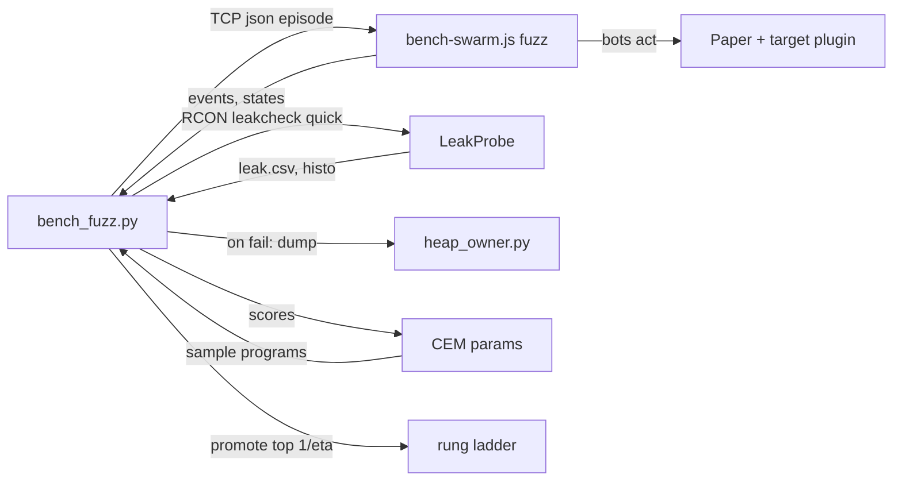

# Requirements

### Overview & Goals
A system that **learns and exacerbates memory leaks**, without reading any plugin's code. Bots run seeded random player behaviour against the real Paper bench server. Short *episodes* measure exact post-GC counts and predict which behaviour leaks; the generator then learns to produce more of that behaviour, so a leak grows faster with every generation until it is large enough to confirm at scale and attribute from a heap dump.

Micro and macro are the two ends of one **fidelity ladder** (bots × repetitions × duration), not two separate tests. Candidate behaviours climb the ladder only while their leak signal holds up (successive halving). Along the way, the generator's continuous parameters (quit delay after `/rtp`, move timing, action mix) are tuned by a noise-tolerant, gradient-free optimiser (the black-box counterpart of gradient descent) towards the **highest leak rate per minute of bench time**.

Randomness is kept on purpose: the optimiser samples from a distribution with a variance floor, and a share of every generation is pure novelty. So besides amplifying known leaks, the run keeps a steady chance of stumbling onto leaks nobody predicted.

**Expected base rate: no leak.** Most targets and most of the behaviour space don't leak, so the normal outcome is that the optimiser does *not* converge. Leaking behaviours are one in many. So the budget is weighted towards discovery: while nothing has a signal, the run spends its time on variation (more novelty, wider sampling, fresh seeds) rather than on exploiting noise. A single surprising episode is checked cheaply straight away by replaying it, and only a confirmed signal pulls the run into exploit mode (CEM narrowing, ladder, dump).

First target: rediscover BetterRTP's known leak (a player quitting mid-teleport stays in memory). Then run the same seeds against `rtp` (LeafRTP) to answer whether we leak.

### Scope
**In scope (first version)**
- Behaviour actions: `/rtp` (with or without args), wait, move, quit, rejoin under the same name, rejoin under a new name, die, second `/rtp` while one is pending.
- Small level: episodes of 2-8 bots and 20-60 s, a lightweight checkpoint between episodes, a per-episode trace, a fit of count deltas against behaviour features, a keep-what's-new corpus guided by plugin replies, and shrinking of leaking episodes.
- Behaviour-parameter optimisation: the generator is a parameterised distribution; a cross-entropy method (CEM) moves its parameters towards the best-scoring (most-leaking) episodes each generation.
- Exploration for chance finds: variance floor, 25% novelty/mutation episodes, and periodic random restarts of the distribution.
- Intermediate rungs: survivors of each rung rerun with more bots and repetitions (e.g. 4 → 12 → 48 bots, 1 → 3 → N reps); only the top fraction by net leak signal is promoted.
- Large level (top rung): the learnt, most-leaking behaviour run with up to 48 bots × N repetitions against the same seeds under a control (`direct`), plus a heap dump and `heap_owner.py` when confirmed. Because the behaviour has been amplified, the leak dominates the dump.
- One RTP plugin at a time, reusing the jar switching and restart from `bench_overnight.py`.

**Out of scope**
- Clicking in plugin menus (later version).
- Code-coverage guidance (Jazzer/MockBukkit); plugin replies stand in for coverage.
- Literal gradient descent: the objective (post-GC count deltas) is noisy, integer-valued and has no analytic gradient. Gradient-free estimators fill that role: CEM now, SPSA as a later option.
- Changing the existing soak (`bench_leakcheck.py`), which stays the nightly check for slow and native leaks.

### User Stories
- As the bench operator, I want a per-plugin leak verdict in under an hour for `direct` + BetterRTP + `rtp`, so that I don't wait for a multi-hour soak.
- As a developer, I want the smallest behaviour sequence that leaks, plus who holds the memory, so that I know the cause, not just that memory grows.
- As the LeafRTP maintainer, I want the same seeds run against our plugin, so that I can show whether we leak.

### Functional Requirements
- **Reproducible:** every episode is fully determined by `(seed, episode index)`, and its trace (JSON lines) can be replayed with `--replay`.
- **Plugin-agnostic:** the grammar treats every action the same and knows nothing about any plugin. The only per-target input is the command template (`/rtp`, `/betterrtp:rtp`, or `rtpstress tp {self}` for `direct`).
- **Measured per episode:** the delta of `retained_player_objects` and of each exact count `LeakProbe` already records (per-plugin listeners, tasks, live instances; threads; open files), plus the per-class live instance deltas from the histogram.
- **Every histogram class is a candidate leak signal**, not only the fixed counters. A class's post-GC instance count is tracked across all episodes, not only when it is among an episode's 50 largest changes. Classes whose cumulative growth beats the control are fitted, flagged, scored and reported in the same way as `retained_player_objects`. The thresholds are corrected for the number of classes tested, so 10k classes don't produce false flags by chance.
- **Prediction:** a coefficient with a confidence interval for each behaviour feature and each count, e.g. `+1.0 retained_player_objects per quit<500ms-after-rtp`. Flagged when the interval excludes 0 and the control's coefficient doesn't.
- **Learning to exacerbate:** each generation of G episodes is scored by `net leak per minute = (target delta − control coefficients · features) / episode seconds`, summed over the counts (each normalised by its control noise). The generator's parameters move towards the top 20% (CEM, smoothed, with a variance floor). Parameters and scores are logged per generation, so the run shows the leak rate rising and the behaviour converging, e.g. quit delay narrowing to 50-300 ms.
- **Chance finds:** 25% of each generation are novelty or corpus mutations, not CEM samples. If the best score stalls for 3 generations, the distribution is widened back to its prior (a restart). An episode that changes a count no feature explains is kept and reported as unexplained.
- **Discovery-first budget:** while no feature or class is flagged, the novelty share rises step by step, up to 60%, and each stall restart starts from a fresh random point, not around the current mean. Once a signal is confirmed, the share falls back to 25% and CEM exploits it. Non-convergence is logged as the expected "no signal yet" state, not as an error.
- **Replay on surprise:** an episode whose score or unexplained residual exceeds the surprise threshold is replayed right away (n=3, same program, fresh bot names). A signal that reproduces k≥2 of 3 times becomes a candidate, even before the fit has enough samples to flag it. Otherwise it is logged as a one-off.
- **Fidelity ladder:** rung r runs each surviving candidate with `bots_r` × `reps_r`; the top `1/eta` (default eta=3) by net signal, and only those whose interval still excludes 0, are promoted. A candidate that loses its signal at a higher rung is reported as a micro-only artefact.
- **Shrinking:** a flagged episode is cut down to the smallest action list that still leaks, reported as `k of n` reproductions. The shrunk sequence explains the cause; the learnt parameters show how to make it leak fastest.
- **Confirmation (pass/fail, top rung):** a target **fails** when, after N repetitions by 48 bots of the learnt behaviour, the count (a fixed counter or a screened class) grows by at least half the predicted amount × N and heap after GC grows beyond the control's growth for the same seeds. On failure, a heap dump and `heap_owner.py` name the owner. A target **passes** only if the optimiser ran its full budget without finding a signal. The pass is reported as "no leak found within budget", not as proof that there is no leak, together with the coverage reached: episodes, distinct `(action, state)` pairs, restarts, seeds and classes tested.
- **Report:** `scripts/tmp/runs/fuzz-<stamp>/report.txt` (default `--out-dir scripts/tmp`, gitignored, as `bench_leakcheck.py` uses) with the verdict per target, the top predicted leaks, the top growing classes net of the control, the leak-rate curve per generation, the learnt parameters, the shrunk sequences, unexplained finds and surprises (k of n), and the owner.

### Non-Functional Requirements
- About 80 episodes per hour per target; the ladder above the micro rung uses at most about 1/3 of a target's budget; a lightweight checkpoint takes about 3 s (one full GC plus histogram, no thread dump, NMT or heap dump).
- Fully reproducible despite the randomness: optimiser state is derived from `(seed, generation)` and logged.
- Python is stdlib-only (`scripts/` rule); the swarm uses only `mineflayer` plus Node built-ins.
- Permissions granted for the fuzz run are reverted on exit, including Ctrl+C or a crash, the same way the jar renames are.

# Technical Design

### Current Implementation
- `devstack/clients/bench-swarm.js`: passive mineflayer bots. They join with a global join delay (optionally across `childProcess.fork` workers), reconnect on `end`, and rename after a `StressTestRTP churn` kick when `--churn-rename` is set. Chat goes only through `messagestr` logging and the `BUSY_RE` counter.
- `StressCommand.doLeakCheck` → `LeakProbe.checkpoint(label, dump, cb)`: full GC, class histogram, `leak.csv` row, `leak-metrics.csv` metrics (NMT, thread dump, per-plugin census by jar class ownership, workload counters). `doChurn` and `doTp` exist.
- `scripts/bench_leakcheck.py`: RCON `Driver` and `prepare_target` (jar isolation and restart via `bench_overnight.py`), `checkpoint()`/`wait_leakcheck()` polling, `load_checkpoints`, `fit`/`slope`, `read_histo`.
- `scripts/heap_owner.py`: MAT headless with jar-class owner attribution.

### Key Decisions
1. **Control channel: a local TCP socket with newline-delimited JSON.** `bench_fuzz.py` starts the swarm itself (`node bench-swarm.js --fuzz-control <port>`) as a child process, so their lifetimes are tied. This is the option recommended in the approved design; a schedule file was the alternative.
2. **Per-episode bots, single process.** Fuzz mode doesn't use the passive roster or workers. Each episode connects its own named bots (`fz<ep>_<i>`, and `...g<n>` on a renamed rejoin), and all of them are gone before the checkpoint. The macro run uses up to 48 bots in one process (no world decode, as today).
3. **Plugin-agnostic permissions.** At start the script grants `*` to LuckPerms `group.default` (`lp group default permission set * true`) and reverts it in a `finally`/atexit, matching the jar-restore pattern. `--grant <perm,...>` replaces `*` when cooldown or delay bypass from `*` would hide a path. The `direct` control maps a bot's `/rtp` to `/rtpstress tp <self>`.
4. **Guidance from plugin replies.** A *state* is a bot's chat reply or kick reason, normalised (digits → `#`, colour codes stripped). An episode is kept in the corpus if it reaches a new `(previous action, state)` pair, or changes any count.
5. **Prediction by ridge least squares** (stdlib, normal equations) over features: each action count, plus derived `quit` buckets by time since the last `/rtp` (<250 ms, <1 s, <3 s, later), and `move` during a pending teleport. The coefficients are the local "gradient" of each count with respect to behaviour; they feed the score and promotion.
6. **Gradient-free optimiser: the cross-entropy method over generator parameters, maximising net leak rate.** Parameters: action weights (softmax logits) and log-normal mean/sd for the wait after `rtp`, before `quit` and before `move`. Each generation, CEM fits a Gaussian to the top 20% and blends it with the old one (alpha 0.7) under a variance floor. It beats finite-difference/SPSA gradients here because scores are integer and noisy and there are only a handful of samples per generation, and it is a few dozen stdlib lines.
7. **Deliberate exploration for chance finds.** The variance floor, a 25% novelty/mutation share (decision 4) and a restart on a 3-generation stall stop CEM from collapsing onto one leak. Several independent seeds can run in one session (`--seeds 1,2,3`), and each seed is another random restart.
8. **Multi-fidelity promotion by successive halving (Hyperband-style).** Rungs default to `(bots, reps) = (4,1) → (12,3) → (48,N)`, each using the quick checkpoint. The top rung replaces the separate macro run. This turns the fixed micro→macro jump into a gradient of cost, so weak candidates are dropped cheaply. The ladder runs only for candidates; with none, the remaining budget goes back to micro exploration.
9. **Class tracking: full sparse deltas plus a cumulative screen.** The quick checkpoint already writes the whole histogram. `class_deltas` keeps every non-zero class delta, not only the top 50, written to a sidecar `classes.jsonl` to keep `episodes.jsonl` small. A class missing from a record then means 0, which is exactly right. A cumulative screen (sum of deltas over usable episodes, target minus the control's per-episode mean × n, divided by control noise × √n) picks at most `--max-classes` (default 64) classes with the largest positive z. Only those enter `fit_counts`, `flag_features`, `unexplained_counts` and the score. Why: a real leak is post-GC live growth that accumulates monotonically, while noise mean-reverts. Fitting all 10k classes would be slow in stdlib and would drown in false positives.
10. **Multiple-comparison control.** Flags on screened classes use a Bonferroni-adjusted z (z for 0.05 / (classes × features)) instead of 1.96. The fixed counters keep 1.96. In the score, each class contributes only its positive excess beyond that z, capped per class. So a single noisy class like `HashMap$Node` can't dominate the score, while a newly growing class still lifts it.
11. **Explore/exploit switch driven by evidence, not time.** The state is `searching` (no confirmed signal) or `exploiting`. In `searching`: the novelty share rises by +0.1 per stall up to 0.6, stall restarts re-draw the mean from the prior, and the ladder isn't run. A confirmed replay-on-surprise or a flagged feature/class moves the state to `exploiting`. That's what most targets need, since they won't leak and should spend their budget looking rather than converging on noise.

### Proposed Changes
**`LeakProbe` / `StressCommand`: lightweight checkpoint**
- `leakcheck <label> quick` runs the full GC, histogram, `leak.csv` row and a reduced metrics row (heap, retained players, per-plugin census, threads count, open files). It skips the thread dump file, NMT, heap dump and the other side files.
- Implemented as an options record passed to `checkpoint(...)`, so the existing callers keep their behaviour.

**`bench-swarm.js`: `--fuzz-control <port>` mode**
- Listens on `127.0.0.1:<port>`.
- Requests:
  - `{op:"episode", id, cmd, bots:[{name, program:[...]}]}`
  - `{op:"stop"}`
- Per bot, a program interpreter runs `rtp`, `wait{ms}`, `move{dx,dz,ms}` (position packets with physics off), `quit`, `rejoin{rename}`, `die` (chat `/kill`) and `rtp2` (a second `/rtp`), with timestamps.
- Streams events: `{ev:"chat"|"kick"|"spawn"|"tp"|"end", bot, t, text}`, where `tp` comes from `forcedMove`/position packets. Then `{ev:"done", id}` once every bot has disconnected.
- Normal (passive) mode is unchanged.

**New `scripts/bench_fuzz.py`**
- Reuses `bench_leakcheck.py` (`Driver`, `prepare_target`, `wait_leakcheck`, `read_histo`) and the `bench_overnight.py` jar switching.
- Phases per target, run in a fixed order:
  1. Restart and isolate the target.
  2. Settle and take a baseline quick checkpoint.
  3. Micro rung, in generations: sample programs from the CEM distribution, or mutate/novelty from the corpus (the share set by the search state), run each, wait for quiet (`done` + 3 s), take a quick checkpoint, record the deltas (all non-zero classes to `classes.jsonl`), update the corpus, and replay any surprise. After each generation: rescreen the classes, refit, score, update CEM and the explore/exploit state.
  4. Pick the top candidates (episodes and learnt parameter settings).
  5. Shrink the flagged episodes.
  6. Climb the ladder with successive halving, only if there are candidates. The top rung is the confirmation, with a dump and owner lookup on failure. With no candidates, the remaining budget goes back to micro exploration, then the pass report is written.
- The same seeds run under `direct` first, as the control.

### Data Models / Contracts
```
episode trace line (runs/fuzz-<stamp>/<target>/episodes.jsonl):
{seed, ep, parent, bots:[{name, program}], events:[...], states:[...],
 gen, rung, origin:"cem"|"novelty"|"mutation",
 params:{w_quit:0.3, quit_after_rtp_ms:{mu:5.1, sd:0.8}, ...},
 features:{rtp:3, quit_lt250:1, ...}, deltas:{retained_player_objects:1,
 "plugin.BetterRTP.live_instances":12, "cls:java.util.HashMap$Node":4, ...},
 score}

class sidecar (runs/fuzz-<stamp>/<target>/classes.jsonl), one line per episode:
{ep, rung, d:{"java.util.HashMap$Node":4, ...}}   # all non-zero post-GC instance deltas

optimiser line (runs/fuzz-<stamp>/<target>/optimiser.jsonl):
{seed, gen, params, elite_scores, best_score, net_leak_per_min, restarted,
 state:"searching"|"exploiting", novelty, surprises:[{ep, k, n}],
 screen:[{cls, cum, z}]}   # top --max-classes by cumulative z vs control

replay episode line (episodes.jsonl): {..., origin:"replay", replay_of:<ep>}

CLI:
python3 scripts/bench_fuzz.py --server-dir DIR --host H --targets direct,betterrtp,rtp
  --seeds 1 --episodes 80 --generation 8 --elite 0.2 --novelty 0.25
  --rungs 4x1,12x3,48x10 --eta 3 --max-classes 64 --novelty-max 0.6 --surprise-z 4
  [--no-optimise] [--grant perms] [--replay FILE --ep K] [--out-dir runs]
```

### File Structure
- `helpers/StressTestRTP/src/main/java/.../LeakProbe.java`: modified, quick checkpoint option.
- `helpers/StressTestRTP/src/main/java/.../StressCommand.java`: modified, `quick` flag.
- `helpers/StressTestRTP/src/test/java/.../LeakProbeTest.java`: modified.
- `devstack/clients/bench-swarm.js`: modified, fuzz-control mode.
- `scripts/bench_fuzz.py`: new.
- `scripts/tests/test_bench_fuzz.py`: new (grammar determinism, state normalisation, ridge fit, CEM convergence and restarts, successive halving, shrinking on a fake oracle).
- `helpers/StressTestRTP/README.md`: modified, a fuzz section.

### Architecture Diagram

The script drives the bots through the socket and reads the server's exact counts over RCON and the run files. It keeps the corpus, fits the counts, moves the generator towards the highest net leak rate while still exploring, promotes survivors up the rungs, shrinks leaking episodes, and only takes a heap dump for a confirmed leak.

### Risks
- **Network jitter** changes quit-mid-teleport timing. Shrunk sequences are replayed `n=3` times and reported as `k of n`.
- **`*` permission** bypasses cooldowns and delays and can hide paths. `--grant` lets you narrow it, and the report records which grant was used.
- **Timing on a large heap:** a full GC on the 16 GB heap takes about 3 s. Episodes are about 40 s, so the checkpoint overhead is under 10%.
- **Passive roster:** a passive swarm still connected adds unrelated churn. The script refuses to start if non-fuzz players are online, unless `--allow-online` is set.
- **Revert on crash:** if the permission grant isn't reverted (for example after a kill -9), it stays on the server. The script prints the revert command at start.
- **Optimiser chasing noise or collapsing:** a lucky score or a single dominant leak can mislead CEM. Mitigations: the control-subtracted, noise-normalised score, the variance floor, the novelty share, stall restarts, and promotion only while the interval excludes 0.
- **Exacerbating a leak can exhaust the bench heap:** that's the goal, but the script stops a target when post-GC heap passes `--heap-stop` (default 75% of max) and records it as a failure.
- **Non-stationary server:** world exploration and caches drift during a run. Scores are relative to the `direct` control's coefficients, and each rung takes its own baseline checkpoint.
- **Many classes, few episodes:** with about 80 episodes and 10k classes, chance growth is guaranteed somewhere. Mitigations: the cumulative screen, the Bonferroni z, the replay-on-surprise reproduction requirement, and the ladder. A class flagged only at the micro rung is reported as micro-only.
- **Classes that grow with exploration** (`StructureTemplate$StructureBlockInfo`, `BlockPos` from new terrain) also grow under `direct`. That's why the screen and score always subtract the control's per-episode mean.
- **Sidecar size:** a few thousand non-zero classes per episode is about 100 KB, so about 10 MB per target-hour. That's acceptable; plain JSON lines stay readable by stdlib tools.

# Testing

### Validation Approach
- Unit tests for everything that can run off-server: the Java quick-checkpoint option, and the pure Python logic in `bench_fuzz.py`.
- `./gradlew :helpers:StressTestRTP:build` (only this module is touched on the Java side).
- `python3 -m unittest scripts/tests/test_bench_fuzz.py`.
- `node --check devstack/clients/bench-swarm.js`, plus a loopback smoke test: the fuzz-control socket accepts an episode and replies `done` when the server is unreachable (bots report `end`).
- Bench end-to-end is for the user to run. I'll give the exact command and the expected log lines.

### Key Scenarios
- The same `(seed, ep)` generates byte-identical programs.
- State normalisation maps `wait 12s` and `wait 3s` to one state.
- The ridge fit recovers a planted coefficient (+1 per `quit_lt250`) from synthetic noisy episodes and gives ~0 for the other features.
- CEM against a simulated oracle that leaks only for quit delays of 50-300 ms (plus Poisson noise) raises the leak rate per generation and converges to that window within about 10 generations, with sd held above the floor.
- A second planted rare leak (e.g. `die` then `rejoin{rename}`) is still found by the novelty share in most simulated seeds, and a stall triggers a restart.
- Class gap closed: a planted class that grows +2 per `quit_lt250` episode but is never among an episode's 50 largest changes is screened in, fitted, flagged and lifts the score. 2,000 noise classes with control-matched drift produce no flag (Bonferroni).
- A class absent from some episodes' sidecar lines is read as delta 0 and gives the same fit as a dense matrix.
- No-leak oracle: over the full budget the state stays `searching`, the novelty share rises to its cap, no ladder runs, and the verdict is "no leak found within budget" with the coverage numbers.
- One-in-many leak (only for `die` → `rejoin_new` within 1 s, <2% of random programs): replay-on-surprise reproduces it, the state flips to `exploiting`, and CEM raises its rate in most simulated seeds. A one-off noise spike is replayed, fails to reproduce, and doesn't flip the state.
- Successive halving with eta=3 promotes the planted leaking candidate and drops the noise-only ones; a candidate that leaks only at 4 bots is reported as micro-only.
- Shrinking, with a fake oracle that leaks only when `rtp` is followed by `quit` within 250 ms, reduces a 30-action program to `[rtp, wait<250, quit]`.
- The pass/fail rule flags a target that grows by the predicted amount × N above the control, and passes one that matches the control.
- `leakcheck <label> quick` writes a `leak.csv` row and skips the thread dump and NMT side files.

### Edge Cases
- A bot kicked mid-program: the remaining actions are skipped and the kick reason is recorded as a state.
- A rename past the 16-character username limit wraps, using `churnName`.
- No histogram for an episode (checkpoint timed out): the episode is excluded from the fit and logged.
- The permission grant and jar renames are reverted on `KeyboardInterrupt`.

### Test Changes
- New: `scripts/tests/test_bench_fuzz.py`.
- Updated: `LeakProbeTest` for quick-option metric selection.

# Delivery Steps

### ✓ Step 1: Add the lightweight quick checkpoint to StressTestRTP
`/rtpstress leakcheck <label> quick` finishes in about 3 s with the exact counts the fuzzer needs.

- Add a checkpoint options record to `LeakProbe.checkpoint(...)`: dump, quick. Existing callers keep their current behaviour.
- In quick mode: full GC, histogram, `leak.csv` row and a reduced `leak-metrics.csv` row (heap, retained players, per-plugin census, threads count, open files). Skip the thread dump file, NMT and the heap dump.
- Parse a `quick` flag in `StressCommand.doLeakCheck`.
- Extend `LeakProbeTest` for the quick metric selection.
- Verify with `./gradlew :helpers:StressTestRTP:build`, and copy the jar to the bench's `plugins/update/`.

### ✓ Step 2: Add fuzz-control mode to bench-swarm.js
The swarm can run seeded per-bot behaviour programs on request and stream back what the server said.

- Add `--fuzz-control <port>`: a TCP server on 127.0.0.1 with newline-delimited JSON `episode` and `stop` requests.
- Per-episode bots (single process, no roster, no workers), with program actions `rtp`, `wait`, `move`, `quit`, `rejoin{rename}`, `die`, `rtp2`.
- Stream events: chat, kick, spawn, tp (forced position), end, and `done` once all of the episode's bots have disconnected.
- Leave passive mode unchanged.
- Verify with `node --check` and a loopback smoke test against an unreachable server.

### ✓ Step 3: Build bench_fuzz.py episode loop, grammar and corpus
`scripts/bench_fuzz.py` runs seeded episodes per target and records traces with exact count deltas.

- Seeded grammar generator and mutator; command template per target (`direct` maps to `rtpstress tp <self>`).
- Start the swarm as a child process; grant LuckPerms default-group permissions (`*` or `--grant`) and revert them on exit.
- Reuse `prepare_target` and the RCON `Driver` from `bench_leakcheck.py` and `bench_overnight.py` for one-plugin-at-a-time isolation.
- Episode loop: run, wait for quiet, quick checkpoint, deltas of the counts and per-class histogram, then write the episode to `episodes.jsonl`.
- State normalisation and the keep-what's-new corpus; the online-player guard; `--replay`.
- Unit tests for determinism, normalisation and corpus selection in `scripts/tests/test_bench_fuzz.py`.

### ✓ Step 4: Fit and score every histogram class (close the class-delta gap)
Per-class post-GC growth is fitted, flagged, scored and reported like the fixed counters, without false flags from 10k classes.

- The existing prediction, CEM, novelty and shrinker code in `scripts/bench_fuzz.py` is kept and extended.
- `class_deltas`: keep all non-zero deltas (drop the top-50 cut); write them to `classes.jsonl` and load them back as sparse deltas, where missing means 0.
- New `screen_classes(records, control, max_classes)`: cumulative z against the control's per-episode mean. The screened classes are added to the counts in `fit_from_records`, `unexplained_counts` and the score.
- Bonferroni-adjusted z for class flags in `flag_features`; capped, positive-excess-only class terms in `net_leak`.
- The `direct` control fit (`control.json`) includes class means and noise, so targets subtract exploration growth.
- Unit tests in `scripts/tests/test_bench_fuzz.py`: a planted class outside the top 50 is found, sparse equals dense, 2,000 noise classes give no flag; run `python3 -m unittest scripts/tests/test_bench_fuzz.py`.

### ✓ Step 5: Discovery-first search: adaptive novelty and replay on surprise
Without a leak the run keeps varying behaviour instead of converging on noise, and a one-in-many leak is reproduced and exploited as soon as it appears.

- Search state `searching` / `exploiting` in the generation loop, logged to `optimiser.jsonl` with the novelty share.
- In `searching`: novelty +0.1 per stall up to `--novelty-max` (0.6); `Cem` stall restarts re-draw the mean from the prior.
- Replay on surprise: a score or unexplained residual above `--surprise-z` triggers an immediate n=3 replay (`origin:"replay"`); k≥2 makes a candidate and switches to `exploiting`.
- Shrinking is on by default for candidates (the `--shrink` default changes from 0).
- Unit tests: a no-leak oracle stays `searching` with novelty at its cap; a <2% rare leak is reproduced and flips the state; a one-off spike doesn't.

### ✓ Step 6: Add the fidelity ladder, confirmation, owner attribution and report
Each target gets a pass/fail verdict, with candidates promoted from micro to macro by successive halving and the memory owner named on failure.

- Rung ladder (`--rungs`, `--eta`), run only when there are candidates: survivors rerun with more bots and repetitions, under the target and the `direct` control, with quick checkpoints before and after each rung. With no candidates, the remaining budget goes back to micro exploration.
- Candidates include screened classes, so a class-only leak is confirmed by that class's count growing by the predicted amount × N.
- Top rung: up to 48 bots repeat the learnt behaviour and the shrunk sequences N times; `--heap-stop` guard.
- Pass/fail rule: the count grows by at least half the predicted amount × N and heap after GC grows beyond the control's growth.
- On failure: a `leakcheck ... dump` heap dump, then `heap_owner.py` against the baseline dump.
- Write `<out-dir>/runs/fuzz-<stamp>/report.txt`; the default `--out-dir` stays `scripts/tmp` (gitignored; user decision). A pass is worded as "no leak found within budget", with the coverage numbers.
- Add a fuzz section to `helpers/StressTestRTP/README.md`.
- Before the hand-over, compare the SHA of the bench's installed StressTestRTP jar with the local build; if they differ, stage the build in `plugins/update/`.
- Unit test for the pass/fail rule; hand over the bench command and the expected log lines.