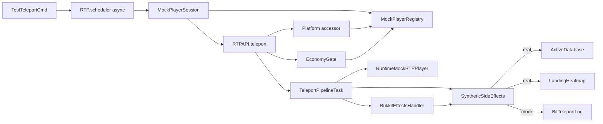
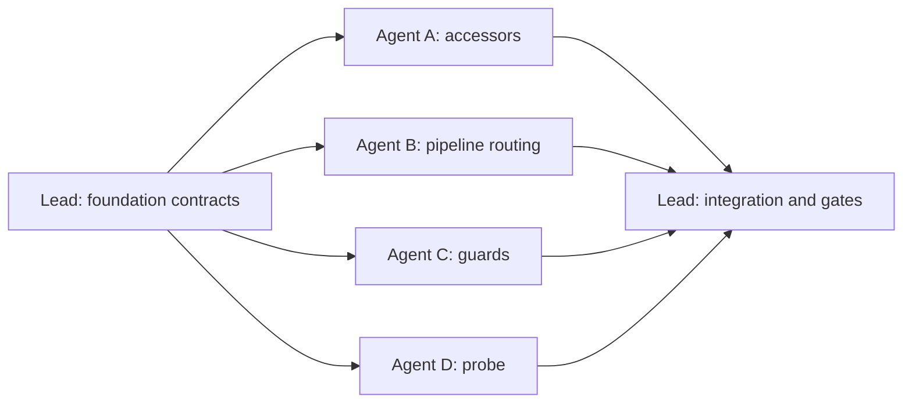

# Requirements

### Overview & Goals
ADR-121 BIT probes need to run a **real teleport pipeline** (real region selection, real async chunk I/O) for a **synthetic player**, without leaving persistent traces and without claiming the platform teleport was exercised. `RuntimeMockRTPPlayer` and `MockPlayerRegistry` already exist in `rtp-core/common/mock`, but no platform accessor consults the registry, so `RTPAPI.teleport(mockUuid, …)` returns `PLAYER_OFFLINE` today.

Pre-flight (guidelines):
- **Platforms:** Bukkit/Spigot/Paper (`AbstractServerAccessor`), Folia (`AbstractFoliaServerAccessor`), Fabric (`FabricServerAccessor`), NeoForge (`NeoForgeServerAccessor`).
- **Thread context:** the probe runs off-main through `RTP.scheduler().runTaskAsynchronously`. Registry lookups are lock-free and safe from any thread. Folia `runTaskForPlayer` already falls back to the global scheduler for non-Folia players.
- **Chunk I/O:** unchanged. Selection still does real async loads (S-005), so the probe is `HEAVY`, never `SAFE`.
- **Governing ADRs:** ADR-121 (sections 10 and 11), ADR-104 (the `LandingHeatmap` must not be polluted), ADR-072 and ADR-115 (pipeline context only).
- **Safety rules:** S-002, S-004 and S-005 apply. S-007 does not, because BIT output is developer diagnostics (ADR-121 section 11).
- **D-005:** this tab plus Technical Design form the proposal. Code starts only after approval.

### Scope
**In scope**
1. All four accessors resolve registered mocks in `getPlayer(UUID)`, `getPlayer(String)` and `getSender(UUID)`. Mocks are excluded from `getOnlinePlayers()` and `getOnlinePlayerNames()`.
2. A lifetime helper, `MockPlayerSession`, owns each mock: create, register, run, then unregister and purge session state in `finally`. Names are `rtp-bit-<8 hex>`.
3. A pipeline-side side-effect gate, `SyntheticSideEffects`, plus guards in `EconomyGate`, `RTPTeleportCancel.refund`, `RTPCommandEvents` and `BukkitEffectsHandler`. Each guard has its own test.
4. A new IBIT component `teleport` (`/rtp test teleport`, `HEAVY`), with codes in the TEST block 3200-3299. Every run adds the `TEST_TELEPORT_MOCKED` INFO finding.
5. A bounded in-memory `BitTeleportLog` that exposes the recorded landings (world, x, y, z, region, attempts, duration) as data only.

**Out of scope**
- Suppressing addon-registered `TeleportPipelineTask` hook lists, because core's own `isRunning` hooks live in the same lists.
- Heatmap rendering.
- Disconnect-midflight scenarios that use `setOnline(false)`.
- Fabric/NeoForge `/rtp test` subcommand wiring. The component registers with `RtpBit.RUNNER` wherever its class loads.
- Routing `sendMessage(UUID, …)` to mocks. These calls are dropped at FINE, as they are today.

### User Stories
- As a BIT author, I want to teleport a synthetic player through the real pipeline so that I can verify region selection end to end on a live server.
- As an operator, I want BIT runs to leave no cooldowns, history, usage-cap counts, economy charges, heatmap landings or plugin events behind.
- As a report reader, I want every teleport-probe report to state that the platform teleport was mocked.
- As a future heatmap consumer, I want structured access to the probe's recorded destinations.

### Functional Requirements
- **FR-1 Lookup:** accessors return the registered mock before any native lookup. With no mocks registered, the behaviour is unchanged.
- **FR-2 Naming:** mock names match `rtp-bit-[0-9a-f]{8}`, 16 characters. The `-` is illegal in Minecraft names, so a mock can never collide with a real player.
- **FR-3 Lifetime:** `MockPlayerSession.close()` always unregisters the mock and purges its `TeleportSessions` entries, even when the probe body throws.
- **FR-4 No persistence:** for a mock UUID the pipeline shall not call:
  - `DatabaseAccessor.cacheValue(TeleportData)`
  - `TeleportLimitStore.recordSuccess`
  - `RTP.updateSharedLastTeleportTime`
  - `LandingHeatmap.record`
- **FR-5 No economy:** `EconomyGate.charge` returns `Charge(ALLOWED, 0.0)` without calling `bal` or `take` when the payer is a mock. Refunds to mocks are skipped.
- **FR-6 No events:** for mocks, Bukkit `callEvent` in `BukkitEffectsHandler` (Pre/Post Setup, Load and Teleport events) and the `RTPCommandEvents` success/fail fan-out are not fired.
- **FR-7 Pass criterion:** the probe passes when:
  - the mock's `setLocation` was reached;
  - after the API future completes, `processingPlayers` no longer contains the mock;
  - `MemoryTracker.trackedCountByLabel("TeleportData-" + uuid) == 0`.
- **FR-8 Honesty:** every report includes the INFO finding `TEST_TELEPORT_MOCKED`, including failed runs.
- **FR-9 Data:** each mock landing is appended to `BitTeleportLog` (bounded, newest wins) and can be read with `snapshot()`.

### Non-Functional Requirements
- No raw threads; all work goes through `RTP.scheduler`. No blocking `.get()` on main or region threads.
- S-002: the probe adds no chunk tickets of its own. The pipeline's reservations close on every exit path.
- S-004: every probe failure becomes an ERROR finding and is logged through `RTP.log`. Nothing is swallowed.

# Technical Design

### Current Implementation
- `rtp-core/.../common/mock/MockPlayerRegistry`: a static `ConcurrentHashMap` with `register`, `unregister`, `get`, `getByName`, `isMock` and `clear`. Only `MockPlayerRegistryTest` uses it.
- `RuntimeMockRTPPlayer`: `setLocation` stores the location, logs `[MOCK]` and completes `true`. `hasPermission` is always `true`, which bypasses cooldown, delay and lock. `setOnline(false)` is available.
- Accessors resolve players natively only:
  - `AbstractServerAccessor` (lines 277-307)
  - `AbstractFoliaServerAccessor` (176-200)
  - `FabricServerAccessor` (514-530, 714)
  - `NeoForgeServerAccessor` (242-282)
- Teleport entry: `RTP.teleportDelegate` (`RTP.java` ~265) calls `serverAccessor.getPlayer(uuid)`, `EconomyGate.charge`, then `TeleportPipelineTask`.
- Side-effect sinks in `TeleportPipelineTask`:
  - `finishTeleport`: `ActiveDatabase.accessor().cacheValue` (lines 1156 and 1186) and `RTP.updateSharedLastTeleportTime` (1168).
  - `setLocation` callback: `LandingHeatmap.record` (1211) and `teleportLimitStore().recordSuccess` (1232).
  - `completeDeathTeleport`: the same calls again (1326 and 1333).
- Events:
  - `BukkitEffectsHandler.setupEffects` calls `Bukkit.getPluginManager().callEvent` in six pipeline hooks.
  - `BukkitCommandEvents` republishes `RTPCommandEvents.fireSuccess` and `fireFail`.
- Probe precedents:
  - `TestChunkTicketCmd`: `BitCode` registration in `RtpBitCodes.TEST`, a `BitComponent` on `RtpBit.RUNNER`, and `ProbeBitReport.Builder`.
  - `TestEventsCmd`: `TestSemaphore`, `ActiveTestJobs` and `runTaskAsynchronously`.
  - Registration point: `rtp-plugin` `TestCmd.addSubCommand`.
- `BitRunner.run` blocks its caller (`FutureTask.get`), so it must be called from an async thread.

### Key Decisions
1. **Pipeline-side gate (user choice).** One rtp-core class, `common/mock/SyntheticSideEffects`, keyed on `MockPlayerRegistry.isMock(uuid)`, wraps each sink. `TeleportPipelineTask` calls the gate instead of the sinks. The persistence modules (`DatabaseAccessor`, `TeleportLimitStore`, `LandingHeatmap`) stay unaware of mocks. A source test stops new direct sink calls in `TeleportPipelineTask`.
2. **Event guard scope: platform bus plus command events (user choice).** Guards go in `BukkitEffectsHandler` (`callEvent` only; effects already no-op because `resolveBukkitPlayer` returns null) and in `RTPCommandEvents`. Pipeline hook lists are not split.
3. **Teleport probe registered now (user choice).** `TestTeleportCmd` is an IBIT `HEAVY` component with id `teleport` and subsystem `test.teleport`, so group selectors never run it (ADR-121 section 11).
4. **Mock-first lookup in accessors, excluded from online lists.** The registry is empty in production, so this is a single map miss. Excluding mocks from the online lists keeps `@a`-style targeting and action `FOR_EACH` away from them.
5. **Landing data is captured by the gate.** `SyntheticSideEffects.recordLanding` diverts mock landings from `LandingHeatmap` to `BitTeleportLog`. It records the pipeline's own `TeleportData.attempts` and `processingTime`, so the numbers are what the pipeline measured rather than a probe-side estimate.
6. **Probe drives `RTPAPI.teleport(uuid, RtpTarget.region(name))`.** This is the same entry addons use. Its completion is the terminal cleanup (REQ-RTP-S-004), which is the right moment for the leak check.

### Proposed Changes
- **Accessors (4 files).** In each `getPlayer(UUID)`, `getPlayer(String)` and `getSender(UUID)`, return `MockPlayerRegistry.get(...)` or `getByName(...)` first when it is non-null. Filter `MockPlayerRegistry::isMock` out of `getOnlinePlayers()` and `getOnlinePlayerNames()` where these are overridden.
- **`TeleportPipelineTask`.** Replace the sink calls in `finishTeleport`, the `setLocation` callback and `completeDeathTeleport` with `SyntheticSideEffects.*`. Ordering, null checks and S-004 logging stay as they are. In-memory session writes (`processingPlayers`, `regionTeleportTimes`, `invulnerablePlayers`) stay, because the pipeline needs them. `MockPlayerSession` purges them afterwards.
- **`EconomyGate.charge`.** Before the balance check: `if (MockPlayerRegistry.isMock(payerId)) return new Charge(ALLOWED, 0.0);`.
- **`RTPTeleportCancel.refund`.** Skip the refund when the target is a mock.
- **`RTPCommandEvents.fireSuccess` / `fireFail`.** Return early when `player`, or `sender` for fail, is a registered mock.
- **`BukkitEffectsHandler`.** Wrap each `callEvent` in `if (SyntheticSideEffects.publishesEvents(task.player()))`. For mocks, `PreSetupTeleportEvent` is not fired, so the event-driven cancellation cannot happen.
- **`RuntimeMockRTPPlayer`.** Add a thread-safe list of `setLocation` calls (`destinations()`, `setLocationCount()`) and a `teleportFuture()` that completes on the first `setLocation`.
- **`TestTeleportCmd`.**
  - Parameters: `region=<name>` (default `default`), `count=<1..16>` (default 1), `json=true`.
  - `onCommand` acquires `TestSemaphore`, registers an `ActiveTestJobs` job and hops to `RTPRuntime.scheduler().runTaskAsynchronously`. It then calls `RtpBit.RUNNER.run(COMPONENT.withCheck(...), Runnable::run)` and emits through `BitTableOutput` or `ProbeBitReport.emitJson`.
  - Each mock runs sequentially inside a `MockPlayerSession`. The initial location is `(0, 64, 0)` in the region's world.

### Data Models / Contracts
```java
// rtp-core common/mock
public final class MockPlayerSession implements AutoCloseable {
  public static final String NAME_PREFIX = "rtp-bit-";
  /** Creates rtp-bit-<8hex> mock at initial, registers it. initial must be non-null. */
  public static MockPlayerSession open(RTPLocation initial);
  public RuntimeMockRTPPlayer player();
  /** Idempotent: unregister + purge TeleportSessions maps/sets + usageCaps for uuid. Never throws. */
  @Override public void close();
  /** register -> body -> close() in finally. */
  public static <T> T with(RTPLocation initial, Function<RuntimeMockRTPPlayer, T> body);
}

public final class SyntheticSideEffects {
  public static boolean isSynthetic(UUID id);              // MockPlayerRegistry.isMock
  public static boolean publishesEvents(RTPPlayer p);      // !isSynthetic(p.uuid())
  public static void persistTeleportData(UUID id, TeleportData d);   // -> ActiveDatabase.accessor().cacheValue
  public static void recordLimitUse(UUID id, long uses, long resetMs, long now); // -> teleportLimitStore
  public static void recordSharedLastTeleport(UUID id, long epochMs);  // -> RTP.updateSharedLastTeleportTime
  /** Real: LandingHeatmap.record. Mock: BitTeleportLog.append(...). */
  public static void recordLanding(UUID id, String region, RTPLocation at, TeleportData d);
}

public record MockTeleportRecord(UUID mockId, String world, int x, int y, int z,
    String region, long attempts, long durationMillis, long completedAtMillis) {}

public final class BitTeleportLog {           // bounded ring, CAPACITY = 4096
  public static void append(MockTeleportRecord r);
  public static List<MockTeleportRecord> snapshot(); // immutable copy, oldest first
  public static List<MockTeleportRecord> forRegion(String region);
  public static void clear();
}
```
BIT codes (TEST namespace, block 3200-3299, owner `test.teleport`):

| Id | Key | Level |
|----|-----|-------|
| 3201 | `TEST_TELEPORT_MOCKED` | INFO (always emitted) |
| 3202 | `TEST_TELEPORT_UNAVAILABLE` (no accessor, region or world) | ERROR |
| 3203 | `TEST_TELEPORT_REJECTED` (`RTPResult` not SUCCESS) | ERROR |
| 3204 | `TEST_TELEPORT_SET_LOCATION_NOT_REACHED` | ERROR |
| 3205 | `TEST_TELEPORT_PROCESSING_LEAK` (`processingPlayers` still holds the mock) | ERROR |
| 3206 | `TEST_TELEPORT_TRACKER_LEAK` (`TeleportData-<uuid>` still tracked) | ERROR |
| 3207 | `TEST_TELEPORT_TIMEOUT` (per-mock await of 60 s) | ERROR |

Finding paths: `teleport.mock`, `teleport.setLocation`, `teleport.processingPlayers`, `teleport.memoryTracker`, `teleport.result`.

### Architecture Diagram

How it fits together: the command hops to an async thread and opens a session, which registers the mock. `RTPAPI.teleport` resolves the mock through the accessor and runs the real pipeline. At each persistence sink the pipeline asks `SyntheticSideEffects`, which diverts mock landings into `BitTeleportLog`. After the future completes, the probe checks for leaks and the session closes.

### File Structure
- **New in `rtp-core/src/main/java/io/github/dailystruggle/rtp/common/`:**
  - `mock/MockPlayerSession.java`
  - `mock/SyntheticSideEffects.java`
  - `mock/MockTeleportRecord.java`
  - `mock/BitTeleportLog.java`
  - `commands/test/TestTeleportCmd.java`
- **Modified in `rtp-core`:**
  - `mock/RuntimeMockRTPPlayer.java`
  - `tasks/teleport/TeleportPipelineTask.java`
  - `tasks/teleport/RTPTeleportCancel.java`
  - `economy/EconomyGate.java`
  - `commands/base/RTPCommandEvents.java`
- **Modified platform accessors:**
  - `platforms/rtp-bukkit/rtp-bukkit-common/.../server/AbstractServerAccessor.java`
  - `platforms/rtp-folia/rtp-folia-common/.../server/AbstractFoliaServerAccessor.java`
  - `platforms/rtp-fabric/rtp-fabric-common/.../server/FabricServerAccessor.java`
  - `platforms/rtp-neoforge/rtp-neoforge-common/.../server/NeoForgeServerAccessor.java`
- **Modified in `rtp-plugin`:**
  - `bukkit/effects/BukkitEffectsHandler.java`
  - `bukkit/commands/test/TestCmd.java` (`addSubCommand(new TestTeleportCmd(this))`)
- **Docs:**
  - ADR-121 section 11: add a mock-player probe paragraph and the `teleport` 3200-3299 block.
  - `docs/dev/TRACEABILITY.md` rows.
  - `CHANGELOG.md`.

### Risks
- **Async entry into `RTPAPI.teleport`.** For mocks, the accessor short-circuits before any Bukkit call. The rest of the delegate schedules through `RTP.scheduler`. I will verify that no main-thread-only call is reached from the async caller, and stop and report if one is.
- **`RTPArchitectureTest` blocking rule.** That test exempts some `Test*Cmd` classes. The probe awaits only on the async thread with bounded timeouts. If the rule flags it, an exemption is added with a stated reason, matching the existing `TestChunkTicketCmd` entry.
- **`hasPermission == true`.** Mocks bypass cooldown, delay, lock and `rtp.free`. This is intended for probes. Region permission gates also pass.
- **Residual in-memory state.** The delayed `invulnerablePlayers.remove` from `runTaskLater` may fire after purge. It is harmless because it is idempotent.
- **Addon pipeline hooks still see mocks** (out of scope). For example, the Countdown addon `setupPreActions`. Recorded in the Out of Scope list.
- **Stale `.bak` / dirty files.** Code files that are dirty in git get a `.bak` before editing, per the backup policy. They are deleted once verified.

# Testing

### Validation Approach
Write the failing test first for each behaviour (Gate 1) and record the before/after results. Run targeted module tests per stage. Because this is a cross-module change, finish with `./gradlew build` and `python3 scripts/agent-gate.py`. Devstack acceptance is not required: no proxy or network protocol is touched. Test names and `@DisplayName`s cite ADR-121 and REQ IDs, never process notes.

### Key Scenarios
- **Accessor lookup** (per platform):
  - A registered mock is returned by `getPlayer(UUID)`, `getPlayer(name)` (case-insensitive) and `getSender(UUID)`.
  - It is absent from `getOnlinePlayers()` and `getOnlinePlayerNames()`.
  - After unregister, lookups fall back to native behaviour.
  - Test files:
    - `BukkitServerAccessorTest` (MockBukkit)
    - `FabricServerAccessorPlayerLookupTest`
    - new `FoliaServerAccessorMockLookupTest`
    - new `NeoForgeServerAccessorMockLookupTest`
- **`MockPlayerSessionTest`:**
  - Names match `rtp-bit-[0-9a-f]{8}`.
  - Unregister happens in `finally` even when the body throws.
  - `close()` is idempotent and purges the `TeleportSessions` entries.
- **`SyntheticSideEffectsTest`** (one test per guard):
  - Mock UUID: there is no `cacheValue` (recording `DatabaseAccessor` stub), no `recordSuccess` (recording `TeleportLimitStore`) and no shared-time write. `LandingHeatmap.total(region)` is unchanged and `BitTeleportLog` gains one record with the right fields.
  - Real UUID: every sink is called exactly once.
- **`EconomyGateMockPayerTest`:** with a recording `RTPEconomy`, a mock payer gets `Charge(ALLOWED, 0.0)` and `bal` and `take` are never called. A real payer is still charged.
- **`RTPTeleportCancelRefundMockTest`:** no `give` for a mock.
- **`RTPCommandEventsMockTest`:** subscribers are not invoked for a mock player or sender, and are invoked for a real one.
- **`BukkitEffectsHandlerMockEventsTest`** (`rtp-plugin`, MockBukkit):
  - A counting listener for the Pre/Post Setup, Load and Teleport events sees zero events when the hooks run for a mock task, and sees events for a real player.
  - If building a task is impractical, the test targets the extracted `publishesEvents` gate together with a hook invocation.
- **`TeleportPipelineSinkSourceTest`:** a source scan fails if `TeleportPipelineTask` calls any of these directly:
  - `ActiveDatabase.accessor().cacheValue`
  - `teleportLimitStore().recordSuccess`
  - `LandingHeatmap.record`
  - `RTP.updateSharedLastTeleportTime`
- **`TestTeleportCmdTest`** (`rtp-core`, `RTPTestSetup` and mock world/scheduler):
  - A successful run is `HEALTHY` with exactly one INFO `TEST_TELEPORT_MOCKED`, `setLocationCount == 1`, no leak findings and one `BitTeleportLog` record.
  - The registry is empty afterwards.

### Edge Cases
- An unknown region produces `TEST_TELEPORT_UNAVAILABLE` (ERROR) plus `TEST_TELEPORT_MOCKED`, and the mock is still unregistered.
- A pipeline rejection (e.g. `RELOADING`) produces `TEST_TELEPORT_REJECTED` and `MOCKED`.
- A simulated stuck pipeline (`setLocation` never completes) produces `TEST_TELEPORT_TIMEOUT` and `SET_LOCATION_NOT_REACHED`. `close()` still runs.
- A planted `processingPlayers` entry or tracked `TeleportData-<uuid>` produces the respective leak ERROR. This proves that a wrong implementation fails the test (Gate 5).
- Component metadata: `HEAVY` and IBIT, so `tier=ibit` and `all` do not select it, while selecting it by name does.
- `ProbeBitReportTest` extension: 3201-3207 lie in the TEST namespace and do not collide.
- A `count` outside 1..16 is rejected by the parameter validator.
- `/rtp test teleport region=default json=true` is dispatched through `TreeCommand.onCommand(..., String[] args, ...)`, per the ADR-121 grammar rule.

### Test Changes
- Extend: `BukkitServerAccessorTest`, `FabricServerAccessorPlayerLookupTest`, `MockPlayerRegistryTest` (destination recording), `ProbeBitReportTest`, `TestCmdPlatformSplitTest` if it enumerates subcommands.
- Add: the new test classes listed above.
- Add `TRACEABILITY.md` rows for each new test.

# Team Plan

### Overview
The work is split among a lead and four implementer agents. The lead first lands the shared `common/mock` contracts. Three tracks then run in parallel, because they touch disjoint files. The probe track starts once the contracts exist and runs its end-to-end tests after the other tracks merge. The lead integrates the tracks, writes the docs and runs the full gates.

### Roles and File Ownership
Each file has exactly one owner, so parallel agents never edit the same file.

| Agent | Track | Owns (write access) |
|-------|-------|---------------------|
| Lead | Foundation, integration, docs | `mock/MockPlayerSession`, `mock/SyntheticSideEffects`, `mock/MockTeleportRecord`, `mock/BitTeleportLog`, `mock/RuntimeMockRTPPlayer`, their tests, ADR-121, `TRACEABILITY.md`, `CHANGELOG.md` |
| Agent A | Accessors | the four platform accessors and their lookup tests |
| Agent B | Pipeline routing | `TeleportPipelineTask`, `TeleportPipelineSinkSourceTest` |
| Agent C | Economy and event guards | `EconomyGate`, `RTPTeleportCancel`, `RTPCommandEvents`, `BukkitEffectsHandler` and their four tests |
| Agent D | Probe | `TestTeleportCmd`, `rtp-plugin` `TestCmd`, `TestTeleportCmdTest`, the `ProbeBitReportTest` extension, any `RTPArchitectureTest` exemption |

### Coordination Rules
- **Contracts are frozen after the foundation stage.** If a track needs a change to `SyntheticSideEffects` or `MockPlayerSession`, it asks the lead instead of editing those files.
- **Shared docs belong to the lead.** Each track hands its `TRACEABILITY.md` rows and changelog notes to the lead as text and does not edit those files.
- **Every track follows the same rules:** failing test first, `.bak` for dirty code files it owns, `RTP.scheduler` only, no commits, and no destructive git operations.
- **Gradle:** agents run only targeted module tests. The wrapper's built-in locks serialize runs that share `:rtp-core`, so agents wait for those locks and never stop daemons. Only the lead runs `./gradlew build` and `agent-gate.py`.
- **Hand-off evidence:** each track reports the commands it ran, before/after test results and the files it changed. Every changed file must be one the track owns.
- **ADR refresh:** each agent re-reads ADR-121 sections 10 and 11 before starting its track.

### Dependency Graph

Agent D builds the probe and its unit tests in parallel with the other tracks. Its end-to-end success scenario only passes once A's accessor lookup and B's landing routing are in place, so the lead re-runs that test during integration.

# Delivery Steps

### ✓ Step 1: Lead - land the shared mock contracts
The `common/mock` contracts exist and are tested, so the four tracks can build against them.

- `RuntimeMockRTPPlayer`: add a thread-safe `destinations()`, `setLocationCount()` and `teleportFuture()`.
- `MockPlayerSession`:
  - `open(initial)` creates an `rtp-bit-<8hex>` name and registers the mock.
  - `with(initial, body)` always calls `close()` in `finally`.
  - `close()` is idempotent: it unregisters and purges the `TeleportSessions` maps, sets and `usageCaps` for the UUID.
- Add `SyntheticSideEffects` (full real/mock routing per the contract), `MockTeleportRecord` and the bounded `BitTeleportLog`.
- Failing tests first:
  - `MockPlayerSessionTest`
  - extended `MockPlayerRegistryTest`
  - `SyntheticSideEffectsTest` (one case per sink, mock vs real)
- Verify with `./gradlew :rtp-core:test --tests "*MockPlayer*"` and `--tests "*SyntheticSideEffects*"`.
- Freeze the contracts and hand the four track briefs to Agents A-D.

### ✓ Step 2: Agent A (parallel) - wire MockPlayerRegistry into all platform accessors
All four accessors resolve registered mocks first and leave them out of online-player lists, with a test per platform.

- Failing tests first:
  - extend `BukkitServerAccessorTest` and `FabricServerAccessorPlayerLookupTest`
  - add Folia and NeoForge lookup tests
- Mock-first lookup in `getPlayer(UUID)`, `getPlayer(String)` and `getSender(UUID)` of:
  - `AbstractServerAccessor`
  - `AbstractFoliaServerAccessor`
  - `FabricServerAccessor`
  - `NeoForgeServerAccessor`
- Filter `MockPlayerRegistry::isMock` from `getOnlinePlayers()` and `getOnlinePlayerNames()` where overridden.
- Create a `.bak` for any dirty code file first.
- Verify with `./gradlew :<platform-common>:test` for each touched module.
- Hand the lead the evidence and the `TRACEABILITY.md` rows.

### ✓ Step 3: Agent B (parallel) - route TeleportPipelineTask sinks through the gate
The pipeline routes every persistence sink through `SyntheticSideEffects`, and mock landings go to `BitTeleportLog` instead of `LandingHeatmap`.

- In `TeleportPipelineTask` (`finishTeleport`, the `setLocation` callback and `completeDeathTeleport`), replace these with gate calls:
  - `cacheValue`
  - `recordSuccess`
  - `updateSharedLastTeleportTime`
  - `LandingHeatmap.record`
- Keep the existing ordering and S-004 logging.
- Failing test first: `TeleportPipelineSinkSourceTest`, a source scan that forbids direct sink calls.
- Run the existing `TeleportPipelineTask*Test` suites as regression.
- Hand the lead the evidence and the `TRACEABILITY.md` rows.

### ✓ Step 4: Agent C (parallel) - guard economy and event fan-out for mocks
Mocks never touch the real economy and never publish plugin or command events.

- `EconomyGate.charge`: a mock payer gets `Charge(ALLOWED, 0.0)` before `bal` or `take`.
- `RTPTeleportCancel.refund`: skip for mocks.
- `RTPCommandEvents.fireSuccess` / `fireFail`: return early for a mock player or sender.
- `BukkitEffectsHandler`: gate every `callEvent` on `SyntheticSideEffects.publishesEvents(task.player())`.
- Failing tests first:
  - `EconomyGateMockPayerTest`
  - `RTPTeleportCancelRefundMockTest`
  - `RTPCommandEventsMockTest`
  - `BukkitEffectsHandlerMockEventsTest` (MockBukkit counting listener)
- Verify with `./gradlew :rtp-core:test --tests "*EconomyGate*"`, `--tests "*RTPTeleportCancel*"`, `--tests "*RTPCommandEvents*"` and `./gradlew :rtp-plugin:test --tests "*Effects*"`.
- Hand the lead the evidence and the `TRACEABILITY.md` rows.

### ✓ Step 5: Agent D (parallel) - register the HEAVY teleport BIT probe
`/rtp test teleport` runs real-pipeline teleports for mocks and reports setLocation, leak checks and `TEST_TELEPORT_MOCKED`.

- Register `TEST` codes 3201-3207 in `TestTeleportCmd`.
- Register a `BitComponent("teleport", "test.teleport", IBIT, HEAVY, 120_000, ...)` on `RtpBit.RUNNER`.
- Parameters: `region`, `count` (1..16) and `json`.
- Command flow:
  - acquire `TestSemaphore` and register an `ActiveTestJobs` job;
  - hop to `RTP.scheduler().runTaskAsynchronously`;
  - run each mock in a `MockPlayerSession`;
  - call `RTPAPI.teleport` with a bounded 60 s await;
  - check for leaks (`processingPlayers`, `TeleportData-<uuid>` tracker);
  - always add the `MOCKED` INFO finding.
- Output goes through `BitTableOutput` or `ProbeBitReport.emitJson`.
- Add `TestTeleportCmd` to `rtp-plugin` `TestCmd`.
- Tests:
  - `TestTeleportCmdTest`: success, unknown region, rejection, timeout and planted leaks.
  - Selector exclusion.
  - Parser-level grammar test.
  - `ProbeBitReportTest` namespace assertions.
- If `RTPArchitectureTest` flags the class, add an exemption with a stated reason.
- The end-to-end success scenario may stay red until Steps 2 and 3 land. Report it as pending rather than weakening the assertion.
- Hand the lead the evidence and the `TRACEABILITY.md` rows.

### ! Step 6: Lead - integrate the tracks, update the docs and run the full gates
All tracks are merged, the docs reflect the mock-player probe, and the cross-module change passes full verification.

- Check that each track changed only the files it owns.
- Re-run `TestTeleportCmdTest` (including the end-to-end success scenario) and `TeleportPipelineSinkSourceTest`.
- ADR-121 section 11: add a mock-player probe paragraph covering:
  - the registry-backed accessors;
  - the guard list;
  - the always-on `TEST_TELEPORT_MOCKED`;
  - the `teleport` 3200-3299 block.
- `docs/dev/TRACEABILITY.md`: rows for each new test.
- `CHANGELOG.md`: a net-delta entry.
- Run `./gradlew build`, `python3 scripts/agent-gate.py` and `sh .git/hooks/pre-commit` (mojibake, process-note and `.bak` checks).
- Delete verified `.bak` files.
- No commits.