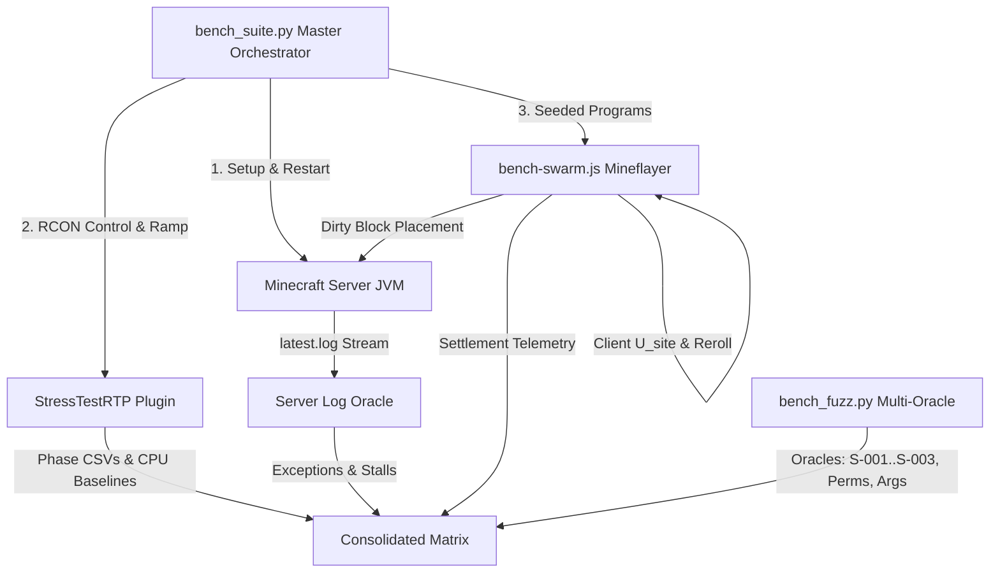

# Requirements

### Overview & Goals
The objective is to consolidate three distinct performance and stability instruments into a single, unified behaviour-test suite for RTP (`LeafRTP`) and its competitors:
1. **Throughput Harness (`helpers/StressTestRTP`):** Measures saturated and paced teleports/sec, latency distributions, chunk loads, and CPU usage.
2. **Behaviour Fuzzer (`scripts/bench_fuzz.py` + `devstack/clients/bench-swarm.js`):** Generates seeded bot interaction programs with coverage guidance, automated replay, delta-debugging shrink, and `direct` differential controls.
3. **Player Utility Model (`docs/dev/PLAYER_TAXONOMY_VALUATION.md`):** Formulates site valuation $\mathcal{U}_{\text{site}}$, settlement yields, wasted chunk ratios, and spatial Clark-Evans $R$ dispersion.

Rather than relying on a single scalar or raw teleport counts, the consolidated suite evaluates plugins across multi-axis vectors directly impacting server stability and player retention, measuring the true system cost **per settled player**.

### Agreed Architectural Principles
- **Cost per Settled Player:** Server CPU and chunk loads are amortized over accepted settlements rather than raw `/rtp` invocations.
- **Strict Methodological Equivalence:** Competitors are measured under identical world states, terrain seeds, hardware, and clean JVM restarts per target.
- **Release Independence:** Independent of LeafRTP 3.3.0 release gating.
- **Public Discretion:** Public reporting remains strictly self-focused and does not publish competitor exploit triggers or vulnerability details; security defects are reported privately per `SECURITY.md`.
- **Modelled Weights:** Valuation weights are mathematically modelled with published fixed seeds.
- **Accurate Verdict Phrasing:** Fuzzing results are reported as "not found within budget", never "leak-free".

### Scope
#### In Scope
- **Prerequisite Tooling Fixes:**
  - Fix `StressTestRTP` ramp idle baseline CPU reporting -1 by adding missing delegation in `RecorderProxy`.
  - Validate Spark thread selector regex matching for multi-thread capture.
  - Fix `net_leak()` scoring in `scripts/bench_fuzz.py` to score in bytes net of control rather than penalizing unmodeled instance counts.
  - Decouple replay and shrink iterations from the planned `--episodes` search budget.
- **Competitor Coverage Matrix Updates:**
  - Update Folia 26.2 paced table in `RESULTS.md` to record BetterRTP (pruned/failed) and JakesRTP (unsupported on Folia with reason).
  - Mark historical 26.1 benchmarks.
  - Complete HuskHomes screening evaluation in `LEAK_FUZZING.md`.
- **New Multi-Oracle Behaviour Fuzzing:**
  - Server-log oracle (uncaught exceptions, Bukkit event errors, can't-keep-up warnings with package attribution).
  - Least-privilege bot profile and denied-action table.
  - Argument grammar and echo injection (unicode, negative/NaN, format codes, selectors, MiniMessage tags).
  - Stall and resource amplification oracle (MSPT spikes, chunk load bursts per command).
  - Server-side safety invariants ($S\text{-}001$ to $S\text{-}003$, quit/rejoin pending teleport clearing, cooldown retention).
- **Homesteader Utility Bot:**
  - Autonomous Mineflayer bot evaluating $\mathcal{U}_{\text{site}}$, executing reroll cascades until $\mathcal{U} \ge \theta$, placing a dirtying block, and disconnecting cleanly.
  - Telemetry emitting attempts, chunks loaded, main-thread CPU ms per settlement, wasted chunk ratios, and Clark-Evans $R$.
- **Unified Master Runner (`scripts/bench_suite.py`):**
  - Consolidated execution across targets (`direct`, `LeafRTP`, `BetterRTP`, `JakesRTP`, `HuskHomes`, `EzRTP`, `JustRTP`).
  - Tiered execution: `--tier smoke` for fast CI verification and `--tier nightly` for full matrix generation.
  - Documentation update relabeling "leak fuzzing" to "behaviour fuzzing".

#### Out of Scope
- Jazzer parser fuzz targets (RESP protocol, editor JSON, YAML, Anvil decoders), which belong to standalone Jazzer CI (RTP-21, RTP-28).
- Full client-side survival bots (pathfinding, tree chopping, mob combat).
- Automated PR gating for 3.3.0 release.

### Functional Requirements
- **FR-001 (Ramp Idle Baseline):** `StressTestRTP` shall record valid non-negative process and tick CPU readings during the idle calibration window before ramp stages commence.
- **FR-002 (Byte-Scale Leak Scoring):** `bench_fuzz.py` shall compute leak scores based on net byte deltas (live object bytes and post-GC heap) relative to the `direct` control.
- **FR-003 (Budget Decoupling):** Replay and shrink phases shall operate under independent execution budgets without decrementing the planned exploration episode count.
- **FR-004 (Structured Oracle Finding Schema):** Every detected anomaly across all oracles shall emit a JSON finding containing `class`, `severity`, `witness_program`, `attributed_plugin`, and `evidence`.
- **FR-005 (Least-Privilege Validation):** Swarm bots shall execute with standard non-OP LuckPerms permissions; any execution of unpermitted actions or administrative overrides shall flag a denial failure.
- **FR-006 (Homesteader Valuation):** The Homesteader bot shall compute client-side $\mathcal{U}_{\text{site}}$ using local block/biome scans and trigger rerolls when $\mathcal{U}_{\text{site}} < \theta$.
- **FR-007 (Dirty Chunk Signaling):** Upon accepted settlement, the bot shall issue a block placement packet to mark the chunk dirty and record the coordinate.
- **FR-008 (Multi-Axis Matrix Output):** The consolidated runner shall output a markdown and JSON comparison table reporting throughput, tick stability, cost per settled player, retained memory, log findings, denial failures, stall amplification, and safety invariants.

# Technical Design

### Current Implementation
- `helpers/StressTestRTP`:
  - `Runner.java` initiates an idle calibration window (`beginIdleCalibration`/`harvestIdleCalibration`) using `recorder.cpuSampler()`.
  - In `StressTestRTPPlugin.java`, the active recorder is wrapped in an inner `RecorderProxy` class that forwards callbacks to the per-run `MetricsRecorder`.
  - `RecorderProxy` fails to override `cpuSampler()` and `setNextPhaseIdleBaseline()`, causing `cpuSampler()` to return `null` and leaving CPU numbers at `-1.0` during ramp runs.
- `scripts/bench_fuzz.py`:
  - `net_leak()` scores target-specific instances missing from the control using fallback noise `1.0`, creating false-positive spikes for harmless plugin instances.
  - The main search loop (`while spent < self.a.episodes`) charges surprise replays and shrinks against the planned discovery budget.
- `devstack/clients/bench-swarm.js`:
  - Bots currently receive wildcard permissions (`*`) via LuckPerms default group.
  - Bot actions are restricted to movement, waiting, quitting, rejoining, and dying, with no block inspection or placement capabilities.

### Key Decisions
1. **Master Orchestrator Pipeline (`scripts/bench_suite.py`):**
   - Centralizes suite orchestration in a master Python runner driving the server via RCON and `bench-swarm.js` via local JSON IPC.
   - Executes target runs in clean isolate phases (restart with single jar, baseline calibration, throughput ramp, multi-oracle fuzzer, homesteader utility evaluation).
2. **Hybrid Client-Server Valuation:**
   - The Mineflayer bot evaluates local blocks/biomes client-side for site utility $\mathcal{U}_{\text{site}}$ and manages the reroll cascade.
   - The server harness (`StressTestRTP`) and server logs independently verify chunk load deltas, main-thread CPU, and server-side safety invariants ($S\text{-}001..S\text{-}003$).
3. **Decoupled Fuzzer Budgets:**
   - Planned episodes (`--episodes N`) dictate discovery exploration.
   - Replays on surprise (`--replay-budget R`) and delta-debugging shrinks (`--shrink-budget S`) operate on isolated quotas.
4. **Byte-Based Net Fuzz Scoring:**
   - Score formulas scale by byte magnitude rather than raw instance count, preventing single small object allocations from dominating the rank score over large heap leaks.

### Proposed Changes
#### 1. `helpers/StressTestRTP`
- Add missing forwarders to `RecorderProxy` in `StressTestRTPPlugin.java`:
  ```java
  @Override public CpuSampler cpuSampler() {
      MetricsRecorder r = plugin.recorder();
      return r != null ? r.cpuSampler() : super.cpuSampler();
  }
  @Override public void setNextPhaseIdleBaseline(IdleBaseline baseline) {
      super.setNextPhaseIdleBaseline(baseline);
      MetricsRecorder r = plugin.recorder();
      if (r != null) r.setNextPhaseIdleBaseline(baseline);
  }
  ```
- Verify `SparkHook.java` glob regex mapping (`DEFAULT_THREADS = "Server thread,RTP-Anvil-IO-*"`) captures samples across both tick and pool threads.
- Expose safety validation hooks or lightweight commands to assert chunk ticket releases and arrival block safety.

#### 2. `scripts/bench_fuzz.py`
- Modify `net_leak()` to score based on net byte growth:
  - Extract live bytes from histograms and post-GC heap measurements.
  - Use target-specific variance scaling or attribute-only tracking for classes absent in the `direct` control.
- Decouple replay and shrink budgets from the planned episode loop.
- Implement new oracles:
  - `ServerLogOracle`: Inspects server log lines during and after episodes; flags stack traces, Bukkit listener errors, and tick watchdogs; attributes to plugins by stack package matching.
  - `LeastPrivilegeOracle`: Ensures bots run under standard permissions; flags unexpected command execution.
  - `GrammarInjectionOracle`: Fuzzes command parameter syntax (unicode, huge numbers, NaN, format codes, MiniMessage tags).
  - `StallAmplificationOracle`: Measures MSPT spikes and chunk allocations per bot action.
  - `SafetyInvariantOracle`: Verifies destination block safety ($S\text{-}001$), chunk ticket cleanup ($S\text{-}002$), claim boundary adherence ($S\text{-}003$), and cooldown state across disconnects.

#### 3. `devstack/clients/bench-swarm.js`
- Implement least-privilege permission profile configuration and denied-action tracking.
- Add client-side block inspection (`bot.findBlock` / column scanner) and atomic block placement action (`place_settlement`).
- Calculate Homesteader landing utility:
  $$\mathcal{U}_{\text{homestead}} = 0.95 \cdot D_{\text{isolation}} + 0.85 \cdot B_{\text{aesthetic}} + 0.80 \cdot T_{\text{flat}} - 1.0 \cdot \mathbb{I}_{\text{defaced}} - 0.90 \cdot H_{\text{hazard}}$$
- Handle reroll cascades by sending subsequent `/rtp` dispatches until $\mathcal{U} \ge \theta$ or limit is reached.

#### 4. `scripts/bench_suite.py` (New Master Runner)
- Coordinates target lifecycles: clean restart, jar isolation, baseline calibration, throughput ramp, behaviour fuzzing, and homesteader evaluation.
- Supports `--tier smoke` (fast CI sanity run) and `--tier nightly` (full multi-seed evaluation).
- Synthesizes findings and metrics into markdown and JSON multi-axis comparison tables.

### Architecture Diagram


### Data Models / Contracts
#### Oracle Finding Schema
```json
{
  "finding_id": "FIND-20261012-001",
  "class": "UNCAUGHT_EXCEPTION",
  "severity": "HIGH",
  "witness_program": [
    {"a": "rtp"},
    {"a": "wait", "ms": 500},
    {"a": "quit"}
  ],
  "attributed_plugin": "BetterRTP",
  "evidence": {
    "log_snippet": "java.lang.NullPointerException at com.betterrtp...",
    "chunk_coords": [1024, -512],
    "reproducibility": "3/3"
  }
}
```

#### Homesteader Settlement Telemetry
```json
{
  "bot": "homesteader_01",
  "target": "LeafRTP",
  "settled": true,
  "attempts_taken": 1,
  "settlement_utility": 0.885,
  "settlement_pos": {"x": 12450, "y": 72, "z": -8920},
  "chunks_loaded": 28,
  "main_thread_ms": 11.2,
  "wasted_chunks": 0
}
```

### File Structure
- `helpers/StressTestRTP/src/main/java/io/github/dailystruggle/helpers/stresstestrtp/StressTestRTPPlugin.java` (Modify `RecorderProxy`)
- `helpers/StressTestRTP/src/main/java/io/github/dailystruggle/helpers/stresstestrtp/SparkHook.java` (Validate thread glob selector)
- `helpers/StressTestRTP/RESULTS.md` (Update competitor matrix, add Folia status for BetterRTP/JakesRTP, mark 26.1 historical)
- `helpers/StressTestRTP/LEAK_FUZZING.md` (Relabel to behaviour fuzzing, document new oracles and findings)
- `scripts/bench_fuzz.py` (Update `net_leak()`, budget isolation, integrate oracles)
- `scripts/bench_suite.py` (New consolidated runner)
- `scripts/tests/test_bench_fuzz.py` (Add oracle and budget test fixtures)
- `devstack/clients/bench-swarm.js` (Add least-privilege profiles, block placement, Homesteader utility logic)
- `docs/dev/POTENTIAL_BUGS.md` (Update resolved entries)

### Relevant ADRs & Requirements
- **Rule D-005:** Propose multi-class/cross-module architecture changes before code modification.
- **ADR-001:** Archimedean spiral 1D coordinate mapping and spatial dispersion guarantees.
- **ADR-015:** Stale-chunk guard, count-bound pipes, and asynchronous chunk pre-filtering.
- **ADR-016:** Anvil region-file parsing and safety pre-filter subsystem.
- **ADR-080:** Opt-in simulation benchmark tier.
- **ADR-091:** Headless Mineflayer protocol client driver architecture.
- **Prohibitions S-001 to S-005:** Safe destination validation, chunk ticket release, claim isolation, unswallowed failures, and async chunk loading.
- **REQ-RTP-F-013:** Configurable user-facing messaging.

### Risks & Mitigations
- **Risk:** Server log buffer overflow or asynchronous log latency dropping finding attribution.
  - *Mitigation:* Tail `latest.log` with file offset tracking and flush before episode boundary checkpoints.
- **Risk:** Mineflayer bot connection storms triggering server connection throttling.
  - *Mitigation:* Preserve global connect spacing (`--join-delay-ms`) and reuse established bot sessions where appropriate.
- **Risk:** Competitor plugin instability crashing the test server mid-suite.
  - *Mitigation:* Enforce strict sub-process timeout wrappers, capture crash reports in witness records, and perform clean JVM restart per target.

# Testing

### Validation Approach
Verification follows a tiered strategy proportional to scope, adhering to `TESTING_GUIDE.md`:
1. **Targeted Unit Tests:**
   - Java harness: Targeted test execution on `StressTestRTP` (`CpuSamplerTest`, `SparkHookTest`, `RunnerTest`).
   - Python test suite: `python3 -m unittest scripts/tests/test_bench_fuzz.py` for scoring, budget decoupling, and oracle detection.
2. **Synthetic Planted-Bug Verification:**
   - Planted log errors (mock plugin throwing runtime exception on quit) verified against `direct` differential.
   - Planted permission bypass verified against denied-action table.
   - Planted unsafe landing block verified against $S\text{-}001$ oracle.
3. **Smoke Tier Verification:**
   - Execute `bench_suite.py --tier smoke --targets direct,rtp` locally to confirm end-to-end orchestration, data collection, and report formatting.

### Key Scenarios
- **Scenario 1: Ramp Idle Baseline CPU Validation:**
  - Run `rtpstress ramp` with idle window; verify `ramp idle baseline` logs non-negative CPU cores (`main CPU >= 0`, `proc CPU >= 0`) and phase CSV contains populated `net_*` columns.
- **Scenario 2: Fuzzer Noise Scoring Calibration:**
  - Inject 10,000 harmless target-specific objects totalling 0.3 MB; assert that score does not exceed a 5 MB/rep leak candidate.
- **Scenario 3: Budget Separation:**
  - Run `bench_fuzz.py` with surprise replays triggered; assert that all planned exploration episodes run to completion and replay count matches `--replay-budget`.
- **Scenario 4: Homesteader Settlement & Reroll:**
  - Deploy Homesteader bot to ocean/hazard landing; verify immediate `/rtp` reroll dispatch.
  - Deploy bot to scenic plains landing; verify settlement block placement, disconnect, and emission of settlement metrics.
- **Scenario 5: Multi-Oracle Finding Attribution:**
  - Run fuzzer against target throwing in event handler; verify finding record with severity `MEDIUM`/`HIGH`, attributed plugin name, and witness program.

### Edge Cases
- Bot disconnected by network hiccup during settlement evaluation (must count as transient retry, not plugin failure).
- Target plugin disables command during reload (must be captured as availability finding rather than test harness crash).
- Zero valid settlement sites within search radius (must terminate gracefully at max attempt budget).
- Server restart hangs due to competitor shutdown hook (handled via process timeout and `kill -9` cleanup).

# Task Checklist

### Implementation Checklist
- [ ] **Phase 1: Prerequisite Tooling Fixes & Coverage Matrix**
  - [ ] 1.1 Implement missing `RecorderProxy` forwarders in `StressTestRTPPlugin.java` (`cpuSampler`, `setNextPhaseIdleBaseline`).
  - [ ] 1.2 Verify non-zero sample capture in `SparkHookTest`.
  - [ ] 1.3 Fix `net_leak()` in `scripts/bench_fuzz.py` to evaluate net byte growth against control.
  - [ ] 1.4 Add decoupled `--replay-budget` and `--shrink-budget` options in `scripts/bench_fuzz.py`.
  - [ ] 1.5 Update `RESULTS.md` Folia 26.2 paced table (BetterRTP, JakesRTP) and mark 26.1 rows historical.
  - [ ] 1.6 Update `LEAK_FUZZING.md` with HuskHomes screening verdict.
- [ ] **Phase 2: Log & Least-Privilege Behaviour Oracles**
  - [ ] 2.1 Implement server-log watcher and package attributor in `scripts/bench_fuzz.py`.
  - [ ] 2.2 Configure least-privilege LuckPerms profile and denied-action table in `devstack/clients/bench-swarm.js`.
  - [ ] 2.3 Add planted-bug tests in `scripts/tests/test_bench_fuzz.py`.
  - [ ] 2.4 Relabel documentation from "leak fuzzing" to "behaviour fuzzing".
- [ ] **Phase 3: Argument Injection, Stall, and Safety Invariant Oracles**
  - [ ] 3.1 Implement argument grammar and echo injection oracle in `bench_fuzz.py`.
  - [ ] 3.2 Implement MSPT stall and chunk amplification oracle.
  - [ ] 3.3 Implement $S\text{-}001..S\text{-}003$ safety invariant and quit/rejoin state oracles.
  - [ ] 3.4 Add test cases verifying invariant detection.
- [ ] **Phase 4: Homesteader Utility Bot & Settlement Metrics**
  - [ ] 4.1 Implement client-side $\mathcal{U}_{\text{site}}$ valuation in `bench-swarm.js`.
  - [ ] 4.2 Implement reroll cascade loop on $\mathcal{U}_{\text{site}} < \theta$.
  - [ ] 4.3 Implement settlement block placement packet and chunk dirtying signal.
  - [ ] 4.4 Emit settlement metrics (attempts, chunks, CPU ms per settlement, wasted chunk ratio, Clark-Evans $R$).
- [ ] **Phase 5: Consolidated Master Runner & Reporting**
  - [ ] 5.1 Implement `scripts/bench_suite.py` orchestrating all phases and targets.
  - [ ] 5.2 Add `--tier smoke` and `--tier nightly` execution modes.
  - [ ] 5.3 Implement multi-axis markdown/JSON comparison matrix generation.
  - [ ] 5.4 Update `POTENTIAL_BUGS.md` with resolution notes.

# Delivery Steps

### ✓ Step 1: Fix prerequisite tooling and update competitor coverage matrix
Ramp idle CPU measurement is operational, spark thread selector is verified, leak scoring measures byte growth net of control, replay/shrink budgets are decoupled, and competitor coverage matrices are updated.

- Update `RecorderProxy` in `helpers/StressTestRTP/.../StressTestRTPPlugin.java` to forward `cpuSampler()` and `setNextPhaseIdleBaseline()`, enabling non-negative idle baseline CPU values and populating `net_*` columns in phase CSVs.
- Verify `SparkHook.buildStartCommand` thread glob regex matching with a targeted test in `SparkHookTest` confirming non-zero sample thread capture.
- Modify `net_leak()` and score computation in `scripts/bench_fuzz.py` to evaluate net byte growth (histogram live bytes and post-GC heap) rather than unscaled counts of target-specific instances missing from the control.
- Introduce decoupled `--replay-budget` and `--shrink-budget` parameters in `scripts/bench_fuzz.py` so verification passes do not consume the planned `--episodes` discovery budget.
- Update `helpers/StressTestRTP/RESULTS.md` Folia 26.2 paced table to explicitly include BetterRTP (pruned/failed) and JakesRTP (unsupported on Folia), mark 26.1 rows as historical, and record HuskHomes screening status in `LEAK_FUZZING.md`.

### * Step 2: Implement server-log and least-privilege oracles
The fuzzer intercepts server log exceptions and enforces least-privilege permission validation with a denied-action table.

- Add a server-log oracle to `scripts/bench_fuzz.py` capturing log streams via RCON or log polling, detecting uncaught exceptions, 'Could not pass event', and 'can't keep up' warnings, attributed to plugins by package prefix.
- Implement a least-privilege LuckPerms bot profile with a denied-action table in `devstack/clients/bench-swarm.js` to ensure unprivileged accounts cannot trigger admin commands or bypass limits.
- Add planted-bug synthetic tests in `scripts/tests/test_bench_fuzz.py` verifying detection and attribution of log errors and unauthorized command executions against the direct control.
- Emit structured finding records following the shared schema `(class, severity, witness_program, attributed_plugin, evidence)`.

###   Step 3: Implement argument injection, stall, and safety invariant oracles
Fuzzer tests command argument robustness, detects MSPT/chunk amplification stalls, and asserts server-side safety invariants.

- Add an argument grammar and echo injection oracle in `scripts/bench_fuzz.py` and `bench-swarm.js` testing unicode, negative/NaN numbers, format codes, selectors, and MiniMessage click tags.
- Implement a stall and amplification oracle measuring MSPT spikes, chunk load surges, and CPU consumption per attacker action relative to the direct baseline.
- Implement server-side safety invariant oracles asserting S-001 (no unsafe landing block), S-002 (no orphaned force-loaded chunks), S-003 (no claim boundary intrusion), quit/rejoin pending teleport cancellation, and cooldown preservation on relog.
- Add unit/harness test coverage for each new oracle with synthetic fault injection in `scripts/tests/test_bench_fuzz.py`.

###   Step 4: Implement Homesteader utility bot and settlement metrics
Mineflayer bots calculate client-side site utility U_site, perform reroll cascades, place an anchoring settlement block, and report settlement resource metrics.

- Implement client-side terrain evaluation in `devstack/clients/bench-swarm.js` to score arrival locations against the Homesteader utility model $U_{site}$ (evaluating flatness, aesthetic biomes, human defacement, and hazards).
- Implement the reroll cascade loop: bots below the acceptance threshold $\theta$ re-dispatch `/rtp` until satisfied or reaching max attempts.
- Add an atomic block placement action upon accepted settlement to mark the chunk dirty (`ChunkAccess.setUnsaved(true)`) and disconnect the bot cleanly.
- Emit settlement metrics per bot run: attempts per settlement, chunks loaded per settlement, main-thread CPU ms per settlement, wasted chunk ratio, and Clark-Evans R landing dispersion.

###   Step 5: Consolidate master runner, documentation, and reporting
A master orchestrator executes end-to-end multi-target benchmark runs across smoke and nightly tiers and generates a consolidated multi-axis comparison table.

- Implement the master test runner in `scripts/bench_suite.py` orchestrating throughput ramps, multi-oracle behaviour fuzzing, and Homesteader settlement evaluation for all targets (`direct`, `LeafRTP`, `BetterRTP`, `JakesRTP`, `HuskHomes`, `EzRTP`, `JustRTP`).
- Configure execution tiers: a fast `--tier smoke` for CI pull requests and an in-depth `--tier nightly` for full competitor evaluation.
- Generate unified comparison tables outputting per-plugin vectors across throughput, tick stability, cost per settled player, retained memory, exception logs, permission failures, and safety findings (using 'not found within budget' wording for fuzz verdicts).
- Relabel 'leak fuzzing' to 'behaviour fuzzing' across `LEAK_FUZZING.md`, README, and related documentation.