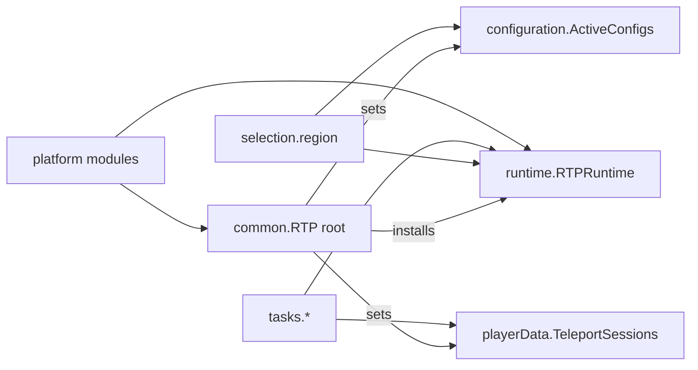

# Requirements

### Overview & Goals
`common.RTP` is the only class in package `common`, and it accounts for **31 of the 38** mutual package pairs left in compiled `rtp-core`. I measured this with `jdeps -verbose:class` after the RTP-67 `tools` step: 66 packages depend on `common`, and `common` depends on 34. Every one of these cycles comes from a domain package reading an `RTP` static.

The goal is to dissolve the hub, ADR-115 seam 4. Domain packages would reach services through a Tier 1 context holder and through slots owned by each package. `RTP` then stays purely as the composition root, which wires everything at startup.

### Scope
**In scope (waves 1-3, as you chose):**
- **Wave 1:** the platform services `log`, `serverAccessor`, `scheduler` and `economy`.
- **Wave 2:** `configs`, `factoryMap` and the `factoryNames` enum.
- **Wave 3:** `selectionAPI`, `metrics`, `actionManager`, and the runtime state reached through `getInstance()`.
  - That state is `latestTeleportData`, `processingPlayers`, `scanTasks`, `databaseAccessor`, `invulnerablePlayers`, `queuedPlayers`, `teleportLimitStore`, `misc*Tasks` and `priorTeleportData`.
  - It also covers the death-teleport and network hook fields.
- **Callers outside `rtp-core`:** the Bukkit, Fabric and NeoForge modules and `rtp-plugin` are rewritten wherever they read or write a field that moves.
- **Enforcement:** an ArchUnit rule saying no `rtp-core` class except `RTP` itself depends on `common.RTP`.

**Out of scope:**
- Mutual pairs that don't involve `common`, such as `selection.region` with `selection`, `playerData`, `database`, `claim` and `cache`. Those stay with RTP-67.
- Constructor injection everywhere. New code may take an `RTPContext`, but existing call sites move to the holder.
- Any behaviour change (ADR-115 invariant 3).

### Functional Requirements
- Runtime behaviour does not change. That includes log buffering and the JUL fallback before the accessor is set, the order in which services are installed, and what is returned before init. Today the fields are simply `null` until set, and they stay that way.
- `RTP.log(..)` stays as a delegating facade, because platform modules and addon docs call it 1,000+ times. Each field that moves becomes a holder accessor; I won't keep a duplicate field in `RTP`.
- After wave 3, `jdeps` reports 0 packages, other than `common`, that depend on `common`, and the mutual-pair count drops by up to 31.
- `:rtp-core:test` stays green, including all `RTPArchitectureTest` rules. Every touched platform module compiles, main and test sources.

# Technical Design

### Current Implementation
- `RTP.java` (2,188 lines) holds public mutable statics:
  - `selectionAPI` (l.60), `factoryMap` (l.62), `configs` (l.73), `serverAccessor`, `scheduler` and `economy` (l.95-97), `metrics` (l.174), `worldContext`/`regionContext` (l.176-177), `baseCommand` and `reloading` (l.185-186).
  - Plus `log(..)` with a pending-log buffer (l.1950-2005), `getInstance()` (l.1903), and the `factoryNames` enum (l.2181).
- How often domain code reads them (uses/files in `rtp-core`, excluding `RTP`): `log` 1116/177, `serverAccessor` 633/129, `configs` 344/80, `getInstance` 246/49, `scheduler` 162/56, `selectionAPI` 145/40, factories 83/16.
- The `getInstance()` state with the most readers: `latestTeleportData` 52, `processingPlayers` 35, `scanTasks` 28, `databaseAccessor` 28.
- Precedent from this session: `Region.setTaskDispatcher`, `MemoryTracker.setRegionSource` and `ConfigReloadLifecycle` are slots owned by their package that `RTP`'s static init fills. This plan applies the same pattern at scale.

### Key Decisions
1. **Tier 1 context holder (your choice).** A new package `common.runtime` holds:
   - an interface `RTPContext`;
   - a static holder `RTPRuntime`, which `RTP` installs.

   `runtime` may depend only on `rtp-api` and the JDK. It therefore holds only services whose types come from `rtp-api`: logging, `RTPServerAccessor`, `RTPScheduler` and `RTPEconomy`.
2. **Services typed by a core class get a slot in the package that owns the type.** If `RTPRuntime` returned `Configs`, `runtime` would depend on `configuration`. `configuration` logs through `runtime`, so that would create a new cycle. So each such service gets its slot next to its type:
   - `configuration.ActiveConfigs`
   - `factory.FactoryRegistry` and `factory.FactoryNames`
   - `selection.ActiveSelection`
   - `metrics.CoreMetrics.instance()`

   This is the decision that refines the option you picked.
3. **Runtime state moves to the package that owns it**, not into a context object:
   - `playerData.TeleportSessions`: `latestTeleportData`, `priorTeleportData`, `processingPlayers`, `queuedPlayers`, `invulnerablePlayers`
   - `tasks.scan.ScanTasks` (`scanTasks`; this also removes `common<->tasks.scan`)
   - `database.ActiveDatabase` (`databaseAccessor`, `teleportLimitStore`)
   - `tasks.tick.MiscTasks` (`misc*Tasks`)
   - `tasks.teleport.DeathTeleports` (`deathEffectInFlight`, `pendingDeathTeleports`)
   - `network.NetworkHooks`
4. **Mechanical rewrite** with one-off scripts in `scripts/tmp/`, the same way as the `FailTypes` and `PlaceholderProvider` moves. Each script rewrites `RTP.<member>` to the new accessor, fixes imports, and covers main and test sources across `rtp-core`, `platforms/**` and `rtp-plugin`. The scripts are deleted afterwards.
5. **The log gate is injected.** `loggingParserUnavailable()` reads config state, so `RTPRuntime` takes a `BooleanSupplier` buffering gate, which `RTP` installs. That keeps `runtime` free of `configuration`.

### Data Models / Contracts
```java
package io.github.dailystruggle.rtp.common.runtime;
public interface RTPContext {
  RTPServerAccessor serverAccessor(); // null before platform enable (current semantics)
  RTPScheduler scheduler();
  RTPEconomy economy();
  void log(Level level, String msg);
  void log(Level level, String msg, Throwable t);
}
public final class RTPRuntime {          // static ambient holder, volatile slots
  public static RTPContext context();
  public static void log(Level l, String m);              // buffering + JUL fallback moved from RTP
  public static RTPServerAccessor serverAccessor();
  public static void setServerAccessor(RTPServerAccessor a);
  public static RTPScheduler scheduler();
  public static void setScheduler(RTPScheduler s);
  public static void setLogBufferGate(BooleanSupplier gate);
  public static void flushPendingLogs();
}
```
The slots owned by individual packages follow one shape, e.g. `ActiveConfigs.get()` / `ActiveConfigs.set(Configs)`.

### Architecture Diagram

The arrows only point away from `RTP`. Domain packages reach services through `runtime` or through the owning package's slot, and nothing inside `rtp-core` points back at `RTP`.

### Risks
- **Wide diff:** about 180 files in wave 1 alone. Mitigation: each wave is a separate stage; I compile, run the architecture tests and run `jdeps` after each one.
- **Platform writes:** platform entry points that assign `RTP.serverAccessor = ...` must switch to the setters. Install order stays the same.
- **Visibility:** the fields are currently plain non-`volatile` statics. Making the slots `volatile` is strictly safer, and I'll note it in the change.
- **Dirty file:** `RTP.java` already has uncommitted edits, so I'll make a `.bak` copy first.
- **Gradle locks:** another agent's run can hold the locks. I'll wait for the wrapper mutex and never stop someone else's run.
- **Qodana baseline:** `.qodana/baseline.sarif.json` line numbers will drift, the same way they did after the earlier moves.

# Testing

### Validation Approach
- After each wave I'll run:
  - `.\gradlew.bat :rtp-core:compileTestJava`, then the targeted tests for the touched packages;
  - `jdeps` on `rtp-core/build/classes/java/main`, to report the mutual-pair count and which packages still depend on `common`.
- At the end I'll run:
  - all of `:rtp-core:test`;
  - `compileJava`/`compileTestJava` for `rtp-bukkit-common`, `rtp-fabric-common`, `rtp-neoforge-common` and every other touched platform module;
  - `:rtp-plugin:compileJava` and `compileLiteJava`.

### Key Scenarios
- `RTPRuntimeTest`:
  - before an accessor is set, logging goes to JUL;
  - while the gate is closed, FINE logs are buffered, and the buffer is capped at the existing limit;
  - `flushPendingLogs` replays to the accessor in order.
- The existing tests stay green, including `RTPArchitectureTest`, `RegionTaskDispatcherTest`, `RegionTicketCensusTest`, `MemoryTrackerTest`, `ScanTaskTest` and the config reload tests.

### Test Changes
- `RTPTestSetup` and the mock fixtures switch from writing `RTP` fields to calling the holder setters.
- `RTPArchitectureTest` gets two new rules:
  - **Rule 20:** `common.runtime..` depends on nothing else in `rtp-core`.
  - **Rule 21:** no `rtp-core` class outside `io.github.dailystruggle.rtp.common` (root) depends on `common.RTP`. This is added in the final stage, and it would fail on today's code.

### Edge Cases
- Static-init order: `RTP`'s static init must fill the slots before the existing `Region.setTaskDispatcher` and `MemoryTracker.setRegionSource` calls.
- Code paths that run before platform enable, and `RTP.stop()` after a failed enable, must still log without throwing an NPE.

# Delivery Steps

### * Step 1: Wave 1: Tier 1 runtime holder for log, accessor, scheduler, economy
Domain packages no longer read `RTP.log`, `RTP.serverAccessor`, `RTP.scheduler` or `RTP.economy`; they go through `common.runtime.RTPRuntime`.
- Make a `.bak` of the dirty `RTP.java`.
- Add `common/runtime/RTPContext.java`, `RTPRuntime.java` and `package-info.java`.
- Move the pending-log buffer, the JUL fallback and `flushPendingLogs` from `RTP` into `RTPRuntime`, and inject the buffering gate as a `BooleanSupplier`.
- `RTP.log(..)` and `RTP.flushPendingLogs()` become one-line delegates.
- Replace the `RTP` fields with holder setters and getters.
- Rewrite call sites in `rtp-core`, `platforms/**` and `rtp-plugin` (main and test sources) with a one-off `scripts/tmp` script, then delete the script.
- Update `RTPTestSetup` and the mock fixtures.
- Add `RTPRuntimeTest` and Rule 20 (`runtime` has no core dependencies).
- Verify:
  - compile `rtp-core` and the touched platform modules;
  - run `RTPArchitectureTest` and the targeted tests;
  - report the mutual-pair count from `jdeps`.

###   Step 2: Wave 2: owned slots for configs and factories
`configs`, `factoryMap` and `factoryNames` are reached through their own packages, not through `RTP`.
- Add `configuration.ActiveConfigs` (get/set), which `RTP` sets wherever it assigns `configs` today, including during reload.
- Move the `RTP.factoryNames` enum to `factory.FactoryNames`, keeping the constant order.
- Add `factory.FactoryRegistry`, which holds the `EnumMap`.
- Rewrite the call sites repo-wide with a script and update fixtures.
- Verify:
  - compile all touched modules;
  - run the config reload tests, factory and shape tests, and `RTPArchitectureTest`;
  - report the `jdeps` pair count.

###   Step 3: Wave 3a: selection, metrics and action services
`selectionAPI`, `metrics`, `actionManager`, `regionContext`/`worldContext` and the remaining service statics move to the packages that own them.
- Add `selection.ActiveSelection`, which holds the `SelectionAPI` instance.
- Add `CoreMetrics.instance()`, plus a slot for the action and trigger managers.
- Move the thread-local region and world context next to `selection.region`.
- Move `networkCommandHook`, `networkBridgeFactory` and `backendStateSamplerFactory` to `network.NetworkHooks`.
- Rewrite the call sites repo-wide with a script and update fixtures.
- Verify by compiling, running the targeted tests and `RTPArchitectureTest`, and reporting the `jdeps` pair count.

###   Step 4: Wave 3b: runtime state out of the RTP instance
Nothing in `rtp-core` other than `RTP` calls `RTP.getInstance()` or uses `RTP` as a type.
- Add `playerData.TeleportSessions`, which holds `latestTeleportData`, `priorTeleportData`, `processingPlayers`, `queuedPlayers` and `invulnerablePlayers`.
- Add `tasks.scan.ScanTasks`, `database.ActiveDatabase` (accessor and limit store), `tasks.tick.MiscTasks` and `tasks.teleport.DeathTeleports`.
- `RTP` creates these at the same points as today and keeps its shutdown order in `stop()`.
- Update `RegionTicketCensus`, `RegionTaskCoordinator`, `lifecycle` and `tasks.teleport` to use the new owners.
- Rewrite the call sites repo-wide with a script and update fixtures.
- Verify by running all of `:rtp-core:test`, compiling every touched module, and reporting the `jdeps` pair count.

###   Step 5: Lock in the result with an ArchUnit rule and docs
A build-failing rule prevents the `common` hub from coming back.
- Add Rule 21 to `RTPArchitectureTest`: no `rtp-core` class outside package `common` depends on `common.RTP`.
- Run all of `:rtp-core:test`, `:rtp-plugin:compileJava` and `compileLiteJava`.
- Run `jdeps` and record the final count of mutual pairs and of packages depending on `common`.
- Update the RTP-67/RTP-68 entries in `POTENTIAL_BUGS.md` with the measured result (Linear owns status).
- Add a short note to ADR-115 seam 4 about the holder pattern, and add `TRACEABILITY.md` rows for the new tests.
- Delete the `.bak` files and the scratch scripts.