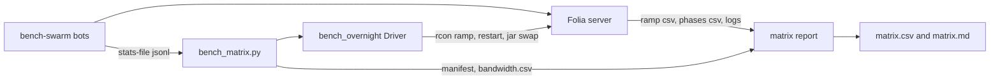

# Requirements

### Overview & Goals
Run every Folia-capable rtp competitor on `~/threadripper-dir/folia/26.2` **one at a time** (only the target's jar enabled, server restarted between targets). For each run, gather timings, server cost, bandwidth and server-log findings. Output one per-plugin table that is comparable within a single run.

This fills the Folia gaps listed in RTP-36 (the Folia paced table has no BetterRTP or JakesRTP row). The earlier Folia Test B (`20261008-052141`) used `sequence` with all RTP jars loaded together. EzRTP and BetterRTP errors in it may have been confounded by co-loaded plugins.

### Scope
**In scope**
- Targets: `direct` (plugin-free control), `rtp` (LeafRTP 3.3.0), `huskhomes`, `justrtp`, `ezrtp`, `betterrtp`, and `jakesrtp` (expected to be refused by Folia; recorded as "unsupported").
- Workload per target (chosen): a paced ramp at 5 TP/s for ~820 s (about 4,096 teleports, same as Test B), then a short ladder `10,20,40 @ 60 s` to find the stress point.
- Bandwidth measured bot-side as wire bytes (chosen): `socket.bytesRead` and `bytesWritten` summed over bots.
- Server-log findings per target window: Folia watchdog stalls, off-thread chunk errors, plugin-attributed stack traces.
- Orchestration by a new wrapper that reuses `bench_overnight.py`'s Driver (chosen).

**Out of scope**
- Paper rerun, leak fuzzing, and the utility/Homesteader bot.
- Publishing results or editing the front page. Self-focused policy applies: nothing goes public from this run without a separate decision.
- Changing any competitor's configuration beyond what the 26.2 Paper run already used.

### Functional Requirements
1. One command runs the full target list unattended and resumes safely. It records an outcome per target: `finished`, `unsupported-not-loaded`, `crashed-recovered`, `not-started`, `timed-out`.
2. Isolation: each target's run is preceded by a jar swap and restart, and the loaded RTP plugin set is verified (already done by `Driver.jar_set_ok`). A wrong set is never measured.
3. Per target and per stage, the report contains:
   - achieved TP/s, success rate, and latency p50/p95/p99/max (from the ramp CSV and `phases.csv`);
   - region CPU and process CPU per attempt, chunks per attempt, GC pause, and regional TPS min/avg;
   - **bandwidth**: server-to-client MB and MB per successful teleport, net of the idle baseline measured in the ramp's idle window;
   - log findings: watchdog stall count and max stall, first plugin error line, and counts of plugin-attributed exceptions.
4. The `direct` row is reported as the floor for bandwidth and cost.
5. Wording: a failure is reported as "failed on this rig, this config" with the first error line. Nothing is reported as a bug in the competitor beyond what the log shows.

### Non-Functional Requirements
- n=1 per target on one rig. The report states this, and a rerun flag exists (`--passes`).
- Stdlib-only Python, per the `scripts/` convention. Node changes limited to `bench-swarm.js`.

# Technical Design

### Current Implementation
- `scripts/bench_overnight.py` already provides RCON, per-target jar enable/disable (`set_jars`), restart through `restart` (spigot `restart-script`), plugin-set verification (`jar_set_ok`), and `run_ramp` polling `rtpstress status`, with a manifest CSV. It has no Folia profile, no bandwidth, and no log scan.
- Harness (`helpers/StressTestRTP`): `/rtpstress ramp <target> <secs> <rates>` writes `<stamp>-ramp.csv`, `-ramp-summary.txt` and `-phases.csv` under `plugins/StressTestRTP/runs/`. Phase labels look like `betterrtp@ramp0-5tps` and carry start and end epoch ms. Folia is detected automatically (`Sched.isFolia()`, `FoliaRegionMonitor`, region-thread CPU in `CpuSampler`).
- `devstack/clients/bench-swarm.js` runs the bot roster across forked workers and prints a stats line every `--stats-interval-s`. It has no byte counters. `minecraft-protocol` clients expose `client.socket` (a `net.Socket`), so `bytesRead` and `bytesWritten` are wire-level.
- The Folia server staged at `folia/26.2` already has `folia-26.2.jar`, `start.sh`, `restart-script: ./start.sh`, game port 25577, RCON 25585, view distance 4, simulation distance 2, `online-mode=false`, and the same `StressTestRTP/config.yml` as the Paper dir. All 6 competitor jars and `StressTestRTP` are in `plugins/`.
- The server dir is a mount on this machine. The server runs elsewhere, so only RCON, the mounted files, and the bots' own counters are reachable.

### Key Decisions
| Decision | Choice | Rationale |
|---|---|---|
| Orchestration | New `scripts/bench_matrix.py` that imports `bench_overnight.Driver` | Reuses the tested restart and wrong-plugin guards without growing `bench_overnight.py`. |
| Workload | Paced 5 TP/s (~820 s), then `10,20,40 @ 60` ladder | Equal-work cost comparison matching Test B, plus a stress point per plugin. |
| Bandwidth source | Bot-side socket bytes, written to a stats file | Independent of server topology. Wire bytes include compression. |
| Bandwidth sync | Driver reads the stats file on its own clock at every poll | Avoids clock skew between the bot host and the server. At a 1 s file interval, the error on an 820 s stage is under 1%. |
| Log attribution | Slice `logs/latest.log` and rotated logs by target window | Restarts rotate the log. The window comes from the manifest, so each plugin is attributed to its own run. |
| Unsupported plugins | Try one load with 0 retries, then record `unsupported-not-loaded` | JakesRTP has no `folia-supported` in `plugin.yml`. The default 2 restart retries would waste minutes. |

### Architecture Diagram

### Proposed Changes
1. **`devstack/clients/bench-swarm.js`**: add `--stats-file <path>`. Each worker appends one JSON line per `--stats-file-interval-s` (default 1): `{t, w, rx, tx, online}`. `rx` and `tx` are cumulative bytes for the worker, including closed sockets (accumulated on `end`/`close`, so reconnects don't reset the total). The existing stats line also prints `rx_mb` and `tx_mb`. Default behaviour is unchanged when the flag is absent.
2. **`scripts/bench_matrix.py`** (new):
   - A `folia` profile: target list, rounds `5@820` and `10,20,40@60`, the unsupported list (`jakesrtp`), and `--server-dir`, `--host`, `--swarm-stats` arguments.
   - Runs each (target, round) through `Driver.restart(target)` then `Driver.run_ramp`. While a ramp runs it polls the stats file every poll and appends `(driver_time, rx, tx, online)` to `bandwidth.csv`. It writes the manifest with the target, round, wall window, outcome and run stamp.
   - Before the first target it prints a preflight: server jars, RCON reachable, swarm online count, swarm stats file advancing, and free disk. It aborts on any failure.
3. **`scripts/bench_matrix_report.py`** (new, also callable from the wrapper): reads the manifest, each run's `-ramp-summary.txt` and `-phases.csv`, `bandwidth.csv`, and the server logs. It writes `matrix.csv` (long form: target, stage, metric, value) and a `matrix.md` table. The log scan counts these patterns:
   - `Tick region .* has not responded` and its duration;
   - `Cannot retrieve chunk asynchronously`;
   - `Could not pass event` and `Exception` blocks, attributed to a plugin by package prefix (the same prefixes as `jfr-allocation.tracked-packages`).
   Bandwidth net of baseline is `(rx during stage - idle_rate x stage_seconds) / successes`, where `idle_rate` comes from the ramp's idle window.
4. **Docs**: a short section in `helpers/StressTestRTP/README.md` (Folia matrix procedure). If it is new methodology, also an entry in `RESULTS.md` only after a run exists.

### Folia readiness checklist (done in the first stage, before any full run)
- **Copy finished**: `folia/26.2` is still being copied (the directory scan was timing out). Confirm the world, `plugins/*` data dirs, and `server.properties` are complete.
- **Ports**: swarm `--port 25577`; driver uses RCON 25585 from `server.properties`.
- **Jakes**: Folia should refuse to load JakesRTP (no `folia-supported`). If it loads, run it like the others.
- **Spark**: no spark jar is in `folia/26.2/plugins` and `spark.enabled: false`. Make profiling optional (`--spark`). Folia threads are `Folia Region Scheduler Thread #N`, so the configured `spark.threads` of `Server thread,RTP-Anvil-IO-*` needs checking in the smoke run. The spark thread selector is also an open `POTENTIAL_BUGS.md` item. Default is off for the first matrix run.
- **View-distance cap**: `ramp.player-view-distance` is Paper-only. Folia uses the server's 4/2 for every target, so all targets are treated the same.
- **`/restart`** on Folia: confirm it relaunches through `start.sh` in the smoke run.
- **`direct` target**: `rtpstress tp {player}` has to work from console on Folia.
- **Per-plugin config parity** with the Paper 26.2 run (cooldowns zero, centre and radius 16k). Hash each config before and after a run to detect BetterRTP's known config revert on shutdown (`PRE_WRITEUP.md`, section 7).

### Risks
- **Bot ceiling**: 48 bots at 5 TP/s is below the harness limit, but a plugin that is slow on Folia may still show `HARNESS_SATURATED`. The ramp summary records this, and the report prints it.
- **Bandwidth noise**: reconnects after kicks add join chunk bursts. The idle baseline and the `online` column from the stats file make that visible. A run with kicks during the stage is flagged.
- **Run time**: about 30 min per target (two restarts, ~17 min paced ramp, ~5 min ladder), so roughly 3.5 h for 6 runnable targets. The preflight and a 2-target smoke run keep failures cheap.
- **Rig constraint**: n=1 on one rig. Compare only within one run, per the earlier methodology.

# Testing

### Validation Approach
No Gradle build is needed: the change touches `scripts/` and `devstack/clients/`. Verify with targeted checks and one short live smoke run.

### Key Scenarios
1. **Swarm counters**: run `bench-swarm.js --stats-file` against any available server for 60 s. Confirm `rx` and `tx` grow monotonically, survive a forced reconnect without resetting, and the file stays one valid JSON object per line.
2. **Report unit checks**: feed `bench_matrix_report.py` a captured Paper run folder (existing `runs/*-ramp-summary.txt` and `-phases.csv`) plus a synthetic `bandwidth.csv` and log file. Check the parsed stages, the baseline-net bandwidth arithmetic, and the log-pattern counts.
3. **Dry run**: `bench_matrix.py --dry-run` prints the plan and time estimate with no RCON traffic, like `bench_overnight.py --dry-run`.
4. **Smoke on Folia**: targets `direct,rtp` only, round `5@60`. Confirm the restart, isolation verification, a `finished` outcome for each, non-empty bandwidth, and a `matrix.md` row for each.
5. **Full run** after the smoke passes.

### Edge Cases
- JakesRTP is refused at load: recorded `unsupported-not-loaded` with no retries, and the run continues.
- A target crashes mid-ramp: `crashed-recovered` is recorded, the report shows partial data, and logs still attribute the stack.
- The swarm stats file stops advancing: the wrapper warns, marks bandwidth `NOT MEASURED` (as `-1`, like other harness columns), and keeps the run going.
- The log scan finds no rotated log for a window: the report marks the log columns `unknown` rather than 0.

### Test Changes
Add a small stdlib `unittest` for the report parser and the bandwidth math under `scripts/tests/` (the folder already exists). No product-code tests are affected.

# Delivery Steps

### ✓ Step 1: Add wire-byte counters and a stats file to bench-swarm
The bot swarm writes cumulative server-to-client and client-to-server wire bytes to a JSONL stats file that survives reconnects.

- Add `--stats-file <path>` and `--stats-file-interval-s` (default 1) to `devstack/clients/bench-swarm.js`.
- Per worker, track `client.socket.bytesRead` and `bytesWritten`, folding closed sockets into a running total on `end` or `close`.
- Append `{t, w, rx, tx, online}` lines, and add `rx_mb` and `tx_mb` to the existing stats line.
- Leave behaviour unchanged when the flag is absent.
- Check it with a 60 s run against an available server, including a forced reconnect.

### ✓ Step 2: Write bench_matrix.py to sequence one plugin at a time on Folia
One command restarts the Folia server per target with only that jar enabled and runs the paced ramp and the ladder, logging a manifest and a bandwidth time series.

- Create `scripts/bench_matrix.py` importing `bench_overnight.Driver`, with a `folia` profile: targets `direct,rtp,huskhomes,justrtp,ezrtp,betterrtp,jakesrtp`, rounds `5@820` and `10,20,40@60`, and the unsupported list.
- Add a preflight: jars present, RCON reachable, swarm online, stats file advancing, free disk. It aborts on failure.
- Poll the swarm stats file during each ramp and write `bandwidth.csv` with the driver clock.
- Write the manifest with target, round, wall window, outcome and run stamp. Unsupported plugins get a single load attempt with no retries and the outcome `unsupported-not-loaded`.
- Add `--dry-run` (plan plus time estimate), `--targets`, `--passes` and an optional `--spark`.

### ✓ Step 3: Write the matrix report and log-scan collector
One table per run shows each plugin's timings, cost, bandwidth and server-log findings, with unmeasured values marked as such.

- Create `scripts/bench_matrix_report.py` that reads the manifest, `-ramp-summary.txt`, `-phases.csv`, `bandwidth.csv` and the server logs.
- Emit `matrix.csv` in long form and a `matrix.md` table per target and stage: achieved TP/s, success, latency percentiles, region and process CPU per attempt, chunks per attempt, GC pause, regional TPS, MB and MB per teleport net of the idle baseline.
- Scan the logs for the Folia watchdog stall lines, off-thread chunk errors, and plugin-attributed exceptions, sliced by target window across rotated logs.
- Flag stages that had kicks or harness saturation.
- Add a `unittest` in `scripts/tests/` covering the parser, the bandwidth arithmetic and the log patterns, using a captured Paper run folder.

### ✓ Step 4: Prepare the Folia server, run the smoke test, then the full matrix
The Folia server is verified ready, a two-target smoke run passes, and the full run produces `matrix.md`.

- Confirm the `folia/26.2` copy is complete, with world, plugin data and ports 25577 and 25585.
- Check that `/restart` relaunches through `start.sh`, that JakesRTP is refused, that `direct` works on Folia, and that config hashes are stable across a restart (BetterRTP).
- Decide the spark setup for Folia: add the jar and check `spark.threads`, or leave it off for this run.
- Smoke run: `--targets direct,rtp --round 5@60`.
- Full run, then review `matrix.md` and the log findings. Add a short Folia matrix procedure to `helpers/StressTestRTP/README.md`.
- Record any harness or competitor bug found in `docs/dev/POTENTIAL_BUGS.md`. Do not touch Linear (RTP-36) or the front page without a separate decision.