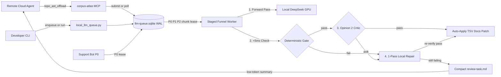

# Requirements

### Overview & Goals

Introduce a priority-queued local LLM dispatch and multi-opinion verification subsystem (`scripts/local_llm_queue.py` integrated with `corpus-atlas/mcp_server.py`) that offloads high-volume, locally-specified work and independent adversarial verification to the local GPU endpoint (`http://127.0.0.1:11434/v1/chat/completions`, e.g. `deepseek-r1:32b`).

The subsystem is designed to achieve two simultaneous outcomes per overarching engineering task:
1. **Remote Token Requirement Reduction:**
   - Offload `O(N)` repetitive batch transformations (11-locale `bleed-<lang>.tsv` translation sweeps, Markdown documentation translation, and `Rule D-010` / `ADR-115` `@governedBy` Javadoc backfills) to zero-marginal-cost local GPU cycles.
   - Return **compact delta digests** (`applied` counts + only quarantined `NEEDS_REVIEW` items) to the remote cloud agent instead of streaming thousands of raw TSV rows, full files, or multi-turn self-review prompts through the remote context window.
2. **Output Quality Improvement:**
   - Gate every local LLM output through a **staged verification funnel**: a `< 5 ms` deterministic syntax/sentinel/schema gate first, followed by an **asymmetric second-opinion critic** (blind back-translation or rubric check), with at most **one bounded local repair retry** before quarantining disputed items.
   - Provide an independent, cold-context **cross-family invariant critic** (`CritiqueDiffHandler`) that audits staged diffs against `ADR-115` `Gov(c)` neighborhoods (`ADR-*`, `REQ-*`, `S-001`..`S-007`) without same-session confirmation bias.

---

### Scope

#### In Scope
- **SQLite Priority Queue Broker (`scripts/out/llm-queue.sqlite`, WAL mode):**
  - Three priority tiers (`P0` live support-bot / interactive lease preemption, `P1` session-scoped diff critique & branch verification, `P2` background batch translation & Javadoc backfill) with chunk-boundary preemption (`5-10` items per batch).
- **Four Offloaded Task Families:**
  1. `translate-bundle` (`P2`): Drains `scripts/out/bleed-<lang>.tsv` via `export-translation-bundle.py` / `import-translation-bundle.py` logic.
  2. `translate-doc` (`P2`): Translates Markdown docs using `<<P#>>` sentinel masking for code blocks, inline code spans, and link targets.
  3. `critique-diff` (`P1`): Audits `git diff` hunks against `repo_ast.py context` `Gov(c)` invariants (`ADR-*`, `REQ-*`, `S-001`..`S-007`).
  4. `backfill-javadoc` (`P2`): Drafts missing `Rule D-010` / `ADR-115` capability Javadocs and `@governedBy` / `@trace` tags for classes surfaced by `repo_ast_audit`.
- **Staged Funnel Multi-Opinion Verification & Bounded Retry:**
  - Opinion 1 (Forward Generator) $\rightarrow$ Deterministic Gate $\rightarrow$ Opinion 2 (Asymmetric Critic) $\rightarrow$ 1-Pass Bounded Local Repair on failure $\rightarrow$ Auto-Apply or Quarantine (`scripts/out/review-<task>.md`).
- **Unified MCP & CLI Surface:**
  - Single compact `repo_ast_offload` MCP tool in `corpus-atlas/mcp_server.py` (and matching `offload` subcommand in `scripts/repo_ast.py`) to enqueue jobs, poll compact digests, or run a synchronous `P1` diff critique.

#### Out of Scope
- Putting any LLM inference on the hot path of the five existing `< 25 ms` deterministic `corpus-atlas` MCP tools (`repo_ast_context`, `repo_ast_search`, `repo_ast_impact`, `repo_ast_audit`, `repo_ast_sync`).
- External non-stdlib Python packages (strictly Python 3.12+ standard library + `sqlite3`).
- Direct unverified modification of git-dirty source code files without `.bak` protection or deterministic gate passage.

---

### User Stories

- **As a developer or remote AI agent working on a feature branch**, I want to invoke a single `repo_ast_offload(action="critique_diff")` call before finalizing a change so that an independent local `deepseek-r1:32b` pass checks my diff against `Gov(c)` ADRs and `S-001`..`S-007` rules and returns a compact `< 30`-line finding digest without burning multiple remote review turns.
- **As a maintainer updating config keys or documentation across 11 locales**, I want to enqueue `translate-bundle` and `translate-doc` jobs into a background `P2` queue that preserves `<<P#>>` sentinels and verifies semantic accuracy via a second opinion, surfacing only ambiguous edge cases in `scripts/out/review-*.md`.
- **As a contributor closing `Rule D-010` (`ADR-115`) audit gaps**, I want the background worker to draft telegraphic `@governedBy` / `@trace` Javadocs from `doc-index.sqlite` and verify that every cited ADR/REQ exists in `TRACEABILITY.md` before staging the patch.
- **As an operator running `discord-support-bot` on the same GPU host**, I want live `P0` support queries to preempt `P2` background batches at the next chunk boundary (`~5-15 s`) so interactive users never wait behind a 1,000-row locale sweep.

---

### Functional Requirements

1. **Priority Queue & Preemption (`REQ-LLM-Q-001`):**
   - Jobs shall be scheduled in strict `(priority ASC, created_at_ms ASC)` order across `P0` (`0`), `P1` (`1`), and `P2` (`2`).
   - Background `P2` jobs shall segment work into small atomic chunks (`5-10` bundle blocks, doc sections, or classes) and check for pending `P0`/`P1` jobs or active `P0` leases between every chunk.
2. **Staged Funnel Verification (`REQ-LLM-Q-002`):**
   - Every task handler shall run its `< 5 ms` deterministic gate **before** invoking the Opinion 2 GPU critic so syntactically invalid drafts never waste second-opinion GPU cycles.
   - Every draft passing the deterministic gate shall undergo an asymmetric Opinion 2 check (blind back-translation / glossary parity for translations; AST/diff citation accuracy for Javadocs and diff critiques).
3. **Bounded Local Retry & Quarantine (`REQ-LLM-Q-003`):**
   - When either the deterministic gate or the Opinion 2 critic rejects a draft, the worker shall feed the specific failure reason into **at most one** local repair pass (`max_retries = 1`) and re-verify both gates.
   - Items that still fail after one repair pass shall not be auto-applied; they shall be recorded as `NEEDS_REVIEW` and written to a compact `scripts/out/review-<task>.md` digest.
4. **Remote Token Compression (`REQ-LLM-Q-004`):**
   - MCP and CLI status/completion responses shall report aggregate counts (`completed`, `auto_applied`, `retried_ok`, `quarantined`) plus only the compact `NEEDS_REVIEW` entries (`<= 40` lines default), keeping remote agent context consumption under `~500` tokens per offloaded batch.

---

### Non-Functional Requirements

- **Zero Impact on Deterministic AST Latency:** Existing `repo_ast_{context,search,impact,audit,sync}` tools shall remain 100% deterministic with `< 50 ms` p95 latency (`python3 scripts/bench_repo_ast.py --gate` passes with `GO_PROMOTE`).
- **Loopback / Private-LAN Security:** All LLM HTTP requests shall enforce `is_safe_llm_endpoint(url)` (loopback `127.0.0.1` / `::1` / `localhost` or RFC-1918 private LAN only) and redact secrets before transmission.
- **Encoding & Pre-Commit Hygiene:** All generated TSVs, Markdown docs, Javadoc drafts, and review digests shall be written as UTF-8 (no BOM, LF line endings), free of mojibake markers and process-note shorthand (`Slice`, `Phase`, `CHECKLIST-*`, `*_PLAN.md`).

# Technical Design

### Current Implementation

- **Local LLM Client (`discord-support-bot/discord_support_bot.py`):**
  - `LocalLlmSynthesizer` (`line 2531`), `is_safe_llm_endpoint` (`line 2030`), and `_default_llm_http_post` (`line 2413`) already talk to local OpenAI-compatible endpoints (`http://127.0.0.1:11434/v1/chat/completions`, default model `deepseek-r1:32b`), strip `<think>...</think>` blocks, and validate cited config keys/commands against `doc-index.sqlite` via `verify_llm_draft_against_schema` (`line 2136`).
- **Locale Translation Pipeline (`scripts/`):**
  - `scripts/audit-locale-bleed.py` produces `scripts/out/bleed-<lang>.tsv`.
  - `scripts/export-translation-bundle.py` masks non-translatable tokens (`@type:`, URLs, `#hex`, `&a`, `[placeholder]`) into `<<P0>>`, `<<P1>>` sentinels inside ````bundle` blocks (`scripts/out/bundle-<lang>.md`).
  - `scripts/import-translation-bundle.py` validates sentinel multiset equality (`extract_sentinels`) and mojibake absence (`has_mojibake`), unmasks sentinels, and patches `scripts/out/locale-<lang>.tsv`.
- **AST & Governance Hypergraph (`scripts/repo_ast.py` & `corpus-atlas/mcp_server.py`):**
  - `repo_ast.py` queries `doc-index.sqlite` for `ADR-115` `Gov(c)` neighborhoods (`query_context`), capability search (`query_search`), 1-hop/2-hop impact (`query_impact`), and `Rule D-010` missing Javadoc/`@governedBy` audits (`query_audit`).
  - `corpus-atlas/mcp_server.py` exposes these over persistent `stdio` JSON-RPC 2.0.

---

### Key Decisions

1. **Unified SQLite Broker (`scripts/out/llm-queue.sqlite` in `WAL` mode):**
   - `scripts/local_llm_queue.py` owns the SQLite queue and task handlers. `corpus-atlas/mcp_server.py` adds a single compact tool (`repo_ast_offload`) that reads/writes the shared SQLite queue or runs a bounded `P1` critique, keeping the MCP server stateless with respect to long-running background threads while giving the remote agent 1-call access.
2. **Staged Funnel Verification (`Forward -> Deterministic Gate -> Critic -> 1-Pass Repair`):**
   - Running `< 5 ms` deterministic sentinel/schema/AST checks *before* the second-opinion GPU critic avoids wasting `5-15 s` of GPU compute on drafts that already broke a placeholder or cited a non-existent ADR.
   - Asymmetric Opinion 2 prompts (blind back-translation or rubric evaluation against `Gov(c)` / AST signatures) avoid correlated forward-generation errors.
3. **Chunk-Boundary Preemption (`5-10` items per chunk) + Lease Table:**
   - Because standard local `Ollama` / `vLLM` endpoints queue concurrent HTTP requests FIFO, preemption is enforced by dispatching `P2` work in small chunks (`5-10` bundle blocks) and checking `gpu_leases` / higher-priority `PENDING` rows before every HTTP call.
4. **Delta-Only Remote Context Handoff:**
   - Successfully verified items are applied directly to staging artifacts (`scripts/out/locale-<lang>.tsv`, `scripts/out/javadoc-drafts.patch`, or translated docs); only summary telemetry and unresolved `NEEDS_REVIEW` items are returned to the remote agent.

---

### Proposed Changes

#### 1. Priority Queue & Staged Funnel Engine (`scripts/local_llm_queue.py`)
- Implement `LlmQueueBroker` backed by `scripts/out/llm-queue.sqlite` (`PRAGMA journal_mode=WAL; PRAGMA busy_timeout=5000;`).
- Provide `LocalLlmClient` (extracted from `discord_support_bot.py` patterns) supporting:
  - Loopback/private-LAN validation (`is_safe_llm_endpoint`).
  - Automatic `<think>...</think>` reasoning trace extraction and JSON/block payload parsing.
  - Configurable `forward_model` (default `deepseek-r1:32b`) and `critic_model` (default `deepseek-r1:32b`, or a secondary local model such as `qwen2.5:32b` when configured) with distinct system prompts and temperatures (`0.2` forward, `0.0` critic).
- Implement `StagedFunnelRunner.execute_chunk(chunk)`:
  1. **Opinion 1 (Forward):** Generate structured output for the chunk.
  2. **Gate 1 (Deterministic, `< 5 ms`):** Run handler's `verify_deterministic(item, draft)`.
  3. **Opinion 2 (Critic):** For items passing Gate 1, run handler's `verify_critic(item, draft)` (returns `PASS` or `DRIFT: <reason>`).
  4. **Bounded Repair (`max_retries = 1`):** For items failing Gate 1 or Opinion 2, invoke `repair_draft(item, draft, failure_reason)` once, then re-run Gate 1 and Opinion 2.
  5. **Commit or Quarantine:** Apply passing items via handler's `apply_verified(items)` and append still-failing items to `scripts/out/review-<task_type>.md`.

#### 2. Task Family Handlers (`scripts/local_llm_queue.py`)
- **`TranslateBundleHandler` (`task_type="translate-bundle"`, default `P2`):**
  - Reads `scripts/out/bleed-<lang>.tsv`, groups into chunks of 8 blocks using `export-translation-bundle.py` masking (`<<P0>>`..`<<Pn>>`).
  - **Deterministic Gate:** Exact `<<P#>>` sentinel multiset parity (`extract_sentinels`), zero mojibake (`has_mojibake`), non-empty translation different from English (unless identity key), and valid `@type:`/`@range:` line count parity.
  - **Opinion 2 Critic:** Blind back-translation / semantic parity check verifying that Minecraft/RTP domain terms (`chunk`, `region`, `ticket`, `worldborder`, `cooldown`), units (`ticks`, `ms`, `blocks`), and boolean directionality match `value_english` / `comment_english`.
  - **Apply:** Unmasks sentinels and updates `scripts/out/locale-<lang>.tsv` (creating `.bak` per `import-translation-bundle.py`).
- **`TranslateDocHandler` (`task_type="translate-doc"`, default `P2`):**
  - Splits target Markdown file by level-2/3 headings (`##` / `###`), masking fenced code blocks, inline code spans, and link URLs (`](...)`) into `<<P#>>` sentinels.
  - **Deterministic Gate:** 100% sentinel restoration parity, heading level parity, and zero mojibake.
  - **Opinion 2 Critic:** Verifies technical meaning and command/config accuracy against the English section.
- **`CritiqueDiffHandler` (`task_type="critique-diff"`, default `P1`):**
  - Parses modified files and line ranges from `git diff` (staged or working tree), queries `repo_ast.query_context(conn, cls)` for each touched Java class to gather its `Gov(c)` ADRs, `REQ-*` IDs, and `S-001`..`S-007` rules.
  - **Opinion 1 (Adversarial Auditor):** Cold-context `deepseek-r1:32b` prompt checking whether the diff violates any `Gov(c)` invariant, leaks a `MemoryTracker` ticket (`S-002`), swallows a failure (`S-004`), or blocks the main thread (`S-005`).
  - **Deterministic Gate:** Verifies that every cited class, file path, `ADR-*`, `REQ-*`, or `S-00x` ID actually exists in the diff and `doc-index.sqlite`.
  - **Opinion 2 Critic:** Challenges each reported finding against the exact diff lines to filter out speculative false positives before returning the compact digest.
- **`BackfillJavadocHandler` (`task_type="backfill-javadoc"`, default `P2`):**
  - Pulls missing Tier 1/2 Javadoc targets from `repo_ast.query_audit(conn)` along with `repo_ast.query_context(conn, cls)`.
  - **Deterministic Gate:** Verifies `<= 8` lines telegraphic limit, valid `@governedBy ADR-NNN` / `@trace REQ-*` IDs against `doc-index.sqlite`, and zero forbidden pre-commit process markers (`Slice`, `Phase`, `Step`, `CHECKLIST-*`, `*_PLAN.md`).
  - **Opinion 2 Critic:** Verifies that the capability summary accurately reflects the class's actual method signatures and callers without inventing unsupported behavior.

#### 3. MCP & Support-Bot Integration
- **`corpus-atlas/mcp_server.py` & `scripts/repo_ast.py`:**
  - Add `repo_ast_offload` tool to `MCP_TOOLS_SCHEMA` (keeping total schema compact) and `offload` subcommand to `scripts/repo_ast.py`.
- **`discord-support-bot/discord_support_bot.py`:**
  - Add a lightweight optional context manager in `LocalLlmSynthesizer.synthesize` that writes a `P0` lease row into `scripts/out/llm-queue.sqlite` (when present) before issuing its HTTP POST so any running `P2` worker pauses between chunks until the live support query finishes.

---

### Data Models / Contracts

#### SQLite Schema (`scripts/out/llm-queue.sqlite`)
```sql
CREATE TABLE IF NOT EXISTS jobs (
    job_id INTEGER PRIMARY KEY AUTOINCREMENT,
    priority INTEGER NOT NULL CHECK (priority IN (0, 1, 2)),
    task_type TEXT NOT NULL,
    target_key TEXT NOT NULL,
    payload_json TEXT NOT NULL,
    model_forward TEXT NOT NULL DEFAULT 'deepseek-r1:32b',
    model_critic TEXT NOT NULL DEFAULT 'deepseek-r1:32b',
    status TEXT NOT NULL DEFAULT 'PENDING'
        CHECK (status IN ('PENDING', 'RUNNING', 'COMPLETED', 'NEEDS_REVIEW', 'FAILED')),
    total_items INTEGER NOT NULL DEFAULT 1,
    completed_items INTEGER NOT NULL DEFAULT 0,
    retried_items INTEGER NOT NULL DEFAULT 0,
    quarantined_items INTEGER NOT NULL DEFAULT 0,
    result_summary_md TEXT NOT NULL DEFAULT '',
    review_path TEXT NOT NULL DEFAULT '',
    created_at_ms INTEGER NOT NULL,
    updated_at_ms INTEGER NOT NULL,
    lease_expires_at_ms INTEGER NOT NULL DEFAULT 0
);

CREATE INDEX IF NOT EXISTS idx_jobs_sched
    ON jobs(status, priority ASC, created_at_ms ASC);

CREATE TABLE IF NOT EXISTS gpu_leases (
    holder_id TEXT PRIMARY KEY,
    priority INTEGER NOT NULL,
    acquired_at_ms INTEGER NOT NULL,
    expires_at_ms INTEGER NOT NULL
);
```

#### Python Task Handler & MCP Contracts
```python
class OffloadTaskHandler(Protocol):
    task_type: str
    default_priority: int  # 0=P0, 1=P1, 2=P2

    def split_chunks(self, payload: dict[str, Any]) -> list[list[dict[str, Any]]]: ...
    def build_forward_messages(self, chunk: list[dict[str, Any]]) -> list[dict[str, str]]: ...
    def verify_deterministic(self, item: dict[str, Any], draft: dict[str, Any]) -> tuple[bool, str]: ...
    def build_critic_messages(self, item: dict[str, Any], draft: dict[str, Any]) -> list[dict[str, str]]: ...
    def parse_critic_verdict(self, raw_response: str) -> tuple[bool, str]: ...
    def build_repair_messages(
        self, item: dict[str, Any], draft: dict[str, Any], reason: str
    ) -> list[dict[str, str]]: ...
    def apply_verified(self, verified_items: list[tuple[dict[str, Any], dict[str, Any]]]) -> int: ...
```

- **`repo_ast_offload` MCP Tool Input Schema:**
  - `action`: `enum ["enqueue", "status", "critique_diff", "run_once"]`
  - `task_type`: `enum ["translate-bundle", "translate-doc", "critique-diff", "backfill-javadoc"]` (optional for `status` / `critique_diff`)
  - `target`: `string` (locale code like `"de"` or `"all"`, doc path, class/module filter, or `job_id`)
  - `priority`: `integer` (`0`, `1`, or `2`, default per task type)
  - `format`: `enum ["markdown", "json"]` (default `"markdown"`)

---

### File Structure

| Path | Action | Responsibility |
|------|--------|----------------|
| `scripts/local_llm_queue.py` | Added | SQLite `WAL` priority queue broker, loopback-safe LLM client, staged funnel verifier, and the 4 task handlers (`translate-bundle`, `translate-doc`, `critique-diff`, `backfill-javadoc`). |
| `scripts/tests/test_local_llm_queue.py` | Added | Unit tests for `P0 > P1 > P2` preemption, lease expiry recovery, deterministic + critic staged funnel, 1-retry repair, and all 4 task handlers using deterministic mock HTTP transports. |
| `corpus-atlas/mcp_server.py` | Modified | Register `repo_ast_offload` tool and dispatch handler while keeping `< 25 ms` deterministic AST tools isolated. |
| `scripts/repo_ast.py` | Modified | Add `offload` CLI subcommand and formatting helpers for CLI/MCP parity. |
| `scripts/tests/test_repo_ast.py` | Modified | Update `tools/list` assertion for `repo_ast_offload` and test MCP/CLI offload parity. |
| `discord-support-bot/discord_support_bot.py` | Modified | Acquire/release optional `P0` lease in `LocalLlmSynthesizer.synthesize` so background `P2` batches yield between chunks. |
| `docs/dev/AI_USAGE.md` | Modified | Document the `local_llm_queue.py` / `repo_ast_offload` workflow and remote token-compression patterns. |

---

### Architecture Diagram

The diagram below illustrates how the remote agent, CLI scripts, and `discord-support-bot` coordinate through `llm-queue.sqlite`, and how the worker executes the staged funnel verification pipeline before writing verified outputs or compact review digests:



---

### Risks

- **Local GPU Endpoint Offline or Unreachable:**
  - *Mitigation:* If `http://127.0.0.1:11434/v1/chat/completions` is unreachable or times out, `local_llm_queue.py` fails closed without modifying any files, leaves queued jobs in `PENDING` (or returns a 1-line `"Local LLM endpoint offline"` status for synchronous `critique_diff`), and never blocks `repo_ast_{context,search,impact,audit,sync}`.
- **MCP Tool Schema Token Bloat:**
  - *Mitigation:* Consolidating all queue operations behind a single `repo_ast_offload` tool adds `< 110` tokens to `MCP_TOOLS_SCHEMA`, preserving the compact declaration budget verified by `scripts/bench_repo_ast.py --gate`.
- **Stale Worker Leases After Process Kill:**
  - *Mitigation:* Every `RUNNING` job and `P0` lease records `lease_expires_at_ms` (default `180 s` per chunk); workers automatically reclaim expired leases on startup or poll.

# Testing

### Validation Approach

All queue scheduling, preemption, staged verification gates, and MCP integrations will be validated deterministically using in-memory / temporary SQLite databases and programmable mock HTTP transports (no live GPU required for unit tests), followed by running the existing repository AST benchmark gate and pre-commit checks.

---

### Key Scenarios

1. **Priority Preemption (`P0 > P1 > P2`):**
   - Enqueue a multi-chunk `P2` `translate-bundle` job, insert a `P1` `critique-diff` job and a `P0` `gpu_leases` entry mid-run, and verify that the worker yields after completing the current 8-row `P2` chunk and executes the `P1` job only after the `P0` lease clears.
2. **Staged Funnel Happy Path & 1-Pass Bounded Repair:**
   - **Pass on first try:** Mock forward draft preserves all `<<P0>>` sentinels and passes Opinion 2 critic $\rightarrow$ auto-applied to `locale-<lang>.tsv` in 2 LLM calls (1 forward + 1 critic).
   - **Deterministic gate repair:** Mock forward draft drops `<<P1>>`; deterministic gate catches it in `< 5 ms` *without* calling Opinion 2, triggers 1 repair call with the exact missing sentinel error, and passes both gates on retry.
   - **Critic drift repair:** Mock forward draft preserves `<<P0>>` but mistranslates `"chunk"` as `"slice"` (or flips a boolean comment); Opinion 2 critic flags `DRIFT`, triggers 1 repair call, and passes on retry.
3. **Quarantine After Persistent Disagreement:**
   - When the repaired draft still fails either the deterministic gate or Opinion 2 critic, verify that `locale-<lang>.tsv` is left unmodified (or retains `# TODO(i18n):`) and a compact entry is written to `scripts/out/review-translate-bundle.md`.
4. **Gov(c) Diff Critique & Hallucination Filtering:**
   - Feed a synthetic `git diff` touching a `Tier 2` class into `CritiqueDiffHandler`; verify that valid `S-002`/`S-005` findings citing real diff lines and `doc-index.sqlite` ADRs survive, while fabricated ADR IDs (`ADR-999`) or findings rejected by the Opinion 2 critic are stripped.
5. **D-010 Javadoc Backfill Hygiene:**
   - Verify that `BackfillJavadocHandler` rejects drafts containing process notes (`Phase 2`, `Slice A`, `CHECKLIST-foo.md`) or unknown `REQ-*` IDs, and accepts clean `<= 8`-line `@governedBy` / `@trace` Javadoc blocks.
6. **MCP `repo_ast_offload` & Benchmark Gate Parity:**
   - Verify `tools/list` and `tools/call` for `repo_ast_offload` in `scripts/tests/test_repo_ast.py` and confirm `python3 scripts/bench_repo_ast.py --gate` reports `Decision: GO_PROMOTE`.

---

### Edge Cases

- **Expired Lease Recovery:** Simulate a crashed worker by inserting a `RUNNING` job with `lease_expires_at_ms < now_ms` and verify that the next worker poll safely resets and resumes the job from the first uncommitted chunk.
- **DeepSeek `<think>...</think>` Reasoning Traces & Malformed Fences:** Verify that `<think>` blocks and markdown prose wrapping ````bundle` or JSON responses are cleanly stripped before deterministic gate evaluation.
- **Unsafe Endpoint Rejection:** Verify that passing a non-loopback/non-RFC1918 URL (e.g., `https://api.example.com`) to `LocalLlmClient` immediately fails closed via `is_safe_llm_endpoint`.

---

### Test Changes

- **Add `scripts/tests/test_local_llm_queue.py`:** Comprehensive `unittest` suite covering queue ordering, `P0` lease preemption, `StagedFunnelRunner`, `TranslateBundleHandler`, `TranslateDocHandler`, `CritiqueDiffHandler`, and `BackfillJavadocHandler`.
- **Update `scripts/tests/test_repo_ast.py`:** Add `repo_ast_offload` coverage to `test_impact_analysis_and_cli_json_and_zero_stale_reads`.
- **Run Verification Commands:**
  - `python3 -m unittest scripts/tests/test_local_llm_queue.py scripts/tests/test_repo_ast.py scripts/tests/test_bench_repo_ast.py corpus-atlas/tests/test_corpus_atlas.py`
  - `python3 scripts/bench_repo_ast.py --gate`
  - `sh .git/hooks/pre-commit`

# Delivery Steps

### ✓ Step 1: Stage 1: Build SQLite Priority Queue Broker and Staged Verification Engine
`scripts/local_llm_queue.py` provides a WAL-backed `P0`/`P1`/`P2` SQLite job broker, loopback-safe OpenAI-compatible HTTP client, and the staged funnel verification engine (`Forward -> Deterministic Gate -> Second-Opinion Critic -> 1-Pass Bounded Repair -> Quarantine`).

- Create `scripts/local_llm_queue.py` (Python 3.12 stdlib + `sqlite3`) managing `scripts/out/llm-queue.sqlite` with `jobs`, `job_attempts`, and `gpu_leases` tables in `WAL` mode.
- Implement loopback/private-LAN endpoint validation (`is_safe_llm_endpoint`), `<think>...</think>` stripping, and chunk-boundary `P0` preemption checks (`acquire_p0_lease` / `yield_if_higher_priority_pending`).
- Implement `StagedFunnelRunner` executing Opinion 1 (forward draft), the pluggable `< 5 ms` deterministic verifier, Opinion 2 (asymmetric blind critic/back-translation), at most one targeted local repair pass on failure, and compact quarantine digest emission (`scripts/out/review-<task>.md`).
- Add CLI subcommands (`enqueue`, `run-worker`, `status`, `cancel`) and optional `P0` lease hooks in `discord-support-bot/discord_support_bot.py` (`LocalLlmSynthesizer`).
- Add unit tests in `scripts/tests/test_local_llm_queue.py` using mocked HTTP transports to verify `P0 > P1 > P2` preemption, crash recovery of expired `RUNNING` leases, and the 1-retry staged funnel state machine.

### ✓ Step 2: Stage 2: Implement Locale Bundle and Markdown Doc Translation Handlers
The queue worker drains `P2` locale bundle batches (`bleed-<lang>.tsv`) and Markdown documentation translation jobs with `<<P#>>` sentinel protection, mojibake checks, and blind back-translation/semantic critique.

- Implement `TranslateBundleHandler` in `scripts/local_llm_queue.py` reusing `mask_text` from `scripts/export-translation-bundle.py` and `extract_sentinels`, `parse_legend`, `unmask`, and `has_mojibake` from `scripts/import-translation-bundle.py` in batches of `5-10` rows.
- Implement `TranslateDocHandler` in `scripts/local_llm_queue.py` masking fenced code blocks, inline code spans, and Markdown link targets (`](...)`) into `<<P#>>` sentinels before translation and verifying 100% sentinel and heading parity on unmask.
- Implement the Opinion 2 blind semantic critic for translation tasks (checking domain glossary terms such as chunk/region/ticket, numeric units, negation parity, and `TRANSLATION_GUIDE.md` Rule 8 identity-key preservation) and routing unresolved drift after 1 retry to `scripts/out/review-locale-<lang>.md` or `scripts/out/review-docs.md`.
- Extend `scripts/tests/test_local_llm_queue.py` to test sentinel mismatch repair, mojibake rejection, blind critic drift detection, and clean TSV/Markdown patching.

### ✓ Step 3: Stage 3: Implement Gov(c) Diff Invariant Critique and D-010 Javadoc Backfill Handlers
The queue worker executes `P1` cold-context diff invariant critiques against `ADR-115` `Gov(c)` neighborhoods and `P2` `@governedBy`/`@trace` Javadoc backfills validated against `doc-index.sqlite`.

- Implement `CritiqueDiffHandler` (`P1`) in `scripts/local_llm_queue.py` that extracts changed Java classes from a git diff, resolves each class's `Gov(c)` neighborhood (`ADR-*`, `REQ-*`, `S-001`..`S-007`) via `scripts/repo_ast.py`, runs a cold-context `deepseek-r1:32b` adversarial check, and filters citations through a deterministic `doc-index.sqlite` + diff-line verifier plus a second-opinion false-positive critic.
- Implement `BackfillJavadocHandler` (`P2`) in `scripts/local_llm_queue.py` that consumes `repo_ast.query_audit` gaps, drafts telegraphic (`<= 8` lines) class Javadocs with `@governedBy` and `@trace` tags, verifies zero process-note violations and valid `TRACEABILITY.md` / ADR IDs, and runs an Opinion 2 accuracy critic against the class's AST methods.
- Add unit tests in `scripts/tests/test_local_llm_queue.py` covering hallucinated ADR/REQ rejection, process-shorthand rejection (`Slice`, `Phase`, `CHECKLIST`), and structured diff-critique digest compression.

### ✓ Step 4: Stage 4: Wire repo_ast_offload into corpus-atlas MCP Server and Benchmark Gates
`corpus-atlas/mcp_server.py` exposes `repo_ast_offload` for low-token job submission, status polling, and synchronous `P1` diff critiques while preserving all `< 25 ms` deterministic AST benchmark gates.

- Register `repo_ast_offload` in `corpus-atlas/mcp_server.py` (`action` in `["enqueue", "status", "critique_diff", "run_once"]`) returning compact (`<= 40` lines) token-compressed Markdown or JSON summaries.
- Update `scripts/repo_ast.py` CLI (`offload` subcommand) so CLI and MCP tool surfaces remain at 100% parity.
- Update `scripts/tests/test_repo_ast.py` (`tools/list` assertion and `repo_ast_offload` round-trip tests) and verify `python3 scripts/bench_repo_ast.py --gate` (`Decision: GO_PROMOTE`).
- Document the local GPU queue workflow and token-saving guidelines in `docs/dev/AI_USAGE.md`.