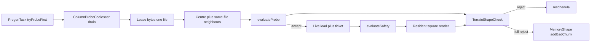

# Requirements

### Overview & Goals
Stop RTP from placing players on mountainsides and cliff edges, using only blocks and no generator noise, so it works on Iris, Terra and vanilla alike. The design follows the measured results (ADR-119, `LandingTerrainCheckMeasurementTest`):
- **Mountainside rule at the landing:** 8 directions, floors 16 and 32 blocks out, searched near the landing Y. A direction is steep at 30° or more.
- **Plane fit:** over ±8 blocks, rejecting at 30° or steeper.
- **Threshold:** steep directions ≥ half of the directions measured.
- On the full square, the rule plus the plane fit catch 96% of mountainsides and 66% of cliff edges.

The check runs in two places:
1. **Provisional verdict in the probe pre-compute.** It only reads what the one resident region file can supply.
2. **Authoritative recheck** when the server pins the chunk. One RTP ticket keeps the surrounding square resident, so the recheck needs no extra loads or pins.

### Scope
**In scope**
- A shared check used by the measurement harness, the probe path and the live path.
- Neighbour columns from the same region file attached to the probe.
- A per-chunk memory mark.
- The live recheck in `PregenTask`.
- A vert config key, fail types, ADR-120, docs and benchmark evidence.

**Out of scope**
- Changes to what happens after a rejection. Rejects reuse the existing reschedule path.
- Generator-noise hooks, walkability fills, steering (ADR-062) and `TeleportPipelineTask`.
- Changes to `viewDistanceTeleport` / `viewDistanceSelect` defaults.

### User Stories
- As an admin, I want to set a region's vert to refuse steep landings, so players don't arrive on a hillside or ledge.
- As an admin on a custom generator, I want the check to read blocks, so it behaves the same as on vanilla.
- As an operator, I want terrain rejects counted separately in the fail map, so I can see their cost.

### Functional Requirements
1. **New vert key `maxHillAngle`** (degrees, e.g. `30`) on `linear`, `jump` and `generic` verts. The name says what an admin controls: the steepest hill a player may land on. It avoids "grade" (read as a percent in road usage) and stays distinct from the existing `maxSlope` (a block-height difference).
   - The commented config example reads: `# Refuse landings on hillsides or cliff edges steeper than this many degrees. Remove or set to -1 to allow any terrain.`
   - Absent or negative means off. It has no defaults entry, so the cache key doesn't change when it is unset (same pattern as `maxSlope`).
   - When set, the candidate is rejected if `steep * 2 >= measured`, where `measured >= 1`, or if the plane fit over ±8 blocks (step 2) is ≥ `maxHillAngle`.
2. **Measured samples only.** A sample the reader cannot supply is left out, never guessed.
   - If the 2-chunk sample is missing, the 1-chunk sample is used alone.
   - A direction with no readable sample is unmeasured.
   - With 0 measured directions, the rule abstains.
   - The plane fit abstains when fewer than half of its points are readable.
3. **Probe verdict.**
   - Runs after `adjustFromProbe` picks Y, using the chunk and its same-file neighbours.
   - A reject is reported as a new probe fail type and reschedules, like the other probe rejects.
   - A verdict with all 8 directions measured is also written to spatial memory, like `addBadChunk`.
4. **Live recheck.**
   - Runs in `PregenTask.evaluateSafety` after the block-safety scan passes.
   - Reads only neighbours the server already holds (`isChunkLoaded` + `getCachedChunk`), and never loads one (S-005).
   - A reject uses the existing safety-reject path (`recordOutcome`, `addBadChunk`, `rescheduleNextAttempt`) with a new fail type (S-004).
5. Block safety (S-001), claims (S-003) and the existing `slopeOk` are unchanged.

### Non-Functional Requirements
- With `maxHillAngle` unset, the extra cost on the probe and live paths is one int compare, and the coalescer does no neighbour decodes.
- Neighbour decodes run only on the anvil executor and stay bounded: one decode per chunk per drain, plus a capped cache tied to the resident file.
- On every platform, a neighbour that isn't resident counts as unmeasured, not as a failure.

# Technical Design

### Current Implementation
- **Probe pre-compute:** `ColumnProbeCoalescer.serve` (anvil-api) drains up to 64 same-file requests from one `AnvilRegionByteCache.Lease`. Each request returns one `ColumnProbe`, which holds full palette sections, so any column in that chunk is readable.
- **Probe evaluation:** `PregenTask.tryProbeFirst` → `evaluateProbe` runs `vert.adjustFromProbe`, then the biome and block prefilters (`FailTypes.prefilterBiome` / `prefilterBlock`).
- **Live path:** `loadSafetyNeighbours` → `evaluateSafety` runs the `(2r+1)^3` block scan. A reject calls `addBadChunk(FailTypes.safety)` and `rescheduleNextAttempt`; a pass goes on to `GlobalRegionVerifiers`.
- **What one ticket keeps resident:**
  - Bukkit / Paper / Folia: `addPluginChunkTicket` is level 31, so the 5x5 square is FULL.
  - Fabric: `RTP_TICKET_DISTANCE = 1`, which is level 32, so only the 3x3 is FULL. The ring 2 chunks away is below FULL; there the 2-chunk samples fall back to 1-chunk samples, which the harness measured at full direction coverage.
- **Existing slope check:** `AbstractVerticalAdjustor.slopeOk` / `SlopeCheck` / `FloorReader` give one definition for both paths (ADR-016). New vert keys go in the vert data that `RegionCacheKey` hashes (ADR-119 item 8).
- **Harness:** `LandingTerrainCheckMeasurementTest` holds a private copy of the rule (`squareRuleClipped`) and the plane fit (`planeFit`).

### Key Decisions
1. **One pure check, three readers.**
   - `TerrainShapeCheck` lives in rtp-core next to `AbstractVerticalAdjustor` and reads through a `SquareReader`.
   - It has three adapters: the probe square, the live resident square, and the harness `Patch`.
   - Rationale: one definition across probe and live (ADR-016), and the harness measures the same code that ships (gate 5).
2. **Readable samples only, scaled threshold.** This was measured at 83% recall and 0.5% false rejects on one region file, and matches the full square on interior chunks.
3. **The probe verdict is provisional; the live recheck decides.** The rejection procedure is unchanged: both use existing fail-and-reschedule paths.
4. **Probe plus memory.**
   - Memory marks are written only for full verdicts (8 of 8 directions measured), so a partial square never retires a chunk.
   - Marks use `MemoryShape.addBadChunk`; the reasoning is the same as for safety marks (same column order means the same verdict).
5. **Neighbour data stays in anvil-api.**
   - A request carries a `squareRadius` (0 or 2).
   - The drain decodes same-file neighbours once per drain and attaches them to the probe.
   - The existing `ProbeFirstGovernor` (ADR-109) already records drain nanoseconds, so the extra cost throttles the probe path by itself.

### Proposed Changes
- **Shared check.**
  - Move the rule and the plane fit from the harness into `TerrainShapeCheck`.
  - Make the harness call it, keeping the clipping test (no reads outside the file).
- **anvil-api.**
  - `ColumnProbeCoalescer.submit(..., squareRadius)` and the matching `probeChunkColumn` overload.
  - In `serve`, for requests with `squareRadius > 0`, decode the 24 neighbours with `readColumnProbe`.
    - Skip neighbours outside the region file or not generated.
    - Share decodes through a map local to the drain.
    - Attach them via `ColumnProbe.withNeighbours`.
  - Add a bounded LRU (default 128 chunks) keyed by region file. It is dropped when that file's lease is evicted from `AnvilRegionByteCache`.
  - Add `ChunkColumnProbe.neighbour(dx, dz)` (default `null`). `AnvilColumnProbeAdapter` and the rtp-api `ChunkColumnProbe.of` wrapper delegate to it.
- **rtp-core probe path.**
  - `tryProbeFirst` requests `squareRadius = 2` only when `vert.maxHillAngle() >= 0`.
  - `evaluateProbe` runs the check after the block prefilter, using the probe square reader.
  - A reject records `FailTypes.prefilterTerrain` and reschedules. Full verdicts also call `addBadChunk(finalL, FailTypes.terrain)`.
- **rtp-core live path.**
  - In `evaluateSafety`, after `pass`, build the live square reader:
    - the centre and `localChunks` first;
    - then other chunks within 2 via `isChunkLoaded` + `getCachedChunk`, never `getChunkAt`.
  - It runs on the thread that already does the safety scan (the Folia region thread via `dispatchToRegion`).
  - A reject goes through the same block as the safety reject, with `FailTypes.terrain`.
- **Config.** Add `maxHillAngle` to `LinearAdjustorKeys`, `JumpAdjustorKeys` and `GenericVerticalAdjustorKeys`, plus `AbstractVerticalAdjustor.maxHillAngle()`. Add plain-language commented examples in the shipped region yml (no user-facing messages, so no locale change). Internal names (`tanMax`, `Verdict.grade`) stay technical; only the config key is user-facing.

### Data Models / Contracts
```java
// rtp-core .../verticalAdjustors/TerrainShapeCheck.java
public final class TerrainShapeCheck {
  /** Reads a 5x5-chunk square centred on the landing chunk; world-block coords relative to its NW corner. */
  public interface SquareReader {
    boolean readable(int sx, int sz);               // column inside an available chunk
    boolean isFloor(int sx, int feetY, int sz);      // same floor test as FloorReader
  }
  public record Verdict(int steep, int measured, double grade, boolean planeKnown) {
    public boolean reject(double tanMax) { ... }     // steep*2 >= measured (measured>0) || (planeKnown && grade >= tanMax)
    public boolean full() { return measured == 8; }
  }
  /** Pure; reads only through reader; <= 8*2 floor searches + 81 plane points, window 48. */
  public static Verdict evaluate(SquareReader r, int lx, int lz, int y, double tanMax, int minY, int maxY);
  public static SquareReader probeSquare(ChunkColumnProbe centre);        // uses neighbour(dx,dz)
  public static SquareReader liveSquare(RTPWorld<?> w, RTPChunk<?> centre, RTPChunk<?>[] known, int L);
}

// anvil-api ChunkColumnProbe
default ChunkColumnProbe neighbour(int dx, int dz) { return null; } // |dx|,|dz| <= 2; null = unavailable

// FailTypes (append only; ordinal persisted)
prefilterTerrain, terrain
```

### Architecture Diagram


### File Structure
- Added: `rtp-core/src/main/java/.../selection/region/selectors/verticalAdjustors/TerrainShapeCheck.java`
- Added: `rtp-core/src/test/java/.../verticalAdjustors/TerrainShapeCheckTest.java`
- Added: `docs/adr/ADR-120-mountainside-check-over-pinned-square.md`
- Modified (anvil-api): `ChunkColumnProbe.java`, `ColumnProbe.java`, `ColumnProbeCoalescer.java`, `AnvilColumnProbeAdapter.java`, `AnvilRegionByteCache.java` (eviction hook)
- Modified (rtp-api): `world/ChunkColumnProbe.java`, `RTPWorld` probe overload
- Modified (rtp-core): `PregenTask.java`, `FailTypes.java`, `AbstractVerticalAdjustor.java`, `LinearAdjustorKeys.java`, `JumpAdjustorKeys.java`, `GenericVerticalAdjustorKeys.java`, `LandingTerrainCheckMeasurementTest.java`
- Docs: `ADR-119` (cross-link), `docs/adr/README.md`, `TRACEABILITY.md`, `CHANGELOG.md`, region config docs

### Risks
- **Probe cost:** about 215 µs per neighbour decode. Mitigations:
  - It only applies when the feature is opted into.
  - Decodes are shared within a drain and cached per file.
  - The ADR-109 governor throttles the probe path.
  - The cost is measured before ADR-120 is accepted.
- **Fabric / NeoForge** have a 3x3 FULL square, so their recheck is partial. This is covered by the 1-chunk fallback and stated in the ADR.
- **Folia:** neighbours are read only on the centre's region thread, under the same assumption as the existing safety grid. A neighbour that isn't resident counts as unmeasured.
- **Persisted ordinals:** new `FailTypes` go at the end only.
- **Probe/live disagreement** on edge chunks is expected (provisional vs authoritative). Parity is asserted only on squares with every chunk readable.

# Testing

### Validation Approach
Unit-test the pure check, check the harness against its earlier numbers through the shared code, and test the probe and live wiring with existing `PregenTask` / coalescer test fixtures. Then capture benchmark evidence (gate 10).

### Key Scenarios
- `TerrainShapeCheckTest` (REQ-RTP-F-015) uses synthetic squares:
  - Flat ground accepts.
  - A 30° slope toward 4 directions rejects.
  - A cliff within 8 blocks makes the plane fit reject.
  - Flipping a single block of the rule's sample changes the verdict (mutation sensitivity).
- **Clipping:** an edge reader measures 5 of 8 directions and a corner reader 3. The rule never reads unreadable columns (an asserting reader enforces this).
- **Harness regression:** `./gradlew :rtp-core:test --tests "*LandingTerrainCheckMeasurementTest*"` should reproduce, within ±0.5 pp, the prior scaled + plane row and the full-square row.
- **Coalescer:**
  - With `squareRadius = 2`, neighbours are attached only within the file and each chunk is decoded at most once per drain.
  - With `squareRadius = 0`, nothing is decoded (decode counter).
- **Probe/live parity:** on the same fully readable square, the probe reader and the live reader give equal verdicts (ADR-016).
- **`PregenTask`:**
  - A probe reject records `prefilterTerrain` and reschedules.
  - A live reject records `terrain` through the safety-reject path.
  - A neighbour that isn't resident never triggers `getChunkAt` (a mock world fails the test if it does).

### Edge Cases
- `maxHillAngle` unset: the cache key is unchanged and the probe has no neighbours.
- 0 measured directions: the check abstains.
- Ungenerated or corrupt neighbour: counted as unmeasured, not as an exception.
- Nether / cave landing: floors are searched near the landing Y.

### Test Changes
- New `TerrainShapeCheckTest`.
- The harness is refactored to call `TerrainShapeCheck`.
- Coalescer and `PregenTask` tests are extended.
- New `TRACEABILITY.md` rows.

### Evidence
- Drain timing with and without the square, in the harness.
- A `StressTestRTP` A/B run with `maxHillAngle` off vs 30, recording throughput, probe drain nanoseconds and fail-map counts.
- `python3 scripts/agent-gate.py` result.

# Delivery Steps

### ✓ Step 1: Extract TerrainShapeCheck into rtp-core and rebase the harness on it
A single pure mountainside rule + plane-fit check exists in rtp-core and the measurement harness reproduces its prior numbers through it.

- Add `TerrainShapeCheck` (`SquareReader`, `Verdict`, `evaluate`) beside `AbstractVerticalAdjustor`, porting `squareRuleClipped` and `planeFit(clipped)` from `LandingTerrainCheckMeasurementTest`.
- Scaled threshold `steep*2 >= measured`; plane abstains below half readable points; 1-chunk fallback when 2-chunk sample unreadable.
- Add `TerrainShapeCheckTest` (REQ-RTP-F-015): flat, slope, cliff, edge/corner clipping with an asserting reader, single-block mutation sensitivity.
- Refactor the harness `Patch` into a `SquareReader` adapter and call the shared check; rerun it and confirm the scaled+plane and full-square rows match within ±0.5 pp.
- Run `./gradlew :rtp-core:test --tests "*TerrainShape*" --tests "*LandingTerrainCheckMeasurementTest*"` and `spotlessCheck`.

### ✓ Step 2: Add maxHillAngle config and the live recheck in PregenTask
With `maxHillAngle` set, the live path rejects mountainside/cliff landings using only server-resident neighbours, through the existing safety-reject path.

- Add `maxHillAngle` to `LinearAdjustorKeys`, `JumpAdjustorKeys`, `GenericVerticalAdjustorKeys` (no defaults entry) and `AbstractVerticalAdjustor.maxHillAngle()`.
- Append `terrain` and `prefilterTerrain` to `FailTypes` (end only, ordinals persisted).
- Add `TerrainShapeCheck.liveSquare`: centre + `localChunks`, then `isChunkLoaded` + `getCachedChunk` for other chunks within 2; never `getChunkAt` (S-005).
- In `PregenTask.evaluateSafety`, after the block scan passes and befo ` `GlobalRegionVerifiers`, run the check; reject reuses `recordOutcome` / `addBadChunk(FailTypes.terrain)` / `closeIfPresent` / `rescheduleNextAttempt` (S-004).
- Tests: mock world asserting no load calls, reject recorded under `terrain`, unset `maxHillAngle` leaves behaviour and cache key unchanged.
- Mid-task checkpoint: re-read ADR-016 and ADR-110 to confirm parity and read-only-fill invariants.

### ✓ Step 3: Attach same-file neighbours to probes and add the provisional probe verdict
The probe pre-compute rejects provisional mountainsides from one region file and records full verdicts in spatial memory.

- anvil-api: `ChunkColumnProbe.neighbour(dx,dz)` default null; `ColumnProbe.withNeighbours`; `AnvilColumnProbeAdapter` delegation; rtp-api `ChunkColumnProbe.of` delegation.
- `ColumnProbeCoalescer.submit(..., squareRadius)`: in `serve`, decode same-file generated neighbours via `readColumnProbe` with a per-drain map; bounded per-file LRU (128) dropped on `AnvilRegionByteCache` lease eviction.
- `RTPWorld.probeChunkColumn` overload carrying `squareRadius`; `PregenTask.tryProbeFirst` requests 2 only when `maxHillAngle >= 0`.
- `evaluateProbe`: after block prefilter, run `TerrainShapeCheck` on `probeSquare`; reject records `prefilterTerrain` and reschedules; `Verdict.full()` rejects also call `MemoryShape.addBadChunk(finalL, FailTypes.terrain)`.
- Tests: coalescer decode-once and radius-0 no-decode counters, out-of-file neighbours null, probe/live verdict parity on a fully readable square.
- Run `./gradlew :anvil-api:test`, `:rtp-api:test`, `:rtp-core:test`.

### ✓ Step 4: Capture benchmark evidence and write ADR-120 and docs
The feature has differential performance evidence and an ADR documenting the decision and platform coverage.

- Extend the harness to time drains with and without the square (decodes per probe, µs per probe, LRU hit rate).
- Run a `StressTestRTP` A/B with `maxHillAngle` off vs 30: throughput, probe drain nanos, `terrain`/`prefilterTerrain` fail counts.
- Write `docs/adr/ADR-120-mountainside-check-over-pinned-square.md` (extends ADR-119, ADR-016; relates ADR-109, ADR-110): rule, scaled threshold, provisional vs authoritative, memory on full verdicts, Bukkit 5x5 vs Fabric 3x3 resident square.
- Update `docs/adr/README.md`, ADR-119 cross-link, `TRACEABILITY.md`, `CHANGELOG.md`, and region config docs/commented example for `maxHillAngle` (plain-language wording per `CONFIG_COMMENT_STYLE.md`).
- Run `scripts/check-mojibake.py` and `python3 scripts/agent-gate.py`; cite results.

### ✓ Step 5: Measure angle-staged evaluation (3x3 first) in the harness
Test the hypothesis that steeper limits are decided from the 3x3 square, so the outer ring is needed less often.

- In `TerrainShapeCheck`, evaluate in stages: 16-block samples (3x3) and the plane fit first, 32-block samples only for directions that could still change the verdict. Same verdict as today (asserted per landing in the harness).
- Harness: per `maxHillAngle` in {30, 45, 60}, report rejection rate, chunks touched per check (staged vs eager), share of checks decided within the 3x3, and recall of a 3x3-only variant vs the full rule.

### ✓ Step 6: Fetch the square on demand, after the cheap prefilters (option A)
- The probe request stays centre-only; after `adjustFromProbe` and the biome/block prefilters pass, a terrain job runs in a same-file drain with neighbours decoded lazily the first time the check reads them (lease held, per-drain map).
- Remove the eager `attachNeighbours` decode and the low-hit LRU.
- Tests: decodes only for touched chunks, none for prefilter rejects, out-of-file neighbours unreadable.

### ✓ Step 7: Cheaper neighbour decode (option C)
- Measure inflate vs NBT parse split per chunk first.
- Neighbour decode keeps only sections overlapping the landing's floor window and skips biomes/heightmap; faster inflate if inflate dominates.
- Tests: same floor answers as the full probe inside the window.

### ✓ Step 8: Re-benchmark and update ADR-120 / docs
- Rerun `TerrainSquareDrainBenchmarkTest` (counted over all candidates) and the harness; update ADR-120, CHANGELOG, TRACEABILITY.
- Run `spotlessCheck`, affected module tests, mojibake check.

### ✓ Step 9: 3x3 at every angle and integrate into region settings
- Use the 3x3 square for every `maxHillAngle` (cost/benefit); drop the 45-degree switch.
- Ship `maxHillAngle: "off"` in `config.yml` `defaults.vert` (baseline + locales) with `@options: ["off", 30, 45, 60]`, default `off`; `off` parses as disabled and hashes like an absent key.
- Update REGIONS.md, region example, ADR-120, CHANGELOG; tests for `off` parsing and cache key.