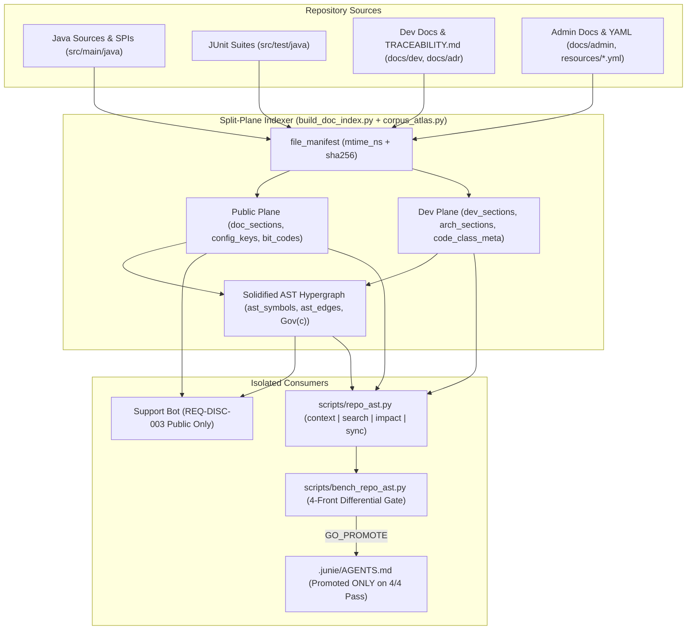

# Requirements

### Overview & Goals
Expose the repository's existing SQLite FTS5 + AST knowledge graph (`corpus-atlas/generated/doc-index.sqlite`, with compatibility re-exports for `discord-support-bot`) to AI coding agents and developers through a project-neutral general engine (`corpus-atlas/`), a fast, zero-dependency CLI (`scripts/repo_ast.py`), and an isolated developer AST plane (`Shared DB, Split Planes`).

Because this capability is in the idea/validation phase, the rollout is strictly governed by **`docs/dev/VERIFICATION_GATES.md` Gate 10 (Feature Evidence)**: a multi-front differential benchmark (`scripts/bench_repo_ast.py`) must prove a **measured improvement across all four quantitative fronts** (Tool Call & Token Savings, Comprehension & Recall, Latency & Freshness, and Anti-Redundancy SPI Discovery) without regressing `REQ-DISC-003` support-bot isolation. If any front fails to meet its threshold or regresses, integration into `.junie/AGENTS.md` is automatically **held for refinement**.

### Scope
#### In Scope
- **Extract General Multi-Project Engine (`corpus-atlas/`) & Split-Plane AST Expansion (`corpus-atlas/build_doc_index.py`, `corpus-atlas/corpus_atlas.py`):**
  - Extract the general multi-project FTS5 + AST indexer (`build_doc_index.py`, `corpus_atlas.py`, and `generated/doc-index.sqlite`) into a top-level `corpus-atlas/` directory while keeping thin compatibility re-exports in `discord-support-bot/` for existing callers.
  - Keep `doc_sections` strictly isolated for public support bot answers (`REQ-DISC-003`).
  - Add `dev_sections` (FTS5) for internal engineering docs (`docs/dev/{TRACEABILITY,RULES,TESTING_GUIDE,LESSONS_LEARNED,POTENTIAL_BUGS,GLOSSARY,VERIFICATION_GATES}.md`) and index subproject ADRs (`api/*/docs/adr/**`, `platforms/*/docs/adr/**`) into `arch_sections`.
  - Expand Java AST extraction to capture `extends` / `implements` hierarchies, cross-package `import` dependencies, `ADR-115` Javadoc annotations (`@governedBy`, `@trace`, `@invariant`, `@prohibition`), package DAG tiers (`Tier 1..4`), `src/test/java/**/*.java` test nodes, and `docs/dev/TRACEABILITY.md` (`REQ-*` $\rightarrow$ `Class` $\rightarrow$ `Test`) edges.
  - Add a `file_manifest` table (`mtime_ns`, `sha256`) for sub-150ms incremental refresh on edited working-tree files.
- **Developer AST & Search CLI (`scripts/repo_ast.py`):**
  - `context`, `search`, `impact`, and `sync` subcommands with compact Markdown and `--json` output modes.
- **Multi-Front Differential Benchmark & Hold Gate (`scripts/bench_repo_ast.py`):**
  - Automated benchmark harness measuring all 4 quantitative fronts with run-to-run variance and enforcing a hard Go / Hold-for-Refinement gate.
- **Conditional Agent Router Integration (`.junie/AGENTS.md`, `docs/dev/AI_USAGE.md`):**
  - Promoted only if `python3 scripts/bench_repo_ast.py --gate` passes 100% of fronts.

#### Out of Scope
- Changing public Discord bot answer generation logic or exposing `dev_sections` / `arch_sections` in public customer citations (`REQ-DISC-003`).
- External third-party Python dependencies (must remain Python 3.12+ stdlib + `sqlite3` only).
- Modifying Java production code in `rtp-core`, `rtp-api`, `platforms/`, or `addons/`.

### User Stories
- **As an AI coding agent working in RTP**, I want to query a symbol, file, or `REQ-*` ID in one `< 50 ms` call and receive its complete `ADR-115` governing neighborhood $\text{Gov}(c)$ (`ADR-*`, `REQ-*`, `S-00x`, callers/SPIs, config keys, and Gradle test command), so I do not spend 5–15 `grep`/`open` calls orienting myself or miss safety invariants.
- **As an AI coding agent planning a new helper or feature**, I want capability search to surface existing Tier 1/2 SPIs (`EwmaEstimator`, `ComparativeCostGovernor`, `DurationParser`, `MemoryTracker`, `RTPRunnable`) in the top 3 results, so I reuse existing modules instead of writing redundant implementations.
- **As the repository maintainer**, I want a deterministic, multi-front benchmark gate that verifies quantitative gains across tool-call count, token volume, recall, latency, freshness, and anti-redundancy before adopting the tool, automatically holding rollout if any metric regresses.

### Functional Requirements
1. **`REQ-DISC-003` Split-Plane Isolation:** `doc_sections` shall remain 100% free of `docs/adr/**`, `docs/architecture/**`, and internal `docs/dev/**` files (except `BIT_CODES.md` and `SUPPORT_MATRIX.md`). All developer-only prose and traceability tables shall reside in `dev_sections`, `arch_sections`, and typed `ast_*` nodes/edges.
2. **`ADR-115` Decision-Preservation Hypergraph Materialization:** Querying `context <target>` shall compute $\text{Gov}(c) = \{ v \in (\mathcal{REQ} \cup \mathcal{ADR} \cup \mathcal{S}) \mid (c, v) \in \mathcal{E} \}$ alongside structural class edges (`EXTENDS_CLASS`, `IMPLEMENTS_SPI`, `IMPORTS_CLASS`), `VERIFIED_BY_TEST` targets, and package DAG tier (`Tier 1..4`).
3. **Zero-Stale-Read Incremental Sync:** Before executing any query, `scripts/repo_ast.py` shall compare watched file `mtime_ns` against `file_manifest` and incrementally re-index any modified `.java`, `.md`, or `.yml` file in `< 150 ms`.
4. **4-Front Quantitative Go / Hold Gate (`scripts/bench_repo_ast.py --gate`):**
   - **Front 1 (Tool Call & Token Savings):** $\ge 50\%$ fewer discovery calls and $\ge 40\%$ fewer bytes/tokens read vs baseline `grep_search` + `glob_search` + `open` chains across a benchmark suite of 20 representative repo tasks.
   - **Front 2 (Comprehension & Recall):** $\ge 90\%$ top-5 recall on ground-truth `TRACEABILITY.md` (`REQ-*` $\leftrightarrow$ `Class` $\leftrightarrow$ `Test`) and `ADR-115` $\text{Gov}(c)$ governance sets, with $0$ `REQ-DISC-003` leaks.
   - **Front 3 (Latency & Freshness):** p95 query latency $< 50\text{ ms}$, single-file incremental sync $< 150\text{ ms}$, and $0\%$ stale-read rate after working-tree edits.
   - **Front 4 (Anti-Redundancy SPI Discovery):** $\ge 90\%$ top-3 hit rate on natural-language capability queries for existing Tier 1/2 SPIs and utilities.

# Technical Design

### Current Implementation
- **`discord-support-bot/build_doc_index.py` (`parse_java_code_sections`, `build_index`):**
  - Compiles `doc_sections`, `arch_sections`, `code_sections` (`1,383` Java classes), `config_keys` (`887` keys), `bit_codes` (`221` codes), `locale_aliases`, and `corpus_vocab` into `discord-support-bot/generated/doc-index.sqlite`.
  - Currently, `parse_java_code_sections()` (lines 1211–1348) extracts method names, thrown/caught exceptions, log strings, and `*Keys` enum constants, but omits `extends`/`implements` clauses, cross-package `import` statements, `ADR-115` Javadoc tags (`@governedBy`, `@trace`, `@invariant`, `@prohibition`), and `src/test/java/**` test classes.
  - `build_index()` (lines 1542–1750) drops and rebuilds all tables from scratch in ~8.5s without per-file `mtime_ns`/`sha256` tracking.
- **`discord-support-bot/corpus_atlas.py` (`bake_project_ast`, `explain_query`):**
  - Builds the 6-table solidified AST (`ast_symbols`, `ast_edges`, `ast_claims`, `ast_conflicts`, `ast_candidate_refs`, `ast_config_tree`).
  - Links `JAVA_CLASS`, `CONFIG_KEY`, `BIT_CODE`, `ADR_RECORD`, `SAFETY_PROHIBITION`, `CLI_COMMAND`, and `PERMISSION_NODE`, but does not yet index `docs/dev/TRACEABILITY.md` (`REQ_ID` $\rightarrow$ `JAVA_CLASS` $\rightarrow$ `TEST_CLASS`) or Java inheritance/SPI implementation edges.
- **`discord-support-bot/bot_verification_tools.py` (`resolve_ast_cross_reference_map`):**
  - Resolves AST neighborhoods and pairs Java classes with `*Test.java` files via a runtime filesystem scan (`_get_repo_test_index()`).

### Key Decisions
1. **Shared DB, Split Planes (`doc-index.sqlite`):**
   - Store the developer FTS5 plane (`dev_sections`), incremental `file_manifest`, and expanded `ast_symbols` / `ast_edges` inside `discord-support-bot/generated/doc-index.sqlite` while keeping `doc_sections` and public support-bot retrieval (`search_docs`, `combinatorial_retrieve`) strictly untouched. This avoids duplicating the 8.5s index build while preserving `REQ-DISC-003` isolation.
2. **Incremental `file_manifest` Dirty Check on Query:**
   - Track `(file_path, mtime_ns, sha256, plane, last_indexed_at)` in SQLite. When `scripts/repo_ast.py` runs, a fast `stat()` scan over watched directories (`rtp-core`, `rtp-api`, `rtp-plugin`, `platforms`, `addons`, `api`, `docs/dev`, `docs/adr`) detects any file whose `mtime_ns` changed and re-parses/re-links only the dirty file(s) in `< 150 ms`.
3. **Tier-Weighted Anti-Redundancy Ranking (`ADR-115`):**
   - When `scripts/repo_ast.py search "<capability>"` executes, hits in `TIER_1_SPI_PURE` (`api/*`, `rtp-api`) and `TIER_2_CORE_DOMAIN` (`rtp-core`) receive a deterministic structural rank multiplier ($1.35\times$ and $1.20\times$) and explicit `[REUSE SPI]` badges so agents discover shared abstractions before leaf platform/addon classes.
4. **Hard Go / Hold-for-Refinement Gate (`Gate 10`):**
   - `scripts/bench_repo_ast.py --gate` runs a reproducible differential benchmark comparing the baseline multi-call workflow (`grep_search` $\rightarrow$ `glob_search` $\rightarrow$ `open`) against `scripts/repo_ast.py` across all 4 fronts. `.junie/AGENTS.md` is modified in Stage 4 **if and only if** all 4 fronts pass.

### Proposed Changes
- **`corpus-atlas/build_doc_index.py` & `discord-support-bot/build_doc_index.py` (compatibility shim):**
  - Host the general multi-project indexer in `corpus-atlas/build_doc_index.py` (with `DEFAULT_DB_PATH` under `corpus-atlas/generated/doc-index.sqlite` and compatibility re-export in `discord-support-bot/build_doc_index.py`).
  - Add `dev_sections` FTS5 virtual table and `file_manifest` table to `build_index()`.
  - Add `parse_dev_sections(repo_root, project)` to index `docs/dev/*.md` and subproject ADRs (`api/*/docs/adr/*.md`, `platforms/*/docs/adr/*.md`).
  - Extend `CodeSection` (backwards-compatibly via optional/additional columns or metadata table `code_class_meta`) to record `super_types`, `implemented_spis`, `imported_classes`, `javadoc_tags` (`@governedBy`, `@trace`, `@invariant`, `@prohibition`), `dag_tier`, and `module_name`.
  - Add `parse_test_classes(repo_root, project)` and `parse_traceability_matrix(repo_root, project)` to parse `src/test/java/**/*.java` and `docs/dev/TRACEABILITY.md`.
  - Add `sync_incremental_index(conn, repo_root, project)` to update only changed/deleted files recorded in `file_manifest`.
- **`corpus-atlas/corpus_atlas.py` & `discord-support-bot/corpus_atlas.py` (compatibility shim):**
  - Host the general AST baker and multi-facet evidence engine in `corpus-atlas/corpus_atlas.py` with a thin re-export shim in `discord-support-bot/corpus_atlas.py`.
  - Extend `bake_project_ast()` to register `REQ_ID` (`req:REQ-*`) and `TEST_CLASS` (`test:<module>:<TestClass>`) symbols in `ast_symbols` and emit `EXTENDS_CLASS`, `IMPLEMENTS_SPI`, `IMPORTS_CLASS`, `GOVERNED_BY_ADR`, `SATISFIES_REQ`, and `VERIFIED_BY_TEST` edges in `ast_edges`.
- **`scripts/repo_ast.py`:**
  - Implement CLI subcommands `context`, `search`, `impact`, and `sync` with bounded, high-density output (`<= 45` lines by default so a single call replaces 5–10 file opens with minimal token footprint).
- **`scripts/bench_repo_ast.py`:**
  - Implement the 4-front differential benchmark suite and `--gate` evaluator producing both human-readable tables (with mean, median, p95, min/max spread) and JSON evidence artifacts.

### Data Models / Contracts

#### 1. New SQLite Tables & Symbol/Edge Types in `doc-index.sqlite`
```sql
CREATE VIRTUAL TABLE IF NOT EXISTS dev_sections USING fts5(
    title,
    heading,
    path,
    body,
    tags,
    project UNINDEXED,
    tokenize='porter unicode61'
);

CREATE TABLE IF NOT EXISTS file_manifest (
    file_path TEXT PRIMARY KEY,
    mtime_ns INTEGER NOT NULL,
    sha256 TEXT NOT NULL,
    plane TEXT NOT NULL,
    project TEXT NOT NULL,
    last_indexed_at REAL NOT NULL
);

CREATE TABLE IF NOT EXISTS code_class_meta (
    class_name TEXT NOT NULL,
    package_name TEXT NOT NULL,
    path TEXT PRIMARY KEY,
    module_name TEXT NOT NULL,
    dag_tier TEXT NOT NULL,          -- TIER_1_SPI_PURE | TIER_2_CORE_DOMAIN | TIER_3_PLATFORM_ADAPTER | TIER_4_LEAF_ENTRY
    super_class TEXT NOT NULL,
    interfaces_json TEXT NOT NULL,   -- JSON list of implemented SPI/interface names
    imports_json TEXT NOT NULL,      -- JSON list of in-repo imported class names
    governed_by_json TEXT NOT NULL,  -- JSON list of ADR-* / REQ-* / S-00x from Javadoc + TRACEABILITY.md
    gradle_test_cmd TEXT NOT NULL
);
```

New `ast_symbols.symbol_type` values:
- `REQ_ID` (`req:REQ-RTP-S-005`, etc.)
- `TEST_CLASS` (`test:rtp-core:LocationGeneratorTest`, etc.)
- `SPI_CONTRACT` (`spi:EwmaEstimator`, `spi:RTPScheduler`, etc.)

New `ast_edges.edge_type` values:
- `IMPLEMENTS_SPI` / `SPI_IMPLEMENTED_BY`
- `EXTENDS_CLASS` / `SUBCLASSED_BY`
- `IMPORTS_CLASS` / `IMPORTED_BY_CLASS`
- `SATISFIES_REQ` / `REQ_SATISFIED_BY`
- `VERIFIED_BY_TEST` / `TESTS_CLASS`
- `GOVERNED_BY_ADR` / `ADR_GOVERNS_CLASS`

#### 2. `scripts/repo_ast.py` CLI Contract
```text
usage: repo_ast.py [-h] [--db PATH] [--json] [--no-auto-sync]
                   {context,search,impact,sync} ...

subcommands:
  context <target>   Resolve ADR-115 Gov(c) neighborhood for a class, SPI, file path, REQ-*, ADR-*, or config key
  search <query>     Hybrid FTS5 + AST capability search with Tier 1/2 SPI anti-redundancy ranking
  impact <target>    Compute downstream dependents, affected REQ-* rows, and exact Gradle test commands
  sync [--check]     Incrementally refresh dirty files via file_manifest (<150ms for single-file edits)
```

#### 3. `scripts/bench_repo_ast.py` Gate Contract
```python
@dataclass(frozen=True)
class BenchmarkGateReport:
    passed_all_fronts: bool
    decision: Literal["GO_PROMOTE", "HOLD_FOR_REFINEMENT"]
    front1_call_reduction_pct: float       # Gate: >= 50.0%
    front1_token_reduction_pct: float      # Gate: >= 40.0%
    front2_traceability_recall_top5: float # Gate: >= 0.90
    front2_gov_recall_top5: float          # Gate: >= 0.90
    front2_req_disc_003_leaks: int         # Gate: == 0
    front3_query_p95_ms: float             # Gate: < 50.0 ms
    front3_incremental_sync_p95_ms: float  # Gate: < 150.0 ms
    front3_stale_reads: int                # Gate: == 0
    front4_spi_top3_hit_rate: float        # Gate: >= 0.90
    failed_reasons: tuple[str, ...]
```

### File Structure
| File Path | Action | Responsibility |
|-----------|--------|----------------|
| `corpus-atlas/build_doc_index.py` | Add / Extract | Project-neutral multi-plane FTS5 indexer (`dev_sections`, `file_manifest`, `code_class_meta`, Java/test/traceability parsers, incremental sync) |
| `corpus-atlas/corpus_atlas.py` | Add / Extract | Project-neutral AST hypergraph baker (`REQ_ID`, `TEST_CLASS`, `SPI_CONTRACT` symbols; `IMPLEMENTS_SPI`, `EXTENDS_CLASS`, `IMPORTS_CLASS`, `SATISFIES_REQ`, `VERIFIED_BY_TEST`, `GOVERNED_BY_ADR` edges) |
| `discord-support-bot/build_doc_index.py` & `discord-support-bot/corpus_atlas.py` | Modify | Thin compatibility re-exports delegating to `corpus-atlas/` so existing Discord bot, MkDocs, and Web Editor callers work seamlessly |
| `scripts/repo_ast.py` | Add | Fast stdlib CLI (`context`, `search`, `impact`, `sync`) with auto-incremental sync and compact Markdown/JSON output |
| `scripts/bench_repo_ast.py` | Add | 4-front differential benchmark harness and `--gate` Go/Hold evaluator |
| `corpus-atlas/tests/test_corpus_atlas.py` & `discord-support-bot/tests/test_discord_doc_index.py` | Modify | Unit tests for `dev_sections` isolation (`REQ-DISC-003`), `code_class_meta`, `file_manifest` incremental sync, and `ADR-115` `Gov(c)` edges |
| `scripts/tests/test_repo_ast.py` | Add | Unit and integration tests for `scripts/repo_ast.py` (`context`, `search`, `impact`, `sync`, stale-read prevention) |
| `scripts/tests/test_bench_repo_ast.py` | Add | Unit tests for the 4-front benchmark evaluator and hold-for-refinement gate logic |
| `.junie/AGENTS.md` & `docs/dev/AI_USAGE.md` | Modify (Conditional) | Add router instructions for `scripts/repo_ast.py` **only if** `scripts/bench_repo_ast.py --gate` returns `GO_PROMOTE` |

### Architecture Diagram


### Risks & Mitigations
- **Risk — `REQ-DISC-003` Public Corpus Contamination:** Indexing `docs/dev/TRACEABILITY.md` or `LESSONS_LEARNED.md` into `doc_sections` would leak internal engineering docs into public Discord support answers.
  - *Mitigation:* Store developer docs exclusively in `dev_sections` and `arch_sections`; `search_docs()` in `build_doc_index.py` queries only `doc_sections`, and Front 2 of `bench_repo_ast.py` plus `test_strictly_excludes_adrs_and_internal_dev_docs` assert zero leaks.
- **Risk — Token Bloat from Overly Verbose AST Dumps:** If `repo_ast.py context` dumps hundreds of lines of raw edges, it could consume more tokens than opening a file directly (failing Front 1).
  - *Mitigation:* Bound default Markdown output to a telegraphic `<= 45`-line card (top governing ADRs/REQs/S-00x, direct SPIs/callers, config keys, and exact Gradle test command), and verify net byte/token reduction in Front 1 of `bench_repo_ast.py`.
- **Risk — Stale Index After Uncommitted Edits:** An agent edits a Java file and immediately queries `repo_ast.py`, receiving outdated edges.
  - *Mitigation:* Auto-run `sync_incremental_index()` on query startup whenever `file_manifest` detects a newer `mtime_ns`, and gate p95 incremental sync at `< 150 ms` with `0` stale reads in Front 3.

# Testing

### Validation Approach
Validation follows `docs/dev/VERIFICATION_GATES.md` (Gates 1–10) and is executed in two tiers:
1. **Deterministic Unit & Isolation Tests (`unittest`):**
   - `python3 -m unittest discover -s discord-support-bot/tests -p "test_*.py"`
   - `python3 -m unittest discover -s scripts/tests -p "test_*.py"`
2. **Gate 10 Multi-Front Differential Benchmark (`scripts/bench_repo_ast.py --gate`):**
   - Runs the 4-front benchmark across multiple iterations to capture mean, median, p95, and run-to-run spread, comparing baseline `grep`/`glob`/`open` discovery cost against `scripts/repo_ast.py`.
   - Enforces the Go / Hold-for-Refinement rule: Stage 4 only updates `.junie/AGENTS.md` and `docs/dev/AI_USAGE.md` if all 4 fronts pass.

### Key Scenarios
1. **Front 1 — Discovery Call & Token Reduction:**
   - Benchmark 20 representative tasks (e.g., orienting on `LocationGenerator`, `TeleportPipelineTask`, `ComparativeCostGovernor`, `REQ-RTP-S-005`, `ADR-115`, `shape.centerRadius`, `BukkitFoliaScheduler`).
   - Verify `>= 50%` reduction in tool calls (1 `repo_ast.py` call vs 4–9 baseline `grep`/`glob`/`open` calls) and `>= 40%` reduction in total bytes/tokens read.
2. **Front 2 — Ground-Truth Comprehension & `REQ-DISC-003` Isolation:**
   - Query every `REQ-*` and class row sampled from `docs/dev/TRACEABILITY.md` and `ADR-115`; verify `>= 90%` top-5 recall of the ground-truth implementing classes, governing ADRs, and `*Test.java` targets, and `0` internal doc rows in `doc_sections`.
3. **Front 3 — Query & Incremental Sync Latency + Freshness:**
   - Run 50 cold and warm queries across `context`, `search`, and `impact`; verify p95 latency `< 50 ms`.
   - Touch/modify a temporary copy or tracked file in a fixture repo, run a query, and verify auto-incremental sync completes in `< 150 ms` with `0` stale reads.
4. **Front 4 — Anti-Redundancy SPI Discovery:**
   - Run natural-language capability queries (e.g., `"exponential moving average estimator"`, `"duration string parser"`, `"adaptive cost governor"`, `"chunk ticket memory lifecycle"`, `"folia region scheduler abstraction"`, `"yaml comment preserving parser"`).
   - Verify `>= 90%` top-3 hit rate for the canonical Tier 1/2 SPIs (`EwmaEstimator`, `DurationParser`, `ComparativeCostGovernor`, `MemoryTracker`, `RTPScheduler`, `YamlFile`).

### Edge Cases
- **Missing or Unbuilt SQLite Database:** Running `scripts/repo_ast.py` when `doc-index.sqlite` does not yet exist automatically initializes and builds the database cleanly.
- **Deleted or Renamed Working-Tree File:** Incremental sync removes stale `code_class_meta`, `code_sections`, and `ast_symbols` / `ast_edges` entries for deleted files so `context` and `impact` never reference non-existent paths.
- **Ambiguous Symbol Names:** Querying a short name shared across modules (e.g., `RTPPlugin` across Bukkit/Fabric/NeoForge) disambiguates and lists each module's symbol and package tier clearly.
- **Benchmark Failure Simulation:** Unit test in `test_bench_repo_ast.py` injects a synthetic regression on any single front (e.g., p95 latency `> 50 ms` or recall `< 90%`) and verifies `bench_repo_ast.py --gate` returns `HOLD_FOR_REFINEMENT` (exit code `1`).

### Test Changes
- **Update `discord-support-bot/tests/test_discord_doc_index.py`:** Add tests for `dev_sections`, `code_class_meta`, `file_manifest`, and verify `test_strictly_excludes_adrs_and_internal_dev_docs` continues to pass.
- **Update `discord-support-bot/tests/test_corpus_atlas.py`:** Add tests for `REQ_ID`, `TEST_CLASS`, `IMPLEMENTS_SPI`, and `ADR-115` `Gov(c)` edges.
- **Add `scripts/tests/test_repo_ast.py`:** Test `context`, `search`, `impact`, `sync`, `--json` formatting, and zero-stale-read auto-sync after file modification.
- **Add `scripts/tests/test_bench_repo_ast.py`:** Test all 4 benchmark fronts and the `GO_PROMOTE` vs `HOLD_FOR_REFINEMENT` gate decision logic.

# Delivery Steps

### ✓ Step 1: Stage 1: Expand Split-Plane AST Index & Incremental File Manifest
`corpus-atlas/` (`corpus-atlas/build_doc_index.py`, `corpus-atlas/corpus_atlas.py`, and `corpus-atlas/generated/doc-index.sqlite`, with thin compatibility shims in `discord-support-bot/`) stores isolated developer documentation (`dev_sections`), full Java/Test/Traceability AST hypergraph edges, and per-file `mtime_ns`/`sha256` manifest metadata for sub-150ms incremental refresh while preserving `REQ-DISC-003` public-corpus isolation.

- Extract `build_doc_index.py` and `corpus_atlas.py` into `corpus-atlas/` with compatibility re-exports in `discord-support-bot/`, and extend `parse_java_code_sections()` / `parse_java_class_metadata()` to extract `extends` / `implements` types, cross-package `import` targets, `ADR-115` Javadoc tags (`@governedBy`, `@trace`, `@invariant`, `@prohibition`), and `ADR-115` package DAG tier classification (`TIER_1_SPI_PURE`..`TIER_4_LEAF_ENTRY`).
- Add `dev_sections` (FTS5) and `file_manifest` (`file_path`, `mtime_ns`, `sha256`, `plane`, `last_indexed_at`) tables in `corpus-atlas/build_doc_index.py`, indexing `docs/dev/{TRACEABILITY,RULES,TESTING_GUIDE,LESSONS_LEARNED,POTENTIAL_BUGS,GLOSSARY,VERIFICATION_GATES}.md` and subproject ADRs (`api/*/docs/adr/**`, `platforms/*/docs/adr/**`) without modifying `doc_sections`.
- Extend `bake_project_ast()` in `corpus-atlas/corpus_atlas.py` to emit `REQ_ID` (`req:REQ-*`), `TEST_CLASS` (`test:*`), and `SPI_CONTRACT` (`spi:*`) symbols and `EXTENDS_CLASS`, `IMPLEMENTS_SPI`, `IMPORTS_CLASS`, `GOVERNED_BY_ADR`, `SATISFIES_REQ`, and `VERIFIED_BY_TEST` edges from `docs/dev/TRACEABILITY.md` and `src/test/java/**/*.java`.
- Implement `sync_dirty_files(conn, repo_root)` for incremental single-file/working-tree updates in `< 150 ms` and add unit tests in `corpus-atlas/tests/` and `discord-support-bot/tests/` verifying `REQ-DISC-003` isolation and incremental refresh.

### ✓ Step 2: Stage 2: Implement Developer AST & Anti-Redundancy Search CLI (scripts/repo_ast.py)
Developers and AI agents can query the repository AST neighborhood, search existing SPIs/capabilities, inspect downstream change impact, audit corpus searchability/governance gaps, and trigger incremental sync via `python3 scripts/repo_ast.py`.

- Create `scripts/repo_ast.py` (Python 3.12+ stdlib only) with automatic pre-query dirty-file check against `file_manifest` so uncommitted working-tree edits are reflected with zero stale reads.
- Implement `context <symbol|class|file|REQ|ADR>` returning the `ADR-115` decision-preservation subgraph `Gov(c)` (file path, DAG tier, superclass/SPIs, 2-hop sibling/co-coupled classes, callers/imports, config keys, BIT codes, governing ADRs/REQs/`S-00x` prohibitions, and exact `./gradlew :<module>:test --tests ...` commands).
- Implement `search "<intent or capability>"` combining FTS5 (`code_sections`, `dev_sections`, `arch_sections`, `config_keys`), query-token IDF, and AST graph ranking with a tier/implementor boost for `TIER_1_SPI_PURE` and `TIER_2_CORE_DOMAIN` modules (`api/*`, `rtp-api`, `rtp-core`) to surface existing utilities before agents write new helpers.
- Implement `impact <class|file|SPI>`, `audit` (corpus searchability & `ADR-115` `Gov(c)` hygiene check), and `sync [--check]`, supporting both compact Markdown output (for low-token agent consumption) and `--json` output, and add unit tests in `scripts/tests/test_repo_ast.py`.

### ✓ Step 3: Stage 3: Build Multi-Front Differential Benchmark & Hold Gate (scripts/bench_repo_ast.py)
`scripts/bench_repo_ast.py` quantitatively evaluates the AST tool against baseline `grep`/`glob`/`open` workflows across all four mandatory fronts with run-to-run variance and a non-zero exit code if any front fails.

- Create `scripts/bench_repo_ast.py` implementing the Gate 10 differential benchmark harness over a standardized fixture of repository tasks (`TRACEABILITY.md` rows, `ADR-115` `Gov(c)` classes, cross-module impact tasks, and Tier 1/2 SPI capability queries).
- Measure Front 1 (Tool Call & Token Savings: discovery calls and bytes/tokens read vs baseline `grep`/`glob`/`open` sequences; pass threshold `>= 50%` call reduction and `>= 40%` byte/token reduction).
- Measure Front 2 (Comprehension & Recall: top-5 recall on `REQ-*`/`Class`/`Test` and `Gov(c)` sets `>= 90%`, plus `0` `REQ-DISC-003` leaks) and Front 4 (Anti-Redundancy SPI hit rate: top-3 recall `>= 90%` on existing SPIs such as `EwmaEstimator`, `ComparativeCostGovernor`, `DurationParser`, `MemoryTracker`, `RTPRunnable`, `RTPServerAccessor`).
- Measure Front 3 (Latency & Freshness: p50/p95/spread query latency with p95 `< 50 ms`, single-file incremental sync `< 150 ms`, and `0%` stale-read rate on mutated files) and add unit tests in `scripts/tests/test_bench_repo_ast.py`.

### ✓ Step 4: Stage 4: Execute 4-Front Gate Evaluation & Conditionally Wire Agent Router
The 4-front benchmark report is generated and evaluated; `.junie/AGENTS.md`, `docs/dev/AI_USAGE.md`, `docs/dev/RULES.md`, and `docs/dev/REQUIREMENTS.md` are wired to use `scripts/repo_ast.py` and enforce AST/searchability documentation & Javadoc contracts (`@governedBy`, `@trace`, capability summaries, `TRACEABILITY.md` parity) only if all four fronts pass, or held with a documented refinement report if any front regresses.

- Execute `python3 scripts/bench_repo_ast.py --gate` against the live repository index and capture the multi-run statistical report (mean, median, p95, run-to-run variance across all 4 fronts).
- Enforce the Go / Hold-for-Refinement decision gate: if any front falls below its threshold or regresses, leave `.junie/AGENTS.md` untouched and output the failing front's diagnostic breakdown for refinement.
- If all four fronts pass, add a concise router pointer in `.junie/AGENTS.md` (*Pre-Flight Checklist* / *Environment & Execution* / *Code & Testing Conventions*), usage examples in `docs/dev/AI_USAGE.md`, and normative AST/corpus searchability rules in `docs/dev/RULES.md` and `docs/dev/REQUIREMENTS.md`, then run `check-mojibake.py` and the Python test suites to verify zero regressions.