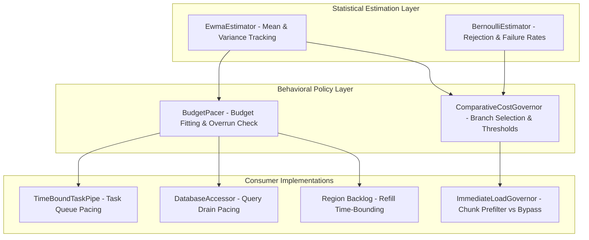

# Requirements

### Overview & Goals
The objective of this architectural change is to unify predictive cost modeling and budget pacing across the codebase. Currently, empirical online cost estimation (moving averages of execution durations and outcome rates) and thresholded decision making are duplicated across multiple independent components:
* `TimeBoundTaskPipe` (`rtp-core/tasks`): predicts task execution time to avoid overrunning the tick budget using an integer moving average (`((avg * 7) / 8) + (diff / 8)`).
* `DatabaseAccessor` (`rtp-core/database`): maintains duplicate write and read moving averages to avoid overrunning database drain budgets.
* `Region.processBacklog` (`rtp-core/selection/region`): maintains `backlogPickNanos` with identical 7/8 decay to bound refill bursts.
* `ImmediateLoadGovernor` (`rtp-core/selection/region`): maintains four EWMA registers ($C_{\text{file}}$, $C_{\text{native}}$, $C_{\text{sync}}$, $P_{\text{reject}}$) to decide between Anvil pre-filtering and direct native chunk loading.
* `ProbeFirstGovernor` (`rtp-core/selection/region`): maintains nested `Ewma` and linear regression `Fit` models to decide whether to probe chunk columns.

This proposal extracts these models into a unified, modular predictive engine located in `io.github.dailystruggle.rtp.common.predict`. The engine cleanly separates **statistical estimation** (pure math tracking means, variances, and rates) from **behavioral policy** (budget pacing, branch gating).

Crucially, to prevent behavioral deviation or regression during this pure architectural change, comprehensive characterization pin-down unit tests are established first to lock down existing behavior before code changes occur.

### Scope
#### In Scope
* Establishing characterization pin-down unit tests for current pacing and cost estimation behavior across `TimeBoundTaskPipe`, `DatabaseAccessor`, `Region`, and `ImmediateLoadGovernor`.
* Designing and implementing decoupled statistical tracking primitives: `EwmaEstimator` and `BernoulliEstimator`.
* Designing and implementing behavioral decision actuators: `BudgetPacer` (for time-bounded execution) and `ComparativeCostGovernor` (for cost-driven branch selection).
* Refactoring `TimeBoundTaskPipe`, `DatabaseAccessor.drainQueries`, `Region.processBacklog`, and `ImmediateLoadGovernor` to consume the unified engine.
* Preserving exact arithmetic compatibility for integer decay (7/8 weighting) and floating-point EWMA.

#### Out of Scope
* Modifying Folia's `CountBoundTaskPipe` (ADR-004 explicitly selected count-bounding for Folia regional threads; count-bounding remains unchanged).
* Modifying the external configuration keys, commands, or user-facing messaging.
* Altering `ProbeFirstGovernor`'s specialized multi-chunk linear regression `Fit` algorithm (which is specific to coalesced region-file opens).

### User Stories
* As a server administrator and player, I want tick-budgeted tasks (task pipes, database queues, backlog refills) to accurately predict upcoming execution costs and preemptively yield before exceeding tick deadlines, so that server tick rates remain stable at 20.0 TPS without latency spikes.
* As a developer, I want a clean, decoupled, and portable predictive modeling engine that transforms raw execution measurements into runtime behavioral decisions, so that new and existing components across plugins can implement budget pacing and cost governance without re-implementing statistical filters.

### Functional Requirements
* `REQ-PRED-F-001 (Unified EWMA Estimator)`: The system shall provide an `EwmaEstimator` in `io.github.dailystruggle.rtp.common.predict` tracking running mean, variance, and sample count. It shall support both fractional/double alpha decay ($\alpha = 2/(N+1)$) with optional early-sample unbiasing ($1/n$), and exact integer decay (`((avg * 7) + diff) / 8`) for historical pipe compatibility.
* `REQ-PRED-F-002 (Bernoulli Outcome Estimator)`: The system shall provide a `BernoulliEstimator` tracking binary success, failure, and rejection rates ($P_{\text{reject}}$) over time.
* `REQ-PRED-F-003 (Budget Pacer)`: The system shall provide a `BudgetPacer` evaluating $(t_{\text{elapsed}} + \mathbb{E}[C_{\text{predicted}}]) \le \text{budget}$. It shall guarantee forward progress by running at least one task when budget is positive (`runAtLeastOnce`), while halting immediately when the budget is zero or negative.
* `REQ-PRED-F-004 (Comparative Cost Governor)`: The system shall provide a `ComparativeCostGovernor` to evaluate multi-branch expected costs ($E[C_A]$ vs $E[C_B]$) and threshold-triggered branch selection.
* `REQ-PRED-F-005 (Characterization-Backed Refactoring)`: Existing components (`TimeBoundTaskPipe`, `DatabaseAccessor`, `Region.processBacklog`, `ImmediateLoadGovernor`) shall be refactored to consume the unified classes only after characterization tests confirm baseline behavior, guaranteeing zero functional drift.

### Non-Functional Requirements
* `REQ-PRED-NF-001 (Zero External Dependencies)`: The statistical estimation and behavioral pacing classes shall have zero Minecraft, Bukkit, Paper, or Folia dependencies, ensuring clean cross-plugin reusability.
* `REQ-PRED-NF-002 (Performance & Low Contention)`: The estimator and pacer primitives shall incur negligible execution overhead ($< 25\text{ ns}$ per record/evaluate call) and provide thread-safe or atomic updates suitable for high-throughput execution.
* `REQ-PRED-NF-003 (Numerical Stability)`: All mathematical operations shall guard against integer overflow, divide-by-zero, negative clock deltas, and `NaN` propagation.

# Technical Design

### Current Implementation
Predictive modeling is currently fragmented across multiple classes:
1. `TimeBoundTaskPipe`:
   * Stores `protected long avgTime = TimeUnit.MILLISECONDS.toNanos(50);`.
   * Pacing check: `while (!runnables.isEmpty() && (!ranAny || (dt + avgTime) < availableTime))`.
   * Update: `avgTime = ((avgTime / 8) * 7) + (diff / 8);`.
2. `DatabaseAccessor.drainQueries`:
   * Stores `avgTimeWrite` and `avgTimeRead`.
   * Write check: `if (dt + avgTimeWrite > availableTime) break;`.
   * Update: `if (avgTimeWrite == 0) avgTimeWrite = diff; else avgTimeWrite = ((avgTimeWrite * 7) / 8) + (diff / 8);`.
3. `Region.processBacklog`:
   * Stores `backlogPickNanos`.
   * Refill check: `if (backlog.size() >= backlog.capacity() || now + backlogPickNanos >= deadline) break;`.
   * Update: `backlogPickNanos = (backlogPickNanos == 0L) ? cost : (backlogPickNanos / 8L) * 7L + cost / 8L;`.
4. `ImmediateLoadGovernor`:
   * Stores 4 private `double` EWMA registers: `ewmaFileReadMs`, `ewmaNativeLoadMs`, `ewmaNativeSyncMs`, and `ewmaRejectRate`.
   * Evaluates deduplication threshold: $P_{\text{reject}} > \frac{C_{\text{file}}}{C_{\text{native}} + W_{\text{tick}}(\text{MSPT}) \cdot C_{\text{sync}}}$.

### Key Decisions
* **Decision 1: Two-Layer Architecture (Statistical Estimation vs Behavioral Policy).** Decouple pure statistical tracking (`EwmaEstimator`, `BernoulliEstimator`) from behavioral actuators (`BudgetPacer`, `ComparativeCostGovernor`). This allows time-bound queues, database writers, and chunk load governors to share the same statistical core while expressing different behavioral outcomes (yield vs proceed vs branch).
* **Decision 2: Dual Decay Modes in `EwmaEstimator`.** Support both `FractionalDecay` (floating-point EWMA with optional $1/n$ early-sample unbiasing) and `IntegerDecay` (fixed-ratio integer shifts like 7/8). This guarantees 100% mathematical and bitwise identity for existing task-pipe and database loops while giving cost governors high-precision floating-point statistics.
* **Decision 3: Characterization Pin-Down Prior to Refactoring.** Implement dedicated characterization unit tests on the unrefactored classes before introducing the new abstractions to strictly prevent behavioral deviation during architectural changes.

### Data Models / Contracts
```java
package io.github.dailystruggle.rtp.common.predict;

/** Tracks running mean, variance, and sample counts over execution costs. */
public final class EwmaEstimator {
    public enum DecayMode { FRACTIONAL, INTEGER_SEVEN_EIGHTHS }

    public static EwmaEstimator ofWindow(int windowSize);
    public static EwmaEstimator ofIntegerDecay(int weightHistory, int weightNew, long initialValueNanos);

    public void record(double value);
    public void recordNanos(long nanos);

    public double mean();
    public long meanNanos();
    public double variance();
    public double standardDeviation();
    public long sampleCount();
}
```

```java
package io.github.dailystruggle.rtp.common.predict;

/** Tracks binary success/rejection probabilities over time. */
public final class BernoulliEstimator {
    public static BernoulliEstimator ofWindow(int windowSize, double initialRate);

    public void record(boolean outcome);
    public double rate();
    public long sampleCount();
}
```

```java
package io.github.dailystruggle.rtp.common.predict;

/** Paces task execution to prevent overrunning available time budgets. */
public final class BudgetPacer {
    public static BudgetPacer ofTaskPipe(long initialAvgNanos);
    public static BudgetPacer ofEstimator(EwmaEstimator estimator, double safetyMultiplier);

    public boolean canExecute(long elapsedNanos, long availableNanos, boolean ranAny);
    public void recordDuration(long durationNanos);
    public long predictedCostNanos();
}
```

```java
package io.github.dailystruggle.rtp.common.predict;

/** Evaluates comparative cost branches and threshold conditions. */
public final class ComparativeCostGovernor<T extends Enum<T>> {
    public static <T extends Enum<T>> ComparativeCostGovernor<T> of(Function<CostContext, T> policy);
    public T evaluate(CostContext context);
}
```

### File Structure
* **Added Files in `rtp-core`:**
  * `src/main/java/io/github/dailystruggle/rtp/common/predict/EwmaEstimator.java`
  * `src/main/java/io/github/dailystruggle/rtp/common/predict/BernoulliEstimator.java`
  * `src/main/java/io/github/dailystruggle/rtp/common/predict/BudgetPacer.java`
  * `src/main/java/io/github/dailystruggle/rtp/common/predict/ComparativeCostGovernor.java`
  * `src/main/java/io/github/dailystruggle/rtp/common/predict/CostContext.java`
  * `src/test/java/io/github/dailystruggle/rtp/common/predict/EwmaEstimatorTest.java`
  * `src/test/java/io/github/dailystruggle/rtp/common/predict/BernoulliEstimatorTest.java`
  * `src/test/java/io/github/dailystruggle/rtp/common/predict/BudgetPacerTest.java`
  * `src/test/java/io/github/dailystruggle/rtp/common/predict/ComparativeCostGovernorTest.java`
  * `src/test/java/io/github/dailystruggle/rtp/common/tasks/TimeBoundTaskPipeCharacterizationTest.java`
* **Modified Files in `rtp-core`:**
  * `src/main/java/io/github/dailystruggle/rtp/common/tasks/TimeBoundTaskPipe.java`
  * `src/main/java/io/github/dailystruggle/rtp/common/database/DatabaseAccessor.java`
  * `src/main/java/io/github/dailystruggle/rtp/common/selection/region/Region.java`
  * `src/main/java/io/github/dailystruggle/rtp/common/selection/region/ImmediateLoadGovernor.java`

### Architecture Diagram


### Risks
* **Risk 1: Integer rounding deviation in historical task pipes.** If floating-point arithmetic is inadvertently introduced into `TimeBoundTaskPipe`, subtle rounding differences could change the number of tasks dispatched per tick.
  * *Mitigation:* Implement `INTEGER_SEVEN_EIGHTHS` mode in `EwmaEstimator` that uses exact integer arithmetic `((avg * 7) + diff) / 8`, preserving 100% bitwise parity with historical behavior.
* **Risk 2: Multi-threaded contention during concurrent pacing.** If multiple threads update a shared estimator, synchronization could cause lock contention.
  * *Mitigation:* `BudgetPacer` instances are thread-confined or thread-safe via lock-free atomic bit operations, matching the non-blocking conventions of `rtp-core`.
* **Risk 3: Cold-start overrun on initial burst.** An uninitialized estimator might report zero cost, allowing too many tasks to run on the very first tick.
  * *Mitigation:* Initialize `BudgetPacer` with a safe non-zero default (e.g. 50 ms in `TimeBoundTaskPipe`), ensuring the first prediction respects conservative bounds.

# Testing

### Validation Approach
To prevent deviation on a pure architecture change, a strict two-phase testing strategy is employed:
1. **Phase 1: Characterization Pin-Down:** Before modifying any production code, write comprehensive pin-down tests that execute existing classes (`TimeBoundTaskPipe`, `DatabaseAccessor`, `ImmediateLoadGovernor`) with known inputs and record their exact outputs and behaviors.
2. **Phase 2: Architectural Parity Verification:** Implement the unified classes and refactor the production code, asserting that all characterization tests and existing unit tests pass with zero regression.

### Key Scenarios
* **Task Pipe Execution Count Invariant:** Execute `TimeBoundTaskPipe` with deterministic task runtimes (e.g., 5ms, 10ms, 15ms) across multiple budget sizes (0ms, 1ms, 25ms, 50ms, 100ms), asserting that task execution counts and yields match before and after refactoring.
* **Progress Guarantee (Positive Budget):** A budget of `1L` nanosecond must always execute exactly one task, guaranteeing forward progress.
* **Exhausted Budget Protection (Zero/Negative Budget):** A budget of `0L` or negative must execute zero tasks, leaving all tasks queued for subsequent pulses.
* **Integer Decay Bitwise Parity:** Verify that `EwmaEstimator` with integer decay produces identical values to historical `((avg * 7) / 8) + (diff / 8)` arithmetic across 1,000 synthetic duration samples.
* **Governor Deduplication Threshold Parity:** Verify that `ImmediateLoadGovernor` produces identical `BYPASS` vs `PREFILTER` verdicts under healthy ticks ($\text{MSPT} \le 30\text{ ms}$) and distressed ticks ($\text{MSPT} > 35\text{ ms}$).

### Edge Cases
* **Clock Inversion / Negative Deltas:** Synthetic time samples where `localStop < localStart` (simulating clock adjustment) are guarded to avoid corrupting moving averages.
* **Extreme Outlier Durations:** A single massive task (e.g. 500 ms) does not permanently stall the pipeline; the estimator smoothly decays back down as normal-duration tasks execute.
* **Thread Interruption:** Interrupted threads exit immediately without spinning on access guards and preserve the interrupt flag.

### Test Changes
* Added test: `TimeBoundTaskPipeCharacterizationTest` in `rtp-core/src/test/java/io/github/dailystruggle/rtp/common/tasks/`
* Added test: `EwmaEstimatorTest` in `rtp-core/src/test/java/io/github/dailystruggle/rtp/common/predict/`
* Added test: `BernoulliEstimatorTest` in `rtp-core/src/test/java/io/github/dailystruggle/rtp/common/predict/`
* Added test: `BudgetPacerTest` in `rtp-core/src/test/java/io/github/dailystruggle/rtp/common/predict/`
* Added test: `ComparativeCostGovernorTest` in `rtp-core/src/test/java/io/github/dailystruggle/rtp/common/predict/`
* Verified regression suite: `TimeBoundTaskPipeTest`, `RTPTaskPipeTest`, `ImmediateLoadGovernorTest`, `ProbeFirstGovernorTest`, and `PregenTaskLoadPurposeTest`.

# Delivery Steps

### ✓ Step 1: Establish Characterization Pin-Down Unit Tests for Existing Predictors
A comprehensive suite of characterization tests locks down current timing, decay math, budget pacing, and governor decisions before any architectural refactoring begins.

- Create `TimeBoundTaskPipeCharacterizationTest` in `rtp-core/src/test/java/io/github/dailystruggle/rtp/common/tasks/` to record exact task execution boundaries and 7/8 integer decay progression under synthetic task execution durations.
- Add characterization assertions for budget boundary conditions: zero budget (`availableTime = 0`) running zero tasks, micro-budget (`availableTime = 1L`) running exactly one task for progress, and budget overruns yielding to the next pulse.
- Add characterization tests for `DatabaseAccessor.drainQueries` pacing behavior across write, delete, and read queues under synthetic time budgets.
- Add characterization tests for `Region.processBacklog` refill pacing (`backlogPickNanos` decay and deadline checks).
- Verify 100% test pass rate across existing test suites (`TimeBoundTaskPipeTest`, `RTPTaskPipeTest`, `ImmediateLoadGovernorTest`, `ProbeFirstGovernorTest`) to establish the pre-refactoring baseline.

### ✓ Step 2: Implement Core Statistical Estimators (EwmaEstimator & BernoulliEstimator)
A standalone, high-performance statistical tracking package in `io.github.dailystruggle.rtp.common.predict` provides unified EWMA mean, variance, and outcome rate tracking with zero external dependencies.

- Implement `EwmaEstimator` in `io.github.dailystruggle.rtp.common.predict` supporting dual decay modes: double-precision fractional decay ($\alpha = 2/(N+1)$) with optional early-sample unbiasing ($1/n$), and exact integer decay (`((avg * 7) + diff) / 8`) for historical pipe compatibility.
- Implement `BernoulliEstimator` in `io.github.dailystruggle.rtp.common.predict` to track binary outcome rates (rejection rate $P_{\text{reject}}$, success rate $P_{\text{safe}}$) with bounded smoothing.
- Ensure zero external dependencies (no Bukkit, Paper, Folia, or engine classes) to guarantee complete portability and cross-plugin reusability.
- Provide thread-safe, lock-free or minimal-contention accessors for `mean()`, `meanNanos()`, `variance()`, `standardDeviation()`, and `sampleCount()`.
- Add unit test suites `EwmaEstimatorTest` and `BernoulliEstimatorTest` asserting numerical stability, integer decay equivalence, variance calculation, and cold-start convergence.

### ✓ Step 3: Implement Behavioral Policy Actuators (BudgetPacer & ComparativeCostGovernor)
Domain-agnostic behavioral policy actuators turn measured statistical estimates into concrete execution decisions (proceed vs yield, prefilter vs direct load).

- Implement `BudgetPacer` in `io.github.dailystruggle.rtp.common.predict` to evaluate $(t_{\text{elapsed}} + \mathbb{E}[C_{\text{predicted}}]) \le \text{budget}$ with forward-progress guarantees (`runAtLeastOnce`) and configurable safety margins.
- Implement factory methods on `BudgetPacer` (`ofTaskPipe(initialAvgNanos)`, `ofEstimator(estimator, safetyMargin)`) providing plug-and-play drop-ins for task pipelines and queue drainers.
- Implement `ComparativeCostGovernor` in `io.github.dailystruggle.rtp.common.predict` to evaluate multi-branch expected costs ($E[C_A]$ vs $E[C_B]$) and threshold-triggered branch selection.
- Add unit test suites `BudgetPacerTest` and `ComparativeCostGovernorTest` asserting boundary conditions, zero/negative budget handling, safety margin scaling, and multi-branch evaluations.

### ✓ Step 4: Migrate Consumers to Unified Modeling & Verify Zero Behavioral Deviation
All task pipes, database drains, cache refills, and chunk load governors use the unified predictive engine, with 100% test pass rate across the characterization baseline.

- Refactor `TimeBoundTaskPipe` in `rtp-core` to delegate task timing, moving average decay, and overrun checks to `BudgetPacer` configured with integer 7/8 decay mode.
- Refactor `DatabaseAccessor.drainQueries` to replace ad-hoc `avgTimeWrite` and `avgTimeRead` loops with `BudgetPacer` instances.
- Refactor `Region.processBacklog` to replace manual `backlogPickNanos` math with `BudgetPacer`.
- Refactor `ImmediateLoadGovernor` to compose `EwmaEstimator` and `BernoulliEstimator` instances for $C_{\text{file}}$, $C_{\text{native}}$, $C_{\text{sync}}$, and $P_{\text{reject}}$, delegating branch thresholding to the shared policy model.
- Execute all characterization unit tests (`TimeBoundTaskPipeCharacterizationTest`) and full module test suites (`.\gradlew.bat :rtp-core:test`) to confirm zero behavioral regression, bitwise pacing equivalence, and complete system stability.