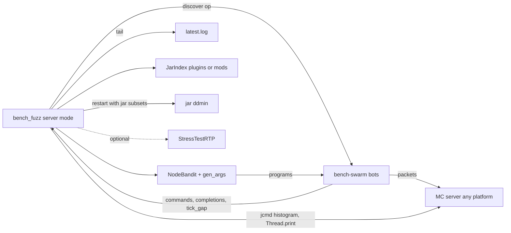

# Requirements

### Overview & Goals
Within a week, show a method that fuzzes an **unspecified server** for leaks and stalls without knowing its plugins or mods. The fuzzer gets a host, the RCON details and the server directory, and nothing else. It works out the attack surface from the server itself:
- It discovers commands from the Brigadier tree.
- Bots choose behaviour through goal-based heuristics: a bandit over command nodes and action shapes.
- It finds leaks and stalls by comparing against a vanilla baseline and against the run's own episodes, with no class named.
- It attributes each finding to a jar afterwards.

The headline evidence is a real bug the method has never been told about: **BetterRTP 3.6.13 retains players who quit**, confirmed in run `fuzz-20261010-213747` and documented in `LEAK_FUZZING.md`. The method has to find it again with BetterRTP installed among other plugins and never named, then attribute it to `BetterRTP-3.6.13.jar`.

### Scope
**In scope**
- A whole-server mode in `scripts/bench_fuzz.py` (`--mode server`) that runs without `--cmd`, `--names` or `--jars`.
- Swarm features in `devstack/clients/bench-swarm.js`:
  - Capturing the `declare_commands` tree.
  - Tab completion.
  - Commands with generated arguments.
  - Clicks in inventory windows.
  - Tick-gap (stall) events.
- An agentless observer that runs on the host: `jcmd` for histograms and thread dumps, a log tail, and a class-to-jar index built by scanning `plugins/` or `mods/`. When StressTestRTP is installed, its richer data is used.
- Two permission tiers: default bots and op bots (opped through RCON `op`), with a denylist for destructive commands.
- Attribution by delta-debugging the jar set (`ddmin`).
- A planted-bug fixture (Paper plugin and Fabric mod) with neutral names.
- Evidence runs:
  - Paper on `leaf26`, with BetterRTP and the fixture among several plugins.
  - Fabric through the devstack.
- ADR-125 and a method write-up.

**Out of scope**
- The ADR-122 harness carriers for Fabric and NeoForge.
- A NeoForge run (the method applies, but there is no devstack for it yet).
- JaCoCo coverage in server mode.
- Changes to `rtp-api` or `server-api`.

### User Stories
- As a presenter, I want one command that fuzzes any Paper or Fabric server and reports "jar X leaks class Y per departure after command Z", so that I can show the method is generic.
- As a server admin, I want leaks and stalls traced to a jar and shrunk to a minimal reproduction, so that I can report them upstream.
- As a skeptic, I want a known real bug (BetterRTP) and planted bugs found without hints, so that I can trust that a PASS means something.

### Functional Requirements
- **FR-1 Discovery:** each bot records the `declare_commands` tree it receives at login, per permission tier, and the driver merges the trees into `commands.json`.
  - Namespaced duplicates (`betterrtp:rtp` and `rtp`) are kept as aliases of one node.
  - Nodes on the denylist are never sent.
- **FR-2 Arguments:** argument values come from the parser type:
  - `brigadier:integer`, `float` and `double`, within the declared bounds.
  - `bool`.
  - `string`: word, quoted or greedy.
  - `minecraft:entity` and `game_profile`, using `{self}` or another bot.
  - `block_pos` and `vec3`, near the bot.
  - `dimension` and `resource_location`, learnt from tab completion.
  - Values from tab-completion replies are cached per node.
- **FR-3 Goal heuristics:** a bandit over (command node, follow-up shape) pairs rewards:
  - novelty: a new reply shape or a new log signature;
  - harm: class growth per action, tick-gap excess, kicks.

  Follow-up shapes include quitting at once, quitting during a delay, rejoining, repeating, and acting while another bot runs the same node. A usage or error reply moves argument mutation toward the other parser branches.
- **FR-4 Leak oracle:** a per-feature class screen fits each class's growth after a full GC against features of the form `node×follow-up`, including departures. It is Bonferroni-corrected and compared with a vanilla baseline run (the same seeds, with `plugins/` or `mods/` emptied except for the via/loader prerequisites). No class name is hardcoded.
- **FR-5 Stall oracle:**
  - Bots report gaps between `update_time` packets (sent every 20 ticks) and keep-alive delay.
  - A gap of more than `--stall-ms` (default 2000) above the baseline p99 is a stall candidate.
  - The driver captures `jcmd Thread.print` while the stall is happening, and the signature is the top frame of the main thread that is not a JDK or server frame.
- **FR-6 Attribution:** frames and classes are mapped to jars by the class-to-jar index. A reproduced finding is then confirmed by `ddmin` over the jar set (restart with halves) until one jar or a minimal set remains.
- **FR-7 Permissions:** `--tiers default,op`. Op bots are opped and de-opped through RCON. The denylist covers `stop`, `restart`, `op`, `deop`, `ban*`, `pardon*`, `whitelist`, `save-off`, `kill` with a selector, `execute`, `reload confirm`, `kick`, `difficulty` and `gamerule`, and can be extended with `--deny`.
- **FR-8 Reports:**
  - `verdict.json` and the report list each finding with its oracle, jar, command node, a shrunk program and a reproduction count.
  - `commands.json` and its coverage show which nodes were reached and replied.

### Non-Functional Requirements
- The Python side stays stdlib only and the swarm stays Node with Mineflayer (ADR-111 §2.2).
- Every episode is still reproducible from its seed and trace.
- Server mode works the same against Paper and Fabric. The only per-platform input is a profile (`paper` or `fabric`) covering the jar folder, the log format and the via prerequisites.

# Technical Design

### Current Implementation
- `scripts/bench_fuzz.py` already has the search loop (`gen_program`, `mutate`, `Corpus.consider`, `Cem`), the shrinkers (`ddmin`, `shrink_bots`), the oracles (`screen_classes`, `departure_slopes`/`screen_departures`, `ServerLogOracle`, `LeastPrivilegeOracle`) and the restart and jar isolation (`bench_overnight.Driver.set_jars`).
- Its vocabulary is fixed (`ACTIONS`, line 130) and its target is fixed (`DEFAULT_CMDS` and `--cmd`).
- `bench-swarm.js` (`runFuzzProgram`, around line 889) already runs a generic `cmd` action and sends `chat`, `tp`, `kick` and `spawn` events. It has no discovery, tab completion, window or tick events.
- Histograms and plugin ownership come only from StressTestRTP (`LeakProbe`, Bukkit only).
- ADR-111 §2.2 *Isolation* (one plugin per restart) and its `--cmd` input are exactly what server mode relaxes. ADR-125 records the amendment.

### Key Decisions
- **Agentless observation with the harness optional.** The driver runs on the server host:
  - It runs `jcmd <pid> GC.class_histogram` (live, so a full GC is forced) and `jcmd <pid> Thread.print`.
  - The PID comes from `--pid-file` (written by `bench-loop.sh`) or from `jcmd -l` matched against the server jar. For Docker the command is wrapped as `docker exec <c> jcmd 1 ...`.
  - If `/rtpstress` answers over RCON, StressTestRTP checkpoints are used. This works the same on every platform.
- **Discovery comes from the protocol, not from plugin metadata.** `declare_commands` is the same on Paper, Fabric and NeoForge, and it already reflects permissions per tier.
- **Attribution comes after detection.** Detection compares against a vanilla baseline and against the run's own episodes. Blame is assigned by the class-to-jar index plus a jar `ddmin`, so no target is ever named up front.
- **Two permission tiers through RCON `op`.** This is platform-neutral and needs no LuckPerms.

### Proposed Changes
- **Swarm (`bench-swarm.js`):**
  - On `login`, capture `_client.on('declare_commands')` and serialise the node graph (children, redirects, `executable`, parser and properties, suggestion type) into the event `{ev:'commands', tier, tree}`.
  - New op `discover`: one bot per tier joins, sends its tree plus `complete` probes, then quits.
  - New actions:
    - `complete {text}`: sends a `tab_complete` packet and emits `{ev:'completions', text, matches}`.
    - `click {slot, button, mode}`: answers `open_window` with a `window_click`. The window and its slot count are emitted as `{ev:'window', title, slots}`.
  - A tick meter listens for `update_time` and `keep_alive` and emits `{ev:'tick_gap', ms}` when the gap exceeds the threshold.
- **Discovery and grammar (new `scripts/fuzz_commands.py`):**
  - `CommandTree.from_events()` merges tiers and folds namespace aliases.
  - `paths(max_depth)` enumerates the paths that can be executed.
  - `gen_args(rng, node, ctx)` generates values by parser.
  - `apply_denylist`.
  - `bench_fuzz.gen_program` gets a `cmd` action kind drawn by a `NodeBandit` (UCB1 over `node×follow-up`). Its rewards come from the corpus novelty keys and the harm scores.
- **Observer (new `scripts/fuzz_observe.py`):**
  - `AgentlessProbe.checkpoint()` returns the same `{class: count}` shape that `screen_classes` reads, and `thread_dump()` returns a thread dump.
  - `JarIndex.scan(dirs)` maps class to jar using `zipfile`. Classes in no jar are labelled `server`.
  - `PlatformProfile` (`paper` or `fabric`) holds the jar folder, the log exception patterns, the prerequisite jars that are always kept, and the restart command.
- **Oracles (`bench_fuzz.py`):**
  - `departure_slopes` is generalised to `feature_slopes(features)`, where the features are the counts per episode of `node`, `node×quit_lt1s`, `node×rejoin` and `departures`.
  - New `StallOracle(FindingOracle)` takes `tick_gap` events, triggers a thread dump, and builds its signature from the top non-JDK frame and the jar from `JarIndex`.
  - `ServerLogOracle` uses `JarIndex` instead of `PLUGIN_PACKAGES` when attributing in server mode.
- **Attribution (new `scripts/fuzz_attribute.py`):** `jar_ddmin(finding, jars, probe)` reuses `ddmin`. Its probe restarts the server with a subset of jars plus the prerequisites and replays the shrunk program `--finding-n` times.
- **Whole-server mode (`bench_fuzz.py --mode server`):**
  1. Baseline run: the vanilla server with only the prerequisites.
  2. Discover on the full server.
  3. Explore and replay.
  4. Shrink the program.
  5. Run the jar `ddmin`.
  6. Write the report.

  The existing target mode is unchanged.
- **Fixture (new `helpers/FuzzFixture`):** a small neutral core plus a Paper plugin (`plugin.yml`, namespace `ff`) and a Fabric mod (a Brigadier command through Fabric API `CommandRegistrationCallback`). It plants two bugs behind ordinary-looking commands:
  - `/ff:queue <n>` stores the player in a static map and clears the entry only when a 1.5 s timer completes, so quitting first leaks the session. This has the same shape as BetterRTP.
  - `/ff:scan <radius>` with `radius > 48` busy-loops the main thread for about 3 s (a stall).

### Data Models / Contracts
```
// swarm -> driver
{ev:"commands", tier:"op", tree:{nodes:[{i, kind:"literal|argument|root", name, parser?, props?, children:[..], redirect?, exec:bool, suggest?}]}}
{ev:"completions", text:"/rtp world:", matches:["world","world_nether"]}
{ev:"window", title, slots:int}   {ev:"tick_gap", ms:int}
// program actions (driver -> swarm)
{a:"cmd", cmd:"betterrtp:rtp", node:"n17"}  {a:"complete", text:"/ff:scan "}  {a:"click", slot:3, button:0, mode:0}
```
```python
class AgentlessProbe:
    def checkpoint(self) -> dict[str, int]: ...   # live histogram (full GC)
    def thread_dump(self) -> str: ...
class JarIndex:
    def owner(self, class_name: str) -> str: ...  # jar file name or "server"
def jar_ddmin(finding, jars: list[str], probe) -> list[str]: ...
```

### Architecture Diagram


### Risks
- **Destructive commands:** the denylist plus a disposable bench copy (`bench_setup.py`) limit the damage. The world is restored from the copy between runs.
- **Noise across many plugins:** the per-feature screen keeps its Bonferroni correction. Findings need `--finding-k` reproductions and the jar `ddmin` before they fail the verdict.
- **BetterRTP is intermittent:** it needs roughly 24 or more episodes. The follow-up shapes `quit_lt1s` and `quit during delay` make the trigger reachable, but if the budget runs out the fallback is a replay of the shrunk program.
- **`jcmd` reach:** it needs the same user and a JDK on the host, and Docker on the Fabric devstack. A missing `jcmd` fails fast with a hint.
- **Mineflayer and 26.x:** the Via plugins on Paper are kept as prerequisites. Fabric 1.21.11 is supported natively.
- **D-005:** this spans several modules, so ADR-125 has to be approved before Stage 2.

# Testing

### Validation Approach
- Unit tests in `scripts/tests/` (stdlib `unittest`), using the existing `FakeSwarm` and fake server pattern in `test_bench_fuzz.py`.
- Run `node --check` on the swarm, plus a smoke test of the `declare_commands` parser on a recorded packet fixture.
- Gradle tests for the fixture.
- Live acceptance runs as the presentation evidence.
- Run `python3 scripts/agent-gate.py` before hand-off.

### Key Scenarios
- `CommandTree` built from a recorded tree:
  - Aliases fold.
  - Redirects resolve without infinite recursion.
  - Denied nodes never appear in generated programs.
- `gen_args` respects integer and float bounds, and `entity` values resolve to `{self}` or another bot.
- `NodeBandit` moves weight toward a fake node whose episodes grow a made-up class.
- `feature_slopes` flags a fake class that grows per `node×quit_lt1s` but not with plain departures. Noise alone flags nothing.
- `StallOracle`: a fake `tick_gap` of 3000 ms triggers a thread dump, and the signature attributes to the fixture jar through `JarIndex`.
- `jar_ddmin` over 6 fake jars isolates the one jar whose presence reproduces the finding, using at most about 2·log2(n)·k restarts.
- **Live, Paper (`leaf26` bench):** with plugins {LuckPerms, Vault, ViaVersion, BetterRTP 3.6.13, FuzzFixture, plus 2 or 3 benign plugins} and no target named:
  - the `ff:queue` leak and the `ff:scan` stall are found and attributed;
  - the BetterRTP session retention is found (a class screen hit such as `AdvancementProgress` per `betterrtp:rtp×quit_lt1s`) and `ddmin` reduces the jar set to `BetterRTP-3.6.13.jar`.
- **Live, Fabric devstack (1.21.11):** the same command, with the fixture mod and Fabric API only, finds both planted bugs.

### Edge Cases
- No `jcmd` or wrong PID: fails fast with a hint (and uses the harness if present).
- A tier whose tree has no executable nodes.
- A window that closes before the click arrives.
- A kick caused by a denied action.
- A finding that is also in the vanilla baseline is never blamed on a jar.
- `ddmin` where the bug needs two jars returns the minimal set.

### Test Changes
- Add `test_fuzz_commands.py`, `test_fuzz_observe.py` and `test_fuzz_attribute.py`, and add `ServerModeTest` and `StallOracleTest` to `test_bench_fuzz.py`.
- Add a fixture unit test checking that `queue` retains on early quit and that `scan` is gated by radius.
- The existing 196 bench tests must still pass, because target mode is unchanged.

# Week Schedule

### Timeline (7 days)
- **Day 1:** ADR-125 and the method doc, then swarm discovery, tab completion, clicks and the tick meter.
- **Day 2:** the command tree, argument generation, the bandit and the permission tiers.
- **Day 3:** the agentless observer, `JarIndex`, `feature_slopes` and `StallOracle`.
- **Day 4:** wiring server mode, the jar `ddmin` and the report. The fixture is built in parallel by a subagent.
- **Day 5:** the Paper run on `leaf26`, overnight.
- **Day 6:** the Fabric devstack run, then fixing issues and rerunning.
- **Day 7:** results in the method doc and `LEAK_FUZZING.md`, and diagrams for the slides.

### Fallbacks if time runs short
- The BetterRTP rediscovery does not reproduce within budget: show the shrunk-program replay plus the jar `ddmin`, and state the episode count honestly.
- Fabric slips: show discovery and the stall oracle on Fabric, and leave the leak to Paper.

# Delivery Steps

### * Step 1: Record ADR-125 and the method write-up
An approved method and decision record exists that server mode can be built against.
- Add `docs/adr/ADR-125-whole-server-discovery-fuzzing.md`, which amends ADR-111 §2.2 (*Isolation* and the `--cmd` input) for server mode. It covers:
  - discovery from `declare_commands`;
  - agentless observation;
  - attribution after detection by jar `ddmin`;
  - the two permission tiers and the denylist.
- Add a row to `docs/adr/README.md`.
- Add `docs/dev/WHOLE_SERVER_FUZZING.md`, the method doc with mermaid diagrams, BetterRTP 3.6.13 as the known real-world positive, and the planted-bug fixtures.
- Update Stage 5 in `BEHAVIOUR_FUZZING_PLAN.md` to point to ADR-125.
- Wait for the user's approval (D-005) before continuing.

###   Step 2: Add discovery, completion, window and tick events to the swarm
`bench-swarm.js` reports the server's command tree per tier and can complete commands, click windows and report stalls.
- Capture `declare_commands` at login and serialise the nodes (kind, name, parser/props, children, redirect, executable) into `{ev:'commands', tier, tree}`.
- Add the new control op `discover` (one bot per tier: join, send the tree, quit).
- Add the actions `complete` (a `tab_complete` packet, which emits `completions`) and `click` (`window_click` on an open window). Emit `window` when a window opens.
- Add a tick meter based on `update_time` and keep-alive timing that emits `tick_gap`.
- Extend `parseEpisode` validation for the new actions.
- Verify with `node --check` and a parser smoke test against a recorded `declare_commands` fixture.

###   Step 3: Implement the command tree, argument generation and the goal bandit
`bench_fuzz` can generate programs from a discovered tree, with no `--cmd` given.
- New `scripts/fuzz_commands.py`:
  - `CommandTree.from_events` (tier merge, alias folding, redirect resolution);
  - `paths`;
  - `gen_args` per parser type, with a completion cache;
  - the denylist and `--deny`.
- `NodeBandit` (UCB1 over `node×follow-up` shapes such as `quit_lt1s`, `quit_delay`, `rejoin`, `repeat`, `concurrent`). Its rewards come from corpus novelty and the harm scores.
- Integrate a `cmd`/`complete`/`click` action kind into `gen_program` and `mutate`. Usage or error replies push mutation toward other argument branches.
- Permission tiers: RCON `op`/`deop` per bot, with `--tiers default,op`.
- Tests: `scripts/tests/test_fuzz_commands.py` plus generator and bandit tests in `test_bench_fuzz.py`.

###   Step 4: Add agentless observation and the leak and stall oracles
Leaks and stalls are detected through `jcmd` and the log, with no harness and no class named.
- New `scripts/fuzz_observe.py`:
  - `AgentlessProbe` (`jcmd` `GC.class_histogram` and `Thread.print`; PID from `--pid-file` or `jcmd -l`; an optional `docker exec` wrapper);
  - `JarIndex.scan` over `plugins/` or `mods/`;
  - `PlatformProfile` for `paper` and `fabric`.
- Use the StressTestRTP checkpoints instead when `/rtpstress` answers.
- Generalise `departure_slopes`/`screen_departures` to `feature_slopes` over the `node×follow-up` features, compared with the vanilla baseline.
- New `StallOracle(FindingOracle)`: a `tick_gap` above the threshold triggers a thread dump, the signature is the top non-JDK frame, and the jar comes from `JarIndex`.
- `ServerLogOracle` attributes through `JarIndex` in server mode.
- Tests: `test_fuzz_observe.py` and `StallOracleTest`.

###   Step 5: Wire whole-server mode with jar ddmin attribution
`bench_fuzz.py --mode server` runs the baseline, discovery, exploration, shrinking, the jar `ddmin` and the report end to end.
- New `scripts/fuzz_attribute.py`: `jar_ddmin` reuses `ddmin`. Its probe restarts the server with a subset of jars plus the prerequisites and replays the shrunk program `--finding-n` times.
- Server-mode flow:
  1. Vanilla baseline (only the prerequisite jars).
  2. Discovery into `commands.json`.
  3. Explore and replay.
  4. Shrink the program.
  5. Run the jar `ddmin`.
  6. Write `verdict.json` and the report.
- The report lists each finding with its oracle, jar, command node, shrunk program and reproduction count, plus command-node coverage.
- Target mode stays unchanged, and the existing bench tests pass.
- Tests: `test_fuzz_attribute.py` and `ServerModeTest` on the fake server (a planted fake leak and stall, found and attributed to one fake jar).

###   Step 6: Build the planted-bug fixture for Paper and Fabric
Neutral-looking fixture jars with a hidden session leak and a hidden stall exist for both platforms.
- New `helpers/FuzzFixture`: a neutral core plus a Paper plugin (`plugin.yml`, namespace `ff`) and a Fabric mod (Brigadier via Fabric API), registered in `settings.gradle`.
- `/ff:queue <n>` keeps the player in a static map until a 1.5 s timer completes, so quitting first leaks the session.
- `/ff:scan <radius>` with `radius > 48` busy-loops the main thread for about 3 s.
- A Gradle unit test covers the leak and stall triggers. It can be delegated to a subagent in parallel with the earlier stages.

###   Step 7: Run the live evidence on Paper and Fabric and record the results
The presentation evidence is produced and documented.
- Paper on `leaf26` (a `bench_setup.py` copy), with LuckPerms, Vault, Via, BetterRTP 3.6.13, FuzzFixture and 2 or 3 benign plugins. Run `--mode server` with no target named. Expected results:
  - the fixture leak and stall are found;
  - BetterRTP's quit-session retention is found again and the jar `ddmin` isolates `BetterRTP-3.6.13.jar`.
- Fabric 1.21.11 devstack (`docker-compose.fabric.yml`-based) with the fixture mod: the same command, both planted bugs found.
- Record the run IDs, findings, episode counts and command coverage in `WHOLE_SERVER_FUZZING.md` and `LEAK_FUZZING.md`, and state anything that was not reproduced.
- Run `python3 scripts/agent-gate.py` and cite its result.