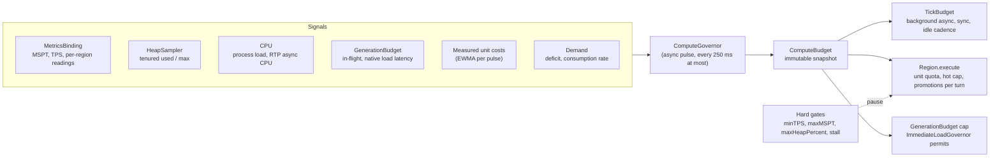

# ADR-087 - Adaptive Compute Governor: Demand-Driven Backoff, Memory Backpressure, and Multi-Region Concurrency

**Status:** Accepted (2026-10-24). Section 3 records Folia constraints already in force: 3.2 is implemented by the `FoliaSchedulerImpl` regional permit pool, and 3.4 and 3.6 by [ADR-112](ADR-112-per-region-work-division-on-folia.md), which owns them. Folia tick-region allocation (work placement, per-region shares, steering, lending) is [ADR-123](ADR-123-folia-tick-region-allocation.md) and consumer attribution is [ADR-124](ADR-124-consumer-attribution-for-background-refill.md); both build on this ADR and have their own evidence gates.
**Date:** 2026-09-07
**Revised:** 2026-10-24 (rewritten before implementation; scope widened from Folia to every platform; guarantees reduced to the invariants of section 1, each with a mechanical check in section 8; then split: former section 4.5 moved to ADR-123 and former section 4.6 to ADR-124, invariant IDs kept; then re-aimed at per-tick budgets: background refill may run on every pulse within the per-tick ceilings instead of once per `period`, and invariant I2 bounds spend per pulse and per tick; then I2 restated as a per-pulse safety bound with one task of slack plus a window bound, kept by an overrun carry-forward, that holds the long-run average at or below the configured values. Review history is in git.)

## Context

RTP spends server compute on background work: backlog picks, cold-cache fill, cold-to-hot promotion, pregeneration, and the async and sync pulses that drain the selection pipelines. Today that spend is set by **fixed budgets plus on/off gates**:

| Mechanism | Kind | Source |
|-----------|------|--------|
| `TickBudget` (`syncAllottedTime` 5 ms, `asyncAllottedTime` 25 ms, `period` 20 ticks) | Fixed values from `performance.yml`, clamped to `[1, 25]` ms | `rtp-core` `tasks/tick/TickBudget` |
| `ServerHealthGate` (`minTPS`, `maxMSPT`, stalled tick) | Binary pause with hysteresis; per region on Folia | `rtp-core` `tools/ServerHealthGate` |
| `HeapPressureMonitor` (`maxHeapPercent`) | Binary pause plus active hot-cache shedding | `rtp-core` `tools/HeapPressureMonitor`, `Region#shedHotCacheUnderPressure` |
| `GenerationBudget` (cap 2 on 1.20/1.21, 4 on 26.x) | Fixed in-flight cap for first-come, first-served chunk systems | `rtp-core` `tools/GenerationBudget` |
| `ImmediateLoadGovernor` permits (1 regional, 2 global, 1 when MSPT > 35) | Fixed caps with one step | `rtp-core` `selection/region/ImmediateLoadGovernor` (ADR-114) |
| `Region.MAX_PROMOTIONS_PER_PULSE` (8) | Fixed | `rtp-core` `selection/region/Region` |
| `RegionThreadBudget` (`syncAllottedTime` per region thread per 50 ms) | Fixed token bucket | `rtp-folia` (ADR-112) |
| `cacheCap`, `activeChunkCap`, `backlogCacheCap` | Fixed per region | region definitions, `config.yml` |

The problems this ADR addresses:

1. **The operator is the tuner.** Picking `period`, `asyncAllottedTime`, `syncAllottedTime`, `activeChunkCap` and `cacheCap` requires knowing the host's CPU, storage, heap, platform and player load. Most operators never touch them; others copy a prefab (`low-performance`, `high-performance`, `folia-tuned`) that matches their host on the day they install it and not after. REQ-RTP-OPS-001 requires only that the defaults work. This ADR removes tuning in both directions within the configured per-tick values: spending less on a loaded, small or idle host, and spending each tick's allotment on a busy one instead of once per `period`. Per-tick values that are themselves too low for a host still need raising; that is rollout step 5, a separate decision. "Never need to tune" is a Server Administrator goal in [`STAKEHOLDERS.md`](../dev/STAKEHOLDERS.md) with no requirement, because nothing yet shows it can be met; this ADR's differential benchmark (section 8) covers both directions on the bench only.
2. **Binary gates are a cliff, not a slope.** Between "healthy" and "paused" RTP runs at full configured spend. A server at 40 ms MSPT gets the same background load as one at 5 ms, until it crosses `maxMSPT` (45 ms) and gets none. The result is avoidable lag just below the threshold, and stop-start refill around it.
3. **Spend does not follow demand, and refill is paced by `period`, not by the tick.** Each region refills once per `period` whether or not anyone teleports there, and a full cache still pays the pulse. A lobby-adjacent region with constant traffic and a forgotten region with none get the same compute. `AsyncTaskProcessing#runPulse` fires every tick with a fresh `asyncAllottedTime` budget, but under the shipped defaults (`period: 20`) a region turn runs only once every `period / R` pulses: with one region, refill gets 1 pulse in 20, and once the selection drains are empty the rest of each tick's allotment goes unused. To refill on every tick, the Paper 26.2 Linux ramp ([`RESULTS.md`](../../helpers/StressTestRTP/RESULTS.md)) had to use a custom `bench-config` override (`period: 1`, `syncAllottedTime: 50`, `asyncAllottedTime: 50`, gates off); even there, with `cacheCap: 10` and `activeChunkCap: 5`, the ready queue runs out at 40 TP/s and p50 latency rises from 5 ms to 158 ms.
4. **Platform and environment drift.** Operators swap jars (Paper to Folia), hardware, JVM flags and heap sizes without revisiting plugin config. Static unit estimates misjudge the real footprint (cold NVMe versus spinning disk versus network storage; G1 on 32 GB versus a 2 GB container).
5. **No control over downstream startup flags.** RTP cannot set JVM flags, GC tuning, or heap size. Background execution must adapt to the compute and memory it actually gets.
6. **Each subsystem adapts alone.** `ProbeFirstGovernor` (ADR-109), `LiveLoadGate` (ADR-110), `ImmediateLoadGovernor` (ADR-114), `HotBudgetAllocator` (ADR-078) and `RegionThreadBudget` (ADR-112) each measure their own costs or bound their own resource. `ImmediateLoadGovernor` also reacts to MSPT through one fixed constant, `mspt > 35`, in three places: it damps the global permits, forces PREFILTER, and is the knee of the tick-time shadow price `computeTickWeight`. They share the `common/predict` primitives (`EwmaEstimator`, `BernoulliEstimator`, `EwmaLinearFit`, `BudgetPacer`, `ComparativeCostGovernor`, `AimdLimiter`) but not a budget, so they cannot trade compute against each other and can react to the same spike several times.

Folia-specific hazards remain in scope (section 3):

7. **The 50 ms tick cliff per region.** When a region's own load uses 40-48 ms of its tick, any RTP work scheduled onto it pushes the tick past 50 ms; queued tasks spill into later ticks and players see rubber-banding and hit delay.
8. **Region over-instantiation.** Chunk loads scattered across disjoint coordinates can create more ticking regions than tick threads, so regions time-share threads and each ticks late. This hazard follows from Folia's threading model; no RTP benchmark isolates it yet. The competitor failure often cited next to it is a different one: in run `20260617-191448` (Folia 26.1) EzRTP 3.4.0 tripped the Folia watchdog 7 times, with one region unresponsive for 20.4 s, and the stack shows a synchronous `World.loadChunk` on a region thread (`ServerChunkCache.syncLoad`). That is an S-005-class block, not over-instantiation ([`PRE_WRITEUP.md`](../../helpers/StressTestRTP/PRE_WRITEUP.md) section 5.3). S-005 and ADR-112 guard the blocking load; section 3.2 guards over-instantiation.
9. **Multi-region allocation churn.** Concurrent chunk loads across regions expand young-gen quickly on elastic collectors (G1 on 16-32 GB heaps can grow Eden past 8 GB before collecting).
10. **Uneven cost concentration.** In the ADR-112 stress run one region fell to about 1.4 TPS while the mean stayed at 18.9. The candidate causes (chunk-bound clustering, placement-free work pinned to the global region, inline continuations, new regions starting from zero) and the Folia-side response are the subject of [ADR-123](ADR-123-folia-tick-region-allocation.md). This ADR supplies the snapshot, limiter and observe-only mode it builds on.

## Decision

Introduce one **Adaptive Compute Governor** in `rtp-core` that measures headroom and demand, computes an effective value for every background compute knob, and publishes them as one immutable snapshot that every actuation point reads. Operator-configured values become **limits** the governor works within, so the operator states how much RTP may use, not how to spend it.

**One problem.** Every mechanism below answers the same question: how much background work RTP does, and when. Demand idling and the per-region quota stop spending when nobody consumes, and spend each tick's allotment when players consume faster than the caches refill (section 4.3, item 1). The limiter and the heap and chunk-system terms stop spending when the server cannot spare it (sections 4.3, 4.4). Section 3 bounds how many regions RTP creates on Folia. Two follow-on decisions build on this one: [ADR-124](ADR-124-consumer-attribution-for-background-refill.md) shares constrained refill by the players who cause it, and on Folia [ADR-123](ADR-123-folia-tick-region-allocation.md) puts what remains on the tick region and thread that can absorb it, not on bystanders.

**What the governor is for.** It spends more when players are teleporting and the server has room, and less when they are not or it has none. The operator's per-tick values (`asyncAllottedTime` per pulse, `syncAllottedTime` per tick) stay ceilings (invariant I2): a single pulse or tick may overshoot by one task, the overshoot is repaid from the next background budgets, and the long-run average never exceeds them. `period` no longer limits how often refill runs: background refill may use the remainder of every pulse while a region has a deficit or consumption (section 4.3, item 1). RTP's total background spend over a period can therefore exceed today's, up to the per-tick ceilings on every tick, and only while the headroom terms allow it: MSPT below its soft target on single-loop hosts ($B_{\text{cpu}}$, section 4.3), the ADR-112 per-thread bucket on Folia, and process CPU, heap and chunk-system latency (section 4.4). Raising the per-tick ceilings themselves is a separate, evidence-gated decision (section 9, step 5). The governor does not change the budgets, order or admission of player-facing work (principle 4).

### 1. Principles

1. **Spend headroom only where there is demand.** Background spend is the product of two terms: how much the server can spare (tick time, heap, chunk-system capacity, CPU) and how much work is needed (cache deficit, consumption rate). Either term at zero means background work idles; with both above zero it runs on every tick, up to the per-tick ceilings.
2. **Never more than the configured per-tick limits.** Every effective value (background async per pulse, background sync per tick, promotions per turn, hot cap, generation cap) lies between a fixed internal floor and the operator's configured value, which is the ceiling. `period` is not a spend limit: it sets the credit horizon and the idle cadence (section 4.3, item 1). On Folia, `syncAllottedTime` stays the ADR-112 per-tick-thread ceiling. Any per-region refinement, and its one bounded exception (a loan), is ADR-123's decision and its invariant I1.
3. **Hard gates stay as backstops.** `minTPS`, `maxMSPT`, `maxHeapPercent`, the stalled-tick check and the ADR-112 regional circuit breaker keep their current semantics and keep pausing background work. The governor's soft targets sit below them, so in normal operation the gates do not trip.
4. **Players already waiting are never throttled.** The governor shapes background work only. Player-facing pipelines (urgent selection, each region's `miscPipeline`, waiting `playerQueue` entries including cold promotions and fills needed to cover a `playerQueue` shortfall when `keptLocations` is empty, interactive loads, teleport stages) keep the configured budgets, their existing order and their existing admission rule, as today ("serving waiting players is never gated"; `GenerationBudget` never refuses a load). The governor never refuses or reorders a player's request and never applies a reduced budget to one. ADR-112 admission is unchanged: one-shot interactive dispatches count towards the section 3.2 bound and take permits ahead of background slices (with ADR-112's 2 s anti-starvation rule for aged slices), so an interactive request can wait for a permit under the same rule as with `autoTune: false`. How long it waits depends on how many background slices hold permits, which the governor changes, usually downwards.
5. **Fail to configured, never climb blind.** A signal that has never been sampled (no metrics on this platform) leaves its knobs at configured values, which is today's behaviour. A signal that was sampled and is now stale or failed holds the current effective value and never raises it; recovery needs fresh readings. No effective value ever exceeds a ceiling, and no signal failure blocks interactive work.
6. **One controller, no new threads.** The governor runs on the existing async pulse through `RTP.scheduler` (Rule F-001). It holds no locks on hot paths: actuation points read a `volatile` snapshot reference.
7. **Pure and testable.** The control law is a pure function `(signals, previous state, clock) -> (budget, state)`. Signal sources and the clock are injectable, so every behaviour below is unit-testable without a server.

**Invariants.** These are the governor's guarantees, and the only ones. Each has at least one mechanical check in section 8 that names it. Everything else in this ADR (fairness between regions, fill time, lower MSPT) is a design expectation measured by benchmark, not a guarantee. Invariant IDs are shared with ADR-123, which owns I1 and I9, so that references stay stable; this ADR owns I2-I8 and I10-I12. On acceptance they are added to `REQUIREMENTS.md` (IDs assigned then, phrased with *shall*) and traced in `TRACEABILITY.md`. The rest of this ADR is design and may change by revision without changing them.

| ID | Invariant | Principle |
|----|-----------|-----------|
| I2 | With `autoTune` enabled, spend is bounded at two scales, cancellations excluded from both. **Per pulse (safety):** a pulse spends at most $A_{\text{cfg}}$ plus one background task (since all background drains in a pulse share one deadline), and background sync work per tick at most $S_{\text{cfg}}$ plus one task. **Over a window (target):** over any $n$ consecutive pulses, async spend is at most $n \cdot A_{\text{cfg}} + \varepsilon_A$, and background sync spend over any $n$ consecutive ticks is at most $n \cdot S_{\text{cfg}} + \varepsilon_S$, where $\varepsilon_A$ and $\varepsilon_S$ are the longest single background async and sync task and do not grow with $n$ (section 4.3, items 3 and 4). Overruns by unshaped and player-facing work, which I4 leaves as today, are added to the async and sync bounds and are repaid from background budget whenever there is any. The long-run average therefore does not exceed the configured value; it is a ceiling, not a level the governor promises to reach (reaching it under saturation is checked by I12). No other effective background value (promotions per turn, hot cap, generation cap) exceeds the configured value of its key. `period` is not bounded by this invariant: background refill may run on every pulse. The only exception is a Folia loan under ADR-123 invariant I1, if that ADR ships. | 2 |
| I3 | With `autoTune` disabled, every budget equals its configured value, refill runs once per `period / R` pulses as today, and the per-thread ADR-112 bucket is used unchanged. | 2 |
| I4 | The budgets and queue order of player-facing work, and the section 3.2 admission rule it is subject to, are identical with `autoTune` enabled and disabled. (Admission *timing* can differ, because background work occupying permits differs; the rule that interactive requests go first is unchanged.) | 4 |
| I5 | On single-loop hosts with a fresh MSPT reading, no background tick work starts while $B_{\text{cpu}} < 1$ ms; otherwise background tick charge per tick stays within $S_{\text{eff}}$ plus one task. | 1 |
| I6 | A never-sampled signal leaves its knobs at configured values; a stale signal never raises an effective value. | 5 |
| I7 | The semantics of `minTPS`, `maxMSPT`, `maxHeapPercent`, the stalled-tick check and the regional circuit breaker are unchanged. | 3 |
| I8 | The governor creates no threads and takes no locks on actuation paths. | 6 |
| I10 | One-shot regional dispatches in flight, interactive and background, never exceed the section 3.2 bound; inline runs and repeating timers are exempt, as today. | 3.2 |
| I11 | Over any window $[a, b]$, the background units delivered to RTP region $r$ never exceed $\int_a^b x_r\,dt + b_r(a)$, where $b_r(t) = \max\left(1,\; x_r(t) \cdot \text{period}_{\text{cfg}}\right)$ when $x_r(t) > 0$ and $0$ when $x_r(t) = 0$ is the region's credit cap (section 4.3, item 1); their total never exceeds $\int_a^b r^{*}\,dt + \sum_r b_r(a)$. | 1 |
| I12 | With `autoTune` enabled and every signal that drives a knob `FRESH` and not in breach, each published effective value reaches its model target within $\max(5\text{ s},\; L) + 50$ s: it differs from the target by no more than the deadband (section 4.4), and equals it when the target is a ceiling. A `STALE` signal is excluded on purpose: it holds its knobs (principle 5) and raises `GOVERNOR_SIGNAL_STALE`. | 1, 5 |

Existing requirements this design must also meet: REQ-RTP-OPS-002 (every load-driven reduction of a `performance.yml` value reports its cause and configured value on an operator surface; section 6 is the governor's design for it) and REQ-RTP-OPS-001 (shipping `autoTune: true` must not stop the shipped configuration from working on any Tested platform).

### 2. Architecture



- **`ComputeSignals`**: one sampled reading of every input, built by a `SignalSource` (production: metrics binding, heap sampler, CPU sampler, budgets, regions; tests: fixed values). Each reading carries a state: `NEVER_SAMPLED`, `FRESH` or `STALE` (principle 5).
- **`ComputeGovernor`**: holds the estimator and limiter state and evaluates the control law. It is a single instance, reset on reload.
- **`ComputeBudget`**: an immutable record of effective values plus a `reason` per knob (`CONFIGURED`, `CPU_HEADROOM`, `ASYNC_CPU`, `HEAP_HEADROOM`, `IDLE`, `CHUNK_LATENCY`, `REGION_OVERLOAD`, `STALE_SIGNAL`, `BACKSTOP`) for diagnostics.
- **Global plus regional.** The governor sets server-wide values and a per-RTP-region unit quota. Per-tick-region values on Folia (share, steering weight, loan) and the signals they need are added to the same snapshot by ADR-123, from each region's own readings, because one slow region must not shrink every other region's budget (ADR-112 decision 6).

### 3. Multi-Region Concurrency, Tracked Scheduling and Anti-Starvation (Folia)

Sections 3.4 and 3.6 are implemented by [ADR-112](ADR-112-per-region-work-division-on-folia.md).

1. **Zero untracked worker threads.** All async and regional operations go through the server's native schedulers (`RTPScheduler` to Folia `AsyncScheduler`, `RegionScheduler`, `GlobalRegionScheduler`). `AsyncTaskProcessing` runs on one thread at a time; a tick thread is engaged only through the native schedulers (ADR-123 adds placement classes that decide which). Watchdog, tick monitor and profilers (Spark, Paper timings) see every RTP task.
2. **In-scheduler regional concurrency bound.** `FoliaSchedulerImpl` bounds in-flight regional dispatches with a permit pool of $C_{\text{max\_regional\_inflight}} = \max(1, \lfloor \text{availableProcessors} / 2 \rfloor)$ and defers new dispatches until in-flight checks complete, so RTP does not create disjoint ticking regions faster than the thread pool can tick them. RTP's off-tick Anvil prefilter (ADR-016; addon-registered readers per ADR-077) evaluates most candidates from disk without touching live chunks; this bound covers prefilter-disabled worlds, custom generators and burst load.
3. **Spatial balance under the bound.** When the regional ceiling is saturated, the pipeline prefers Type A work (coordinate generation, bitmap lookups, off-tick prefilter) and Type B work (chunks inside an already-active region), and defers Type C work (L2-to-L1 promotion or live fallback reads that create a new region). It never substitutes non-uniform candidates, preserving the ADR-001 spiral distribution.
4. **Coalesce per region, interleave across regions.** *Implemented by ADR-112 (per-cell FIFOs, one slice per cell, per-region-thread token bucket).*
5. **Backlog is bounded by existing tiers.** Deferred Type C work stays in its current tier (`backlogLocations`, `unkeptLocations`), already bounded by `backlogCacheCap` and `cacheCap` (ADR-028, ADR-078). No new queues are introduced and nothing in a tier is dropped.
6. **Regional circuit breaker.** *Implemented by ADR-112 (late slice > 100 ms or unhealthy region runs one task; `RTPScheduler#isRegionSaturated`).*

### 4. Control Law

Evaluated at most every 250 ms (the gate sampling interval) at the start of an async pulse. Notation: $R$ = active RTP regions (selection regions) with a loaded world; $R_d$ = those with demand ($\bar d_r > 0$, section 4.3); configured values carry the suffix `cfg`. $\text{period}_{\text{cfg}}$ is the configured `period` in ticks. Rates ($\lambda_r$, $\bar d_r$, $x_r$, $r^{*}$) are in units per tick, because the pulse runs every tick. With `autoTune: false`, `period` keeps today's role: one region turn every `period / R` pulses, with `period` raised to at least $R$.

#### 4.1 Signals

| Signal | Source | Notes |
|--------|--------|-------|
| $\text{mspt}$ | `MetricsBinding#worstMspt` (single-loop hosts) | Tick **work**, not interval (METRICS_PLAN). NaN = unsampled. Not used as headroom on Folia (below). |
| $\text{mspt}_{\text{rtp}}^{b}$ | EWMA of RTP's measured **background** tick-thread time per tick (single-loop hosts) | Subtracted from $\text{mspt}$ so background work does not throttle against itself and oscillate. RTP's interactive tick time is not subtracted: it is load like any other, not headroom for background work. |
| Region readings | `MetricsBinding#regionTps1m` / `#regionMspt`, ADR-112 slice dispatch lag | Folia samples tick intervals: below 50 ms they carry no headroom information; only overload is visible. |
| Process CPU | `com.sun.management.OperatingSystemMXBean#getProcessCpuLoad` and `#getProcessCpuTime`; RTP async CPU per pulse from `ThreadMXBean#getCurrentThreadCpuTime` around `AsyncTaskProcessing` drains | Async work (the 25 ms pulse, Anvil decompression) competes with tick threads for cores, and $B_{\text{cpu}}$ cannot see it. The only CPU-contention reading on Folia. It covers this JVM only; contention from other processes on a shared host is not seen. `NEVER_SAMPLED` when the JVM does not support these calls. |
| Tick stall | `ServerHealthGate#tickStalled` | Backstop and breach signal. |
| Heap | `HeapSampler` tenured used/max, `Runtime#maxMemory` | Same tenured-first rules as `HeapPressureMonitor`, including the 512 MiB absolute-headroom floor. The hot-cap terms ($B_{\text{mem}}$ and the heap breach) read post-GC collection usage only: `HeapSampler`'s fallback to current pool usage is a sawtooth, and because decreases publish at once it would ratchet the hot cap down at every peak. Without a post-GC reading the hot cap's heap signal is `NEVER_SAMPLED` (configured value), and `HeapPressureMonitor` stays the backstop. |
| Chunk-system load | `GenerationBudget#inFlight`, native load latency EWMA and windowed minimum | Latency is shared with `ImmediateLoadGovernor` (ADR-114) rather than re-measured. |
| Unit costs | $\Delta T_{\text{async}}$, $\Delta T_{\text{tick}}$, $\Delta T_{\text{prom}}$, $\Delta M_{\text{unit}}$ | Section 4.2. |
| Demand | Per region: deficit $D_r$, consumption rate $\lambda_r$ | $D_r = \max(D_r^{\text{cold}}, D_r^{\text{hot}})$, where each tier's deficit is its configured or effective fill level minus (current + in flight + pending); $\lambda_r$ = EWMA of locations served per tick (the `HotBudgetAllocator#recordDemand` counters). |

- **Signal lag.** Every signal declares its lag $L_s$: the window its value averages over (for example the window of the MSPT statistic the binding reads, or one minute for `regionTps1m`), or 0 for instantaneous readings such as a tick stall. The limiter uses it (section 4.4).
- **Folia is detected by `MetricsBinding#regionalTicking()`, not by a NaN MSPT.** With Spark installed, `SparkMetricsBinding` wraps `FoliaMetricsBinding` and `worstMspt()` returns the worse of Spark's scalar MSPT and the worst region interval. Neither is per-region work time, so on Folia no MSPT reading is used as headroom, whichever binding is active.

Soft targets, derived from the existing keys so that no new key is required:

- $T_{\text{cpu}} = 0.8 \times \text{maxMSPT}$ (36 ms at the default 45 ms; 40 ms when `maxMSPT` is 0 = off).
- $T_{\text{heap}} = \text{maxHeapPercent} - 10$ points (75 % at the default 85 %; 80 % when the gate is off).
- $T_{\text{proc}} = 0.9$ process CPU load.

#### 4.2 Measured unit costs (empirical before/after differentials)

A **unit** is one verified location advanced into a cache tier (cold fill or hot promotion), so units have the same dimension (locations) as $\lambda_r$ and $D_r = \max(D_r^{\text{cold}}, D_r^{\text{hot}})$. Every location served from the hot cache ($\lambda_r$) requires both a cold fill and a cold-to-hot promotion; if both tiers drew from a single combined count, a steady-state plan of $x_r = \lambda_r$ would deliver only $\lambda_r / 2$ hot locations, and unverified `processBacklog` shape picks (which run first and may be rejected by verification) would consume the quota before cold fill or promotion ran. Instead, a turn's quota $u_r$ caps each verified stage independently ($\min(u_r, D_r^{\text{cold}})$ cold fills and $\min(u_r, p_{\text{eff}}, D_r^{\text{hot}})$ promotions), unverified backlog picks stay bounded by `backlogCacheCap` and the turn's async deadline, and the turn reports $\max(\text{coldFills}, \text{promotions})$ as the units completed. In `Region#execute`, `coldFills` is the sum of validated backlog entries drained into `unkeptLocations` by `drainValidatedToCold` and `RegionCacheTask` fills started in that turn (with `GenerationBudget` slots reserved only up to the remaining turn quota $\min(u_r, D_r^{\text{cold}}) - \text{drainedFromBacklog}$ rather than the full `deficit`), and `promotions` is the number of `promoteCold` dispatches started in the turn.

- $\Delta T_{\text{async}}$: async-worker nanoseconds per unit, measured around each `Region.execute` turn and divided by $\max(\text{coldFills}, \text{promotions})$ so that sub-microsecond unverified shape picks do not dilute the cost of Anvil and chunk operations. When a turn runs only unverified `processBacklog` picks or defers on saturation so $\max(\text{coldFills}, \text{promotions}) = 0$, its async elapsed time is carried forward and added to the numerator of the next turn for that region that completes at least one unit, avoiding division by zero while charging backlog-pick time to the units it feeds.
- $\Delta T_{\text{tick}}$: tick-thread nanoseconds per unit, averaged over completed units. It sizes the unit rate $r^{*}$ so that when tick headroom $B_{\text{cpu}}$ is the binding limit, the constrained allocation (section 4.3, item 1) shares that tick headroom across regions by weight rather than letting the first region in turn order spend all of $S_{\text{eff}}$. Only promotions have material tick cost, so $\Delta T_{\text{tick}}$ equals the promotion share of units times $\Delta T_{\text{prom}}$.
- $\Delta T_{\text{prom}}$: tick-thread nanoseconds per promotion (completion, ticket activation, native sync load cost). It sizes promotions per turn and queued tick work. On Folia both are charged to the region by the ADR-112 bucket and only inform the global estimate.
- All three use `EwmaEstimator` with $\alpha = 0.1$. Priors are today's effective values, so the first minutes match current behaviour.
- $\Delta M_{\text{unit}}$: retained heap per hot entry, modelled from the chunks RTP holds rather than from heap deltas:
  $$\Delta M_{\text{unit}} = n_{\text{chunks}} \cdot m_{\text{chunk}}$$
  - $n_{\text{chunks}}$ is the measured mean number of chunk tickets per hot entry (EWMA, prior $(2 \cdot \text{viewDistanceSelect} + 1)^2$).
  - $m_{\text{chunk}}$ starts at a per-version prior, calibrated offline with `helpers/StressTestRTP/.../TicketFootprintProbe.java` and recorded before rollout step 3. It is refined by the least-squares slope of post-GC tenured used (`HeapSampler#tenuredUsedBytes`, collection usage) against RTP-held chunk tickets over a 10-minute window. The slope replaces the prior only when the window holds at least 20 post-GC samples and RTP's ticket count varied by at least 25 % of its mean; otherwise the prior stands. Other allocations enter the fit as noise rather than as RTP's cost.
  - **Only demand-driven ticket changes enter the fit.** Samples taken within 60 s after a hot-cap contraction or a heap shed are excluded.
  - The estimate stays within $[m_{\text{prior}},\; 4 \cdot m_{\text{prior}}]$. It moves in both directions inside that range and returns to the prior when the fit no longer supports a higher value.

  Why the fit is guarded this way:
  - **The controller biases the fit low.** Under `autoTune` the hot cap contracts when heap is high (section 4.3, item 6), so the governor itself pushes ticket count down exactly when tenured use is up. The regression then sees a negative correlation that is not a property of chunks, and the slope comes out low. A low $m_{\text{chunk}}$ grows $N_{\text{total}}$ and expands the hot tier into the pressure it is meant to avoid; a high one only costs hit rate. Excluding contraction windows removes most of the induced correlation, and the floor at the prior removes the dangerous direction. Observe-only data (rollout step 1) is free of this bias, and is recorded to check the prior.
  - **Large heaps rarely refine the prior.** On large G1 heaps old-gen collection usage updates infrequently, the 20-sample condition is seldom met, and the calibrated prior is the operative estimate. That is intended: the hot tier is a small share of a large heap.
  - **Per-batch tenured deltas are not used.** Tenured growth includes every allocation on the server, kept chunks reach tenured long after their batch, and a GC between samples hides the delta. Dropping negative deltas would leave an estimate that only ratchets upwards.

#### 4.3 Knob formulas (model targets)

**Background CPU headroom per tick (single-loop hosts):**
$$B_{\text{cpu}} = s \cdot \max\left(0,\; T_{\text{cpu}} - (\text{mspt} - \text{mspt}_{\text{rtp}}^{b})\right), \quad s = 0.5$$

With $\text{mspt}$ `NEVER_SAMPLED`, $B_{\text{cpu}}$ is undefined and every term that reads it is dropped, leaving configured values (principle 5). With $\text{mspt}$ `STALE`, the last $B_{\text{cpu}}$ is held and never raised.

$B_{\text{cpu}}$ is an allowance spent on every tick that has background work, not a cap on a per-period plan. Refill runs on every pulse (item 1), so while regions have credit the background tick time per tick approaches $\min(B_{\text{cpu}}, S_{\text{cfg}})$, and it falls with $B_{\text{cpu}}$ as MSPT rises towards $T_{\text{cpu}}$.

$B_{\text{cpu}}$ is the whole background tick allowance per tick, and it is spent once. Background sync stages and promotion completions both draw from the background sync budget $S_{\text{eff}}$ (item 4), and nothing else sizes tick work from $B_{\text{cpu}}$. Promotion completions are background tick work; where one runs outside the background sync span today, rollout step 2 brings it under that span. Otherwise sync stages and promotions would each size themselves from $B_{\text{cpu}}$, background tick spend could reach $2 \cdot B_{\text{cpu}} = T_{\text{cpu}} - \text{base}$, and the $s = 0.5$ safety margin would be gone.

**Background unit rate.** The rate is driven by demand and limited by every capacity limit in force, in units per tick. Region $r$'s deliverable demand is its consumption plus its deficit spread over one configured period, capped by what one full-budget turn can complete ($u_{\max}$ units, item 1), since a region gets at most one turn per pulse:
$$\bar d_r = \min\left(\lambda_r + \frac{D_r}{\text{period}_{\text{cfg}}},\; u_{\max}\right)$$
Today a region completes at most $u_{\max}$ units per `period`; here the cap is $u_{\max}$ per tick. With no capacity limit binding, a cold region therefore plans to fill within one configured period, and a full region ($D_r = 0$) plans its consumption $\lambda_r$, however high. Deficit smoothing applies only to the weight used when a limit binds (item 1), $w_r = \lambda_r + D_r / h$ with $h = \max(600, \text{period}_{\text{cfg}})$ ticks, so that a large deficit does not take the whole constrained rate. Then
$$r^{*} = \min\left(f_A \cdot \min\left(\sum_r \bar d_r,\; \frac{\hat A_{\text{bg}}}{\Delta T_{\text{async}}}\right),\; \frac{B_{\text{cpu}}}{\Delta T_{\text{tick}}}\right)$$
Here $\hat A_{\text{bg}}$ is the async time a pulse leaves for background work: an EWMA of the remainder of $A_{\text{cfg}}$ after cancellations, `MiscTasks` and the player-facing drains (item 3), so player-facing load lowers the background rate instead of competing with it. $\Delta T_{\text{async}}$ is floored at $1\ \mu\text{s}$. $f_A = \ell_A / A_{\text{cfg}} \in (0, 1]$ is the async limiter's current fraction (item 3; 1 until it first cuts). The tick term is dropped (treated as $+\infty$) when $\Delta T_{\text{tick}} < 1\ \mu\text{s}$: units without tick cost do not spend $B_{\text{cpu}}$, and promotions are still stopped by $S_{\text{eff}} = 0$ (item 4). This also keeps $0/0$ out of the law (`Math.min` returns NaN if either argument is NaN). Every server-wide capacity limit enters through $r^{*}$, so whenever one binds, the constrained allocation (item 1) decides which regions give up refill, rather than the region with the most demand being clipped first.

**Folia** (selected by `regionalTicking()`, section 4.1). No reading gives tick headroom below 50 ms on Folia, so $B_{\text{cpu}}$ is not computed there and no knob reads it. Tick-time headroom is enforced where it is spent: by the ADR-112 per-region-thread bucket, refined by ADR-123's per-region shares if they ship. Without a reading, the global CPU terms stay at their configured values (principle 5):

- $r^{*}$ has no $B_{\text{cpu}}$ term: $r^{*} = f_A \cdot \min\left(\sum_r \bar d_r,\; \hat A_{\text{bg}} / \Delta T_{\text{async}}\right)$. The per-region plan and the async budget follow from it as below, and the process CPU breach (item 3) still acts through $f_A$. Refill turns on every pulse dispatch more background regional work than today; it stays within the section 3.2 permit pool (I10) and the ADR-112 per-region-thread bucket.
- Promotions per turn stay at the ceiling (8). Promotion completions are chunk-bound tick work, already bounded by the ADR-112 bucket of the region thread they run on.
- Item 4 (single-loop sync) does not apply; on Folia the sync bound is ADR-112's, refined by ADR-123. Item 6 has no CPU term and applies unchanged.
- The global limiters breach only on server-wide signals: tick stall, heap above $T_{\text{heap}}$, process CPU above $T_{\text{proc}}$, chunk-system latency, and the mean-TPS gate (ADR-112 decision 6). A slow tick region is handled by the ADR-112 circuit breaker (and ADR-123's per-region share) and never cuts a global knob.

1. **Per-region quota and turn scheduling.**
   - **Plan.** Each region gets a planned rate $x_r$: its deliverable demand $\bar d_r$ when $r^{*} = \sum_r \bar d_r$, otherwise its constrained allocation (below), so that $\sum_r x_r = r^{*}$ and $0 \le x_r \le \bar d_r$.
   - **Constrained allocation.** When $r^{*} < \sum_r \bar d_r$, the rate is divided in proportion to the smoothed weight $w_r$, capped at deliverable demand (water-filling):
     $$x_r = \min\left(\bar d_r,\; \theta \cdot w_r\right), \qquad \theta \text{ chosen so that } \sum_r x_r = r^{*}$$
     Regions below their cap keep the same fraction of their weight, so no region is clipped first and a popular region is not penalised relative to its demand; a region whose cap binds passes its excess to the others. A smaller $r^{*}$ gives a smaller $\theta$, so no region's plan rises when a limit tightens. It needs no ledger and matches the demand weighting of the hot quotas (item 6). [ADR-124](ADR-124-consumer-attribution-for-background-refill.md) proposes the same water-filling with distinct consuming players $n_r$ as weights; until it ships, this is the allocation.
   - **Quota (credit bucket).** Each region holds a credit $c_r$. At every evaluation and every turn it accrues the integral of the plan since its last update (the plan is constant between evaluations) and is then clamped to the cap
     $$b_r = \begin{cases} 0 & x_r = 0 \\ \max\left(1,\; x_r \cdot \text{period}_{\text{cfg}}\right) & x_r > 0 \end{cases}$$
     so a region whose plan is $0$ holds no credit and a region that was skipped or idle for a long time cannot bank more than one configured period's plan. A region turn completes at most
     $$u_r = \min\left(\lfloor c_r \rfloor,\; u_{\max}\right)$$
     units per verified tier ($\min(u_r, D_r^{\text{cold}})$ cold fills and $\min(u_r, p_{\text{eff}}, D_r^{\text{hot}})$ promotions), and $c_r$ is debited by $\max(\text{coldFills}, \text{promotions})$ (section 4.2). Long-run delivery therefore equals $x_r$ even when $0 < x_r \cdot \text{period}_{\text{cfg}} < 1$, and over any window delivery exceeds the summed plan by at most the credit held at the window's start, which is the bound of I11. Accrual uses the integral of the plan, not the current plan times elapsed time, so a plan that rose late in a window does not release a burst sized from its latest value. `ComputeBudget#unitsPerTurn(region)` publishes $u_r$.
   - **Scheduling.** $u_{\max} = \max\left(1,\; \lfloor A_{\text{cfg}} / \Delta T_{\text{async}} \rfloor\right)$ is the number of units one uncontended full-budget region turn can complete. On every pulse, after the player-facing drains (item 3), the background budget runs turns for regions with $c_r \ge 1$, largest credit first (ties in round-robin order), at most one turn per region per pulse, until the budget or the credit runs out. Because $\bar d_r \le u_{\max}$ per tick and credit accrues every tick, one turn per pulse can deliver any region's plan.
     A short turn completes fewer than $u_r$ units, and a pulse whose budget runs out skips the remaining regions; the shortfall stays in $D_r$ and in $c_r$ up to its cap, and the largest-credit order serves those regions first on the next pulse. I11 is an upper bound, so short turns do not affect it; how often they happen is a benchmark measure. `period` paces nothing while a region has credit. A region whose plan is 0 gets a turn at most once per idle period $\text{period}_{\text{eff}} = 8 \cdot \text{period}_{\text{cfg}}$ (`backgroundPeriodTicks()`), so whatever `Region#execute` does besides refill keeps running; its credit starts accruing on the first evaluation that gives it a plan, not on its next turn. Full regions with no credit get no refill, and candidates within a region are never reordered (ADR-001).

   Why it is built this way:
   - **The quota is the rate limiter.** The global knobs ($A_{\text{eff}}$, $p_{\text{eff}}$) are the same for every region. Without a per-region bound a turn completes as many units as its deficit and budget allow, so a region capped by the constrained allocation still refills at full speed, the delivered total can exceed $r^{*}$, and the allocation is a number nobody enforces.
   - **Turns every pulse, not once per period.** Pacing refill by `period` caps every region at $u_{\max}$ units per period however much of each tick's budget goes unused: with one region and `period: 20`, 19 pulses in 20 offer refill nothing (Context item 3). Handing out turns on every pulse lets the plan set the rate, and the per-pulse budget, $B_{\text{cpu}}$ and the limiters bound it. It also removes the shared cadence, which the busiest region would have to set: sized from the mean instead, a region holding 90 % of demand among ten would get about a tenth of its plan.
   - **Largest credit first.** Several regions can hold credit when a pulse's budget runs out. Serving the largest credit first keeps each region's delivery close to its plan without a ledger, and the credit cap bounds how far behind any region can fall.
2. **Promotions per turn** (today `MAX_PROMOTIONS_PER_PULSE = 8`), drawn from the background sync budget rather than from $B_{\text{cpu}}$ directly:
   $$p_{\text{eff}} = \text{clamp}\left(\left\lfloor \frac{S_{\text{eff}}}{\max(1, R_d) \cdot \Delta T_{\text{prom}}} \right\rfloor,\; 1,\; 8\right), \quad p_{\text{eff}} = 0 \text{ when } S_{\text{eff}} = 0$$
   Turns run every pulse, so this is per tick. The background sync span, not $p_{\text{eff}}$, bounds promotion tick time per tick (I5).
3. **Background async budget (`asyncAllottedTime`).** This is enough for one pulse's share of the plan, with a 25 % margin up to the ceiling:
   $$A_{\text{eff}} = \text{clamp}\left(1.25 \cdot \lceil r^{*} \rceil \cdot \Delta T_{\text{async}},\; 1\text{ ms},\; A_{\text{cfg}}\right)$$
   For a plan at or near $\hat A_{\text{bg}} / \Delta T_{\text{async}}$ the margin is clamped away, and the pulse's background work gets all that earlier work in the pulse left (below): as much as one turn per period gets today, but on every pulse. A turn that runs out of budget completes fewer than $u_r$ units; the shortfall stays in $D_r$ and enters the next plan, so I11, an upper bound, is unaffected. The budget is sized from the plan, not from units completed last turn: those are capped by the budget, so a history-based budget would hold itself low. Its limiter $\ell_A$ does not clamp $A_{\text{eff}}$ directly. It acts through $f_A$ in $r^{*}$, so a cut lowers the plan, then the quotas, then $A_{\text{eff}}$, and the constrained allocation decides which regions give up refill. Its knob-specific breach is process CPU load above $T_{\text{proc}}$ on two consecutive evaluations while RTP's async CPU is at least 10 % of the process's CPU time over the same interval (the `ThreadMXBean` sum over the `getProcessCpuTime` delta), so RTP backs off when cores are saturated and it is a material contributor. Contention from other processes on a shared host does not trigger it (section 4.1); there the knob behaves as today.

   **One pulse, one budget.** A pulse runs cancellations (excluded from the pulse timer), `MiscTasks`, then the player-facing drains (`ActiveSelection` urgent selection, each region's `miscPipeline`, and each region's waiting `playerQueue` across all regions), then background work (the standard selection drain and region turns in credit order, item 1), all from one `asyncNanos()` budget (`AsyncTaskProcessing#runPulse`). In the player-facing `playerQueue` phase, each region wakes waiting players from `privateQueue` or `keptLocations` and, when `keptLocations` cannot cover `playerQueue.size()`, promotes from `unkeptLocations` or starts `RegionCacheTask` fills for the waiting-player shortfall $\max(0,\; \text{playerQueue.size()} - (\text{kept} + \text{pendingKept} + \text{inFlight}))$ (up to `MAX_PROMOTIONS_PER_PULSE`, gated only by the existing hard gates of I7 and `GenerationBudget`), outside $c_r$, $u_r$, $p_{\text{eff}}$ and $S_{\text{eff}}$. A player in `playerQueue` is therefore never stalled when $B_{\text{cpu}} < 1\text{ ms}$ ($S_{\text{eff}} = 0$) or when a region has no refill credit or background budget (principle 4, I4). Background work runs on one shared budget $\text{bgBudget} = \max\left(0,\; \min\left(A_{\text{eff}},\; \text{remainder of } A_{\text{cfg}}\right) - d_A\right)$, and the remainder of $A_{\text{cfg}}$ after the player-facing drains is the $\hat A_{\text{bg}}$ sample.

   **Overrun carry-forward.** All background stages in a pulse share one background deadline (`bgDeadline = bgStart + bgBudget`) and one pulse-wide `ranAnyBg` flag (replacing per-pipe `ranAny == false`, `i > 0` and `Math.max(1L, ...)` floors): when `bgBudget <= 0` or `now >= bgDeadline`, no background task starts; when `bgBudget > 0` and `!ranAnyBg`, the first background task of the pulse starts even if its predicted cost exceeds `bgBudget` (setting `ranAnyBg = true`), and every subsequent background task across all stages in the pulse requires `now + predictedCost <= bgDeadline` (or `now < bgDeadline` for unpaced steps). A low positive $A_{\text{eff}}$ therefore never deadlocks behind a larger predicted task cost (I12), and the entire pulse's background work overruns its budget by at most one single task ($\varepsilon_A$), so the per-pulse and $n$-pulse bounds of I2 agree at $n = 1$. The governor keeps an async debt $d_A$: after each pulse, $d_A \leftarrow \max\left(0,\; d_A + \text{spend} - A_{\text{cfg}}\right)$, cancellations excluded from the spend. Player-facing drains never pay the debt (principle 4, I4); background work repays it as soon as it has budget to repay it from. Without the carry-forward, a drain that overruns by one task on every pulse would hold the average above $A_{\text{cfg}}$ indefinitely. The debt is the time counterpart of the unit credit $c_r$ of item 1.
4. **Background sync budget (`syncAllottedTime`), single-loop hosts:**
   $$S_{\text{eff}} = \begin{cases} 0 & B_{\text{cpu}} < 1\text{ ms} \\ \text{clamp}\left(B_{\text{cpu}},\; 1\text{ ms},\; S_{\text{cfg}}\right) & \text{otherwise} \end{cases}$$
   In `SyncTaskProcessing`, player-facing sync stages (`CommandsAPI`, `ActionServices`, `MiscTasks.sync()`, and promotion completions serving a waiting `playerQueue` shortfall) run first against $S_{\text{cfg}}$ with their existing 1-task progress floors and never pay $d_S$ (I4). Background tick work (a dedicated `MiscTasks.backgroundSync()` queue for background verification callbacks and speculative promotion completions) runs after them in one shared background sync span with budget $\text{bgSyncBudget} = \max\left(0,\; \min\left(S_{\text{eff}},\; \text{remainder of } S_{\text{cfg}}\right) - d_S\right)$ and one tick-wide `ranAnyBgSync` flag: when $\text{bgSyncBudget} \le 0$ no background sync task or promotion completion starts (principle 1, I5); when positive, the first background sync task starts and subsequent tasks require `now + predictedCost <= bgSyncDeadline`, so at most one task finishes past the deadline (charge within $S_{\text{eff}} + \varepsilon_S$, I5) and after each tick $d_S \leftarrow \max\left(0,\; d_S + \text{syncSpend} - S_{\text{cfg}}\right)$ keeps background sync spend over any $n$ ticks within $n \cdot S_{\text{cfg}} + \varepsilon_S$ (I2). When interactive load alone pushes $\text{mspt} - \text{mspt}_{\text{rtp}}^{b}$ to $T_{\text{cpu}}$ (as player arrival chunk loads do around 40 TP/s on the Paper 26.2 ramp), $B_{\text{cpu}}$ and $S_{\text{eff}}$ reach 0 by design: the governor yields background refill so RTP does not compound tick load between $T_{\text{cpu}}$ (36 ms) and `maxMSPT` (45 ms).
5. **Per-region sync share, steering and lending (Folia).** Not part of this decision; see ADR-123. Without it, Folia keeps the ADR-112 uniform per-region-thread bound.
6. **Hot cache capacity (`activeChunkCap`).** Memory available to the hot tier is what RTP already holds plus the remaining headroom to the soft target:
   $$B_{\text{mem}} = \max\left(0,\; T_{\text{heap}} \cdot \text{maxHeap} - \text{tenuredUsed}_{\text{postGC}}\right) + N_{\text{hot}} \cdot \Delta M_{\text{unit}}$$
   $$N_{\text{total}} = \left\lfloor \frac{B_{\text{mem}}}{\Delta M_{\text{unit}}} \right\rfloor$$
   $N_{\text{total}}$ is divided across regions by demand weight with `HotBudgetAllocator#computeQuotas` (floors honoured first, then proportional). Each region is bounded by $[\min(1, \text{activeChunkCap}_{\text{cfg}}),\; \text{activeChunkCap}_{\text{cfg}}]$, and a region with $\lambda_r = 0$ over 10 minutes floats down to $\lceil \text{activeChunkCap}_{\text{cfg}} / 4 \rceil$.
   - **Contraction** gates promotions first (ADR-078: quota changes act as promotion gating). Tickets are released only while the hot count exceeds the quota by more than 25 % or the heap is above $T_{\text{heap}}$, at most 4 per pulse, through the existing shed path: the location returns to cold and its ticket is closed exactly once (S-002).
   - **Kept chunks also cost tick time.** $N_{\text{total}}$ has no CPU term, and the hot-cap limiter breaches on heap only (section 4.4). A tick breach stops the hot tier growing, because it cuts $S_{\text{eff}}$ and so $p_{\text{eff}}$, but releases no tickets: shedding on a CPU spike churns tickets, and refilling them later costs promotion tick time. Whether that is enough depends on the per-ticket tick cost, which varies with the ticket level each platform uses. Rollout step 1 records MSPT against RTP-held ticket count while nothing actuates, so the governor cannot bias the measurement. If the per-ticket cost at $\text{activeChunkCap}_{\text{cfg}}$ is not negligible against $B_{\text{cpu}}$, step 3 adds a CPU bound (and a sustained-tick-breach term for the hot-cap limiter) before it ships. On Folia, ADR-123's steering orders sheds by tick-region weight; without it, sheds follow the existing order.
   - **`cacheCap` (cold) is not floated.** Cold entries hold no chunk tickets and cost little memory; demand weighting orders their refill (item 1) instead.
   - **Pin slots follow the quota.** `LiveLoadGate` (ADR-110) bounds pinned native loads by `activeChunkCap`. It reads `budget.hotCap(region)` instead, so pinned loads cannot overcommit a contracted hot tier.
7. **Generation concurrency.** The `GenerationBudget` server cap and the `ImmediateLoadGovernor` global permits read one value:
   $$g_{\text{eff}} \in \left[1,\; \text{capFor(version)}\right]$$
   Unifying both on $\text{capFor(version)}$ aligns the 26.x global permit ceiling with `GenerationBudget` (4 when healthy, 2 on 1.20/1.21) instead of keeping separate fixed caps. This value is driven by the limiter only. A breach is native load latency EWMA $> 2\times$ its 5-minute windowed minimum (queueing in the chunk system), the process CPU breach of item 3, or a tick breach (section 4.4: $\text{mspt} > T_{\text{cpu}}$ on single-loop hosts, the mean-TPS gate on Folia). The fixed `mspt > 35 -> 1 permit` step is removed. The other two uses of the constant (Context item 6), the PREFILTER short-circuit and the knee of `computeTickWeight`, are cost-model inputs rather than budgets, so the limiter does not drive them. They keep reading the MSPT value they read today (`ServerHealthGate.lastMspt()` in `PregenTask`) and replace the constant 35 with $\min(35\text{ ms},\; T_{\text{cpu}})$ from the snapshot: the shipped defaults keep 35, a lower `maxMSPT` moves the knee down, and with `autoTune: false` they keep 35. A lower knee forces PREFILTER and prices tick time earlier, which only makes RTP lighter. `ProbeFirstGovernor` (ADR-109) compares wall-clock costs, reads no MSPT and does not read the snapshot. The regional permit (1) and the "loads are never refused, interactive loads still count" invariant are unchanged. The ceiling stays at `capFor(version)`: on first-come, first-served chunk systems every extra RTP load delays a joining player's chunks, so raising it needs its own evidence (section 9).

#### 4.4 Stability guard (AIMD limiter)

Each knob's effective value is $\min(\text{model target}, \text{limit})$, where the limit is an additive-increase / multiplicative-decrease limiter (new `common/predict/AimdLimiter`). The one exception is the background async budget, whose limit $\ell_A$ acts through $f_A$ in $r^{*}$ (section 4.3, item 3):

- **Breach**: the limit is multiplied by 0.5 and clamped to the floor. Each limiter cuts only on breaches of the resource its knob spends, so one spike does not cut every knob at once:

  | Limiter | Cuts on |
  |---------|---------|
  | $\ell_A$ (background async, through $f_A$) | process CPU breach (section 4.3, item 3), tick stall |
  | $S_{\text{eff}}$ (single-loop background sync) | tick breach, tick stall |
  | Hot cap | heap above $T_{\text{heap}}$ (post-GC reading, section 4.1) |
  | $g_{\text{eff}}$ (generation) | chunk-system latency breach, process CPU breach, tick breach, tick stall (section 4.3, item 7) |

  A **tick breach** is $\text{mspt} > T_{\text{cpu}}$ on single-loop hosts and the mean-TPS gate (ADR-112 decision 6) on Folia. `period` no longer paces refill, and $p_{\text{eff}}$ and $u_r$ have no limiter: they are derived from the plan and from $S_{\text{eff}}$, so a cut reaches each of them once, through $r^{*}$ or $S_{\text{eff}}$.
- **The tick breach reads raw MSPT, RTP's own background work included.** The model target subtracts $\text{mspt}_{\text{rtp}}^{b}$ so that the headroom *estimate* is not biased by RTP's own spend. The limiter deliberately does not: it keeps total tick time below $T_{\text{cpu}}$ whoever spends it, so when RTP's background work is what pushes MSPT over the target, backing off is the intended response. The cycle this can cause is bounded by the next two rules and is the oscillation the bounded-oscillation test asserts.
- **One cut per breach episode, then a lag-aware cooldown.** A knob is cut when a breach begins. While the breach persists, it is cut again only after a cooldown of $\max(1\text{ s},\; L)$, where $L$ is the largest lag among the signals in breach. A single spike seen by several signals therefore cuts once. *Why:* a windowed mean stays above target for most of its window after the load has gone. With a fixed 1 s cooldown, one short spike seen through a 10 s window would cut about ten times and drive the knob to its floor. This is the usual failure of AIMD under delayed feedback.
- **Recovery**: after $\max(5\text{ s},\; L)$ without a breach, the limit rises by 10 % of the knob's range per 5 s window. Recovery counts only evaluations whose driving signals are `FRESH`: a `STALE` signal holds the limit (reason `STALE_SIGNAL`), because readings freeze during the stalls they should report (`ServerHealthGate`). A full return from floor to ceiling takes at least 50 s, which subsumes the original 30 s stabilisation window.
- **Deadband**: an increase is published only when the new target exceeds the published value by more than 10 % or reaches a ceiling, so actuation points see few changes. Decreases are published at once. The deadband therefore never holds a published value above its model target, and every ceiling bound (and ADR-123's pool and loan caps) holds for the published values, which are what the tests check.
- **Bounded oscillation**: a stable load converges to a limit cycle no wider than one cut, below the hard gates. The tests assert this with signals that carry realistic lag (section 8); with instantaneous test signals the assertion would prove nothing.

The model gives fast, informed targets after a platform or load change. The limiter is there so that estimate errors are corrected by measured breaches, with each cut taking effect on the next evaluation; how long the server stays over its soft target is a benchmark measure (section 8), not an invariant.

### 5. Operator Surface

`performance.yml` gains one key, mirrored into `lang/<file>.lang.yml` and every `lang/<locale>/advanced/performance.yml` (REQ-RTP-F-013, ADR-020, `LocaleParityTest`):

```yaml
# Tune background work automatically from measured server headroom and demand.
# While players teleport and the server has room, cache refill uses the
# per-tick budgets below on every tick instead of once per period. Under
# load or with full caches it backs off. The budgets stay hard limits.
# Requests from waiting players keep the full values.
# false = fixed values and refill once per period.
# @type: boolean
# @default: true
autoTune: true
```

The key ships with rollout step 2, the first step that actuates anything. Before that the key is absent, and observe-only mode (step 1) runs only when the operator starts the server with the system property `-Drtp.governor.observe=true`; without it, no observer runs and no CPU timing is taken, which is today's behaviour. From step 2, `autoTune` controls the observers too (`false` starts none of them), and `true` actuates only the knobs whose rollout step has shipped; the others stay at their configured values with reason `CONFIGURED`.

| Key | With `autoTune: true` | With `autoTune: false` |
|-----|-----------------------|------------------------|
| `period` | Credit horizon and idle cadence (8x); refill runs on every pulse while there is demand | Fixed refill cadence (today) |
| `asyncAllottedTime`, `syncAllottedTime` | Per-tick ceiling for background work, used on every tick with demand and headroom; player-facing work keeps the full value | Fixed (today) |
| `syncAllottedTime` on Folia | Per-region-thread ceiling, unchanged (ADR-112); ADR-123 adds per-region shares and lending if it ships | Fixed per region thread (ADR-112) |
| `activeChunkCap` | Per-region ceiling; floats with heap headroom and demand | Fixed (today) |
| `cacheCap`, `backlogCacheCap` | Unchanged; refill order and share follow demand | Unchanged |
| `minTPS`, `maxMSPT`, `maxHeapPercent` | Hard backstops; also derive the soft targets | Hard backstops (today) |

With the shipped defaults `autoTune: true` raises RTP's refill rate when players consume faster than one turn per `period` refills and the server has headroom, and lowers RTP's footprint when the server is loaded or the caches are full. Raising the per-tick ceilings themselves is section 9, step 5. The performance prefabs (`low-performance`, `high-performance`, `folia-tuned`) become ceiling presets, and their pulse and budget entries stay valid. Whether operators still need them to match a host is the Context item 1 goal, so whether to retire them is decided after the section 8 evidence and section 9.

### 6. Operator Visibility and Telemetry

Silent adaptation confuses operators (for example, `/rtp info` showing fewer hot entries than configured), and "RTP is slow" becomes a question about the governor's recent history. REQ-RTP-OPS-002 requires at least one operator surface per reduction. The governor uses four because each serves a different reader: the console for the operator at the time, `/rtp info` for a live check, metrics for dashboards, and BIT for support.

1. **Console.** On a state change of any knob's `reason` (not on every value change), the governor logs one line through `RTPRuntime.log(Level.INFO, ...)`, at most once per 60 s per knob. The line names the cause, the configured value and the effective value, for example `[RTP] Background work reduced (MSPT 41.2 ms, target 36.0 ms): background async 25 -> 12 ms, activeChunkCap 10 -> 6.` Recovery to configured values logs once.
2. **`/rtp info`.** Shows configured and effective values with the reason, for example `Background async: 25 ms (effective 12, cpu headroom)`, `Hot cap: 10 (effective 6, heap headroom)`, `Generation: 2 (effective 1, chunk latency)`, plus Folia regional in-flight versus ceiling. ADR-123 and ADR-124 add their own lines (Folia per-region cost; refill share and top consumers). All strings are in `messages.yml` (REQ-RTP-F-013, REQ-RTP-S-007).
3. **Metrics.** Through `metrics-api`: `rtp_governor_period_ticks`, `rtp_governor_async_budget_ms`, `rtp_governor_sync_budget_ms`, `rtp_governor_hot_cap` (per region), `rtp_governor_units_per_turn` (per region), `rtp_governor_generation_cap`, `rtp_governor_breaches_total` (by signal), `rtp_governor_stale_signals`, `rtp_governor_regional_inflight_count`. ADR-123 and ADR-124 add their own metrics under the same prefix. There are no per-player labels, which keeps cardinality bounded and player identifiers out of metrics.
4. **Built-in test ([ADR-121](ADR-121-built-in-test-for-configuration-and-the-action-engine.md)).** The governor registers a CBIT component `compute-governor` under a `GOVERNOR` code namespace, so support reads it through `/rtp test` like every other subsystem instead of through metrics:
   - `GOVERNOR_KNOB_REDUCED` (`INFO`): a knob below its configured value, with its reason.
   - `GOVERNOR_KNOB_AT_FLOOR` (`WARNING`): a knob held at its floor for more than 10 minutes. Background work is effectively off; the server is overloaded or a signal is wrong.
   - `GOVERNOR_SIGNAL_STALE` (`WARNING`): a previously sampled signal stale for more than 60 s; the knobs it drives are held.
   - `GOVERNOR_EVALUATION_FAILED` (`WARNING`): evaluations failing and the previous snapshot kept.

### 7. Mechanical Specification and Implementation Layout

1. **Placement (`rtp-core`, package `io.github.dailystruggle.rtp.common.governor`).** `ComputeGovernor`, `ComputeBudget` (record), `ComputeSignals` (record), `SignalSource`. `AimdLimiter` goes to `common/predict` next to `EwmaEstimator`, since it is domain-agnostic. There are no platform imports; platforms supply signals only through the existing `MetricsBinding` and `RTPScheduler` SPIs. The process CPU sampler uses only JDK management beans and stays in `rtp-core`.
2. **Evaluation point.** `AsyncTaskProcessing#runPulse` calls `ComputeGovernor#maybeEvaluate(now)` before draining. A failed evaluation keeps the previous snapshot and logs at `WARNING`, rate-limited (no silent swallow), and raises `GOVERNOR_EVALUATION_FAILED`.
3. **Actuation points** read the snapshot and do not re-derive anything:
   - `TickBudget`: `asyncNanos()`, `syncNanos()` and `periodTicks()` keep returning configured values. New `backgroundAsyncNanos()`, `backgroundSyncNanos()` and `backgroundPeriodTicks()` return effective values, and background callers opt in to them. A missed call site therefore behaves exactly as today and never throttles players (principle 4). `SelectionAPI`'s default budget supplier, set in `TickBudget`'s static initialiser, stays on the configured accessor; background refill paths pass the background supplier explicitly. On Folia, `RegionThreadBudget` keeps its ADR-112 supplier; ADR-123 changes it.
   - `AsyncTaskProcessing`: the pulse timer starts after `MiscTasks.cancel()` and keeps one `asyncNanos()` total (section 4.3, item 3). `ActiveSelection#compute` is split into its urgent and standard drains, and each region's `miscPipeline` and waiting `playerQueue` drain (including cold promotions and `RegionCacheTask` fills for any waiting-player shortfall when `keptLocations` is empty) run in the player-facing phase right after the urgent drain against the remainder of `asyncNanos()`. The standard background drain and the region turns share one background deadline (`bgBudget = max(0, min(backgroundAsyncNanos(), remainder) - d_A)`) and one pulse-wide `ranAnyBg` flag (replacing per-pipe `ranAny == false`, `i > 0` and `Math.max(1L, ...)` floors so no task starts when `bgBudget <= 0` and at most one task crosses `bgDeadline`), and the post-player remainder is reported to the governor as the $\hat A_{\text{bg}}$ sample. With `autoTune` on, region turns run on every pulse in credit order (section 4.3, item 1) and `backgroundPeriodTicks()` is only the idle cadence; with `autoTune` off, the cadence is today's (`period` raised to at least the region count, one turn per `period / R` pulses). Background drains are timed with `ThreadMXBean#getCurrentThreadCpuTime` for the process CPU signal.
   - `Region#execute` and `SyncTaskProcessing`: the turn's cold fills (`drainValidatedToCold` plus `RegionCacheTask` admissions, reserving `GenerationBudget` slots only up to the remaining turn quota) and promotions are each bounded by `budget.unitsPerTurn(region)` (the governor keeps the credit $c_r$ and debits it by `max(coldFills, promotions)`), `activeCap` comes from `budget.hotCap(region)`, the promotion bound from `min(unitsPerTurn, budget.promotionsPerTurn(), hotDeficit)`, and measured unit costs are reported back to the governor (carrying forward async elapsed time on 0-unit turns). In `SyncTaskProcessing`, `MiscTasks.sync()` stays in the player-facing phase under `syncNanos()`, while background sync callbacks (`MiscTasks.backgroundSync()`) and speculative promotion completions share the background sync span (`max(0, min(backgroundSyncNanos(), remainder) - d_S)` with one tick-wide `ranAnyBgSync` flag and no 1-task floor at 0) on single-loop hosts.
   - `GenerationBudget.configureServerCap(() -> Math.min(versionCap, budget.generationCap()))`. `ImmediateLoadGovernor#tryAcquirePermit` / `#permitsAvailable` use `budget.generationCap()` for the global limit; the PREFILTER short-circuit and `computeTickWeight` read `budget.cpuTarget()`. `LiveLoadGate` reads `budget.hotCap(region)` for its pin-slot bound.
4. **Reload and lifecycle.** The governor resets to configured values on config reload and on `autoTune: false`, and its state is released on shutdown. No `MemoryTracker` registration is needed because no chunk tickets are held.
5. **Safety rules.** S-005: no signal read or actuation loads a chunk; the governor only gates when existing paths run. S-002: hot-cap contraction uses the existing single-close shed path. S-004: a reduced quota leaves background candidates in their tier and never fails a teleport. F-001: no threads.

### 8. Verification and Evidence

**Invariant checks.** Each invariant of section 1 has a build-failing check. Property tests run the pure control law over random signals and region sets, and assert on **published** values. The checks for I1 and I9 are in ADR-123:

| ID | Check |
|----|-------|
| I2 | No published effective value exceeds its ceiling and no published value is NaN or infinite, over random signals (including $\Delta T_{\text{tick}} = 0$ with $B_{\text{cpu}} = 0$); with a simulated pulse loop whose drains run tasks of random duration (including tasks whose predicted and actual durations exceed the remaining budget, a drain that overruns on every pulse, and pulses that run several region turns against one shared background deadline), each pulse spends at most $A_{\text{cfg}}$ plus one background task, and for every $n$ the cumulative gap $\sum \text{spend} - n \cdot A_{\text{cfg}}$, net of player-facing and unshaped overruns, stays at or below $\varepsilon_A$; the same per tick and per window for background sync against $S_{\text{cfg}}$ and $\varepsilon_S$; a background stage with remaining budget 0 or less starts no task, while a positive budget starts the pulse's first background task (`!ranAnyBg`) even when its predicted cost exceeds `bgBudget`; player-facing drains get the same budget with debt outstanding as with none. A governor without the carry-forward fails the window assertion on the always-overrunning fixture. |
| I3 | `autoTune: false` publishes exactly the configured values, refill runs once per `period / R` pulses, and `RegionThreadBudget` runs the unchanged ADR-112 per-thread bucket. |
| I4 | With `autoTune` on and off, the same scripted player requests produce identical budgets and queue order for every player-facing path (including `MiscTasks.sync()`, `region.miscPipeline`, and advancing a location for a waiting `playerQueue` entry when `keptLocations` is empty while $B_{\text{cpu}} < 1$ ms or $c_r < 1$), and with the same permit occupancy the same admission order; `TickBudget`'s existing accessors return configured values with `autoTune` on. |
| I5 | On single-loop hosts, with $B_{\text{cpu}} < 1$ ms no background sync stage (`MiscTasks.backgroundSync()`) or speculative promotion completion starts; otherwise the background charge per tick (background sync stages plus speculative promotion completions) is within $S_{\text{eff}}$ plus one task. |
| I6 | A never-sampled signal leaves its knobs at configured values; a sampled signal that turns stale never raises them; recovery resumes only on fresh readings. |
| I7 | Existing gate tests pass unchanged with the governor enabled. |
| I8 | An architecture test rejects thread creation and `synchronized` / `Lock` use in `common.governor` and on the budget-reading actuation paths (`TickBudget`, `RegionThreadBudget`, `GenerationBudget#cap`, `ImmediateLoadGovernor#tryAcquirePermit` / `#permitsAvailable`). |
| I10 | Existing ADR-112 permit tests pass unchanged with `autoTune` on. |
| I11 | Property test over random plans, plan changes between evaluations (including transitions to $x_r = 0$, which clamp $b_r = 0$ and $c_r = 0$ and deliver 0 background units), skipped, idle and budget-short turns, turns combining `drainValidatedToCold` and `RegionCacheTask` admissions, regions skipped when a pulse's budget runs out, and windows of every length (including windows shorter than one turn and windows starting after a long skip): delivery to each region over $[a, b]$ never exceeds $\int_a^b x_r\,dt + b_r(a)$, the total never exceeds $\int_a^b r^{*}\,dt + \sum_r b_r(a)$, and $u_r \le u_{\max}$. Fixtures include skewed demand (one region with 90 % of demand among ten) and regions with $0 < x_r \cdot \text{period}_{\text{cfg}} < 1$, which receive $x_r$ in the long run through the credit. |
| I12 | With injected `FRESH`, non-breaching signals after breaches have driven every limiter to its floor, each published value is within the deadband of its model target after $\max(5\text{ s},\; L) + 50$ s. A fixture with saturated demand and headroom above every ceiling publishes every per-tick ceiling and runs a refill turn on every pulse for every region with credit, so a governor that holds any knob low, or paces refill by `period`, fails. |

- **Design behaviour tests** (pure control law, injected signals and clock). These check intended behaviour that is not an invariant:
  - Step load in MSPT cuts on the first evaluation and recovers within the bounded window.
  - A single one-tick spike observed through a windowed-mean signal model with lag $L$ cuts each knob once, not once per second of the window; constant load through the same model gives an oscillation width of one cut or less.
  - Zero demand idles (no refill turns, idle cadence at $8 \cdot \text{period}_{\text{cfg}}$, background async at floor).
  - Under constraint the plan is water-filled on $w_r$: regions below their cap get the same $\theta w_r$, the plan sums to $r^{*}$, no region gets more than $\bar d_r$, and lowering $r^{*}$ raises no region's plan.
  - With no limit binding, a cold region's plan is $\min(\lambda_r + D_r / \text{period}_{\text{cfg}},\; u_{\max})$, above today's $u_{\max} / \text{period}_{\text{cfg}}$ whenever consumption or deficit needs it, and a full region's is $\lambda_r$.
  - $u_r \le u_{\max}$ and at most one turn per region per pulse, including the region holding most demand; with skewed demand and budget-short pulses, largest-credit-first order keeps every region's shortfall within its credit cap.
  - **Uses the tick.** With sustained consumption above today's refill rate, headroom, and no limit binding, background async spent per pulse tracks $\min(A_{\text{eff}}, \hat A_{\text{bg}})$ on every pulse, not on one pulse in `period / R`; as MSPT rises towards $T_{\text{cpu}}$ it falls with $B_{\text{cpu}}$.
  - Process CPU above $T_{\text{proc}}$ on two evaluations, with RTP async CPU at least 10 % of process CPU time, cuts $\ell_A$ and $g_{\text{eff}}$, and the cut lowers $r^{*}$ by the cut fraction and raises no region's plan; with RTP's share below 10 % it does not cut.
  - Each breach type cuts exactly the limiters listed in section 4.4; a tick breach sheds no hot-tier tickets and leaves refill turns to follow the plan.
  - With only the current-usage heap fallback available, the hot cap stays at its configured value.
  - Under constant load where RTP's own background work alone pushes MSPT over $T_{\text{cpu}}$, the limiter settles into a cycle no wider than one cut.
  - Heap ramp contracts the hot cap before `maxHeapPercent` trips.
  - The per-chunk memory estimate never falls below the prior, never exceeds $4 \cdot m_{\text{prior}}$, ignores samples within 60 s after a contraction, keeps the prior when RTP's ticket count did not vary, and stays at or above the prior when the input carries a controller-induced negative correlation.
  - The background async budget reaches its planned level on the first evaluation after demand appears, rather than growing from the floor.
  - The deadband publishes every decrease on the evaluation that computes it.
  - On Folia (`regionalTicking() == true`, with and without a Spark-wrapped binding) no global knob reads $B_{\text{cpu}}$ or any MSPT as headroom, and a single slow region cuts no global limiter.
  - The PREFILTER knee and `computeTickWeight` read 35 ms at the default `maxMSPT` and with `autoTune: false`.
- **Simulation**: the ADR-090 `SimulatedFoliaRuntime` with injected regional MSPT and dispatch lag exercises the section 3 bounds and the Folia rules of section 4.3 (no global knob reads MSPT as headroom; a slow tick region cuts no global limiter). ADR-123 adds the clustered scenario.
- **Go/no-go** (recorded in this ADR before the step it gates). On the bench and at least one real server:
  1. **Is RTP the marginal cost?** Answered by the stress runs; it gates no step. On Paper 26.2 Test B (paced 5 TP/s) LeafRTP adds 4.3 ms MSPT over the settle-gap baseline (12.2 -> 16.4 ms). On the Paper 26.2 Linux ramp its MSPT p95 rises from 21.2-21.3 ms at 5 TP/s to 42.6-45.2 ms at 40 TP/s, and it fails 80 TP/s on MSPT p95 (87.9-90.5 ms) with 0 failed teleports ([`RESULTS.md`](../../helpers/StressTestRTP/RESULTS.md)). RTP's spend is a material share of tick time near the gate, so the $B_{\text{cpu}}$ terms ship with step 2: they are what keeps spending each tick's allotment safe. Observe-only mode (rollout step 1) still records RTP's background share of MSPT between $T_{\text{cpu}}$ and `maxMSPT`, to check $s$ and $T_{\text{cpu}}$.
  2. **Memory**: the observe-only memory fit against the calibrated prior, and MSPT against RTP-held ticket count (section 4.3, item 6).

  The same observe-only mode also carries ADR-123's go/no-go measurements (concentration diagnostic, sampler agreement, lending veto) and ADR-124's (how often refill is constrained), recorded in those ADRs.
- **Differential benchmark** (VERIFICATION_GATES gate 10): the same bench scenarios with `autoTune` on and off, reporting the highest ramp stage passed, MSPT p50/p95/p99, gate trips, cache fill time after startup, teleport latency p50/p99, failed teleports and RTP CPU time (tick and async). The reference is the Paper 26.2 Linux ramp (60 s stages at 5, 10, 20, 40, 80, ... TP/s, stopping after two failed stages), run under the **shipped defaults** (`period: 20`, `cacheCap: 50`, `activeChunkCap: 10`) rather than the `bench-config` `period: 1` override, plus a parity check on `bench-config`. Acceptance:
  1. On the shipped defaults, the highest stage passed (MSPT p95 within the ramp's threshold, zero failed teleports) is at least the `autoTune: false` value, and across the stages where $B_{\text{cpu}} > 0$ (5-20 TP/s, where `period: 20` starves refill under `autoTune: false`), teleport latency p50 and p99 are lower without manual `period: 1` tuning. By 40 TP/s, where player arrival chunk loads alone push MSPT past $T_{\text{cpu}}$ (36 ms), the governor intentionally tapers background refill toward 0 to protect MSPT p95/p99.
  2. Gate trips are fewer and MSPT p99 is no higher under load.
  3. Cache fill time after startup is no slower.
- **Traceability**: invariants I2-I8 and I10-I12 are added to `REQUIREMENTS.md` and `TRACEABILITY.md` when this ADR is accepted; each invariant check carries its REQ ID.
- **Revision rule.** A later finding that a claim in this ADR can fail is handled by checking whether it contradicts an invariant. If it does, a failing check is added first and then the design is fixed. If it does not, the finding is a design-expectation question for the benchmarks, and the prose is corrected without new guarantees. Numeric constants in this ADR ($s = 0.5$, $h = 600$, the 8x idle ceiling, the 25 % margin, the 10 % deadband, cooldown and recovery windows) are initial values, revisable under this rule.

### 9. Rollout

Each step ships behind its own evidence and is independently revertible by `autoTune: false`, except step 1. ADR-123 and ADR-124 have their own rollouts on top of steps 1 and 2.

1. **Observe only.** With `-Drtp.governor.observe=true`, the governor computes and publishes metrics, `/rtp info` lines and its BIT component, but actuates nothing. Without the property nothing runs. No config key ships yet (section 5). Run go/no-go 2 and the observe-only checks of section 8 and record them here; go/no-go 1 is already recorded.
2. **Per-tick refill.** Split `ActiveSelection#compute` into its urgent and standard drains and run each region's `miscPipeline` and waiting `playerQueue` drain (with waiting-player shortfall promotions and fills) in the player-facing phase (section 4.3, item 3). Actuate demand idling, the per-region credit quota with the constrained allocation, refill turns on every pulse (section 4.3, item 1), background async (with $\hat A_{\text{bg}}$, the shared pulse-wide `ranAnyBg` deadline and the process CPU breach), promotions per turn, and the single-loop sync budget $S_{\text{eff}}$ with its $B_{\text{cpu}}$ terms, and bring `MiscTasks.backgroundSync()` and speculative promotion completions under the background sync span. The headroom terms ship in this step, not after it, because this step is what raises RTP's spend per period.
3. **Hot cache.** Actuate `activeChunkCap` floating, after the per-version priors are calibrated and go/no-go 2 has decided whether a CPU bound is needed.
4. **Generation.** Actuate the generation cap and the `ImmediateLoadGovernor` permits.
5. **Raising per-tick ceilings** (separate decision). Step 2 already raises RTP's spend per period within today's per-tick values. With differential evidence, consider shipping higher per-tick defaults (for example `syncAllottedTime` above 5 ms, `cacheCap` sized to consumption, generation caps above today's on prioritised chunk systems), since the governor would then only spend them when there is headroom and demand.

## Alternatives Considered

| Alternative | Why Rejected |
|-------------|--------------|
| **Fixed operator configuration knobs (status quo)** | Operators rarely tune them, and static limits cannot react to boss fights, farms, raids or platform swaps. |
| **Per-knob control loops in each owning class** | No shared budget: loops react to the same spike several times and fight each other (for example, the hot cap growing while the period stretches). |
| **Single `targetMSPT` knob replacing the existing keys** | Breaks existing configs and prefabs, and removes the operator's hard upper bound on RTP's spend. |
| **Headroom-only driving signal** | Burns CPU filling caches nobody uses; idle regions still cost compute. |
| **Demand-only driving signal** | Keeps the binary cliff below `maxMSPT`; busy servers still get full spend until the gate trips. |
| **Pure AIMD** | Robust but slow to find the right level after a platform or load change; spends a long time far below the target. |
| **Pure cost model** | Reacts fast but depends on estimate quality; a bad estimate can hold the server over target. |
| **Refill paced by `period` (one region turn per `period / R` pulses)** | Under the shipped `period: 20` default, leaves 19 of 20 pulses' async allotment unused once the selection drains are empty and caps each region at $u_{\max}$ units per period, which forced the Paper 26.2 benchmark to use a custom `period: 1` override (Context item 3). Turns run on every pulse for regions with credit (section 4.3, item 1). |
| **Every limiter cuts on every breach, including a `period` limiter** | Reacts to one spike several times inside the governor, the failure Context item 6 describes. A `period` limiter would act on nothing, because `period` no longer paces refill; a hot-cap cut on a CPU spike churns tickets (section 4.4). |
| **Deficit smoothed over $h$ in the plan cap** | Caps cold-start fill at about `cacheCap` per 30 s even with full headroom, slower than today's one full turn per period, so the fill-time acceptance of section 8 would fail by design. Smoothing is kept only in the constrained weight (section 4.3). |
| **Quota sized from the current plan times the time since the last turn** | A region skipped for a long time releases one large burst, and a plan that just rose releases a burst sized from its new value, so no bound holds over short windows. The credit bucket accrues the plan's integral and is capped (section 4.3, item 1). |
| **AIMD with a fixed 1 s cut cooldown** | Shorter than the lag of windowed signals; one spike cuts repeatedly and drives knobs to the floor (section 4.4). |
| **Climb towards configured values when a signal goes stale** | Readings freeze during the stalls they should report, so the governor would raise spend exactly when it is blind. Only a never-sampled signal defaults to configured values. |
| **Cadence sized from mean regional demand, no per-region quota** | Starves the busiest region (it gets about $\text{mean} / \text{max}$ of its plan), and the constrained allocation is never enforced (section 4.3, item 1). |
| **Static a priori unit cost estimates** | Wrong when the platform or storage changes (Paper to Folia, NVMe to HDD or network storage). Measured differentials self-correct. |
| **Symmetric clamp on the fitted per-chunk memory cost** | Under `autoTune` the governor's own contraction biases the fit low, and a low estimate grows the hot tier into heap pressure. The estimate may only rise above the calibrated prior (section 4.2). |
| **Global thread-sleep throttling** | Sleeping workers does not relieve Folia region queues once tasks are dispatched. |
| **Unbounded regional dispatch** | Region over-instantiation: more ticking regions than tick threads, so every region ticks late (Context item 8). |
| **Bypassing region schedulers** | Violates S-005 and Folia's threading contract (`ThreadAccessException`, races on live world state). |
| **Folia tick-region allocation and consumer attribution in this ADR** | Each is a separate decision with its own evidence gate, and Folia allocation depends on a diagnostic not yet run. Moved to ADR-123 and ADR-124 so this ADR can be accepted or rejected on its own. |

## Consequences

- **Positive:**
  - Operators state per-tick limits once; RTP adapts to hardware, platform, heap and player load in both directions within them, without changing config values by hand.
  - Busy regions refill on every tick with headroom instead of once per `period`, so the per-tick allotment that sits unused today goes to the caches that are running out (Context item 3).
  - Background spend slopes down as MSPT approaches the soft target instead of falling off a cliff at `maxMSPT`, so gate trips and stop-start refill are expected to become rare (differential benchmark).
  - Compute follows demand: busy regions refill first and get the rate they need, idle regions and full caches cost close to nothing.
  - The hot cache shrinks before heap pressure forces a full pause, and grows back when memory is available.
  - Chunk-system queueing and core saturation are detected from measured latency and CPU load, protecting joining players on first-come, first-served chunk systems.
  - One snapshot replaces scattered constants (`mspt > 35`, fixed permits, fixed promotions per pulse); `/rtp info`, metrics and the BIT component explain every reduction.
  - Player-facing work keeps its budgets, order and admission rule: no waiting player is throttled or reordered by the governor (I4).
  - The Folia protections (section 3, ADR-112) are kept and fed by the same budget.
- **Negative / Trade-offs:**
  - RTP's background spend per period can exceed today's: with demand and headroom, background work runs on every tick up to the per-tick ceilings. The $B_{\text{cpu}}$, process CPU, heap and chunk-latency terms are what keep it below the soft targets, so a wrong cost estimate shows as extra MSPT until the limiter cuts; the hard gates remain the backstop.
  - Under sustained load, caches refill more slowly, so more teleports are served from cold or backlog tiers or resolved on demand.
  - A region with no plan gets turns only at the idle cadence (8x `period`), but its credit accrues from the first evaluation that gives it a plan, so refill resumes on the next pulse after that evaluation (at most 250 ms after demand returns).
  - The player-facing / background split needs background callers to opt in to the `TickBudget` background accessors. A missed call site leaves that work at the configured value, the same as today, and never throttles players. Tests on each background path and the differential benchmark's RTP CPU time catch missed sites.
  - More moving parts: behaviour depends on measured state, so bug reports need `/rtp info` governor output, the `compute-governor` BIT findings and metrics to reproduce.
  - The lag-aware cooldown makes the limiter slower to cut a second time under a sustained breach; the hard gates remain the fast backstop.
  - The memory estimate cannot fall below its calibrated prior, so a host whose chunks are genuinely cheaper than the prior keeps a smaller hot tier than it could.
  - Observe-only data (step 1) comes only from servers that opt in with the system property, so the go/no-go evidence covers the bench and cooperating servers, not the general population.

## References

- Folia regional threading, `RegionScheduler` and `EntityScheduler` contracts
- [ADR-001](ADR-001-archimedean-spiral-1d-mapping.md): Archimedean spiral mapping (candidate order preserved; full regions are skipped, never reordered)
- [ADR-004](ADR-004-countbound-taskpipe-on-folia.md): CountBoundTaskPipe Instead of TimeBoundTaskPipe on Folia Regional Threads
- [ADR-015](ADR-015-stale-chunk-guard-countbound-pipes.md): Stale-Chunk Guard for Count-Bound Pipes
- [ADR-028](ADR-028-l3-backlog-cache.md): L3 backlog cache tier
- [ADR-067](ADR-067-adaptive-scan-rate-and-mca-header-generation-check.md): Automatic PRESCAN, Adaptive Scan Rate Control, and .mca-Header Generation Check
- [ADR-078](ADR-078-composable-cache-pipeline-stages.md): Composable Cache Pipeline Stages and Dynamic Hot Quota Allocation (`HotBudgetAllocator`)
- [ADR-090](ADR-090-test-driver-and-synthetic-mca-architecture.md): Test-Driver and Synthetic MCA Architecture (`SimulatedFoliaRuntime`)
- [ADR-109](ADR-109-measured-cost-probe-first-gate.md), [ADR-110](ADR-110-purpose-gated-live-loads.md), [ADR-114](ADR-114-cost-governed-on-demand-chunk-reads.md): measured-cost gates whose constants this budget feeds
- [ADR-112](ADR-112-per-region-work-division-on-folia.md): Per-Region Work Division on Folia (implements sections 3.4 and 3.6)
- [ADR-123](ADR-123-folia-tick-region-allocation.md): Folia tick-region allocation (work placement, per-region shares, steering, lending; invariants I1, I9)
- [ADR-124](ADR-124-consumer-attribution-for-background-refill.md): Consumer attribution for constrained background refill
- [ADR-121](ADR-121-built-in-test-for-configuration-and-the-action-engine.md): Built-In Test (the `compute-governor` CBIT component)
- [`PERFORMANCE.md`](../admin/configuration/PERFORMANCE.md), [`METRICS_PLAN.md`](../dev/METRICS_PLAN.md), [`VERIFICATION_GATES.md`](../dev/VERIFICATION_GATES.md)
- Competitor benchmark: EzRTP 3.4.0 on Folia 26.1, 7 watchdog stalls and a 20.4 s region freeze from a synchronous `World.loadChunk` on a region thread, run `20260617-191448`, [`helpers/StressTestRTP/PRE_WRITEUP.md`](../../helpers/StressTestRTP/PRE_WRITEUP.md) section 5.3 and [`RESULTS.md`](../../helpers/StressTestRTP/RESULTS.md)
