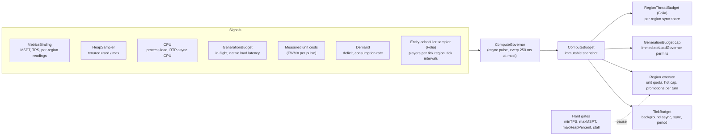

# ADR-087 - Adaptive Compute Governor: Automatic Performance Tuning, Memory Backpressure, and Multi-Region Concurrency

**Status:** Proposed
**Date:** 2026-09-07
**Revised:** 2026-10-23 (rewritten in place before implementation: scope widened from Folia to every platform; section 3 retained, with sections 3.4 and 3.6 implemented by ADR-112. Second pass the same day after review: per-region unit quota and cadence sized from the busiest region; background tick headroom spent once; lag-aware limiter cuts and stale-signal hold; async CPU signal; memory fit guarded against the governor's own influence; regional cuts gated on RTP's contribution; interval-based entity-scheduler sampler; absolute loan cap; waiting-player ordering removed, so the governor never reorders or delays player requests; proposed requirements listed; observe-only go/no-go gates; governor BIT component; competitor evidence citation corrected)

## Context

RTP spends server compute on background work: backlog picks, cold-cache fill, cold-to-hot promotion, pregeneration, and the async and sync pulses that drain the selection pipelines. Today that spend is set by **fixed budgets plus on/off gates**:

| Mechanism | Kind | Source |
|-----------|------|--------|
| `TickBudget` (`syncAllottedTime` 5 ms, `asyncAllottedTime` 25 ms, `period` 20 ticks) | Fixed values from `performance.yml`, clamped to `[1, 25]` ms | `rtp-core` `tasks/tick/TickBudget` |
| `ServerHealthGate` (`minTPS`, `maxMSPT`, stalled tick) | Binary pause with hysteresis; per region on Folia | `rtp-core` `tools/ServerHealthGate` |
| `HeapPressureMonitor` (`maxHeapPercent`) | Binary pause plus active hot-cache shedding | `rtp-core` `tools/HeapPressureMonitor`, `Region#shedHotCacheUnderPressure` |
| `GenerationBudget` (cap 2 on 1.20/1.21, 4 on 26.x) | Fixed in-flight cap for first-come, first-served chunk systems | `rtp-core` `tools/GenerationBudget` |
| `ImmediateLoadGovernor` permits (1 regional, 2 global, 1 when MSPT > 35) | Fixed caps with one step | `rtp-core` `selection/region/ImmediateLoadGovernor` (ADR-114) |
| `Region.MAX_PROMOTIONS_PER_PULSE` (8) | Fixed | `rtp-core` `selection/region/Region` |
| `RegionThreadBudget` (`syncAllottedTime` per region thread per 50 ms) | Fixed token bucket | `rtp-folia` (ADR-112) |
| `cacheCap`, `activeChunkCap`, `backlogCacheCap` | Fixed per region | region definitions, `config.yml` |

The problems this ADR addresses:

1. **The operator is the tuner.** Picking `period`, `asyncAllottedTime`, `syncAllottedTime`, `activeChunkCap` and `cacheCap` requires knowing the host's CPU, storage, heap, platform and player load. Most operators never touch them; others copy a prefab (`low-performance`, `high-performance`, `folia-tuned`) that matches their host on the day they install it and not after. REQ-RTP-OPS-001 requires only that the defaults work. "Never need to tune" is a Server Administrator goal in [`STAKEHOLDERS.md`](../dev/STAKEHOLDERS.md) with no requirement, because nothing yet shows it can be met; this ADR's observe-only evidence (section 8) is what would let it become one.
2. **Binary gates are a cliff, not a slope.** Between "healthy" and "paused" RTP runs at full configured spend. A server at 40 ms MSPT gets the same background load as one at 5 ms, until it crosses `maxMSPT` (45 ms) and gets none. The result is avoidable lag just below the threshold, and stop-start refill around it.
3. **Spend does not follow demand.** Each region refills once per `period` whether or not anyone teleports there, and a full cache still pays the pulse. A lobby-adjacent region with constant traffic and a forgotten region with none get the same compute.
4. **Platform and environment drift.** Operators swap jars (Paper to Folia), hardware, JVM flags and heap sizes without revisiting plugin config. Static unit estimates misjudge the real footprint (cold NVMe versus spinning disk versus network storage; G1 on 32 GB versus a 2 GB container).
5. **No control over downstream startup flags.** RTP cannot set JVM flags, GC tuning, or heap size. Background execution must adapt to the compute and memory it actually gets.
6. **Each subsystem adapts alone.** `ProbeFirstGovernor` (ADR-109), `LiveLoadGate` (ADR-110), `ImmediateLoadGovernor` (ADR-114), `HotBudgetAllocator` (ADR-078) and `RegionThreadBudget` (ADR-112) each measure their own costs or bound their own resource. `ImmediateLoadGovernor` also reacts to MSPT through one fixed constant, `mspt > 35`, in three places: it damps the global permits, forces PREFILTER, and is the knee of the tick-time shadow price `computeTickWeight`. They share the `common/predict` primitives (`EwmaEstimator`, `BernoulliEstimator`, `BudgetPacer`, `ComparativeCostGovernor`) but not a budget, so they cannot trade compute against each other and can react to the same spike several times.

Folia-specific hazards remain in scope (section 3):

7. **The 50 ms tick cliff per region.** When a region's own load uses 40-48 ms of its tick, any RTP work scheduled onto it pushes the tick past 50 ms; queued tasks spill into later ticks and players see rubber-banding and hit delay.
8. **Region over-instantiation.** Chunk loads scattered across disjoint coordinates can create more ticking regions than tick threads, so regions time-share threads and each ticks late. This hazard follows from Folia's threading model; no RTP benchmark isolates it yet. The competitor failure often cited next to it is a different one: in run `20260617-191448` (Folia 26.1) EzRTP 3.4.0 tripped the Folia watchdog 7 times, with one region unresponsive for 20.4 s, and the stack shows a synchronous `World.loadChunk` on a region thread (`ServerChunkCache.syncLoad`). That is an S-005-class block, not over-instantiation ([`PRE_WRITEUP.md`](../../helpers/StressTestRTP/PRE_WRITEUP.md) section 5.3). S-005 and ADR-112 guard the blocking load; section 3.2 guards over-instantiation.
9. **Multi-region allocation churn.** Concurrent chunk loads across regions expand young-gen quickly on elastic collectors (G1 on 16-32 GB heaps can grow Eden past 8 GB before collecting).
10. **Uneven cost concentration.** In the ADR-112 stress run one region fell to about 1.4 TPS while the mean stayed at 18.9. Chunk-bound work clustering where the candidates are is one possible cause. RTP's tick-thread work also concentrates for reasons unrelated to any chunk:
    - **Placement-free work pinned to one thread.** Location-less `RTPScheduler#runTask`, `#runTaskLater` and `#runTaskTimer` go to Folia's global region scheduler (`FoliaSchedulerImpl`). That includes the per-tick `SyncTaskProcessing` pulse, the scan batch hand-off in `ScanTask`, fill deadlines and failsafes in `RegionCacheTask`, action starts, cancellations and teardown reports. However many tick regions exist, all of it lands on one serial queue.
    - **Inline continuations.** Non-`*Async` `CompletableFuture` stages run on the thread that completes the future. ADR-112 decision 1 hands `FoliaRTPWorld#getChunkAt` completions to the async scheduler, but two paths remain. A future completed inside a region task (for example a live-check result in `QueueTask` or `PregenTask`) runs every dependent stage inline on that region thread, so placement-free selection and bookkeeping are charged to whichever region happened to own the candidate. The hand-off also falls back to inline when the async scheduler rejects. Either way "async" work maps onto the finite set of regions that complete RTP's results.
    - **New regions start from zero.** `RegionThreadBudget` is a per-tick-thread bucket (`ThreadLocal`) that starts full on first use and keeps no per-region history. A newly created region has no estimator or limiter state, and Folia's rolling TPS window for it starts empty. RTP's spend and the readings are least reliable exactly when RTP is creating regions.

    Which of these produced the 1.4 TPS region is not yet established; section 8 adds the diagnostic that separates them. ADR-112 caps RTP at one `syncAllottedTime` per region thread per 50 ms, but only for work inside its spans, and the cap is uniform. A region at 45 ms of its own load pays the same as one at 5 ms, so its players pay for background work that idle regions could have absorbed. Those players did not request the teleports: the cost is socialised onto bystanders instead of falling on the players and RTP regions that consume it. Work clustered in one region also drains at one budget per tick while other regions have headroom and nothing to do, so it finishes later than it needs to.

## Decision

Introduce one **Adaptive Compute Governor** in `rtp-core` that measures headroom and demand, computes an effective value for every background compute knob, and publishes them as one immutable snapshot that every actuation point reads. Operator-configured values become **limits** the governor works within, so the operator states how much RTP may use, not how to spend it.

**What the governor is for, and what it is not.** With the shipped defaults the governor can only make RTP *lighter*: it idles background work when nobody needs it and backs it off before the hard gates trip. It never makes RTP faster than today, because every configured value is a ceiling (principle 2). A speed-up needs raised ceilings, which is a separate, evidence-gated decision (section 9, step 8). It never touches player-facing work (principle 4).

### 1. Principles

1. **Spend headroom only where there is demand.** Background spend is the product of two terms: how much the server can spare (tick time, heap, chunk-system capacity, CPU) and how much work is needed (cache deficit, consumption rate). Either term at zero means background work idles.
2. **Never more aggressive than the configured limits.** Every effective value lies between a fixed internal floor and the operator's configured value, which is the ceiling (for `period`, the configured value is the shortest cadence allowed). On Folia, `syncAllottedTime` is a per-region ceiling. RTP's server-wide sync spend per 50 ms stays within today's ADR-112 bound of one `syncAllottedTime` per tick thread running RTP work: the pool $\Pi$ (section 4.5, item 3). A region may exceed its own value only by borrowing pool budget that other regions left unused, up to $\min(2 \cdot S_{\text{cfg}},\; 25\text{ ms})$.
3. **Hard gates stay as backstops.** `minTPS`, `maxMSPT`, `maxHeapPercent`, the stalled-tick check and the ADR-112 regional circuit breaker keep their current semantics and keep pausing background work. The governor's soft targets sit below them, so in normal operation the gates do not trip.
4. **Players already waiting are never throttled.** The governor shapes background work only. Player-facing pipelines (urgent selection, waiting `playerQueue` entries, interactive loads, teleport stages) keep the configured budgets and their existing order, as today ("serving waiting players is never gated"; `GenerationBudget` never refuses a load). The governor never refuses, reorders or delays a player's request.
5. **Fail to configured, never climb blind.** A signal that has never been sampled (no metrics on this platform) leaves its knobs at configured values, which is today's behaviour. A signal that was sampled and is now stale or failed holds the current effective value and never raises it; recovery needs fresh readings. No effective value ever exceeds a ceiling, and no signal failure blocks interactive work.
6. **One controller, no new threads.** The governor runs on the existing async pulse through `RTP.scheduler` (Rule F-001). It holds no locks on hot paths: actuation points read a `volatile` snapshot reference.
7. **Pure and testable.** The control law is a pure function `(signals, previous state, clock) -> (budget, state)`. Signal sources and the clock are injectable, so every behaviour below is unit-testable without a server.
8. **Background cost follows consumption, not bystanders.** Background refill is shared per player, not per teleport or per RTP region: a region used by many players is not penalised for being popular, and a region driven by one player's repeated teleports refills at one player's weight. On Folia, background tick work goes to tick regions with headroom and few or no players. Per-player rate policy (cooldowns, prices, permissions) stays operator policy outside the governor (section 4.6).

**Requirements.** Requirements state the invariants; this ADR records how they are met. On acceptance the following are added to `REQUIREMENTS.md` (IDs assigned then) and traced in `TRACEABILITY.md`. Everything else in this ADR is design and may change by revision without changing them.

| Principle | Proposed requirement |
|-----------|----------------------|
| 2 | With `autoTune` enabled, no effective background budget shall exceed the configured value of its key, except a Folia per-region loan bounded by $\min(2 \cdot S_{\text{cfg}}, 25\text{ ms})$ and by the server-wide pool. |
| 2 | With `autoTune` disabled, every budget shall equal its configured value. |
| 3 | The governor shall not change the semantics of `minTPS`, `maxMSPT`, `maxHeapPercent`, the stalled-tick check or the regional circuit breaker. |
| 4 | The governor shall not throttle, reorder or delay player-facing work. |
| 5 | A never-sampled signal shall leave its knobs at configured values; a stale signal shall not raise any effective value. |
| 6 | The governor shall create no threads and take no locks on actuation paths. |
| 3.2 | RTP shall not have more regional dispatches in flight than the section 3.2 bound. |

Existing requirements this design must also meet: REQ-RTP-OPS-002 (every load-driven reduction of a `performance.yml` value reports its cause and configured value on an operator surface; section 6 is the governor's design for it) and REQ-RTP-OPS-001 (shipping `autoTune: true` must not stop the shipped configuration from working on any Tested platform).

### 2. Architecture



- **`ComputeSignals`**: one sampled reading of every input, built by a `SignalSource` (production: metrics binding, heap sampler, CPU sampler, budgets, regions; tests: fixed values). Each reading carries a state: `NEVER_SAMPLED`, `FRESH` or `STALE` (principle 5).
- **`ComputeGovernor`**: holds the estimator and limiter state and evaluates the control law. It is a single instance, reset on reload.
- **`ComputeBudget`**: an immutable record of effective values plus a `reason` per knob (`CONFIGURED`, `CPU_HEADROOM`, `ASYNC_CPU`, `HEAP_HEADROOM`, `IDLE`, `CHUNK_LATENCY`, `REGION_OVERLOAD`, `STALE_SIGNAL`, `BACKSTOP`) for diagnostics.
- **Global plus regional.** The governor sets server-wide values and a per-RTP-region unit quota. On Folia it also sets, per tick region, a sync share, a steering weight for background work, and any borrowed budget (section 4.5). These come from that region's own readings, because one slow region must not shrink every other region's budget (ADR-112 decision 6).

### 3. Multi-Region Concurrency, Tracked Scheduling and Anti-Starvation (Folia)

Retained from the original decision. Sections 3.4 and 3.6 are implemented by [ADR-112](ADR-112-per-region-work-division-on-folia.md).

1. **Zero untracked worker threads.** All async and regional operations go through the server's native schedulers (`RTPScheduler` to Folia `AsyncScheduler`, `RegionScheduler`, `GlobalRegionScheduler`). `AsyncTaskProcessing` runs on one thread at a time; a tick thread is engaged only as its placement class allows (section 4.5). Watchdog, tick monitor and profilers (Spark, Paper timings) see every RTP task.
2. **In-scheduler regional concurrency bound.** `FoliaSchedulerImpl` bounds in-flight regional dispatches with a permit pool of $C_{\text{max\_regional\_inflight}} = \max(1, \lfloor \text{availableProcessors} / 2 \rfloor)$ and defers new dispatches until in-flight checks complete, so RTP does not create disjoint ticking regions faster than the thread pool can tick them. RTP's off-tick Anvil prefilter (ADR-016; addon-registered readers per ADR-077) evaluates most candidates from disk without touching live chunks; this bound covers prefilter-disabled worlds, custom generators and burst load.
3. **Spatial balance under the bound.** When the regional ceiling is saturated, the pipeline prefers Type A work (coordinate generation, bitmap lookups, off-tick prefilter) and Type B work (chunks inside an already-active region), and defers Type C work (L2-to-L1 promotion or live fallback reads that create a new region). It never substitutes non-uniform candidates, preserving the ADR-001 spiral distribution.
4. **Coalesce per region, interleave across regions.** *Implemented by ADR-112 (per-cell FIFOs, one slice per cell, per-region-thread token bucket).*
5. **Backlog is bounded by existing tiers.** Deferred Type C work stays in its current tier (`backlogLocations`, `unkeptLocations`), already bounded by `backlogCacheCap` and `cacheCap` (ADR-028, ADR-078). No new queues are introduced and nothing in a tier is dropped.
6. **Regional circuit breaker.** *Implemented by ADR-112 (late slice > 100 ms or unhealthy region runs one task; `RTPScheduler#isRegionSaturated`).*

### 4. Control Law

Evaluated at most every 250 ms (the gate sampling interval) at the start of an async pulse. Notation: $R$ = active RTP regions (selection regions) with a loaded world; $R_d$ = those with demand ($d_r > 0$, section 4.3); $k$ = a Folia **tick region** (the server's unit of parallel ticking, unrelated to RTP regions), tracked as a cell group (section 4.5); configured values carry the suffix `cfg`.

#### 4.1 Signals

| Signal | Source | Notes |
|--------|--------|-------|
| $\text{mspt}$ | `MetricsBinding#worstMspt` (single-loop hosts) | Tick **work**, not interval (METRICS_PLAN). NaN = unsampled. Not used as headroom on Folia (below). |
| $\text{mspt}_{\text{rtp}}$ | EWMA of RTP's measured tick-thread time per tick (single-loop hosts) | Subtracted from $\text{mspt}$ so RTP does not throttle against its own load and oscillate. |
| Region readings | `MetricsBinding#regionTps1m` / `#regionMspt`, ADR-112 slice dispatch lag | Folia samples tick intervals: below 50 ms they carry no headroom information; only overload is visible. |
| Region cost ledger (Folia) | `RegionThreadBudget` charges per ADR-112 cell, split interactive / background; queued work per cell FIFO | RTP measures its own spend exactly. Section 4.5. |
| Players per tick region and tick intervals (Folia) | `EntitySchedulerSampler`: short repeating tasks on each sampled player's `Entity#getScheduler()` (public API) | Population and overrun where players are; no spare-time reading below 50 ms. Section 4.5. |
| Tick time by placement class | Budget spans around chunk-bound, entity-bound, global-bound and placement-free tick work, including the global region | Ledger input and diagnostic. Section 4.5. |
| Process CPU | `com.sun.management.OperatingSystemMXBean#getProcessCpuLoad`; RTP async CPU per pulse from `ThreadMXBean#getCurrentThreadCpuTime` around `AsyncTaskProcessing` drains | Async work (the 25 ms pulse, Anvil decompression) competes with tick threads for cores, and $B_{\text{cpu}}$ cannot see it. The only CPU-contention reading on Folia. `NEVER_SAMPLED` when the JVM does not support either call. |
| Consumer ledger | `ConsumerLedger`: distinct consuming players per RTP region; attributed cost per player (telemetry only) | Section 4.6. |
| Tick stall | `ServerHealthGate#tickStalled` | Backstop and breach signal. |
| Heap | `HeapSampler` tenured used/max, `Runtime#maxMemory` | Same tenured-first rules as `HeapPressureMonitor`, including the 512 MiB absolute-headroom floor. |
| Chunk-system load | `GenerationBudget#inFlight`, native load latency EWMA and windowed minimum | Latency is shared with `ImmediateLoadGovernor` (ADR-114) rather than re-measured. |
| Unit costs | $\Delta T_{\text{async}}$, $\Delta T_{\text{tick}}$, $\Delta M_{\text{unit}}$ | Section 4.2. |
| Demand | Per region: deficit $D_r$, consumption rate $\lambda_r$ | $D_r$ = configured fill level minus (current + in flight + pending); $\lambda_r$ = EWMA of locations served per tick (the `HotBudgetAllocator#recordDemand` counters). |

- **Signal lag.** Every signal declares its lag $L_s$: the window its value averages over (for example the window of the MSPT statistic the binding reads, or one minute for `regionTps1m`), or 0 for instantaneous readings such as a tick stall or an entity-scheduler interval. The limiter uses it (section 4.4).
- **Folia is detected by `MetricsBinding#regionalTicking()`, not by a NaN MSPT.** With Spark installed, `SparkMetricsBinding` wraps `FoliaMetricsBinding` and `worstMspt()` returns the worse of Spark's scalar MSPT and the worst region interval. Neither is per-region work time, so on Folia no MSPT reading is used as headroom, whichever binding is active.

Soft targets, derived from the existing keys so that no new key is required:

- $T_{\text{cpu}} = 0.8 \times \text{maxMSPT}$ (36 ms at the default 45 ms; 40 ms when `maxMSPT` is 0 = off).
- $T_{\text{heap}} = \text{maxHeapPercent} - 10$ points (75 % at the default 85 %; 80 % when the gate is off).
- $T_{\text{proc}} = 0.9$ process CPU load.

#### 4.2 Measured unit costs (empirical before/after differentials)

A **unit** is one background location carried one tier forward (backlog pick, cold fill or promotion).

- $\Delta T_{\text{async}}$: async-worker nanoseconds per unit, measured around each `Region.execute` turn and divided by the units it completed.
- $\Delta T_{\text{tick}}$: tick-thread nanoseconds per unit (promotion completion, ticket activation, native sync load cost). On Folia this is charged to the region thread by the ADR-112 bucket and only informs the global estimate.
- Both use `EwmaEstimator` with $\alpha = 0.1$. Priors are today's effective values, so the first minutes match current behaviour.
- $\Delta M_{\text{unit}}$: retained heap per hot entry, modelled from the chunks RTP holds rather than from heap deltas:
  $$\Delta M_{\text{unit}} = n_{\text{chunks}} \cdot m_{\text{chunk}}$$
  - $n_{\text{chunks}}$ is the measured mean number of chunk tickets per hot entry (EWMA, prior $(2 \cdot \text{viewDistanceSelect} + 1)^2$).
  - $m_{\text{chunk}}$ starts at a per-version prior, calibrated offline with `helpers/StressTestRTP/.../TicketFootprintProbe.java` and recorded before rollout step 4. It is refined by the least-squares slope of post-GC tenured used (`HeapSampler#tenuredUsedBytes`, collection usage) against RTP-held chunk tickets over a 10-minute window. The slope replaces the prior only when the window holds at least 20 post-GC samples and RTP's ticket count varied by at least 25 % of its mean; otherwise the prior stands. Other allocations enter the fit as noise rather than as RTP's cost.
  - **Only demand-driven ticket changes enter the fit.** Samples taken within 60 s after a hot-cap contraction or a heap shed are excluded.
  - The estimate stays within $[m_{\text{prior}},\; 4 \cdot m_{\text{prior}}]$. It moves in both directions inside that range and returns to the prior when the fit no longer supports a higher value.

  Why the fit is guarded this way:
  - **The controller biases the fit low.** Under `autoTune` the hot cap contracts when heap is high (section 4.3, item 6), so the governor itself pushes ticket count down exactly when tenured use is up. The regression then sees a negative correlation that is not a property of chunks, and the slope comes out low. A low $m_{\text{chunk}}$ grows $N_{\text{total}}$ and expands the hot tier into the pressure it is meant to avoid; a high one only costs hit rate. Excluding contraction windows removes most of the induced correlation, and the floor at the prior removes the dangerous direction. Observe-only data (rollout step 1) is free of this bias, and is recorded to check the prior.
  - **Large heaps rarely refine the prior.** On large G1 heaps old-gen collection usage updates infrequently, the 20-sample condition is seldom met, and the calibrated prior is the operative estimate. That is intended: the hot tier is a small share of a large heap.
  - **Per-batch tenured deltas are not used.** Tenured growth includes every allocation on the server, kept chunks reach tenured long after their batch, and a GC between samples hides the delta. Dropping negative deltas would leave an estimate that only ratchets upwards.

#### 4.3 Knob formulas (model targets)

**Background CPU headroom per tick (single-loop hosts):**
$$B_{\text{cpu}} = s \cdot \max\left(0,\; T_{\text{cpu}} - (\text{mspt} - \text{mspt}_{\text{rtp}})\right), \quad s = 0.5$$

$B_{\text{cpu}}$ is the whole background tick allowance per tick, and it is spent once. Background sync stages and promotion completions both draw from the background sync budget $S_{\text{eff}}$ (item 4), and nothing else sizes tick work from $B_{\text{cpu}}$. Promotion completions are background tick work; where one runs outside the background sync span today, rollout step 3 brings it under that span. Otherwise sync stages and promotions would each size themselves from $B_{\text{cpu}}$, background tick spend could reach $2 \cdot B_{\text{cpu}} = T_{\text{cpu}} - \text{base}$, and the $s = 0.5$ safety margin would be gone.

**Background unit rate.** The rate is driven by demand and limited by headroom; deficits are filled over a horizon $h = 600$ ticks (30 s):
$$r^{*} = \min\left(\sum_r \lambda_r + \frac{\sum_r D_r}{h},\; \frac{B_{\text{cpu}}}{\Delta T_{\text{tick}}}\right)$$

**Folia** (selected by `regionalTicking()`, section 4.1). No reading gives tick headroom below 50 ms on Folia, so $B_{\text{cpu}}$ is not computed there and no knob reads it. Tick-time headroom is enforced where it is spent, by the per-region shares of section 4.5. Without a reading, the global CPU terms stay at their configured values (principle 5):

- $r^{*}$ is demand only: $r^{*} = \sum_r \lambda_r + \sum_r D_r / h$. The per-region plan, `period` and the async budget follow from it as below; the async budget still answers to the process CPU breach (item 3).
- Promotions per turn stay at the ceiling (8). Promotion completions are chunk-bound tick work, already bounded by their region's share and steering.
- Item 4 (single-loop sync) does not apply; section 4.5 replaces it. Item 6 has no CPU term and applies unchanged.
- The global limiters breach only on server-wide signals: tick stall, heap above $T_{\text{heap}}$, process CPU above $T_{\text{proc}}$, chunk-system latency, and the mean-TPS gate (ADR-112 decision 6). A slow tick region is handled by its own share and never cuts a global knob.

1. **Per-region quota and pulse cadence (`period`).**
   - **Plan.** Each region with demand gets a planned rate $x_r$: its demand $d_r = \lambda_r + D_r / h$ when $r^{*} \ge \sum_r d_r$, otherwise its section 4.6 allocation, so that $\sum_r x_r = r^{*}$.
   - **Quota.** A region turn completes at most
     $$u_r = \left\lfloor x_r \cdot \text{period}_{\text{eff}} + \kappa_r \right\rfloor$$
     units, where $\kappa_r \in [0, 1)$ carries the fractional remainder to the next turn, so long-run delivery equals $x_r$ even when $x_r \cdot \text{period}_{\text{eff}} < 1$. `ComputeBudget#unitsPerTurn(region)` publishes $u_r$; `Region#execute` applies it to every unit kind it completes in the turn, next to today's fill bound `min(deficit, MAX_PROMOTIONS_PER_PULSE)`, which becomes $\min(\text{deficit}, p_{\text{eff}})$.
   - **Cadence.** With $u_{\max} = \lfloor A_{\text{cfg}} / \Delta T_{\text{async}} \rfloor$, the units one full-budget region turn can complete:
     $$\text{period}_{\text{eff}} = \text{clamp}\left(\left\lceil \frac{u_{\max}}{\max_r x_r} \right\rceil,\; \text{period}_{\text{cfg}},\; 8 \cdot \text{period}_{\text{cfg}}\right)$$
     $\max_r x_r = 0$ (no demand, or no headroom) gives the idle ceiling $8 \cdot \text{period}_{\text{cfg}}$. Full regions are skipped, and candidates within a region are never reordered (ADR-001).

   Why it is built this way:
   - **The quota is the rate limiter.** The global knobs ($\text{period}_{\text{eff}}$, $A_{\text{eff}}$, $p_{\text{eff}}$) are the same for every region. Without a per-region bound a turn completes as many units as its deficit and budget allow, so a region capped by section 4.6 still refills at full speed, the delivered total can exceed $r^{*}$, and the allocation is a number nobody enforces.
   - **The busiest region sets the cadence.** Each region gets one turn per period and a turn completes at most $u_{\max}$ units, so region $r$ is served only if $x_r \cdot \text{period} \le u_{\max}$ for every $r$. Sizing the period from the mean, $R_d \cdot u_{\max} / r^{*}$, stretches it until the *average* region is served: with one region holding 90 % of demand among ten, that region would get about a tenth of its plan. Sizing $A_{\text{eff}}$ from the maximum cannot repair this, because $A_{\text{eff}}$ is clamped to $A_{\text{cfg}}$.
   - **With the quota, the cadence only decides latency.** It sets how often turns are handed out; $u_r$ sets how much each delivers. The cadence is computed from capacity and plan, not from units completed, which the budget itself caps.
2. **Promotions per turn** (today `MAX_PROMOTIONS_PER_PULSE = 8`), drawn from the background sync budget rather than from $B_{\text{cpu}}$ directly:
   $$p_{\text{eff}} = \text{clamp}\left(\left\lfloor \frac{S_{\text{eff}} \cdot \text{period}_{\text{eff}}}{R_d \cdot \Delta T_{\text{tick}}} \right\rfloor,\; 1,\; 8\right)$$
3. **Background async budget (`asyncAllottedTime`).** This is enough for the turn's quota, with margin:
   $$A_{\text{eff}} = \text{clamp}\left(1.25 \cdot \max_r u_r \cdot \Delta T_{\text{async}},\; 1\text{ ms},\; A_{\text{cfg}}\right)$$
   The budget is sized from the plan, not from units completed last turn: those are capped by the budget, so a history-based budget would hold itself low. Its knob-specific breach is process CPU above $T_{\text{proc}}$ on two consecutive evaluations while RTP's async CPU per pulse is above zero, so RTP backs off when cores are saturated and it is contributing. Urgent and waiting-player pipeline drains keep $A_{\text{cfg}}$.
4. **Background sync budget (`syncAllottedTime`), single-loop hosts:**
   $$S_{\text{eff}} = \text{clamp}\left(B_{\text{cpu}},\; 1\text{ ms},\; S_{\text{cfg}}\right)$$
   All background tick work, including promotion completions, is charged to it. Player-facing sync stages keep $S_{\text{cfg}}$.
5. **Per-region sync share, steering and lending (Folia).** See section 4.5.
6. **Hot cache capacity (`activeChunkCap`).** Memory available to the hot tier is what RTP already holds plus the remaining headroom to the soft target:
   $$B_{\text{mem}} = \max\left(0,\; T_{\text{heap}} \cdot \text{maxHeap} - \text{tenuredUsed}\right) + N_{\text{hot}} \cdot \Delta M_{\text{unit}}$$
   $$N_{\text{total}} = \left\lfloor \frac{B_{\text{mem}}}{\Delta M_{\text{unit}}} \right\rfloor$$
   $N_{\text{total}}$ is divided across regions by demand weight with `HotBudgetAllocator#computeQuotas` (floors honoured first, then proportional). Each region is bounded by $[\min(1, \text{activeChunkCap}_{\text{cfg}}),\; \text{activeChunkCap}_{\text{cfg}}]$, and a region with $\lambda_r = 0$ over 10 minutes floats down to $\lceil \text{activeChunkCap}_{\text{cfg}} / 4 \rceil$.
   - **Contraction** gates promotions first (ADR-078: quota changes act as promotion gating). Tickets are released only while the hot count exceeds the quota by more than 25 % or the heap is above $T_{\text{heap}}$, at most 4 per pulse, through the existing shed path: the location returns to cold and its ticket is closed exactly once (S-002).
   - **Kept chunks also cost tick time.** $N_{\text{total}}$ has no CPU term. On single-loop hosts the hot-cap limiter also breaches on $\text{mspt} > T_{\text{cpu}}$, so CPU pressure contracts the hot tier through the limiter. Whether that is enough depends on the per-ticket tick cost, which varies with the ticket level each platform uses. Rollout step 1 records MSPT against RTP-held ticket count while nothing actuates, so the governor cannot bias the measurement. If the per-ticket cost at $\text{activeChunkCap}_{\text{cfg}}$ is not negligible against $B_{\text{cpu}}$, step 4 adds a CPU bound before it ships. On Folia the shed order already accounts for it (section 4.5, item 2).
   - **`cacheCap` (cold) is not floated.** Cold entries hold no chunk tickets and cost little memory; demand weighting orders their refill (item 1) instead.
   - **Pin slots follow the quota.** `LiveLoadGate` (ADR-110) bounds pinned native loads by `activeChunkCap`. It reads `budget.hotCap(region)` instead, so pinned loads cannot overcommit a contracted hot tier.
7. **Generation concurrency.** The `GenerationBudget` server cap and the `ImmediateLoadGovernor` global permits read one value:
   $$g_{\text{eff}} \in \left[1,\; \text{capFor(version)}\right]$$
   This value is driven by the limiter only. A breach is native load latency EWMA $> 2\times$ its 5-minute windowed minimum (queueing in the chunk system), an MSPT breach, or the process CPU breach of item 3. The fixed `mspt > 35 -> 1 permit` step is removed. The other two uses of the constant (Context item 6), the PREFILTER short-circuit and the knee of `computeTickWeight`, are cost-model inputs rather than budgets, so the limiter does not drive them. They keep reading the MSPT value they read today (`ServerHealthGate.lastMspt()` in `PregenTask`) and replace the constant 35 with $T_{\text{cpu}}$ from the snapshot (36 ms at the default `maxMSPT`); with `autoTune: false` they keep 35. `ProbeFirstGovernor` (ADR-109) compares wall-clock costs, reads no MSPT and does not read the snapshot. The regional permit (1) and the "loads are never refused, interactive loads still count" invariant are unchanged. The ceiling stays at today's caps: on first-come, first-served chunk systems every extra RTP load delays a joining player's chunks, so raising it needs its own evidence (section 9).

#### 4.4 Stability guard (AIMD limiter)

Each knob's effective value is $\min(\text{model target}, \text{limit})$, where the limit is an additive-increase / multiplicative-decrease limiter (new `common/predict/AimdLimiter`):

- **Breach** (any of: $\text{mspt} > T_{\text{cpu}}$, tick stall, heap above $T_{\text{heap}}$, a knob-specific breach from section 4.3): the limit is multiplied by 0.5 (`period` is multiplied by 2) and clamped to the floor.
- **One cut per breach episode, then a lag-aware cooldown.** A knob is cut when a breach begins. While the breach persists, it is cut again only after a cooldown of $\max(1\text{ s},\; L)$, where $L$ is the largest lag among the signals in breach. A single spike seen by several signals therefore cuts once. *Why:* a windowed mean stays above target for most of its window after the load has gone. With a fixed 1 s cooldown, one short spike seen through a 10 s window would cut about ten times and drive the knob to its floor. This is the usual failure of AIMD under delayed feedback.
- **Recovery**: after $\max(5\text{ s},\; L)$ without a breach, the limit rises by 10 % of the knob's range per 5 s window. Recovery counts only evaluations whose driving signals are `FRESH`: a `STALE` signal holds the limit (reason `STALE_SIGNAL`), because readings freeze during the stalls they should report (`ServerHealthGate`). A full return from floor to ceiling takes at least 50 s, which subsumes the original 30 s stabilisation window.
- **Deadband**: a published value changes only when the new target differs by more than 10 % or crosses a floor or ceiling, so actuation points see few changes.
- **Bounded oscillation**: a stable load converges to a limit cycle no wider than one cut, below the hard gates. The tests assert this with signals that carry realistic lag (section 8); with instantaneous test signals the assertion would prove nothing.

The model gives fast, informed targets after a platform or load change. The limiter guarantees that estimate errors cannot hold the server over its soft target for longer than one cooldown.

#### 4.5 Folia: division of labour and fair cost sharing

On a single-loop host every RTP millisecond lands on the one tick thread, so the only question is how much to spend. On Folia the question is also **where**. Tick regions run in parallel on a fixed pool of tick threads, each with its own 50 ms tick. A uniform per-region cap (ADR-112) protects each region, but it is neither fair nor fast, and it does not see work outside its spans (Context item 10). This section puts each kind of work on the thread that should pay for it, sizes each region's share by probing, moves background work towards regions that take it without lateness, and lets those regions borrow budget that busy regions leave unused. Every input comes from public Folia API; no internals are read.

How much of this section is needed depends on which Context item 10 mechanism produced the low-TPS region. The concentration diagnostic (section 8) answers that before any of it actuates (section 9).

**Work placement classes.** Only some RTP tick work is tied to a chunk. Every stage that needs a tick thread declares one class, and the class decides where it may run:

| Class | Examples | Runs on | Who pays |
|-------|----------|---------|----------|
| Chunk-bound | Live block checks, stale-chunk guard, ticket activation, arrival platform | The region that owns the chunk (S-005, Folia threading contract). It cannot move; only **when** it runs is steered. | That region's share (fairness rules 1-2) |
| Entity-bound | Teleport, fall-distance reset, bed spawn, player-sender commands | The player's entity scheduler, which follows the player across regions | The player's region, the player's own cost |
| Global-bound | Console commands, world-global state that the API places on the global region | The global region scheduler | A budgeted global share, charged in the ledger as region $k = \text{global}$ |
| Placement-free | Future continuations, cache and queue bookkeeping, deadlines and failsafes that only complete a future or flip a flag, scan batch hand-offs, pulse stages that touch no world state | Async by default. If an API requires a tick thread, the requesting player's entity scheduler, so the consumer pays. Unowned work goes to the global share. | The consumer, or the shared pool |

- **Results leave the region thread before dependents run.** A region-task body that completes a future completes it through RTP's async executor, as `FoliaRTPWorld` already does for chunk futures (ADR-112 decision 1). Dependents are placement-free unless they touch the chunk, and then re-enter through `RTPScheduler#runTask`, inside a `RegionThreadBudget` span, so they are charged.
- **Unclassified work keeps today's placement** and is charged to the global share, so a missed stage is visible in the ledger rather than silent.
- **Moving placement-free work onto the consumer's thread is the only cross-thread move.** Chunk-bound work can never follow the consumer (Alternatives).

**Tick-region state without region identity.** Public API cannot enumerate tick regions or name the one a thread is ticking. It can only answer `Bukkit.isOwnedByCurrentRegion` on a tick thread. RTP therefore keeps per-region state (bucket, limiter, ledger, loan) per **cell group**: ADR-112 cells that a slice has observed on the same tick region. Every per-region quantity in this section, including $J$ and $E$, is per group, and $k$ denotes a group.

- **Resolution.** At slice start, `RegionThreadBudget` tests one representative cell of each live group in the slice's world, nearest first, and joins the first match. With no match, the cell forms a new group. Live groups are those with queued work or charges in the last 60 s, which bounds the tests. The result is cached until the slice ends.
- **Splits and merges are conservative.** A cell whose last group no longer matches has split away; its new group starts at the lower of the old group's limit and the new-group prior. Two groups that match the same slice have merged; they keep the lower limit and the sum of their ledgers. A representative that unloads fails its test, which only causes a conservative split.
- **Token state moves from thread to group.** The ADR-112 bucket is a `ThreadLocal` per tick thread, and a thread ticks different regions over time. Kept per thread, tokens earned while ticking a quiet region would be spent in a busy one, and the ledger would not be per region. With `autoTune: true` the bucket lives on the group. With `autoTune: false` the per-thread bucket is unchanged.

**New regions do not start from zero.** A group formed for the first time starts its limiter at $S_{\text{cfg}} / 2$ and grows by the section 4.4 recovery rule, not from a full bucket. A region's interval readings are `NEVER_SAMPLED` until it is older than the reading's window; slice dispatch lag and the sampler's interval readings need no window and apply at once. Section 3.2 permits still bound how many regions RTP creates.

**Fairness rule (who pays).**

1. **A teleport pays where it lands.** Interactive work (arrival chunks, the live check for a waiting player, teleport stages) is charged to the tick region it runs on. It cannot move to another region and is never deferred (principle 4). It uses that region's share first, so background work there yields to it.
2. **Background work is a shared cost.** Background work has no requesting player. It is placed by max-min fairness on projected region tick time: RTP does not add background work to a region while another region that could take the same kind of work has a larger unused share. The busiest region therefore carries the least.
3. **No background candidate is starved.** Deferral is bounded by aging (below), so every region's candidates are processed within a fixed time.
4. **Lending redistributes and never adds.** Only budget that throttled regions did not use is lent. RTP's server-wide sync spend never exceeds the pool $\Pi$ (item 3), which is today's ADR-112 bound (principle 2).

**Per-region signals.**

- **Cost ledger** $c_k^{i}$, $c_k^{b}$: RTP's interactive and background sync milliseconds per tick on region $k$, including the global region. This is an EWMA of `RegionThreadBudget` charges aggregated from ADR-112 cells, split by placement class. It is exact for every span, because RTP times its own work.
- **Queued work** $q_k$: background milliseconds queued for $k$ (cell FIFO lengths times $\Delta T_{\text{tick}}$).
- **Overload**: `regionTps1m`, `regionMspt` (intervals above 50 ms), slice dispatch lag. These use the public API and are always available.
- **Entity-scheduler sampler** (`EntitySchedulerSampler`, rtp-folia). Every 2 s, spread across online players so that each evaluation touches at most 64, RTP starts a task on each sampled player's `Entity#getScheduler()` with `runAtFixedRate` and a period of 1 tick, and cancels it after 10 runs. The task runs on whichever region owns the player. It records:
  - **Population** $P_k$, on the first run: for the cells with pending RTP work, `Bukkit.isOwnedByCurrentRegion(world, cx, cz)` tells whether the cell shares this player's tick region. Cells are checked in one batch.
  - **Tick intervals**: `System.nanoTime()` on every run; the gap between consecutive runs is that region's tick interval. A gap above 60 ms (50 ms plus 10 ms jitter allowance) is an **overrun**. Two or more overruns in one 10-run window, or any single gap above 100 ms, is a breach.

  Why intervals between consecutive runs and not one delayed task: a one-tick-delayed task scheduled at an arbitrary phase of the tick runs between about 50 and 100 ms later on a *healthy* region. A 100 ms threshold on that reading has almost no margin against false positives, and misses a region that steadily overruns at 55-60 ms per tick. Consecutive runs of a period-1 task remove the phase, so the threshold can sit just above 50 ms. This is the same interval reading the existing probes use.

  Tasks of players who leave are retired by the scheduler's retired callback; the sampler holds no reference after that. A missed sample keeps the previous reading for one interval, then becomes `STALE`. The cost is at most 640 task runs per 2 s.
- **No spare-time reading.** Folia starts each region tick on a 50 ms boundary, so a task's timing looks the same whether the region used 5 ms or 45 ms. No public reading measures headroom below 50 ms, so the share is found by probing (item 1) instead of computed.

**1. Per-region share (found by probing).**
$$S_k = \text{clamp}\left(\text{limit}_k,\; S_{\min},\; S_{\text{cfg}}\right), \qquad S_k^{b} = \max\left(0,\; S_k - c_k^{i}\right)$$
Here $\text{limit}_k$ is the section 4.4 limiter, kept on the cell group (above). A breach is a sampler breach, an interval above 50 ms, dispatch lag above 100 ms, or `ServerHealthGate#regionUnhealthy`.

- **A breach cuts only if RTP contributed.** It halves $\text{limit}_k$ only if RTP charged at least $\max(0.5\text{ ms},\; S_{\text{cfg}} / 10)$ per tick on $k$, averaged over the 2 s before the breach. Otherwise the breach holds the limit (no growth) and is counted as `NOT_RTP`. *Why:* a late tick caused by a farm or a boss fight would otherwise halve RTP's share even when RTP spent nothing there. In regions with natural spikes $\text{limit}_k$ would rarely return to $S_{\text{cfg}}$, and those regions could never borrow, because a borrower must be at $S_{\text{cfg}}$ (item 3).
- **Growth.** Without a breach the limit grows additively. Regions with $P_k \le 1$ or with queued interactive work grow at the section 4.4 rate. A populated region ($P_k > 1$) without queued interactive work grows only after 60 s without a breach, and then at a quarter of that rate. One transient breach therefore does not cap a hub permanently, and the probe's occasional late tick falls mostly on empty or sparse regions, often on the teleporting player alone. A new group in a populated region stays near $S_{\text{cfg}} / 2$ for minutes, so its background work stays near $S_{\text{cfg}} / 2 - c_k^{i}$.
- $S_{\min}$ is the ADR-112 one-task floor. `RegionThreadBudget` reads $S_k$ (plus any loan) as its `budgetNanos` supplier for the slice's group. The no-catch-up bucket is unchanged. The group map is bounded, and entries expire after 60 s idle.

**2. Steering: moving background work to regions with headroom.** Each region has a weight $w_k = S_k^{b} / S_{\text{cfg}}$ in $[0, 2]$. Background stages that choose among candidates read it: cold-to-hot promotion, live fallback checks, pregeneration live scans, and the shed order for hot-cap contraction (section 4.3, item 6).

- Candidates are still drawn in ADR-001 order. Steering changes only **when** a candidate is processed, never which candidates exist (section 3.3).
- If $w_k \ge 0.5$, the candidate is processed now. If $w_k < 0.5$, it is deferred in its current tier (section 3.5), and its deferral count and first-deferral time are recorded on the entry. No new queue is created.
- A candidate in no tick region (Type C, which would create one) has $w = 1/2$, the new-group prior, while section 3.2 permits are free, and is deferred while they are saturated (section 3.3). A new region has no players, so it is a good place for work, but it has no history yet; the prior and the pool bound protect it and the other regions.
- **Aging.** A deferred candidate is processed at the one-task floor after 60 s or 8 deferrals, whichever comes first, unless the ADR-112 circuit breaker holds its region (the hard backstop). This bounds deferral time. Over any window longer than the aging bound, the set of destinations still follows the ADR-001 distribution, and no region's candidates starve. Aging applies to background candidates only; no player request is deferred (principle 4).
- **Hot-tier footprint.** A kept chunk becomes part of the tick region that owns it, and adds to that region's tick and merge footprint (ADR-112 Context item 5). Contraction sheds from the lowest-$w_k$ regions first, and steering keeps new hot entries out of busy regions while they stay busy.
- This replaces the binary `RTPScheduler#isRegionSaturated` skip (ADR-112 decision 5) with a graded weight. The skip stays as the backstop.

**3. Lending: finishing the work faster.** Background throughput on Folia is $\sum_k \min(q_k, S_k^{b})$ per tick. Clustered work drains at one share per tick in its own region, whatever the other regions are doing. Steering moves work to where the headroom is; lending lets those regions drain it with budget that throttled regions did not use:
$$\Pi = S_{\text{cfg}} \cdot \min(K, \Theta), \qquad L = \max\left(0,\; \Pi - \sum_k S_k\right)$$
Here $K$ is the number of tick regions (groups) with RTP work in the last second, and $\Theta$ is the number of distinct tick threads that ran RTP work in that second. With one region per thread, $\Pi = K \cdot S_{\text{cfg}}$. With more regions than threads, $\Pi$ is today's per-thread total, so moving the bucket from thread to group cannot outspend today. If $\sum_k S_k > \Pi$, background shares $S_k^{b}$ are scaled down proportionally and $L = 0$. Interactive work is charged but never scaled or deferred (principle 4, ADR-112 decision 4).

- **The pool depends on how spread out RTP's work already is.** $\Theta$ counts threads that ran RTP work. If RTP's work is concentrated on one thread, $\Theta = 1$, $\Pi = S_{\text{cfg}}$ and there is nothing to lend. Lending therefore only helps once placement (rollout step 2) and steering (item 2) have spread the work. This is accepted: it keeps the pool at today's bound by construction.

A region $k$ may borrow only when all of these hold:

- it has more queued work than its share ($q_k > S_k^{b}$);
- its limiter is at $S_{\text{cfg}}$ and it has had no breach for 10 s;
- no sampled region has shown an overload signal in the last 5 s;
- the section 3.2 permits are not saturated. A saturated pool time-shares tick threads, so extra time on one region would delay another region's tick.

Each borrower has its own loan limiter $\ell_k$, probed the same way as its share: it grows additively from 0 while the conditions hold and halves on any breach in $k$. Requests
$$e_k = \min\left(S_{\text{cfg}},\; 25\text{ ms} - S_k,\; \ell_k,\; q_k - S_k^{b}\right)$$
are scaled by $\min\left(1,\; L / \sum e_k\right)$. Hence $S_k + e_k \le \min(2 \cdot S_{\text{cfg}},\; 25\text{ ms})$ and $\sum_k (S_k + e_k) \le \Pi$. Loans are recomputed at every evaluation. A loan lapses when the lending region recovers or any breach appears.

- *Why the absolute cap:* `syncAllottedTime` may be configured up to 25 ms (`MAX_ALLOTTED_MS`), and `RegionThreadBudget#budget()` clamps only at a full tick. A 2x loan alone would allow 50 ms, the whole tick. With the cap no region ever receives more than the largest value an operator can configure for one region.
- The global overload veto may hold most of the time on a busy server, which would make lending a calm-server feature. Rollout step 1 measures how often it would hold before lending is built (section 9, step 7).

**4. Fairness measures.** Without a headroom reading, fairness is measured against what each region has shown it can take. RTP's use of a region's proven capacity is $x_k = c_k / \text{limit}_k$, with $c_k = c_k^{i} + c_k^{b}$. It is reported as Jain's index over regions with RTP work:
$$J = \frac{\left(\sum_k x_k\right)^2}{n \cdot \sum_k x_k^2}$$
$J = 1$ means every region gives up the same fraction of its proven capacity. A second measure tracks principle 8 directly: **bystander exposure** $E = \sum_k P_k \, c_k^{b} / \sum_k P_k$, the background RTP milliseconds per tick that the average online player's region carries. The governor aims to keep $E$ low, not equal. The uniform ADR-112 cap scores low on both whenever load differs between regions.

**5. Bystanders.** The steering weight becomes $w_k / (1 + P_k / 4)$, so background work and new hot entries prefer empty regions over populated ones that take work equally well. A teleport's arrival work necessarily lands in its destination's tick region; RTP destinations are mostly in sparse areas, and that work is the teleporting player's own cost (fairness rule 1).

#### 4.6 Consumer attribution (background share only)

Principle 8 in mechanical form. It applies only while background refill is constrained ($r^{*} < \sum_r d_r$); otherwise every region gets its demand and this section has no effect. It shapes background refill and reporting only: it never touches a waiting player's request, never adds a cooldown or message, and never changes the order of any queue.

**Consumer ledger (`ConsumerLedger`).**

- **Per RTP region:** distinct active players $n_r$ who consumed locations there in the last 10 minutes (minimum 1). This is the only ledger value the control law reads.
- **Per player (telemetry only):** attributed cost $a_p = \tfrac{1}{2}\left(a_p^{30\,\text{s}} + a_p^{10\,\text{min}}\right)$, the mean of two EWMAs of RTP milliseconds per minute charged to that player's requests, with half-lives of 30 s and 10 minutes. Charges cover async selection, sync stages, interactive chunk loads and placement-free work run on the player's entity scheduler, plus one measured unit cost ($\Delta T_{\text{async}} + \Delta T_{\text{tick}}$) per cached location the player consumed, which is the refill they caused. It feeds `/rtp info` "top consumers" and the input of any future rate policy (item 4), never a decision of the governor.
- Keyed by UUID, held in memory only, bounded to 4096 entries (least recently active evicted), expired after 30 minutes idle and cleared on reload. It is never persisted, and there are no per-player metric labels.
- **No exemption permission.** Attribution changes no player's service, so there is nothing to exempt anyone from. An administrator testing or pregenerating counts as one player in $n_r$, like anyone else; pregeneration does not consume cached locations and does not enter $n_r$.

**1. Background refill across RTP regions.** When $r^{*}$ does not cover demand, the rate is divided by weighted max-min fairness (water-filling) with weights $n_r$:
$$x_r = \min\left(d_r,\; n_r \cdot \theta\right), \qquad \theta \text{ chosen so that } \sum_r x_r = r^{*}$$
A region used by 40 players gets up to 40 times the share of a region used by one player, so the main region is not penalised for being popular. Every use is linear in the weight; super-linear weighting is rejected (Alternatives). The quota $u_r$ (section 4.3, item 1) enforces $x_r$. Hot quotas (section 4.3, item 6) use the same capped weights $\min(d_r, n_r \theta)$ instead of raw demand.

**2. What a heavy consumer feels.** A region driven by one player's repeated teleports refills at one player's weight, so that player more often finds the region's ready cache empty and is served from a cold or backlog location or by live selection. That is cache state, not a throttle: those paths run at the configured player-facing budgets and in their existing order. Nothing else changes for them.

**3. Evasion.** Alternate accounts raise $n_r$ for the region they use. The worst case is that the region is weighted as if those accounts were real players, still capped at its demand $d_r$; no other region is starved, because water-filling serves every unsatisfied region the same per-player share.

**4. Out of scope: per-player rate policy.** When one player's request rate outruns refill, the right tool is a cooldown, not reordering. A cooldown is visible (a configurable message, S-007), it reduces incoming work instead of shuffling the same work, and how often a player may teleport is the operator's decision. An optional dynamic cooldown that lengthens with load is therefore left to a separate, opt-in decision outside `autoTune`, with this section's telemetry ($n_r$, $a_p$, refill versus consumption per region) as its input. Constraints recorded for that decision:

- **Fix the cooldown when the teleport completes.** Today the remaining time is recomputed on every check from the current `RTP.getCooldown(...)` minus the time since the last teleport (`RTPCmd`, with the shared last-teleport time from `RTPNetworkManager` / `RedisManager`). A load-dependent value recomputed that way would make a player's remaining time jump; storing an expiry, or the cooldown in force at teleport time, avoids it and changes the shared key format.
- **Drive it from location supply** (consumption versus refill per region, cache depletion), which a cooldown can fix, not from MSPT, which the background governor and the hard gates already handle.
- **Bound it**: the configured cooldown is the floor, an operator-set maximum the ceiling; existing bypass permissions apply, and the message shows the effective value.

**5. Billing, not thread placement.** On Folia, placement-free work that needs a tick thread runs on the consumer's entity scheduler (section 4.5), so its tick cost lands in the consumer's own region. Chunk-bound work always runs where its chunk is; its cost appears in the consumer's ledger entry, while the tick time itself is steered to empty regions.

### 5. Operator Surface

`performance.yml` gains one key, mirrored into `lang/<file>.lang.yml` and every `lang/<locale>/advanced/performance.yml` (REQ-RTP-F-013, ADR-020, `LocaleParityTest`):

```yaml
# Tune background work automatically from measured server headroom and demand.
# The values below become limits: RTP never uses more than syncAllottedTime /
# asyncAllottedTime, or refills faster than period. Players are never slowed.
# false = fixed values.
# @type: boolean
# @default: true
autoTune: true
```

The key ships with rollout step 3, the first step that actuates anything. Until then the governor always runs observe-only and the key is absent. From step 3, `true` actuates only the knobs whose rollout step has shipped; the others stay at their configured values with reason `CONFIGURED`.

| Key | With `autoTune: true` | With `autoTune: false` |
|-----|-----------------------|------------------------|
| `period` | Shortest cadence; idle up to 8x | Fixed cadence (today) |
| `asyncAllottedTime`, `syncAllottedTime` | Ceiling for background work; player-facing work keeps the full value | Fixed (today) |
| `syncAllottedTime` on Folia | Per-region share follows that region's headroom; a region with headroom may borrow unused budget up to 2x, at most 25 ms; the server-wide total never exceeds today's one value per tick thread running RTP work | Fixed per region thread (ADR-112) |
| `activeChunkCap` | Per-region ceiling; floats with heap headroom and demand | Fixed (today) |
| `cacheCap`, `backlogCacheCap` | Unchanged; refill order and share follow demand | Unchanged |
| `minTPS`, `maxMSPT`, `maxHeapPercent` | Hard backstops; also derive the soft targets | Hard backstops (today) |
| (none) | Background refill share weighted by distinct players per region; waiting players unaffected | Today's per-region refill |

With the shipped defaults `autoTune: true` only reduces RTP's footprint, when the server is loaded or the caches are full. Operators should not expect it to make teleports faster; that needs raised ceilings (section 9, step 8). The performance prefabs (`low-performance`, `high-performance`, `folia-tuned`) become ceiling presets, and their pulse and budget entries stay valid. Whether operators still need them to match a host is the Context item 1 goal, so whether to retire them is decided after the section 8 evidence and section 9.

### 6. Operator Visibility and Telemetry

Silent adaptation confuses operators (for example, `/rtp info` showing fewer hot entries than configured), and "RTP is slow" becomes a question about the governor's recent history. REQ-RTP-OPS-002 requires at least one operator surface per reduction. The governor uses four because each serves a different reader: the console for the operator at the time, `/rtp info` for a live check, metrics for dashboards, and BIT for support.

1. **Console.** On a state change of any knob's `reason` (not on every value change), the governor logs one line through `RTPRuntime.log(Level.INFO, ...)`, at most once per 60 s per knob. The line names the cause, the configured value and the effective value, for example `[RTP] Background work reduced (MSPT 41.2 ms, target 36.0 ms): period 20 -> 40 ticks, activeChunkCap 10 -> 6.` Recovery to configured values logs once.
2. **`/rtp info`.** Shows configured and effective values with the reason, for example `Period: 20 ticks (effective 40, cpu headroom)`, `Hot cap: 10 (effective 6, heap headroom)`, `Generation: 2 (effective 1, chunk latency)`, plus Folia regional in-flight versus ceiling. On Folia it also lists the top tick regions by RTP cost (ms per tick by placement class, share, loan, deferred candidates, players), the global region's RTP cost, the total lent, the fairness index $J$, bystander exposure $E$, and sampler coverage (players sampled in the last interval). It also lists the top RTP regions by refill share ($n_r$, demand, allocation) and the top consumers by attributed cost, so an operator can see who drives RTP's load and decide whether a cooldown or price is warranted. All strings are in `messages.yml` (REQ-RTP-F-013, REQ-RTP-S-007).
3. **Metrics.** Through `metrics-api`: `rtp_governor_period_ticks`, `rtp_governor_async_budget_ms`, `rtp_governor_sync_budget_ms`, `rtp_governor_hot_cap` (per region), `rtp_governor_units_per_turn` (per region), `rtp_governor_generation_cap`, `rtp_governor_breaches_total` (by signal), `rtp_governor_stale_signals`, `rtp_governor_regional_inflight_count`. On Folia: `rtp_governor_region_sync_ms` (by kind and placement class; label set bounded to the top 8 tick regions by cost plus `global` and `other`), `rtp_governor_lent_ms`, `rtp_governor_deferred_total`, `rtp_governor_aged_total`, `rtp_governor_fairness_index`, `rtp_governor_bystander_exposure_ms`, `rtp_governor_overruns_total`, `rtp_governor_breaches_not_rtp_total`. Consumer attribution: `rtp_governor_consumer_cost_p99_ms`, `rtp_governor_region_refill_share` (per RTP region). There are no per-player labels, which keeps cardinality bounded and player identifiers out of metrics.
4. **Built-in test ([ADR-121](ADR-121-built-in-test-for-configuration-and-the-action-engine.md)).** The governor registers a CBIT component `compute-governor` under a `GOVERNOR` code namespace, so support reads it through `/rtp test` like every other subsystem instead of through metrics:
   - `GOVERNOR_KNOB_REDUCED` (`INFO`): a knob below its configured value, with its reason.
   - `GOVERNOR_KNOB_AT_FLOOR` (`WARNING`): a knob held at its floor for more than 10 minutes. Background work is effectively off; the server is overloaded or a signal is wrong.
   - `GOVERNOR_SIGNAL_STALE` (`WARNING`): a previously sampled signal stale for more than 60 s; the knobs it drives are held.
   - `GOVERNOR_EVALUATION_FAILED` (`WARNING`): evaluations failing and the previous snapshot kept.

### 7. Mechanical Specification and Implementation Layout

1. **Placement (`rtp-core`, package `io.github.dailystruggle.rtp.common.governor`).** `ComputeGovernor`, `ComputeBudget` (record), `ComputeSignals` (record), `SignalSource`. `AimdLimiter` goes to `common/predict` next to `EwmaEstimator`, since it is domain-agnostic. There are no platform imports; platforms supply signals only through the existing `MetricsBinding` and `RTPScheduler` SPIs. The process CPU sampler uses only JDK management beans and stays in `rtp-core`.
2. **Evaluation point.** `AsyncTaskProcessing#runPulse` calls `ComputeGovernor#maybeEvaluate(now)` before draining. A failed evaluation keeps the previous snapshot and logs at `WARNING`, rate-limited (no silent swallow), and raises `GOVERNOR_EVALUATION_FAILED`.
3. **Actuation points** read the snapshot and do not re-derive anything:
   - `TickBudget`: `asyncNanos()`, `syncNanos()` and `periodTicks()` keep returning configured values. New `backgroundAsyncNanos()`, `backgroundSyncNanos()` and `backgroundPeriodTicks()` return effective values, and background callers opt in to them. A missed call site therefore behaves exactly as today and never throttles players (principle 4). `SelectionAPI`'s default budget supplier, set in `TickBudget`'s static initialiser, stays on the configured accessor; background refill paths pass the background supplier explicitly. On Folia, `RegionThreadBudget` takes its supplier from the governor (below), not from `TickBudget`.
   - `AsyncTaskProcessing`: urgent and waiting-player drains use `asyncNanos()`; standard background drains and `Region#execute` use `backgroundAsyncNanos()`; the region refill cadence reads `backgroundPeriodTicks()`. Background drains are timed with `ThreadMXBean#getCurrentThreadCpuTime` for the process CPU signal.
   - `Region#execute`: the turn's units are bounded by `budget.unitsPerTurn(region)` (the governor keeps the carry $\kappa_r$), `activeCap` comes from `budget.hotCap(region)`, the fill bound from `budget.promotionsPerTurn()`, and measured unit costs are reported back to the governor. Promotion completions run inside the background sync span on single-loop hosts.
   - `GenerationBudget.configureServerCap(() -> Math.min(versionCap, budget.generationCap()))`. `ImmediateLoadGovernor#tryAcquirePermit` / `#permitsAvailable` use `budget.generationCap()` for the global limit; the PREFILTER short-circuit and `computeTickWeight` read `budget.cpuTarget()`. `LiveLoadGate` reads `budget.hotCap(region)` for its pin-slot bound.
   - `FoliaSchedulerImpl`: the `RegionThreadBudget` supplier becomes `() -> governor.regionalSyncNanos(groupOfCurrentSlice)` (share plus loan), and its token state moves from the `ThreadLocal` to the cell group (section 4.5). `RegionThreadBudget` resolves the group at slice start and reports each charge to the ledger with its group, tick thread and kind (interactive or background); the governor derives $\Theta$ from the distinct threads.
   - Background candidate stages (`Region#execute` promotion, live fallback checks, `PregenTask` live scans, hot-cap shed order) read `budget.regionWeight(world, cx, cz)`. `RTPScheduler#isRegionSaturated` stays as the backstop. Deferral count and first-deferral time are two fields on the existing cache entry.
   - `ConsumerLedger` (governor package) receives charges tagged with the requesting player's UUID from `SelectionAPI`, `TeleportPipelineTask` and `RegionThreadBudget`, and consumption events per RTP region. It exposes $n_r$ to the governor and $a_p$ to `/rtp info`. No queue reads it. Water-filling for refill and hot quotas is a pure function next to `HotBudgetAllocator#computeQuotas`.
   - Folia share, steering weight and lending are computed by a pure `RegionShareAllocator` in the governor package (inputs: per-region ledger, queue, overload, overrun and population readings; outputs: shares, weights, loans, $J$, $E$). `EntitySchedulerSampler` lives in `rtp-folia`, uses only `Entity#getScheduler()` and `Bukkit.isOwnedByCurrentRegion`, and is exposed through a new optional `MetricsBinding` default method that returns `NEVER_SAMPLED`, so other platforms are unaffected. No `EXTERNAL_HOOKS.md` row is needed.
   - **Placement.** Each tick-thread stage declares its placement class. Placement-free stages use `RTPScheduler#runTaskAsynchronously`; when an API needs a tick thread they use `RTPScheduler#runTaskForPlayer` with the consumer, or the global share for unowned work. Futures completed inside region-task bodies (`QueueTask`, `PregenTask`, `RegionCacheTask` live checks) complete through an executor backed by `RTPScheduler#runTaskAsynchronously` (no new threads, F-001), like `FoliaRTPWorld.OFF_REGION`; an inline fallback is counted and logged at `FINE`. Deadlines and failsafes that only complete a future move to async delayed tasks. Every global-region dispatch, including the `SyncTaskProcessing` pulse, runs inside a `RegionThreadBudget` span charged as $k = \text{global}$.
   - **Mechanical check.** An architecture test fails the build when `rtp-core` selection, cache, scan or teleport code calls a location-less `RTPScheduler#runTask` / `#runTaskLater` outside an allow-list of global-bound callers (VERIFICATION_GATES gate 2).
4. **Reload and lifecycle.** The governor resets to configured values on config reload and on `autoTune: false`, and its state is released on shutdown. Per-group state is bounded; no `MemoryTracker` registration is needed because no chunk tickets are held. Sampler tasks are cancelled on shutdown, after their 10 runs, and when their player is retired.
5. **Safety rules.** S-005: no signal read or actuation loads a chunk; the governor only gates when existing paths run. S-002: hot-cap contraction uses the existing single-close shed path. S-004: deferral leaves background candidates in their tier and never fails a teleport. F-001: no threads.

### 8. Verification and Evidence

- **Unit tests** (pure control law, injected signals and clock):
  - Step load in MSPT cuts on the first evaluation and recovers within the bounded window.
  - A single one-tick spike observed through a windowed-mean signal model with lag $L$ cuts each knob once, not once per second of the window; constant load through the same model gives an oscillation width of one cut or less.
  - Zero demand idles (`period` at ceiling, background async at floor).
  - Skewed demand (one region with 90 % of demand among ten) delivers each region its plan $x_r$ within one unit per turn, and the total delivered over a window never exceeds $r^{*}$; regions with $x_r \cdot \text{period} < 1$ receive $x_r$ in the long run through the carry.
  - On single-loop hosts, total background tick charge per tick (sync stages plus promotion completions) never exceeds $B_{\text{cpu}}$.
  - Process CPU above $T_{\text{proc}}$ on two evaluations, with RTP async CPU above zero, cuts $A_{\text{eff}}$ and $g_{\text{eff}}$; with RTP async CPU at zero it does not.
  - A never-sampled signal leaves its knobs at configured values; a sampled signal that turns stale holds them and never raises them; recovery resumes only on fresh readings.
  - Heap ramp contracts the hot cap before `maxHeapPercent` trips.
  - The per-chunk memory estimate never falls below the prior, never exceeds $4 \cdot m_{\text{prior}}$, ignores samples within 60 s after a contraction, keeps the prior when RTP's ticket count did not vary, and stays at or above the prior when the input carries a controller-induced negative correlation.
  - `autoTune: false` gives exactly the configured values; no effective value exceeds its ceiling (property test over random signals); the background async budget reaches its planned level on the first evaluation after demand appears, rather than growing from the floor; `TickBudget`'s existing accessors return configured values with `autoTune` on.
  - On Folia (`regionalTicking() == true`, with and without a Spark-wrapped binding) no global knob reads $B_{\text{cpu}}$ or any MSPT as headroom, and a single slow region cuts no global limiter.
- **Folia allocator tests** (pure `RegionShareAllocator`, property tests over random region sets): $\sum_k (S_k + e_k) \le \Pi$, including when regions outnumber threads, and $S_k + e_k \le \min(2 S_{\text{cfg}}, 25\text{ ms})$, including with $S_{\text{cfg}} = 25$ ms; a breach halves that region's share on the same evaluation when RTP charged at least the contribution threshold, and holds it without cutting when RTP charged less; a populated region's limit does not grow within 60 s of a breach and then grows at a quarter rate; a new group starts at $S_{\text{cfg}} / 2$; a split group starts no higher than its old limit and merged groups keep the lower limit; tokens earned in one group are never spent in another; no loan while the borrower's limiter is below ceiling or has breached within 10 s, while any region is overloaded, or while section 3.2 permits are saturated; interactive charges are never deferred; every deferred candidate is processed within the aging bound; an empty region is preferred over a populated one with an equal share.
- **Placement tests**: placement-free stages never run on a region thread they did not declare; dependents of a future completed inside a region task run async; global-region work is charged as $k = \text{global}$; the architecture test rejects a new location-less `runTask` in selection code.
- **Sampler tests** (mocked entity scheduler, injected clock): population counts match `isOwnedByCurrentRegion` answers; a region ticking every 50 ms at an arbitrary start phase produces no overrun; a region ticking steadily at 58 ms produces a breach within one window; one gap above 100 ms produces a breach; a retired player leaves no reference; a task cancels after 10 runs; at most 64 players are sampled per evaluation.
- **Attribution tests** (pure, injected clock): water-filling never gives a region more than its demand and gives every unsatisfied region the same per-player share; a region with $n$ players gets $n$ times a one-player region's share when both are unsatisfied; the ledger never exceeds 4096 entries and entries expire; with `autoTune` on, the order and budgets of every player-facing queue are identical to `autoTune: false` (principle 4).
- **Simulation**: the ADR-090 `SimulatedFoliaRuntime` with injected regional MSPT and dispatch lag exercises the per-region share and the section 3 bounds. A clustered scenario reproduces the ADR-112 stress shape (one tick region at high own load holding most queued work, several idle regions) and compares the uniform cap with section 4.5.
- **Observe-only go/no-go** (rollout step 1, recorded in this ADR before step 3). On the bench and at least one real server:
  1. **Is RTP the marginal cost?** The share of evaluations with $\text{mspt}$ between $T_{\text{cpu}}$ and `maxMSPT`, and RTP's background share of MSPT within that band. If RTP's background spend is not a material part of tick time when the server is near the gate, the headroom terms (the $B_{\text{cpu}}$ limits in steps 3 and 6) are not worth shipping. Demand idling still is.
  2. **Concentration diagnostic**: rerun the ADR-112 stress shape with per-region tick time split by placement class, global-region RTP time, placement-free time inside region spans, inline fallbacks of the off-region hand-off, and region age at the first late tick. It establishes which Context item 10 mechanism produced the low-TPS region, and how much of section 4.5 is needed.
  3. **Sampler agreement**: sampler breaches agree with `regionTps1m` and slice dispatch lag on each supported Folia version.
  4. **Lending veto**: the share of time the section 4.5 overload veto would hold.
  5. **Memory**: the observe-only memory fit against the calibrated prior, and MSPT against RTP-held ticket count (section 4.3, item 6).
- **Folia differential benchmark** (clustered stress run, uniform cap versus section 4.5): worst-region TPS p5, spread between best and worst region MSPT, global-region MSPT, background fill time, teleport latency p99, $J$ and $E$. Acceptance: worst-region TPS p5 and teleport latency p99 no worse, background fill time shorter, $J$ higher and $E$ lower.
- **Differential benchmark** (VERIFICATION_GATES gate 10): the same bench scenario with `autoTune` on and off, reporting MSPT p50/p99, gate trips, cache fill time after startup, teleport latency p50/p99 and RTP CPU time (tick and async). Acceptance: no regression in teleport latency p99 or fill time beyond 10 %, and fewer gate trips and lower MSPT p99 under load.
- **Traceability**: the requirements of section 1 are added to `REQUIREMENTS.md` and `TRACEABILITY.md` when this ADR is accepted; each test above that checks one of them carries its REQ ID.

### 9. Rollout

Each step ships behind its own evidence and is independently revertible by `autoTune: false`, except step 2.

1. **Observe only.** The governor computes and publishes metrics, `/rtp info` lines and its BIT component, but actuates nothing. No config key ships yet (section 5). Run the go/no-go measurements of section 8 and record them here.
2. **Placement.** Move placement-free work off the global region and off region threads, add global-region charging and the architecture test. This step changes where work runs, not how much, and is independent of `autoTune`. It does not depend on the governor and may land before step 1.
3. **Pulse budget.** Actuate demand idling, the per-region quota, `period`, background async (with the process CPU breach) and promotions per turn, and bring promotion completions under the background sync span. Demand idling ships regardless of go/no-go 1; the $B_{\text{cpu}}$ limit on $r^{*}$ ships only if go/no-go 1 passes.
4. **Hot cache.** Actuate `activeChunkCap` floating, after the per-version priors are calibrated and go/no-go 5 has decided whether a CPU bound is needed.
5. **Generation.** Actuate the generation cap and the `ImmediateLoadGovernor` permits.
6. **Sync.** Actuate the single-loop sync budget (if go/no-go 1 passed), and the Folia per-region share with probing and steering with aging (if go/no-go 2 shows tick-region concentration that shares can fix, and go/no-go 3 passes, since the shares actuate on sampler breaches).
7. **Folia lending.** Enable only if go/no-go 4 shows the veto leaves lending a meaningful share of time, and the Folia differential benchmark passes. If the veto holds most of the time, lending is not built.
8. **Raising ceilings** (separate decision). With differential evidence, consider shipping higher default ceilings (for example `syncAllottedTime` above 5 ms, generation caps above today's on prioritised chunk systems), since the governor would then only spend them when there is headroom. This is the only step that can make RTP faster than today.

## Alternatives Considered

| Alternative | Why Rejected |
|-------------|--------------|
| **Fixed operator configuration knobs (status quo)** | Operators rarely tune them, and static limits cannot react to boss fights, farms, raids or platform swaps. |
| **Per-knob control loops in each owning class** | No shared budget: loops react to the same spike several times and fight each other (for example, the hot cap growing while the period stretches). |
| **Single `targetMSPT` knob replacing the existing keys** | Breaks existing configs and prefabs, and removes the operator's hard upper bound on RTP's spend. |
| **Headroom-only driving signal** | Burns CPU filling caches nobody uses; idle regions still cost compute. |
| **Demand-only driving signal** | Keeps the binary cliff below `maxMSPT`; busy servers still get full spend until the gate trips. |
| **Pure AIMD** | Robust but slow to find the right level after a platform or load change; spends a long time far below the target. |
| **Pure cost model** | Reacts fast but depends on estimate quality; a bad estimate can hold the server over target. |
| **AIMD with a fixed 1 s cut cooldown** | Shorter than the lag of windowed signals; one spike cuts repeatedly and drives knobs to the floor (section 4.4). |
| **Climb towards configured values when a signal goes stale** | Readings freeze during the stalls they should report, so the governor would raise spend exactly when it is blind. Only a never-sampled signal defaults to configured values. |
| **Cadence sized from mean regional demand, no per-region quota** | Starves the busiest region (it gets about $\text{mean} / \text{max}$ of its plan), and the water-filling allocation is never enforced (section 4.3, item 1). |
| **Static a priori unit cost estimates** | Wrong when the platform or storage changes (Paper to Folia, NVMe to HDD or network storage). Measured differentials self-correct. |
| **Symmetric clamp on the fitted per-chunk memory cost** | Under `autoTune` the governor's own contraction biases the fit low, and a low estimate grows the hot tier into heap pressure. The estimate may only rise above the calibrated prior (section 4.2). |
| **Global thread-sleep throttling** | Sleeping workers does not relieve Folia region queues once tasks are dispatched. |
| **Unbounded regional dispatch** | Region over-instantiation: more ticking regions than tick threads, so every region ticks late (Context item 8). |
| **Bypassing region schedulers** | Violates S-005 and Folia's threading contract (`ThreadAccessException`, races on live world state). |
| **Uniform per-region cap on Folia (ADR-112 as is)** | A region at 45 ms of its own load pays the same as one at 5 ms, and clustered work drains at one budget per tick while other regions sit idle. |
| **Cut a region's share on every breach** | Farms and boss fights would cap RTP in regions where it spent nothing, and those regions could never recover to lend. Cuts require RTP's contribution (section 4.5, item 1). |
| **One-tick-delayed sampler with a 100 ms threshold** | A healthy region already reads 50-100 ms depending on phase, and a region steadily at 55-60 ms per tick is missed. Consecutive-run intervals remove the phase (section 4.5). |
| **Run all of a consumer's work on the consumer's thread** | Adopted for placement-free work only. Chunk-bound work must run on the region that owns the chunk; a task on the consumer's entity scheduler that touches a distant chunk throws `ThreadAccessException`. For chunk-bound work the consumer is billed instead (section 4.6, item 5). |
| **Strictly avoid busy regions (no aging)** | Starves those regions' candidates and permanently biases destinations away from populated areas (ADR-001). |
| **Lending without the pool-health gate, unbounded, or capped only at 2x** | When the pool is saturated, tick threads are time-shared, so extra time on one region delays others (section 3.2). A 2x cap alone allows a whole 50 ms tick at `syncAllottedTime: 25`. |
| **Run chunk-bound work on another region's thread** | Violates Folia's threading contract; only work that touches no chunk can move between threads (section 4.5, placement classes). |
| **Leave location-less work on the global region (status quo)** | One serial queue carries every placement-free task, whatever the number of tick regions, and none of it is budgeted. |
| **Order waiting players by attributed cost (lightest first, with aging)** | The delay is invisible to the player and reads as lag; it reshuffles the same work instead of reducing it; it puts per-player rate policy inside the performance layer; and with per-request aging bounds it needed its own proof of bounded wait. A cooldown does the job openly (section 4.6, item 4). |
| **Dynamic cooldown inside the governor** | Cooldowns are player-visible policy, not background tuning. Left to a separate opt-in decision with this ADR's telemetry as input (section 4.6, item 4). |
| **Super-linear consumer weighting ($n_r^{\gamma}$ or $a_p^{\gamma}$, $\gamma > 1$)** | Charges heavy consumers more than they used. Paying more is a policy choice that belongs to cooldowns and prices. |
| **Attribute cost per teleport or per RTP region** | Penalises popular regions and the many players using them: a region used by 40 players would be throttled like one player's spam. Per-player weighting keeps the cost on the individual heavy consumer. |
| **Reflective per-region tick report (`/tps` internals)** | Would give spare time below 50 ms directly, but reads Folia internals that can change on any update and needs an ADR-026 hook. Probing with public interval readings finds the same limits, at the cost of an occasional late tick in sparse regions. |

## Consequences

- **Positive:**
  - Operators state limits once; RTP adapts to hardware, platform, heap and player load without config edits or prefabs.
  - Background spend slopes down as MSPT approaches the soft target instead of falling off a cliff at `maxMSPT`, so gate trips and stop-start refill become rare.
  - Compute follows demand: busy regions refill first and get the rate they need, idle regions and full caches cost close to nothing.
  - The hot cache shrinks before heap pressure forces a full pause, and grows back when memory is available.
  - Chunk-system queueing and core saturation are detected from measured latency and CPU load, protecting joining players on first-come, first-served chunk systems.
  - One snapshot replaces scattered constants (`mspt > 35`, fixed permits, fixed promotions per pulse); `/rtp info`, metrics and the BIT component explain every reduction.
  - Player-facing work is untouched: no waiting player is throttled, reordered or delayed by the governor.
  - The Folia protections (section 3, ADR-112) are kept and fed by the same budget.
  - On Folia the busiest tick region carries the least background cost, and clustered work finishes sooner because regions with headroom take it and may borrow unused budget. Per-region cost and the fairness index make it visible who pays.
- **Negative / Trade-offs:**
  - With the shipped defaults `autoTune` never makes RTP faster than today; it only lowers RTP's footprint. Gains in speed need raised ceilings (rollout step 8).
  - Under sustained load, caches refill more slowly, so more teleports are served from cold or backlog tiers or resolved on demand. A player who drives a region alone meets this most often.
  - The idle cadence (up to 8x `period`) delays the first refill after demand returns by up to one idle period.
  - The player-facing / background split needs background callers to opt in to the `TickBudget` background accessors. A missed call site leaves that work at the configured value, the same as today, and never throttles players. Tests on each background path and the differential benchmark's RTP CPU time catch missed sites.
  - More moving parts: behaviour depends on measured state, so bug reports need `/rtp info` governor output, the `compute-governor` BIT findings and metrics to reproduce.
  - The lag-aware cooldown makes the limiter slower to cut a second time under a sustained breach; the hard gates remain the fast backstop.
  - The memory estimate cannot fall below its calibrated prior, so a host whose chunks are genuinely cheaper than the prior keeps a smaller hot tier than it could.
  - Without a public spare-time reading, each region's share is found by probing: a region occasionally gets a late tick while RTP finds its limit. Populated regions grow only after 60 s without a breach and at a quarter rate, so this mostly falls on empty regions or the teleporting player. In exchange, background work in a populated region stays near half of `syncAllottedTime` for minutes after the region forms or breaches.
  - Tick-region state is inferred from cell groups because public API has no region identity. Resolution costs one `isOwnedByCurrentRegion` test per live group per slice, and a missed merge or a false split errs towards smaller budgets.
  - The sampler runs up to 10 one-tick tasks per sampled player every 2 s (at most 64 players per evaluation) and adds per-player cleanup on quit.
  - Lending only helps once RTP's work is spread over several tick threads, and may rarely activate on a busy server because of the overload veto.
  - Placement-free work moved onto a consumer's entity scheduler runs in the consumer's region, which may be a populated hub. It is small by construction and appears in that region's ledger; work that is not small belongs async.
  - Background destinations in a busy tick region are processed later, up to the aging bound. This is a temporary bias, not a permanent one.
  - The ledger holds player UUIDs in memory for up to 30 minutes; nothing is persisted or exported per player. Alternate accounts can raise a region's refill weight, at most to its demand.

## References

- Folia regional threading, `RegionScheduler` and `EntityScheduler` contracts
- [ADR-001](ADR-001-archimedean-spiral-1d-mapping.md): Archimedean spiral mapping (distribution preserved under deferral)
- [ADR-004](ADR-004-countbound-taskpipe-on-folia.md): CountBoundTaskPipe Instead of TimeBoundTaskPipe on Folia Regional Threads
- [ADR-015](ADR-015-stale-chunk-guard-countbound-pipes.md): Stale-Chunk Guard for Count-Bound Pipes
- [ADR-026](ADR-026-external-hook-api-surface.md): External hook API surface (no reflective hook is needed; section 4.5 uses public API only)
- [ADR-028](ADR-028-l3-backlog-cache.md): L3 backlog cache tier
- [ADR-067](ADR-067-adaptive-scan-rate-and-mca-header-generation-check.md): Automatic PRESCAN, Adaptive Scan Rate Control, and .mca-Header Generation Check
- [ADR-078](ADR-078-composable-cache-pipeline-stages.md): Composable Cache Pipeline Stages and Dynamic Hot Quota Allocation (`HotBudgetAllocator`)
- [ADR-090](ADR-090-test-driver-and-synthetic-mca-architecture.md): Test-Driver and Synthetic MCA Architecture (`SimulatedFoliaRuntime`)
- [ADR-109](ADR-109-measured-cost-probe-first-gate.md), [ADR-110](ADR-110-purpose-gated-live-loads.md), [ADR-114](ADR-114-cost-governed-on-demand-chunk-reads.md): measured-cost gates whose constants this budget feeds
- [ADR-112](ADR-112-per-region-work-division-on-folia.md): Per-Region Work Division on Folia (implements sections 3.4 and 3.6)
- [ADR-121](ADR-121-built-in-test-for-configuration-and-the-action-engine.md): Built-In Test (the `compute-governor` CBIT component)
- [`PERFORMANCE.md`](../admin/configuration/PERFORMANCE.md), [`METRICS_PLAN.md`](../dev/METRICS_PLAN.md), [`VERIFICATION_GATES.md`](../dev/VERIFICATION_GATES.md)
- Competitor benchmark: EzRTP 3.4.0 on Folia 26.1, 7 watchdog stalls and a 20.4 s region freeze from a synchronous `World.loadChunk` on a region thread, run `20260617-191448`, [`helpers/StressTestRTP/PRE_WRITEUP.md`](../../helpers/StressTestRTP/PRE_WRITEUP.md) section 5.3 and [`RESULTS.md`](../../helpers/StressTestRTP/RESULTS.md)
