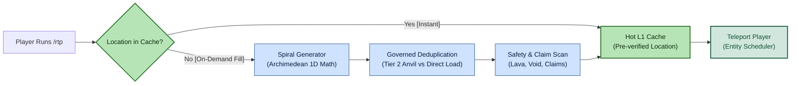
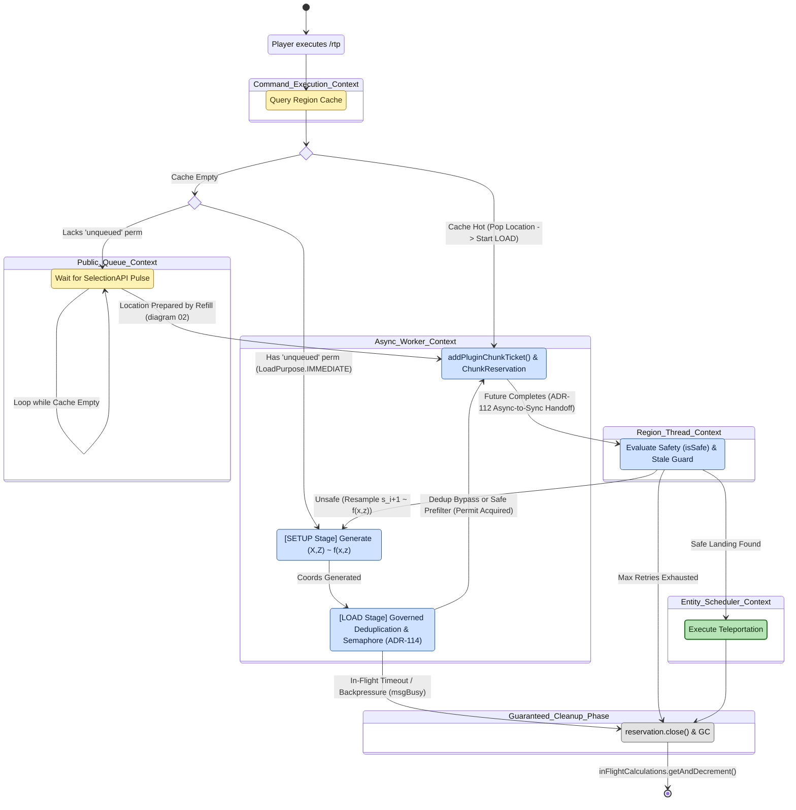

# Teleport execution pipeline

**Scope of this diagram.** This chart covers the end-to-end lifecycle of a *single* `/rtp` teleport once `SelectionAPI.getRegion` has already resolved a region (diagram 07) — from the cache-vs-queue-vs-unqueued branch, through the async `SETUP` → `LOAD` stages, region-thread safety eval, entity-scheduler teleport, and guaranteed cleanup. This is the **outer loop** that orchestrates all other pipelines. Related-but-separate behavior paths are intentionally **out of scope** here and documented elsewhere:
- **How a candidate `(x, y, z)` is accepted or rejected inside one attempt** — see diagram 08 (location selection per attempt); `EvalBlocks` in this chart is a single node that expands into that entire flowchart.
- **How the cache was filled** — see diagram 02 (budgeted cache generator); `QueueWait` simply pops a result prepared by that loop.
- **How chunk tickets are actually issued and released** — see diagram 03 (chunk ticket lifecycle); `ReqTicket` and `Teardown` are abstractions over it.
- **Region / world resolution** — see diagram 07 (`/rtp` command region selection); this chart starts after a region has been chosen.
- **Failure attribution and user-facing messages** — see `CODE_TOUR.md` section 7 and S-004 / S-007.

> Companion walkthrough: [`CODE_TOUR.md` section 2 — Teleport pipeline (end-to-end)](../dev/CODE_TOUR.md).

---

## Executive Overview (Macro Pipeline)

This high-level overview shows the core execution flow of an `/rtp` request. Pre-verified locations are served immediately from cache, while cache misses trigger asynchronous on-demand candidate generation (`LoadPurpose.IMMEDIATE`) using governed deduplication (ADR-114) and safety verification before handing off to player teleportation.

---

## Detailed Teleport State Machine

The detailed lifecycle below tracks thread boundaries, asynchronous chunk reservations, safety evaluation on the region thread, and teardown cleanup.

---

## Architectural Notes & Cross-References

- **Hot cache vs unqueued dispatch:** Serving pre-verified locations from the L1 queue (`keptLocations`) avoids all generation latency. When a player possesses `rtp.unqueued` or when the public queue is depleted, `PregenTask` runs under `LoadPurpose.IMMEDIATE`.
- **Governed on-demand deduplication (ADR-114):** Immediate tasks do not blindly trigger unconstrained native chunk loads. The `ImmediateLoadGovernor` evaluates the thread-weighted threshold ($P_{\text{reject}} > \frac{C_{\text{file, async}}}{C_{\text{native, async}} + W_{\text{tick}}(\text{MSPT}) \cdot C_{\text{native, sync}}}$). In safe terrain under stable ticks, it deduplicates by bypassing Anvil and dispatching directly to native loading, eliminating duplicate decompression and NBT decoding. In hazardous terrain or under tick distress, it engages off-thread Anvil pre-filtering to shed bad candidates without consuming main-thread tick budget.
- **In-flight generation bounding:** Live native generation during unqueued bursts is strictly bounded by regional (max 1) and global (max 2) semaphores, protecting the shared tick loop from sudden MSPT spikes and watchdog timeouts.
- **Asynchronous regional handoff (ADR-112):** On Folia, chunk futures complete off the region thread. `TeleportPipelineTask` continues generation results asynchronously before handing off to the regional entity scheduler within the regional token bucket for arrival validation and teleportation.
- **Guaranteed teardown (S-002, S-004):** Chunk reservations are tracked in `MemoryTracker` and closed on every exit path (successful teleport, hazard rejection, timeout, or cancellation).

Related documentation:
- Companion deep-dive on chunk resolution: [`docs/architecture/15-cost-governed-chunk-reads-and-native-admission.md`](15-cost-governed-chunk-reads-and-native-admission.md).
- Candidate selection per attempt: [`docs/architecture/08-location-selection-per-attempt.md`](08-location-selection-per-attempt.md).
- Chunk ticket lifecycle: [`docs/architecture/03-chunk-ticket-lifecycle.md`](03-chunk-ticket-lifecycle.md).
- Governing ADRs: [ADR-001](../adr/ADR-001-archimedean-spiral-1d-mapping.md), [ADR-015](../adr/ADR-015-stale-chunk-guard-countbound-pipes.md), [ADR-110](../adr/ADR-110-purpose-gated-live-loads.md), [ADR-112](../adr/ADR-112-per-region-work-division-on-folia.md), [ADR-114](../adr/ADR-114-cost-governed-on-demand-chunk-reads.md).