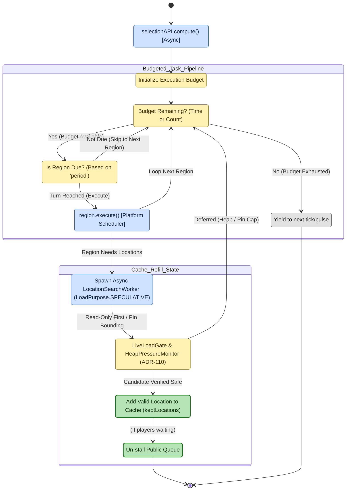

# Budgeted cache generator (queue refill)

**Scope of this diagram.** This chart covers the *background* loop that keeps each region's location cache warm: the periodic `SelectionAPI.compute()` pulse, the region-by-region budget enforcement (`queueLen` / maxBiasedAttempts), the hand-off to `LocationGenerator`, and the insertion of successful results into the cache that diagram 01 pops from. Under ADR-110 (purpose-gated live loads), background cache refill runs strictly under `LoadPurpose.SPECULATIVE`: it reads resident cache and Anvil region files off-tick (`getChunkIfReadable`), acquires pins via `LiveLoadGate` up to `activeChunkCap` on disk misses, and defers candidate attempts when `HeapPressureMonitor` signals memory pressure, ensuring speculative refills never steal native load permits or induce tick starvation.

Related-but-separate behavior paths are intentionally **out of scope** here:
- **What happens inside one candidate attempt** — see diagram 08 (location selection per attempt); `SpawnWorker` in this chart expands into that flowchart.
- **How a waiting `/rtp` consumes the cache** — see diagram 01 (`QueryCache` / `QueueWait`).
- **Chunk ticket book-keeping** — see diagram 03; every generated candidate reserves a ticket via `ChunkReservation`.
- **Purpose-gated live loads and on-demand chunk resolution** — see diagram 15.

> Companion walkthrough: [`CODE_TOUR.md` section 3 — Budgeted cache generator](../dev/CODE_TOUR.md).

---

## Architectural Notes & Invariants

- **Speculative load purpose (`LoadPurpose.SPECULATIVE`):** Background cache refill workers never initiate unconstrained native chunk loads. Candidates evaluate read-only against resident memory or region files (`RTPWorld.getChunkIfReadable`).
- **Admission bounds (`LiveLoadGate`):** When candidate terrain is missing from disk, `LiveLoadGate.tryAcquirePin()` permits live generation only if active pinned chunks remain under `activeChunkCap`. Unpinned cold generation populates `unkeptLocations` without holding active tickets.
- **Heap backpressure (`HeapPressureMonitor`):** When JVM heap usage exceeds `maxHeapPercent`, speculative attempts defer (`completeDeferred`) immediately, shedding background load to protect active server workloads.
- **Fair queue wake-up:** Adding a verified location to `keptLocations` unblocks the public queue (`QueueWait` in diagram 01) immediately, minimizing waiting disutility for pending players.

Related documentation:
- Teleport execution pipeline: [`docs/architecture/01-teleport-execution-pipeline.md`](01-teleport-execution-pipeline.md).
- Candidate selection per attempt: [`docs/architecture/08-location-selection-per-attempt.md`](08-location-selection-per-attempt.md).
- Cost-governed chunk resolution and native admission: [`docs/architecture/15-cost-governed-chunk-reads-and-native-admission.md`](15-cost-governed-chunk-reads-and-native-admission.md).
- Governing ADRs: [ADR-006](../adr/ADR-006-async-queue-pre-generation.md), [ADR-015](../adr/ADR-015-stale-chunk-guard-countbound-pipes.md), [ADR-016](../adr/ADR-016-anvil-subsystem.md), [ADR-078](../adr/ADR-078-composable-cache-pipeline-stages.md), [ADR-087](../adr/ADR-087-adaptive-compute-governor.md), [ADR-110](../adr/ADR-110-purpose-gated-live-loads.md).