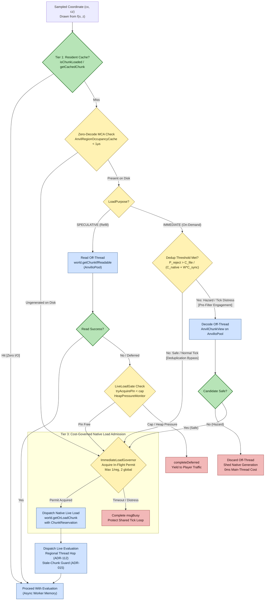
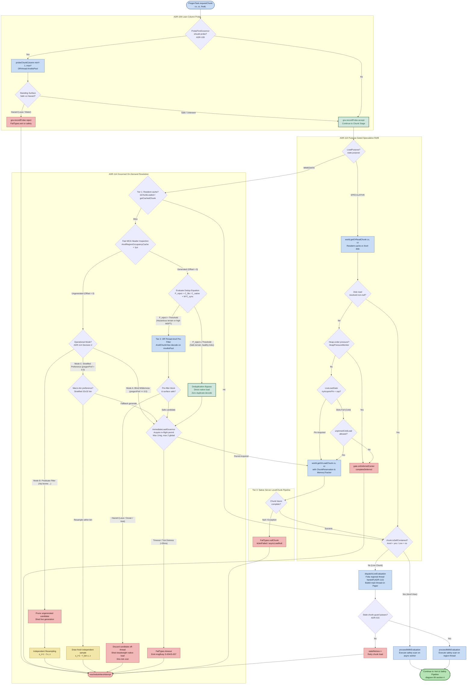

# Cost-Governed Chunk Reads and Native Fallback Admission

**Scope of this document.** This document specifies and visualizes the unified chunk resolution, deduplication, and native load admission architecture across both speculative background queue refill (`LoadPurpose.SPECULATIVE`) and on-demand execution (`LoadPurpose.IMMEDIATE`). It expands node `ChunkStage` of diagram 08 into an authoritative flowchart and mathematical decision framework.

Related-but-separate behavior paths are intentionally **out of scope** here:
- **How coordinates $(cx, cz)$ are drawn from the shape** — see diagram 08 (attempt pipeline) and diagram 13 (dual-layer shape architecture).
- **How chunk tickets and reservations are managed** — see diagram 03 (chunk ticket lifecycle) and diagram 04 (active GC sweep).
- **Macro-level command dispatch and queue wait** — see diagram 01 (teleport execution pipeline) and diagram 07 (`/rtp` command region selection).

Companion architectural decisions and references:
- [ADR-001](../adr/ADR-001-archimedean-spiral-1d-mapping.md): Archimedean spiral 1D mapping.
- [ADR-009](../adr/ADR-009-configurable-spatial-distributions.md): Configurable spatial distributions (`Flat`, `Normal`, `Exponential`).
- [ADR-016](../adr/ADR-016-anvil-subsystem.md): Anvil read-only subsystem (`AnvilChunkView`, `AnvilIoPool`).
- [ADR-028](../adr/ADR-028-l3-backlog-cache.md): L3 backlog cache order preservation (distribution invariance contract).
- [ADR-067](../adr/ADR-067-adaptive-scan-rate-and-mca-header-generation-check.md): Fast `.mca` header generation check Option B.
- [ADR-109](../adr/ADR-109-measured-cost-probe-first-gate.md): Measured-cost probe-first gate (`ProbeFirstGovernor`).
- [ADR-110](../adr/ADR-110-purpose-gated-live-loads.md): Purpose-gated live loads (`LiveLoadGate`, `HeapPressureMonitor`).
- [ADR-112](../adr/ADR-112-per-region-work-division-on-folia.md): Per-region work division and async completion on Folia.
- [ADR-114](../adr/ADR-114-cost-governed-on-demand-chunk-reads.md): Cost-governed on-demand chunk reads and native fallback admission.

---

## Executive Overview (Three-Tier Chunk Resolution)

Chunk resolution treats server computing capacity as a scarce collective resource. To maximize aggregate system welfare and minimize deadweight computational loss, candidate chunks resolve through three explicit tiers based on data presence, thread-weighted cost-benefit heuristics, and real-time tick health.

---

## Detailed Chunk Resolution & Load Governance Flowchart

---

## The Thread-Weighted Deduplication Architecture

### The Redundant Double-Parse Defect

To execute player teleportation under platform contracts (Paper, Folia, Spigot, Fabric, NeoForge), the final destination must be loaded as an authoritative `LevelChunk` registered in the server's primary chunk provider, with ticket tracking (`MemoryTracker` / `ChunkReservation`) and entity management. An `AnvilChunkView` is an unmanaged off-thread byte snapshot.

Whenever an off-thread pre-filter evaluates a safe candidate:
1. The background worker decompresses the sector stream, parses the NBT tree, and decodes the palette into `AnvilChunkView` ($C_{\text{file, async}}$).
2. The candidate passes safety validation.
3. The platform dispatches native chunk loading (`world.getChunkAtAsync`).
4. The server's internal chunk loader opens the region file, decompresses the sector stream, parses the NBT tree, and populates the level chunk structures ($C_{\text{native}}$).

For every accepted candidate, **decompression, NBT parsing, and palette decoding are executed twice**. If candidate acceptance rates are high ($P_{\text{safe}} > 75\%$, typical for Overworld plains and forest biomes), running an Anvil pre-filter on every candidate produces substantial deadweight loss:
- It consumes more aggregate CPU core-time than direct native loading: $C_{\text{file, async}} + C_{\text{native}} > C_{\text{native}}$.
- It inflates command-to-teleport latency ($T_{\text{cmd}\to\text{tp}} = T_{\text{file}} + T_{\text{native}} > T_{\text{native}}$), imposing waiting disutility on the player.

An off-thread pre-filter generates net savings **only when it rejects an unsafe candidate**, sparing the server the overhead of an expensive discarded native load.

---

### Asymmetric Thread Valuation

Computational expenditure cannot be evaluated as an undifferentiated scalar ($C_{\text{cpu}}$) because background worker pools and the server tick loop operate under fundamentally different constraints:

1. **Asynchronous Worker Pool (`AnvilIoPool`):** Resource capacity is elastic and scales across available background hardware CPU cores. Work executed off-thread does not consume server tick time, does not stall entity ticking, and imposes zero direct frame or block lag on connected players.
2. **Main Thread / Regional Tick Threads (`ServerLevel` / Folia):** The tick budget is strictly finite and inelastic (a non-negotiable $50\text{ ms}$ ceiling for 20 TPS). The tick budget is a collective asset shared by all connected players. Every millisecond consumed on a tick thread is permanently subtracted from entity updates, redstone calculation, and player physics.
3. **The Externality of Discarded Native Loads:** Natively loading an ungenerated or hazardous chunk engages the lighting engine, allocates level chunk objects, and synchronizes chunk holders. When rejected, the $0.5\text{--}3.0\text{ ms}$ of main-thread tick time spent managing its admission is irrecoverable deadweight loss stolen from the communal tick budget. Conversely, when an off-thread Anvil pre-filter rejects an unsafe chunk, the main thread pays exactly **$0.00\text{ ms}$**.

---

### Mathematical Model of the Deduplication Threshold

To maximize aggregate system welfare, computational expenditure is decomposed into asynchronous worker core-time ($C_{\text{async}}$) and main/regional tick time ($C_{\text{sync}}$), weighted by the dynamic scarcity of the tick budget:

$$\text{Cost}_{\text{effective}} = C_{\text{async}} + W_{\text{tick}}(\text{MSPT}) \cdot C_{\text{sync}}$$

where $W_{\text{tick}}(\text{MSPT})$ represents the dynamic shadow price multiplier of main-thread tick time:

$$W_{\text{tick}}(\text{MSPT}) = 1 + \alpha + \beta \cdot \left(\frac{\max(0, \text{MSPT} - 35)}{10}\right)^2$$

- **Healthy Conditions ($\text{MSPT} \le 25\text{ ms}$):** $W_{\text{tick}} \approx 5\text{--}10$.
- **Tick Distress ($\text{MSPT} > 35\text{ ms}$):** $W_{\text{tick}}$ escalates quadratically, reflecting the catastrophic disutility of TPS degradation and watchdog aborts.

#### The Net Utility Balance
Let:
- $C_{\text{file, async}}$ be the off-thread CPU core-time to decode an Anvil chunk ($2\text{--}5\text{ ms}$), with $C_{\text{file, sync}} = 0$.
- $C_{\text{native, async}}$ be the asynchronous worker time for server-side native chunk I/O and generation ($10\text{--}50\text{ ms}$).
- $C_{\text{native, sync}}$ be the mandatory main-thread or regional tick-thread time for native ticket registration, chunk holder tracking, and level admission ($0.5\text{--}3\text{ ms}$).
- $P_{\text{reject}}$ be the empirical candidate rejection rate, where $P_{\text{safe}} = 1 - P_{\text{reject}}$.

If the system executes an off-thread Anvil pre-filter before native loading:
$$\mathbb{E}[\text{Cost}_{\text{prefilter}}] = C_{\text{file, async}} + (1 - P_{\text{reject}}) \cdot \left( C_{\text{native, async}} + W_{\text{tick}}(\text{MSPT}) \cdot C_{\text{native, sync}} \right)$$

If the system routes directly to native loading (bypassing Anvil):
$$\mathbb{E}[\text{Cost}_{\text{direct}}] = C_{\text{native, async}} + W_{\text{tick}}(\text{MSPT}) \cdot C_{\text{native, sync}}$$

The net difference in aggregate system cost is:
$$\Delta \mathcal{L} = \mathbb{E}[\text{Cost}_{\text{prefilter}}] - \mathbb{E}[\text{Cost}_{\text{direct}}] = C_{\text{file, async}} - P_{\text{reject}} \cdot \left( C_{\text{native, async}} + W_{\text{tick}}(\text{MSPT}) \cdot C_{\text{native, sync}} \right)$$

The governor engages off-thread Anvil pre-filtering only when $\Delta \mathcal{L} < 0$, establishing the **empirical deduplication threshold**:

$$P_{\text{reject}} > \frac{C_{\text{file, async}}}{C_{\text{native, async}} + W_{\text{tick}}(\text{MSPT}) \cdot C_{\text{native, sync}}}$$

---

### Dynamic Operational Regimes

1. **Healthy Tick State ($\text{MSPT} \le 30\text{ ms}$) in Safe Terrain ($P_{\text{reject}} \le 20\%$):**
   In standard Overworld biomes (plains, forests), candidate rejection is rare. The denominator is moderate, placing the threshold around $20\text{--}25\%$. Because $P_{\text{reject}}$ is below the threshold, the governor **deduplicates by bypassing Anvil entirely**, routing candidates directly to native loading. This saves worker CPU cycles and delivers the player to their destination with the fastest possible response time.
2. **Server Tick Distress ($\text{MSPT} > 35\text{ ms}$):**
   When the server approaches tick starvation, $W_{\text{tick}}(\text{MSPT})$ inflates the denominator, driving the threshold near zero ($P_{\text{reject}} > 3\text{--}5\%$). Even a small risk of wasting main-thread tick time threatens server stability. The governor decisively **engages off-thread Anvil pre-filtering**, paying background async cycles to completely insulate the main tick loop from discarded candidate churn.
3. **Hazardous Terrain or Filtered Queries (Nether, Ocean, `/rtp biome:...`):**
   When searching for specific biomes or navigating lava oceans, rejection rates are high ($P_{\text{reject}} \ge 50\%$). $P_{\text{reject}}$ heavily exceeds the threshold, and the governor engages off-thread Anvil pre-filtering, discarding dozens of hazardous candidates on background threads before admitting a single verified safe chunk to the server engine.

---

## 2D Spatial Distribution Preservation

To maximize system utility without corrupting random wilderness exploration, chunk resolution adheres to foundational spatial invariants (ADR-001, ADR-009, ADR-028):

### Three Operational Modes (ADR-114 Decision 2)

- **Mode A: Blind Wilderness Teleports (`pregeneratedPreference == 0.0`, default):**
  - Standard unconstrained `/rtp` draws candidate coordinates $(cx, cz)$ strictly from the configured probability density function $f(x, z)$.
  - **No Spatial Redirection:** If a sampled candidate is ungenerated on disk, it is **never** discarded in search of existing disk chunks. Discarding ungenerated chunks would create survivor bias, funnelling wilderness exploration into previously explored settlements and spawn corridors.
  - Ungenerated candidates proceed to Tier 3 native generation under in-flight semaphore limits. If the permit queue times out ($T_{\text{wait}} \le 1200\text{ ms}$), the task completes cleanly with `msgBusy` (S-004, S-007) rather than corrupting the world's 2D landing distribution.
- **Mode B: Predicate-Constrained Queries (`/rtp biome:...`):**
  - Candidate acceptance is already constrained by an external predicate.
  - The task checks the MCA header in $<1\ \mu\text{s}$. If ungenerated, the chunk is pruned off-thread to prevent wasteful generation of non-matching biomes.
  - **Independent Resampling Invariant:** Alternative candidates must be drawn via fresh independent pseudo-random draws ($s_{i+1} \sim f(x, z)$). The task shall **never** advance sequentially along a spiral or Hilbert curve, which would introduce absorbing-boundary perimeter accumulation and directional drift.
- **Mode C: Explicit Operator Preference (`pregeneratedPreference > 0.0`):**
  - When explicitly configured by an operator, candidate selection uses **Macro-Bin Stratified Sampling**:
    1. The region is partitioned into coarse $32 \times 32$ chunk `.mca` bins.
    2. The target macro-bin is sampled according to the configured 2D distribution $P(\text{bin})$.
    3. Within that selected macro-bin, pregenerated chunks are preferred with probability $p = \text{pregeneratedPreference}$.
    4. This ensures macro-scale dispersion across the world border matches $f(x, z)$ exactly, while capturing Anvil compute savings within the chosen sector.

---

## Concurrency Control & Tick Damping

Under `LoadPurpose.IMMEDIATE`, live chunk generation is bounded by `ImmediateLoadGovernor`:
- **Regional Semaphore:** Maximum 1 concurrent native generation per region.
- **Global Semaphore:** Maximum 2 concurrent native generations server-wide across all unqueued on-demand executions.
- **Tick Damping:** When server tick duration exceeds $35\text{ ms}$, tick damping $\Phi_{\text{tick}}(\text{MSPT})$ restricts concurrent native generation permits to 1 server-wide, pacing generation to protect the communal tick loop.
- **Bounded Queueing:** If generation slots are occupied, tasks wait in a bounded FIFO queue up to $1200\text{ ms}$. If the permit cannot be acquired within the deadline, the request completes cleanly with `msgBusy` (S-004, S-007) rather than causing watchdog thread warnings or server crashes.

---

## Architectural Verification & Requirements Traceability

| Requirement / Rule | Verification Mechanism | Invariant |
|--------------------|------------------------|-----------|
| **S-001 (Destination Safety)** | Authoritative safety check immediately prior to teleport | Skipping or gating early reads changes only cost, never final safety. |
| **S-002 (Chunk Tickets)** | `MemoryTracker` registration & `ChunkReservation.close()` | All chunk reservations acquired for immediate loads are released on every exit path. |
| **S-004 (Failure Visibility)** | `FailTypes` attribution and configurable `msgBusy` / `msgFailed` | Guaranteed completion; tasks never stall silently. |
| **S-005 (Async I/O)** | Zero synchronous chunk loading on tick threads | Off-thread region reads, async chunk futures, and ADR-112 regional handoff. |
| **S-006 (Fail-Closed Contract)** | Public `rtp-api` throws `IllegalStateException` pre-init | State-machine components verify lifecycle readiness before execution. |
| **S-007 (Configurable Messages)** | Config-driven messages in `messages.yml` | `msgBusy` and `msgBadParameter` are fully customizable. |
| **Criterion A (CPU Cost)** | `OnDemandChunkReadBenchmarkTest` core-time attribution | Deduplication bypass reduces CPU on safe chunks; Anvil pre-filter sheds $\ge 70\%$ CPU in hazardous terrain. |
| **Criterion B (Latency)** | Benchmark percentiles ($P_{50} \le 80\text{ ms}$, $P_{95} \le 250\text{ ms}$) | Zero duplicate parsing delivers destinations with single-read latency. |
| **Criterion C (2D Fidelity)** | 2D Kolmogorov-Smirnov / $\chi^2$ goodness-of-fit ($p > 0.05$) | Independent resampling guarantees zero perimeter clustering or directional drift. |
| **Criterion D (Tick Stability)** | 10-player concurrent burst test ($\Delta \text{MSPT} \le 1.5\text{ ms}$) | In-flight semaphores prevent multi-generation tick stalls. |

Related code:
- `rtp-core`: `ImmediateLoadGovernor`, `LiveLoadGate`, `ProbeFirstGovernor`, `PregenTask`, `HeapPressureMonitor`, `LocationGenerator`.
- `api/anvil-api`: `AnvilRegionOccupancyCache`, `AnvilChunkView`, `AnvilReader`.
- `rtp-api`: `RTPWorld`, `ChunkReservation`, `LoadPurpose`, `MemoryTracker`.
