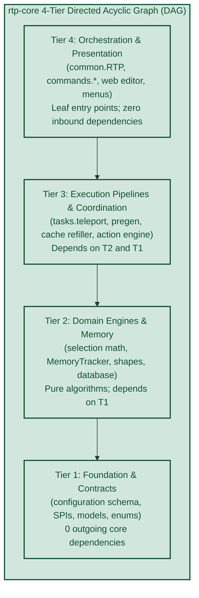
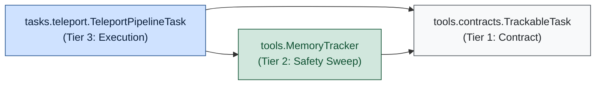
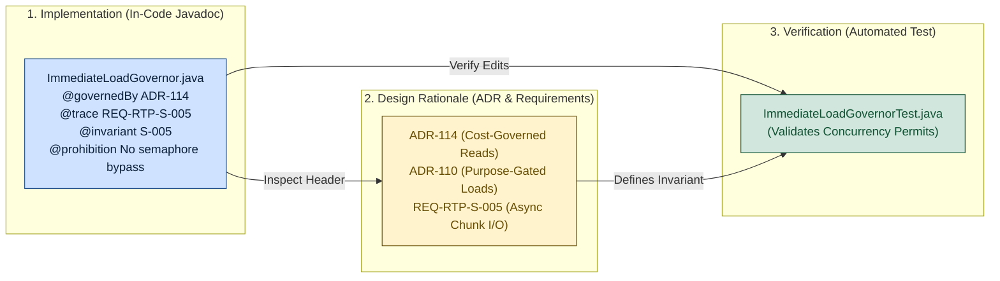

# Core Package Architecture and Decision Traceability Map

**Scope of this document.** This document specifies and visualizes the package hierarchy, structural decoupling boundaries, and decision traceability hypergraph for `rtp-core`. It models the module's 4-tier Directed Acyclic Graph (DAG), diagrams the decoupled seams that eliminate cyclic package tangles, and specifies the closed hypergraph connecting implementation classes to governing ADRs, absolute prohibition requirements (S-001..S-007), and automated verification tests.

Companion architectural decisions and references:
- [ADR-000](../adr/ADR-000-development-workflow.md): Development Workflow and D-005 Guard Rail.
- [ADR-001](../adr/ADR-001-archimedean-spiral-1d-mapping.md): Archimedean Spiral 1D Mapping.
- [ADR-008](../adr/ADR-008-memory-tracker-active-gc.md): MemoryTracker as Active Task GC.
- [ADR-015](../adr/ADR-015-stale-chunk-guard-countbound-pipes.md): Stale-Chunk Guard for Count-Bound Pipes.
- [ADR-016](../adr/ADR-016-anvil-subsystem.md): Anvil Read-Only Subsystem.
- [ADR-094](../adr/ADR-094-quality-engineering-gates.md): Quality-Engineering Gates and ArchUnit Enforcement.
- [ADR-110](../adr/ADR-110-purpose-gated-live-loads.md): Purpose-Gated Live Loads.
- [ADR-112](../adr/ADR-112-per-region-work-division-on-folia.md): Per-Region Work Division on Folia.
- [ADR-114](../adr/ADR-114-cost-governed-on-demand-chunk-reads.md): Cost-Governed On-Demand Chunk Reads.
- [ADR-115](../adr/ADR-115-package-dag-disentanglement-and-decision-preservation-hypergraph.md): Package DAG Disentanglement and Finite Decision-Preservation Hypergraph (Authoritative Decision).
- [`docs/dev/REQUIREMENTS.md`](../dev/REQUIREMENTS.md): Absolute Prohibition Requirements (S-001 through S-007).
- [`docs/dev/TRACEABILITY.md`](../dev/TRACEABILITY.md): Requirements to Code and Test Traceability Matrix.

---

## Executive Overview (Package DAG & Decision Hypergraph)

The `rtp-core` module implements the platform-neutral coordinate math, memory tracking, multi-tier chunk resolution, and teleport execution pipelines. The architecture is structured around two governing models:

1. **Acyclic Package Layering (0.0% SonarQube Package Tangles):**
   The packages in `rtp-core` are organized into a 4-tier Directed Acyclic Graph (DAG). Dependencies flow strictly downward (Tier 4 $\to$ Tier 3 $\to$ Tier 2 $\to$ Tier 1). Elimination of cyclic package tangles ensures that domain algorithms (such as `MemoryTracker` and `LocationGenerator`) operate as isolated, self-contained components without coupling to the plugin composition root or presentation layers.

2. **Finite Decision Hypergraph (Code $\longleftrightarrow$ ADR $\longleftrightarrow$ Requirement $\longleftrightarrow$ Test):**
   Implementation invariants (including Archimedean spiral indexing, Anvil pre-filter deduplication equations, and weak-reference garbage collection sweeps) link directly to their governing design records. Classes declare their governing ADRs, prohibition requirements, and operational invariants in structured Javadoc headers, establishing a closed, traceable graph from requirement to automated verification.



---

## 1. The 4-Tier Package Hierarchy

Dependencies flow strictly downward: Tier 4 $\to$ Tier 3 $\to$ Tier 2 $\to$ Tier 1. Higher tiers consume lower tiers; upward or circular dependencies are prohibited.

```mermaid
flowchart TD
    subgraph T4 [Tier 4: Orchestration, Ingress & Presentation]
        direction TB
        T4_RTP["io.github.dailystruggle.rtp.common (RTP Composition Root)"]
        T4_CmdTree["io.github.dailystruggle.rtp.common.commands (Command Tree)"]
        T4_CmdSub["io.github.dailystruggle.rtp.common.commands.* (Subcommands)"]
        T4_Menu["io.github.dailystruggle.rtp.common.commands.menu.*"]
        T4_Editor["io.github.dailystruggle.rtp.common.commands.editor.*"]
        T4_Events["io.github.dailystruggle.rtp.common.event"]
    end

    subgraph T3 [Tier 3: Execution Pipelines & Runtime Coordination]
        direction TB
        T3_Teleport["io.github.dailystruggle.rtp.common.tasks.teleport (TeleportPipelineTask)"]
        T3_Tasks["io.github.dailystruggle.rtp.common.tasks (TaskPipes, ScanTask)"]
        T3_Tick["io.github.dailystruggle.rtp.common.tasks.tick (Processing loops)"]
        T3_Action["io.github.dailystruggle.rtp.common.action (ActionManager)"]
        T3_Network["io.github.dailystruggle.rtp.common.network (Protocol dispatch)"]
        T3_Importer["io.github.dailystruggle.rtp.common.importer"]
    end

    subgraph T2 [Tier 2: Domain Engines, Math & Storage]
        direction TB
        T2_Selection["io.github.dailystruggle.rtp.common.selection.region (Regions, Queues)"]
        T2_Shapes["io.github.dailystruggle.rtp.common.selection.region.selectors.*"]
        T2_Tools["io.github.dailystruggle.rtp.common.tools (MemoryTracker, ChunkSafety)"]
        T2_Database["io.github.dailystruggle.rtp.common.database (Accessors, Factory)"]
        T2_Metrics["io.github.dailystruggle.rtp.common.metrics (Governors, Profiles)"]
        T2_PlayerData["io.github.dailystruggle.rtp.common.playerData (Limits, Cache)"]
    end

    subgraph T1 [Tier 1: Foundation, Schemas & Primitives]
        direction TB
        T1_Config["io.github.dailystruggle.rtp.common.configuration.schema (Immutable specs)"]
        T1_Enums["io.github.dailystruggle.rtp.common.configuration.enums"]
        T1_Math["io.github.dailystruggle.rtp.common.selection.region.selectors.memory.table"]
        T1_Pool["io.github.dailystruggle.rtp.common.database.pool"]
        T1_Contracts["io.github.dailystruggle.rtp.common.tools.contracts (TrackableTask, TicketHolder)"]
        T1_Text["io.github.dailystruggle.rtp.common.text"]
    end

    T4 --> T3
    T4 --> T2
    T4 --> T1
    T3 --> T2
    T3 --> T1
    T2 --> T1

    classDef t4 fill:#e2d9f3,stroke:#59359a,stroke-width:1px,color:#261447;
    classDef t3 fill:#cfe2ff,stroke:#1f4e8a,stroke-width:1px,color:#0b1f3a;
    classDef t2 fill:#d1e7dd,stroke:#0f5132,stroke-width:1px,color:#0f5132;
    classDef t1 fill:#f8f9fa,stroke:#495057,stroke-width:1px,color:#212529;
    class T4,T4_RTP,T4_CmdTree,T4_CmdSub,T4_Menu,T4_Editor,T4_Events t4;
    class T3,T3_Teleport,T3_Tasks,T3_Tick,T3_Action,T3_Network,T3_Importer t3;
    class T2,T2_Selection,T2_Shapes,T2_Tools,T2_Database,T2_Metrics,T2_PlayerData t2;
    class T1,T1_Config,T1_Enums,T1_Math,T1_Pool,T1_Contracts,T1_Text t1;
```



### Tier Specifications

- **Tier 1 (Foundation & Schemas):**
  Contains pure data schemas, configuration records, domain enums, primitive spatial math tables, and lifecycle contracts. Classes in Tier 1 shall have zero dependencies on other `rtp-core` packages.
- **Tier 2 (Domain Engines & Storage):**
  Contains core mathematical engines and state managers: Archimedean spiral and Hilbert spatial memory (`MemoryShape`), resource tracking (`MemoryTracker`), database accessors (`DatabaseAccessorFactory`), and concurrency governors (`ImmediateLoadGovernor`). Classes in Tier 2 depend strictly on Tier 1 contracts and schemas; they shall contain no references to command execution, player messaging, or presentation layers.
- **Tier 3 (Execution Pipelines & Coordination):**
  Contains runtime task orchestrators and asynchronous pipelines: player teleport pipelines (`TeleportPipelineTask`), background queue pre-generation (`PregenTask`), scan crawlers (`ScanTask`), scripted action execution (`ActionManager`), and network synchronization. Depends on Tier 2 domain engines and Tier 1 foundation contracts.
- **Tier 4 (Orchestration & Ingress):**
  Contains user-facing and external entry points: command dispatch trees, interactive book menus, web editor channels, event bridges, and the plugin composition root (`RTP.java`). Depends downward on Tiers 3, 2, and 1. Zero core packages shall depend on Tier 4.

---

## 2. Structural Seam Decoupling Patterns

The 4-tier DAG resolves cyclic dependencies across packages by decoupling four critical structural seams:

### 1. Task Execution vs. Resource Safety (`tasks.teleport` $\longleftrightarrow$ `tools`)

**Pattern: Interface Extraction.**
- `tools.MemoryTracker` manages resource lifecycles and garbage collection sweeps without coupling to the concrete execution details of `TeleportPipelineTask`.
- `tools.contracts.TrackableTask` defines the lifecycle contract (`UUID id()`, `isCompleted()`, `getReservations()`, `cancel()`).
- `TeleportPipelineTask` implements `TrackableTask`. `MemoryTracker` interacts strictly through the contract, isolating Tier 2 from runtime execution in Tier 3.



### 2. Command Tree Inversion (`commands` $\longleftrightarrow$ `commands.*`)

**Pattern: Shared Base & Provider Registration.**
- Root command infrastructure (`BaseRTPCmd`, parameter parsers) resides in `commands.base` (or leverages `commands-api`).
- Concrete subcommands (`commands.admin.AdminCmd`, `commands.config.ConfigCmd`) depend downward on `commands.base`.
- Subcommands register into the tree dynamically or via provider collections, ensuring child subcommands do not import the parent composition builder.

### 3. Domain Models vs. Runtime Pipelines (`selection.region` $\longleftrightarrow$ `tasks`)

**Pattern: Separation of Schema & Pipeline Coordination.**
- `Region` functions as a calculation manifold operating on immutable configuration schemas (`RegionConfigRecord`) defined in Tier 1.
- Teleport execution pipelines are dispatched by Tier 3 coordinators (`QueueRefillCoordinator`), avoiding direct task invocation inside domain calculation classes.

### 4. Composition Root vs. Global State (`common.RTP`)

**Pattern: Context Encapsulation & Constructor Injection.**
- `RTP.java` operates strictly as a Tier 4 Composition Root: it instantiates and wires subsystems during startup, and tears them down during shutdown.
- Internal domain classes receive required SPI services (`RTPScheduler`, `RTPServerAccessor`, `MemoryTracker`) via constructor parameters or a scoped `RTPContext`.
- Classes in Tiers 1, 2, and 3 shall contain no static references to `RTP.java`.

---

## 3. Decision and Requirement Traceability Hypergraph

The relationship between implementation, requirements, and design rationale forms a closed hypergraph:
$$\mathcal{H} = (V, \mathcal{E}), \quad V = \mathcal{REQ} \cup \mathcal{ADR} \cup \mathcal{S} \cup \mathcal{C} \cup \mathcal{T}$$

Every safety-critical class links directly to its governing requirements, design records, and automated test suites:



### Standard Class Invariant Header Format

Safety-critical classes declare their governing constraints using standardized Javadoc tags:

```java
/**
 * Enforces per-region and global concurrency bounds on native chunk generation
 * during on-demand (LoadPurpose.IMMEDIATE) teleport execution.
 *
 * @governedBy ADR-110 (Purpose-Gated Live Loads)
 * @governedBy ADR-114 (Cost-Governed On-Demand Chunk Reads)
 * @trace REQ-RTP-S-004
 * @trace REQ-RTP-S-005
 * @invariant S-005: Zero synchronous chunk loading or blocking calls on the main/tick thread.
 * @invariant Concurrency-Cap: Maximum 1 concurrent generation permit per region, 2 server-wide.
 * @invariant Fail-Visibility: Requests timing out after 1200ms shall complete with msgBusy (S-004, S-007).
 * @prohibition DO NOT remove semaphores to "speed up" concurrent player teleports; unbound
 *              live chunk generation causes severe main-thread tick stalls and watchdog crashes.
 */
public final class ImmediateLoadGovernor {
    // ...
}
```

### Tag Invariant Definitions

- **`@governedBy ADR-NNN`**: Declares the authoritative architectural decision record defining the engineering trade-offs and rationale.
- **`@trace REQ-MODULE-FAMILY-NNN`**: Declares the functional or non-functional requirement satisfied by the component.
- **`@invariant S-00x`**: Declares compliance with non-negotiable absolute prohibition requirements (S-001 through S-007).
- **`@invariant <Name>`**: Declares mathematical, operational, or concurrency invariants (e.g., concurrency bounds, non-mutating reads).
- **`@prohibition`**: Declares explicit negative constraints defining operations that refactoring shall not introduce.

---

## 4. ArchUnit Verification Guardrails

Package acyclicity and tier separation are verified mechanically during the build by `RTPArchitectureTest` (`rtp-core/src/test/java/.../RTPArchitectureTest.java`):

```java
public class RTPArchitectureTest {

    @ArchTest
    static final ArchRule packages_must_be_free_of_cycles =
            slices().matching("io.github.dailystruggle.rtp.common.(*)..")
                    .should().beFreeOfCycles()
                    .because("Package tangles break modularity and prevent isolated component testing.");

    @ArchTest
    static final ArchRule domain_engines_must_not_depend_on_orchestration =
            noClasses().that().resideInAnyPackage("..selection..", "..tools..", "..database..")
                    .should().dependOnClassesThat().resideInAnyPackage("..commands..", "io.github.dailystruggle.rtp.common")
                    .because("Domain engines in Tier 2 shall not have upward dependencies on Tier 4 orchestration.");

    @ArchTest
    static final ArchRule foundation_must_have_zero_outgoing_core_dependencies =
            classes().that().resideInAPackage("..configuration.schema..")
                    .should().onlyDependOnClassesThat().resideInAnyPackage("..configuration.schema..", "..configuration.enums..", "java..")
                    .because("Tier 1 Foundation schemas shall be completely free of domain and runtime dependencies.");
}
```

---

## 5. Component Tier Taxonomy

Components in `rtp-core` map to the 4-tier hierarchy according to functional domain and dependency characteristics:

| Component Category | Target Package | Tier | Exemplar Classes |
|---|---|---|---|
| Immutable schema, DTO, or enum | `common.configuration.schema` or `common.configuration.enums` | Tier 1 | `RegionConfigRecord`, `ShapeType` |
| Foundation contract or lifecycle SPI | `common.tools.contracts` | Tier 1 | `TrackableTask`, `ChunkTicketHolder` |
| Math curve, spatial memory, shape | `common.selection.region.selectors.*` | Tier 2 | `CircleOptimizedDualLayer`, `CurveHash` |
| Storage, memory tracking, governor | `common.tools`, `common.database`, `common.metrics` | Tier 2 | `MemoryTracker`, `ImmediateLoadGovernor` |
| Pipeline task, async scheduler | `common.tasks.teleport`, `common.tasks` | Tier 3 | `TeleportPipelineTask`, `PregenTask` |
| Command, menu, web editor, UI, composition root | `common.commands.*`, `common.commands.menu.*`, `common` | Tier 4 | `AdminCmd`, `EditorChannelWiring`, `RTP` |
