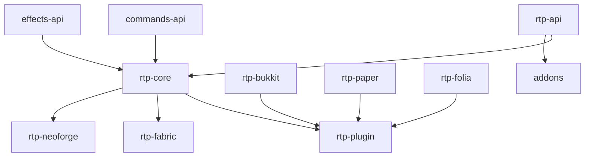

# Project Architecture

**Current Plugin Version:** `@version@`

For a high-level overview of the plugin's reliability guarantees and bounded execution architecture, see [System Architecture and High-Reliability Design](DESIGN.md).
For the full requirements-to-code traceability matrix (Req ID → design decision → implementing class → test), see [TRACEABILITY.md](TRACEABILITY.md).
For actor definitions and stakeholder goals, see [STAKEHOLDERS.md](STAKEHOLDERS.md).
For term definitions, see [GLOSSARY.md](GLOSSARY.md).
For the rationale behind key architectural decisions (why, not just what), see [Architecture Decision Records](../adr/README.md).

The RTP (Random Teleport) plugin is built with a multi-module architecture to ensure scalability, ease of maintenance, and compatibility with various server software environments such as Spigot, Paper, and Folia (Fabric support is a future goal).

## Module Breakdown

### Core & API Modules
* **rtp-api**: Contains the interfaces, APIs, and shared models used by the plugin and external integrations. Addon developers should compile against this module.
* **rtp-core**: Contains the core logic of the plugin. This includes region management, random location selection algorithms (shapes), queue management, database interactions, and memory tracking. It is agnostic of the specific server platform. Internal packages are strictly structured in a 4-tier Directed Acyclic Graph (DAG) to eliminate SonarQube package tangles and isolate domain algorithms from execution pipelines (ADR-115; see [Package Architecture](../architecture/16-package-dag-and-decision-preservation-graph.md)).
* **anvil-api** (`api/anvil-api`): A standalone, platform-neutral off-tick region decoder and prefilter framework (ADR-016, ADR-077). Defines the `RegionFileReader` SPI and ships one built-in reader, Anvil (`.mca` / Zlib / LZ4), decoded off the main thread. Addons may register other formats through `RegionFormatRegistry` or a `RegionFileReaderProvider` service; files in an unregistered format (e.g. `.linear`) are ignored and their chunks fall back to the platform's live async chunk load.
* **commands-api**: A unified command framework (formerly external) now integrated to handle multi-platform command structures, including future support for Brigadier on Fabric.
* **effects-api**: A unified visual/particle effects framework (formerly external) now integrated for cross-platform visual consistency.

### Platform Adapters
These modules implement platform-specific features to maximize performance on their respective servers while maintaining a unified core codebase. For detailed requirements, function specifications, and lifecycle contracts when creating a new server adapter, see [SERVER_ADAPTER_GUIDE.md](SERVER_ADAPTER_GUIDE.md).
* **rtp-bukkit**: The adapter for standard Spigot servers, implementing Bukkit/Spigot-specific event handling and chunk loading.
* **rtp-paper**: The adapter for Paper servers, utilizing Paper-specific APIs for enhanced performance, such as asynchronous chunk loading.
* **rtp-folia**: The adapter for Folia servers, handling Folia's unique region-based multithreading to ensure teleports and tasks run safely on the correct regional thread.
* **rtp-fabric**: The adapter for Fabric servers, bridging the core logic to the Fabric modding environment and Minecraft's Brigadier command system.
* **rtp-neoforge**: The adapter for NeoForge servers, bridging the core logic to the NeoForge modding environment and Minecraft's Brigadier command system.

### Plugin Entry Points
* **rtp-plugin**: The main entry point for Bukkit-based platforms (Spigot, Paper, Folia). It bridges `rtp-core` and the platform-specific adapters.
* **rtp-fabric**: Acts as its own entry point for the Fabric modding environment.
* **rtp-neoforge**: Acts as its own entry point for the NeoForge modding environment.

### Addons
* **addons**: A directory containing subprojects that integrate RTP with external plugins. The canonical template is `LeafRTPCountdownAddon`, which demonstrates how to utilize `rtp-api` to extend the plugin's capabilities. Note: Several common integrations (such as claim plugins) are now folded directly into the core plugin (ADR-019); the standalone `RTP_Glide` addon was folded into `effects-api` as the `GLIDE` effect (effects-api-ADR-001); the experimental `RTP_Iris_integration` addon has been removed (no dedicated integration is required to teleport into Iris-generated worlds).

## Module Dependency Graph

> **Dependency rule:** `rtp-core` and `rtp-api` must never import platform-specific classes (Bukkit, Spigot, Paper, Folia, Fabric). This is enforced by ArchUnit tests.

## Package Architecture (`rtp-core`)

All 78 packages within `rtp-core` are organized into a strict 4-tier Directed Acyclic Graph (DAG) to eliminate SonarQube package tangles and guarantee modular separation (ADR-115):
- **Tier 1 (Foundation & Schemas):** Immutable config records (`configuration.schema`), domain enums (`configuration.enums`), math tables, and SPI contracts (`tools.contracts`). Zero outgoing core dependencies.
- **Tier 2 (Domain Engines & Storage):** Spatial math and memory curves (`selection.region.selectors.*`), resource tracking (`tools.MemoryTracker`), and database accessors (`database.*`). Depends strictly on Tier 1.
- **Tier 3 (Execution Pipelines):** Teleport pipelines (`tasks.teleport`), background pregen (`PregenTask`), and action coordination (`action.*`). Depends on Tier 2 and Tier 1.
- **Tier 4 (Orchestration & Ingress):** Leaf command trees (`commands.*`), interactive book menus, web editor channels, and the composition root (`RTP.java`).

For the package DAG diagram, seam decoupling patterns, and decision traceability specifications, see [`../architecture/16-package-dag-and-decision-preservation-graph.md`](../architecture/16-package-dag-and-decision-preservation-graph.md).

## Key Concepts

* **Regions**: The world is divided into manageable teleport regions. Each region handles its own teleport queue and shape parameters.
* **Shapes**: Mathematical structures (circle, square, rectangle) governing how random points are generated. They support various distributions (normal, flat, exponential) for tailored teleport selection algorithms.
* **Queue System**: Pre-generating and validating random locations before they are needed ensures teleports are instant for the end-user.
