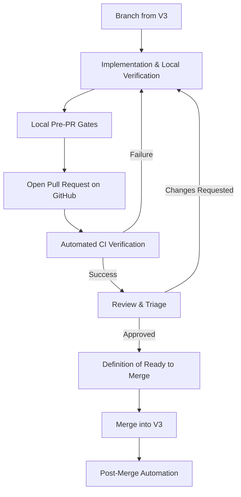
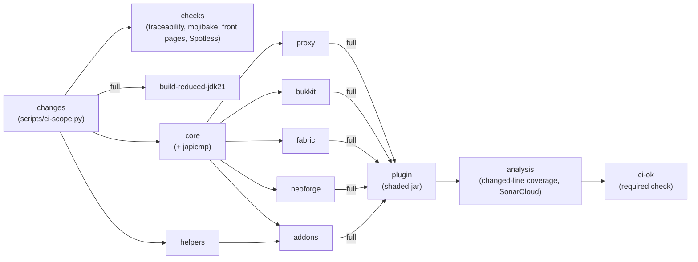

# Pull Request Process

Operational guide and reference for preparing, opening, testing, reviewing, and merging Pull Requests (PRs) in the RTP repository.

This document serves as the canonical Single Source of Truth (SSoT) for the Pull Request lifecycle, connecting implementation and verification to the repository's main line.

---

## 1. Lifecycle Overview

Every code and documentation change intended for the core repository follows a structured lifecycle:



---

## 2. Branching Strategy

1. **Base Branch:**
   - Active development targets the **`V3`** branch (the default branch).
   - Maintenance backports for older releases target **`V2`** or **`V1`** only when explicitly requested.
2. **Branch Naming:**
   Branches must follow descriptive prefix patterns:

   | Change Type | Branch Pattern | Example |
   |-------------|----------------|---------|
   | Bug fix | `fix/<short-description>` | `fix/chunk-leak-on-reload` |
   | New feature | `feature/<short-description>` | `feature/rectangle-shape` |
   | Documentation | `docs/<short-description>` | `docs/pr-process-guide` |
   | Performance | `perf/<short-description>` | `perf/spiral-lookup-caching` |
   | Refactoring | `refactor/<short-description>` | `refactor/command-parameter-cleanup` |
   | Release prep | `release/<version>` | `release/3.3.0` |

3. **Branch Hygiene:**
   - Keep branch history clean and focused on a single logical change.
   - Rebase or merge against updated `upstream/V3` to resolve conflicts prior to review.

---

## 3. Preparation & Architecture Gates

Before or during development, verify that your changes adhere to repository governance:

1. **Propose Before Implementation (Rule D-005):**
   - If a change touches more than one class, crosses a module boundary, or introduces a new command architecture, a written proposal must be submitted and approved before writing code.
   - Detail affected modules, before/after structure, relevant `REQ-*` requirements or ADRs, and trade-offs.
2. **Safety Prohibitions (S-001..S-007):**
   - `S-001`: Zero unsafe teleport destinations.
   - `S-002`: Zero leaked force-loaded chunks (tickets must release on all paths via `MemoryTracker`).
   - `S-003`: Respect land protection plugins.
   - `S-004`: Zero silently discarded teleport failures; report and log all errors.
   - `S-005`: Zero main-thread chunk I/O or blocking `.get()` calls.
   - `S-006`: Throw `IllegalStateException` on early API access before core initialization.
   - `S-007`: Configurable failure and command error messages via `messages.yml`.
3. **Regional Threading & Concurrency:**
   - On Folia, verify region thread ownership via `Bukkit.isOwnedByCurrentRegion` before regional dispatch (Rule F-001).
   - All asynchronous or scheduled tasks must use `RTP.scheduler` (`RTPScheduler` SPI); never spawn raw threads.
4. **Requirements Traceability (4-Step Workflow):**
   When introducing or modifying a functional or architectural requirement:
   - Add the requirement to `docs/dev/REQUIREMENTS.md` (or submodule `REQUIREMENTS.md`) with the next sequential ID (`REQ-<module>-<family>-NNN`).
   - Add a row to `docs/dev/TRACEABILITY.md` binding the requirement to its design reference, implementing class, and test.
   - Update `docs/dev/DESIGN.md` if the change introduces an architectural mechanism.
   - Add or update an automated unit or ArchUnit test.

---

## 4. Local Pre-PR Verification Gates

Contributors must run local verification gates before pushing a branch or opening a pull request. This ensures fast feedback and avoids avoidable CI failures.

### Quick Verification Checklist

```sh
# 1. Code formatting
./gradlew spotlessApply

# 2. Traceability validation
./scripts/check_traceability.sh

# 3. Encoding and mojibake check
python scripts/check-mojibake.py

# 4. Front page copy validation
python scripts/release/build_front_pages.py --check

# 5. Public API binary compatibility check
./gradlew checkBinaryCompatibility

# 6. Targeted or full test run
./gradlew test

# 7. Coverage and static analysis gates (ADR-094)
./gradlew check -Pcoverage -PstaticAnalysis

# 8. Changed-line coverage gate (minimum 80% coverage on changed lines)
python scripts/diff-coverage.py --baseline origin/V3 --min 0.80
```

### Gate Details

- **Code Formatting (Spotless):**
  Enforces consistent formatting across Java source files. Running `./gradlew spotlessApply` automatically resolves discrepancies.
- **Traceability Gate (`check_traceability.sh`):**
  Parses all `REQUIREMENTS.md` files and verifies that every `REQ-*` identifier has an associated row in `docs/dev/TRACEABILITY.md`. CI fails if any requirement is untraced.
- **Mojibake & UTF-8 Scanner (`check-mojibake.py`):**
  Ensures all markdown, configuration, and source files are plain UTF-8 without byte-order marks (BOM) or corrupted encoding characters.
- **Storefront Page Check (`build_front_pages.py --check`):**
  Verifies that storefront templates and copy generated from `docs/publishing/FRONT_PAGE.md` remain consistent and uncorrupted.
- **Binary Compatibility (`japicmp`):**
  Compares public API signatures (`rtp-api`, `commands-api`, `effects-api`, `maps-api`, `metrics-api`, `anvil-api`, `tags-api`) against the baseline release. Any non-deprecated breaking change fails unless recorded in the accepted breaks registry (ADR-094, `DEPRECATION_POLICY.md`).
- **Testing Tier Selection:**
  - *Localized module changes:* Run targeted tests (e.g. `./gradlew :rtp-core:test --tests "*Selection*"`).
  - *Cross-module interface or root Gradle changes:* Run a full multi-module build (`./gradlew build`).
  - *Documentation-only changes:* Exempt from build and test runs.
- **Static Analysis (PMD):**
  Under `-PstaticAnalysis`, evaluates rules in `config/pmd/ruleset.xml`, including the custom `PreferNonLockingExecution` check.
- **Changed-Line Coverage Gate (`diff-coverage.py`):**
  Evaluates JaCoCo per-line coverage for lines added or modified against the base branch (`origin/V3`). Fails if covered fraction falls below 80% (`0.80`).
- **Multi-Server & Acceptance Harness (Devstack):**
  If touching cross-server network mode, proxy protocols, reservation tokens, or multi-platform container parity, execute headless acceptance:
  ```powershell
  .\devstack\run-acceptance.ps1 -Scenario all
  ```
  (or `./devstack/run-acceptance.sh --scenario all` on Linux).

---

## 5. Documentation & Metadata Synchronization

Every PR must keep documentation in lockstep with code:

1. **`CHANGELOG.md`:**
   - Add a bullet under `## [Unreleased]`.
   - Describe the net delta against the last released tag in absolute phrasing.
   - Do not include Pro-exclusive markers or retired edition tags (ADR-100, ADR-108).
2. **`docs/dev/TRACEABILITY.md`:**
   - Update rows for any new or modified requirements.
3. **`docs/MIGRATION.md`:**
   - Required if a breaking public API change or major configuration structure change is introduced.
4. **Locale Parity (`lang/`):**
   - When adding user-facing keys to `rtp-plugin/src/main/resources/messages.yml` or `config.yml`, mirror the keys across `lang/<file>.lang.yml` and all `lang/<locale>/<file>.yml`.
   - Validate with `./gradlew :rtp-plugin:test --tests "*LocaleParityTest*"`.
5. **Architectural Records (ADR):**
   - New significant architectural decisions require an ADR under `docs/adr/` (or `<subproject>/docs/adr/`) and a catalog entry in `docs/adr/README.md`.

---

## 6. Authoring the Pull Request

### PR Title

Use clear, imperative titles prefixed by category:
- `fix: release chunk tickets on player disconnect during teleport`
- `feat: implement polygon shape with concave boundary support`
- `docs: add comprehensive pull request workflow guide`
- `perf: optimize spiral coordinate lookup cache`

### PR Description & Template

GitHub automatically populates `.github/PULL_REQUEST_TEMPLATE.md`. Complete all sections:

1. **Description:**
   - Plain-language summary of what was changed and why.
   - Reference any relevant issues (e.g. `Fixes #123` or Linear tracker issue `RTP-45`).
2. **Related Requirements:**
   - List associated `REQ-*` IDs (e.g. `REQ-CORE-F-001`, `REQ-RTP-S-002`).
3. **Type of Change:**
   - Mark the relevant category (Bug fix, New feature, Refactoring, Documentation, Build/CI).
4. **Checklist:**
   - Verify every item honestly (tests passing, traceability checked, changelog updated, binary compatibility).
5. **Test Evidence:**
   - Provide command outputs, test run summaries, benchmark results, or screenshots demonstrating verification.

---

## 7. Continuous Integration (CI) Pipeline Anatomy

Pull requests trigger automated GitHub Actions workflows configured in `.github/workflows/gradle.yml`. Each project set has its own job (defined once in the reusable `.github/workflows/gradle-set.yml`), chained along the Gradle project graph:



### Job Descriptions

0. **`changes`:**
   - On a pull request, runs `scripts/ci-scope.py` over the diff against the PR base and emits a scope:
     - `full`: any path outside `addons/<Name>/` and `helpers/<Name>/` (core, APIs, platforms, `rtp-plugin`, Gradle or CI config, `scripts/`), or no usable baseline (failed diff).
     - `leaf`: every change is inside addon/helper projects.
     - `none`: only ignorable paths (docs, root markdown). Runs nothing but `ci-ok`.
   - Pushes to `V1`/`V2`/`V3` (merges) and `workflow_dispatch` always emit `full` with every set flagged, so the shaded `rtp-plugin` jar that bundles the addons is rebuilt on every merge.
   - Emits one `true`/`false` flag per project set (`core`, `bukkit`, `fabric`, `neoforge`, `proxy`, `plugin`, `addons`, `helpers`), `full` (every set affected), and `<set>_tasks`: `:<p>:build` for each affected project of the set, or `:<p>:test` for a module whose tests only read a touched addon by path (e.g. `rtp-core` tests loading the shipped `LeafRTPActionAddon` action definitions). A set is flagged when a changed file lies in one of its projects, or one of its projects references an affected project through `project(':...')` or `findProject(':...')`, transitively; a parent project's change flags its children. Paths outside every project (root Gradle files, `gradle/`, `.github/`, `scripts/`) flag every set, so a PR that edits CI or scripts always builds everything.
   - Runs `scripts/ci-scope.py --check-workflow .github/workflows/gradle.yml` first, which fails when a set job does not (transitively) `needs:` the job of a set its projects reference. Adding a project dependency across sets without updating the job chain therefore fails CI.
1. **`checks`:** traceability, mojibake, front-page and Spotless checks; runs unless the scope is `none`.
2. **`build-reduced-jdk21`:** (`full` scope only)
   - Runs on Ubuntu with Temurin JDK 21.
   - Validates the reduced build variant using exclusion flags:
     `-PexcludeJdk25 -PexcludeNeoforge`
   - Executes `./gradlew assemble` and the ADR-113 bytecode gate to guard against silent degradation of offline sandbox and JitPack environments without duplicating full test suites.
3. **Set jobs (`core`, `proxy`, `bukkit`, `fabric`, `neoforge`, `helpers`, `addons`, `plugin`):**
   - Each calls `gradle-set.yml`: JDK 21 and 25, then `./gradlew <set>_tasks -Pcoverage -PstaticAnalysis`, test report publishing, and an artifact `reports-<set>` holding the JaCoCo / PMD XML and compiled classes for `analysis`.
   - A set job runs when its flag is true and no job it needs failed or was cancelled; a skipped upstream job does not block it. Each job is a fresh runner, so it recompiles (but does not re-test) the modules it depends on.
   - `core` also runs japicmp (`checkBinaryCompatibility`) in `full` scope. `proxy`, `bukkit`, `fabric` and `neoforge` run in parallel after `core`; `addons` waits for `core` and `helpers`.
   - `plugin` builds the shaded `rtp-plugin` jar after every other set and only in `full` scope; addon/helper-only PRs skip it, and the merge build verifies the bundled copy.
   - Artifacts: `RTP-Artifacts` (root `build/libs`), `RTP-Addon-Artifacts`, `RTP-Helper-Artifacts`, `jacoco-coverage-<set>`.
4. **`analysis`:** (`full` scope only)
   - Unpacks every `reports-<set>` artifact, then runs `scripts/diff-coverage.py` against the PR base (`origin/V3`) or the previous commit, enforcing the 80% changed-line threshold.
   - Runs SonarCloud (when `SONAR_TOKEN` is present) on the unpacked coverage, PMD reports and classes without re-running tests. When not every set ran, the missing classes are compiled first (`classes testClasses`).
5. **`ci-ok`:**
   - Always runs and fails if any job failed or was cancelled; skipped jobs count as passing.
   - The only job branch protection needs to require; the job split can change without touching branch protection. `pull_request` has no `paths-ignore`, so `ci-ok` reports on docs-only PRs too.

### Auxiliary Workflows

- **Documentation Site (`docs.yml`):**
  Validates MkDocs Material configuration and deploys to `gh-pages` upon merge to `V3`.
- **Nightly Acceptance (`devstack-acceptance.yml`):**
  Runs multi-server proxy and backend cluster integration scenarios using headless Mineflayer bot drivers.
- **Weekly Mutation Testing (`mutation-testing.yml`):**
  Executes PIT mutation tests across critical safety packages (threshold >= 60%).

---

## 8. Review, Revision & Merge

### Review Expectations

1. **Safety First:**
   Reviewers verify compliance with prohibitions `S-001` through `S-007`. Code violating these invariants will not be approved.
2. **Threading Soundness:**
   No blocking thread operations or foreign-region accesses on Folia regional schedulers.
3. **Addressing Review Comments:**
   - Push follow-up commits to the existing PR branch.
   - Avoid force-pushing over existing review history unless cleaning up commits prior to final squash.
   - Reply directly to review comments indicating the resolution or rationale.

### Definition of Ready to Merge

A pull request is ready to merge when **all** of the following conditions are satisfied:

- [ ] All automated CI status checks are passing (green).
- [ ] At least one maintainer review approval is granted.
- [ ] Any architectural change conforms to an approved Rule D-005 proposal and ADR.
- [ ] `CHANGELOG.md` reflects the change under `[Unreleased]`.
- [ ] Any added or modified requirements are traced in `docs/dev/TRACEABILITY.md`.
- [ ] If breaking public API changes were introduced, `docs/MIGRATION.md` is updated.
- [ ] Changed-line test coverage meets or exceeds 80%.
- [ ] Encoding hygiene is maintained (UTF-8, no BOM, zero mojibake).

### Merging & Post-Merge

- PRs are merged into `V3` (typically via **Squash and Merge** to maintain a linear, bisectable commit history).
- The squash commit message should follow repository conventions and reference the PR number.
- Post-merge automation compiles and archives release artifacts and triggers documentation site publication.
