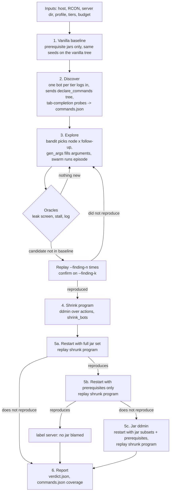
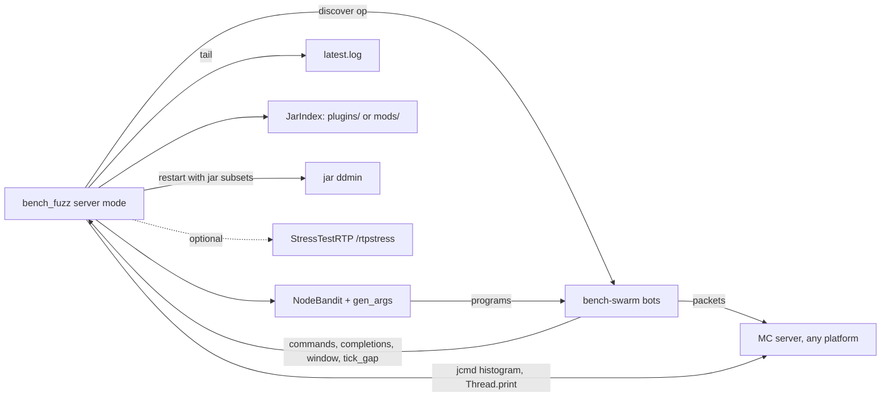
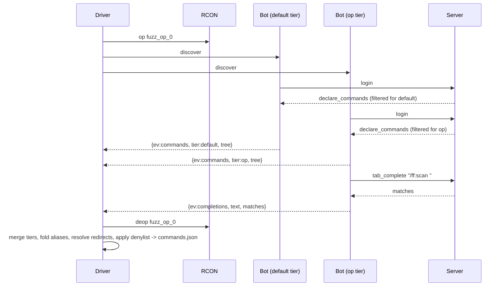
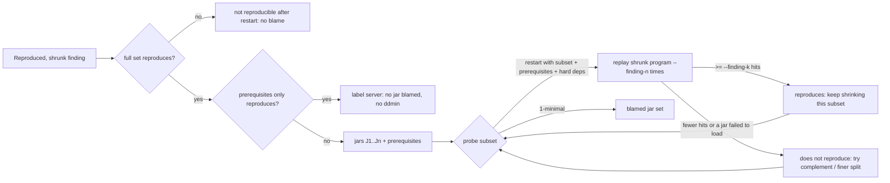

# Whole-server fuzzing: finding leaks and stalls in a server you were not told about

`scripts/bench_fuzz.py --mode server` is the whole-server mode of the live-server behaviour fuzzer governed by [ADR-125](../adr/ADR-125-whole-server-discovery-fuzzing.md). The full ADR-125 design discovers the attack surface from the server itself, finds leaks and main-thread stalls by comparison with a vanilla baseline, and blames a jar only after the finding has reproduced; the shipped CLI slice implements only the defensive, non-executing **passive local audit** (`status: "passive_only"`).

- **Governing decision:** [ADR-125](../adr/ADR-125-whole-server-discovery-fuzzing.md) (**Accepted** under Rule D-005; ADR `Accepted` status records architectural design approval, not implementation completeness). It amends [ADR-111](../adr/ADR-111-live-server-behaviour-fuzzing.md) section 2.2 for server mode only, and extends the platform profile of [ADR-122](../adr/ADR-122-platform-neutral-stress-harness.md) with a server-mode carve-out from its decision 6 (isolation and `--plugin-packages` attribution). ADR-122 is Proposed.
- **Status (passive CLI audit + `--active` live runner + offline callback-driven library):**
  - **Passive local audit (`scripts/bench_fuzz.py --mode server`, default):** runs the read-only passive local audit described in [Passive local audit (`--mode server`)](#passive-local-audit---mode-server) below (`status: "passive_only"`).
  - **Live active discovery fuzzing (`scripts/bench_fuzz.py --mode server --active`):** executes the active ADR-125 discovery, baseline, tier-stratified bandit exploration (including player-taxonomy bot archetypes `homesteader_reroll`, `explorer_wander`, and `coop_group`), `JcmdObserver` (`GC.class_histogram` and `Thread.print` locally, via `--ssh bamboo` / `leaf26`, or `--container`), live action shrinking (`shrink_bots`), numeric argument bisection (`bisect_numeric_arg`), and dependency-closed jar `ddmin` (`ddmin_jars`), guarded by four anti-abuse gates (disposable `--server-dir` + RCON password proof-of-ownership, RFC1918/Tailscale/local-hostname allow-list, offline-only `fz*` bots, and `DEFAULT_DENYLIST`).
  - **Offline & callback-driven Python library (`scripts/bench_fuzz_server.py`):** implements the pure, deterministic schema, scheduling, reduction, and trace-evaluation algorithms tested in `scripts/tests/test_bench_fuzz.py`: Brigadier boundary-ladder argument sampling (`numeric_ladder`, `gen_args`, `build_arm_program`), tier-stratified UCB1 arm scheduling (`NodeBandit`, `SCENARIO_SHAPES`), callback-driven parameter threshold bisection (`bisect_numeric_arg`), pre-`ddmin` guardrails and dependency-closed jar delta debugging (`run_pre_ddmin_probes`, `ddmin_jars`), and offline trace evaluation and report formatting (`evaluate_server_trace`, `build_finding_verdict`, `format_server_findings_report`). Every live-server result below that is not explicitly attributed to a recorded target-mode run remains a validation target, not recorded live evidence.
- **Target mode** (one named plugin per restart, `--cmd`): unchanged; see [`LEAK_FUZZING.md`](../../helpers/StressTestRTP/LEAK_FUZZING.md) and [`BEHAVIOUR_FUZZING_PLAN.md`](BEHAVIOUR_FUZZING_PLAN.md).

---

## Passive local audit (`--mode server`)

The implemented `--mode server` CLI runs a single defensive, non-executing audit pass and refuses any flag that would execute commands, mutate permissions, toggle jars or claim a causal finding:

- **Strict local disposable and offline validation:** requires an explicit `--profile` (`paper`, `fabric` or `neoforge` with an existing `plugins/` or `mods/` directory inside `--server-dir`), a local loopback `--host` and `--mc-host` (`127.0.0.1`, `localhost` or `::1`), and a local disposable bench directory produced by `scripts/bench_setup.py` (`server.properties` with explicit `online-mode=false`, `--mc-port` matching `server-port`, and a disposable marker `bench-loop.sh`, `no-restart-script` in `spigot.yml`, or `.bench-disposable`, outside any `.git` working tree or system root). Only `--tiers default` is accepted. Target-specific flags (`--cmd`, `--names`, `--jars`, `--plugin-packages`, `--targets`, `--rtp-args`), unsafe/op/container/mutation flags (`--grant`, `--lp-group`, `--console*`, `--allow-online`, `--container`, `--mat`, `--no-restart`, `--no-isolate`), replay flags (`--replay`, `--ep`, `--replay-seed`, `--replay-n`, `--replay-budget`), and active budget/stall flags (`--episodes`, `--seeds`, `--reps`, `--rungs`, `--warmup`, `--shrink*`, `--finding*`, `--surprise*`, `--coverage`, `--stall-ms`, `--default-budget-share`) are rejected with exit code `2`.
- **Read-only `declare_commands` capture and offline `JarIndex` inventory:** logs in one `default`-tier bot via `bench-swarm.js` (`discover` op), captures the login `declare_commands` packet without sending any chat commands, `tab_complete` probes, window clicks or RCON commands, folds `namespace:cmd` and `cmd` aliases when their subtrees match, cuts redirect cycles, applies `DEFAULT_DENYLIST` plus any operator `--deny` patterns, and writes `commands.json` (recording an explicit truncation warning if the command graph hits the node cap). `JarIndex` scans `plugins/` or `mods/` offline via `zipfile` without renaming or toggling any `.jar` files.
- **Linux-only verified `jcmd` PID snapshot and GC pause exclusion:** when the operator explicitly passes `--pid-file <path>`, `--pid <pid>` or `--jcmd-snapshot`, `JcmdObserver` verifies on POSIX hosts that the target PID is alive, owned by the current OS user, and positively tied to `--server-dir` via `/proc/<pid>/cwd` or a fresh `/proc/<pid>/cmdline` check (failing closed on Windows/non-POSIX hosts, unreadable `/proc` metadata, or recycled PIDs, and re-verifying PID ownership immediately before each `jcmd` call). It collects one read-only `GC.class_histogram` and one `Thread.print` dump. Because `jcmd <pid> GC.class_histogram` triggers a stop-the-world full GC pause on the target JVM, `JcmdObserver` records `[start_ms, end_ms]` wall-clock exclusion windows (including post-command grace) so `filter_tick_gaps` and `StallOracle` exclude any `tick_gap` event (`{ev: "tick_gap", bot, ms, at, keepalive_ms, id, t}`) whose `[at - ms, at]` interval overlaps a GC or thread-dump window (`observer_window`); untimed gaps (`unverifiable_timestamp`) are failed closed only when exclusion windows are defined.
- **Non-causal report (`PASSIVE_ONLY`):** emits `verdict.json` and `report.txt` with `"status": "passive_only"`, `"verdict": "PASSIVE_ONLY"`, `"baseline": {"available": false, "status": "unavailable"}`, `"confirmed_culprits": []`, `"blamed_jars": []`, and `"findings": []`. Top histogram classes and the main-thread stack frame are annotated with their offline `JarIndex` owner (`jar_owner` / `first_suspect`) for inventory inspection only; statistical leak screening requires exchangeable episodes and a vanilla baseline, so a single snapshot makes no causal leak, stall, mitigation (`operator_mitigation`) or reproducer (`author_reproducer` / `replay_cmd`) claims.

---

## Live active whole-server fuzzing (`--mode server --active`)

Passing `--active` switches `ServerRun` from passive audit mode to live discovery fuzzing against a disposable server copy (either locally or on a LAN bench host such as `leaf26` / `bamboo`):

```bash
# 1. Prepare a disposable bench server copy on the target host / shared mount:
python3 scripts/bench_setup.py /path/to/source-server /mnt/bamboo/bench-26.2 --port 25566 --rcon-port 25576

# 2. Run live whole-server discovery fuzzing from desktop against bamboo (or leaf26):
python3 scripts/bench_fuzz.py --mode server --active \
    --profile paper \
    --server-dir /mnt/bamboo/bench-26.2 \
    --host bamboo \
    --ssh bamboo \
    --remote-server-dir /srv/mc/bench-26.2 \
    --tiers default,op \
    --episodes 40
```

- **Player-taxonomy scenario shapes (`SCENARIO_SHAPES`):** alongside fault-oriented follow-ups (`quit_lt1s`, `quit_delay`, `rejoin`, `repeat`, `concurrent`, `window_click` with protocol-level `click` and `close_window`), `build_arm_program` exercises three player-taxonomy archetypes from [`PLAYER_TAXONOMY_VALUATION.md`](PLAYER_TAXONOMY_VALUATION.md):
  - `homesteader_reroll` (*Mode 1 Reroll Cascade*): dispatches the command, inspects the landing with a short walk (`move`), rejects the site and dispatches two rapid rerolls before settling.
  - `explorer_wander` (*Mode 3 / Mode 4 Outward Traverse*): dispatches the command, traverses outward across chunks via `move` packets, and issues a follow-up command while moving.
  - `coop_group` (*Mode 8 Cooperative Group Settle*): joins multiple bots that coordinate commands and movement together.
- **Anti-abuse safeguards:**
  1. **Proof-of-ownership gate:** requires both filesystem access to a disposable `--server-dir` (`server.properties` with `online-mode=false`, a disposable marker file, and `rcon.password`) and a live authenticated RCON `list` handshake before opening any bot connection.
  2. **Private/local host gate (`is_allowed_bench_host`):** permits only loopback (`127.0.0.1`, `localhost`, `::1`), RFC1918 LAN (`10.0.0.0/8`, `172.16.0.0/12`, `192.168.0.0/16`), Tailscale CGNAT (`100.64.0.0/10`), or local bench hostnames (`leaf26`, `bamboo`, `*.local`, `*.lan`); rejects public WAN IPs and internet domains.
  3. **Offline-only self-identifying bots:** `bench-swarm.js` connects strictly with `auth: 'offline'` and `fz*` / `bench_*` bot names from the single runner IP.
  4. **Mandatory command denylist:** enforces `DEFAULT_DENYLIST` (plus `--deny`) across generation, shrinking, numeric bisection, and replay.

---

## Why a target-free mode

Target mode found BetterRTP 3.6.13's quit-session retention because the operator isolated `BetterRTP-3.6.13.jar` and told the bots to send `/betterrtp:rtp`. A server admin with many plugins has neither piece of knowledge. Server mode replaces each piece of prior knowledge with something the server reports or a measurement:

| Target mode needs | Server mode uses instead |
|---|---|
| `--cmd` (what to send) | The `declare_commands` Brigadier tree each bot receives at login, per permission tier |
| A fixed action list | A bandit over (command node, follow-up shape), with parser-typed arguments and tab-completion values |
| One jar per restart (isolation) | All jars at once; isolation only afterwards, by jar `ddmin` |
| The `direct` control | A same-seed vanilla baseline with only the prerequisite jars (population control), plus a prerequisites-only replay of each shrunk finding (per-finding control) |
| StressTestRTP histograms (Bukkit only) | `jcmd GC.class_histogram` and `Thread.print` from the host; StressTestRTP used if it answers |
| `PLUGIN_PACKAGES` / `--plugin-packages` | A class-to-jar index scanned from `plugins/` or `mods/` |

---

## Pipeline (ADR-125 design, not implemented)

The stages below are the ADR-125 active design. Only the passive local audit above is implemented; none of these stages run under `--mode server` today.



### Components (design)



---

## 1. Discovery (design; only the read-only `commands.json` capture above is implemented)



- **Tree:** nodes carry kind (root, literal, argument), name, parser and properties, children, redirect, executable flag and suggestion type. Each merged node records which tiers can see it and its minimum visible tier (`default` before `op`).
- **Aliases:** `betterrtp:rtp` and `rtp` (when both resolve to the same subtree) are one node with two names. Redirect cycles (`execute ... run`) are cut.
- **Arguments** by parser: integer, long, float and double sampled from a boundary and magnitude ladder (`min`, `-1`, `0`, `1`, `16`, `64`, `256`, `1024`, a clamped upper cap and `max`, plus uniform within bounds) so threshold bugs are reached without wasting episodes on extreme 32-bit values; `bool`; word, quoted and greedy strings; entity and game-profile as `{self}` or another bot; block positions and vectors near the bot; dimensions and resource locations from completion replies. A usage or error reply moves mutation toward the other parser branches.
- **No metadata:** `plugin.yml` and `fabric.mod.json` are never read for discovery. They are read only for hard dependencies during jar `ddmin`.

## 2. Goal heuristics (design)

- **Arms:** (command node, follow-up shape). Shapes: `quit_lt1s` (quit within a second), `quit_delay` (quit while a delay or countdown is pending), `rejoin`, `repeat`, `concurrent` (another bot runs the same node), and protocol-level `window_click` + `close_window` sequences when a command opens an inventory window (`bench-swarm.js` handles `open_window`, `window_click` and `close_window` packets directly because lean mode disables Mineflayer's `inventory` plugin).
- **Selection:** UCB1, stratified by tier so `default`-visible (player-reachable) nodes get the primary episode share and cannot be starved by a much larger `op` tree (`--tiers default` restricts the run to player-reachable nodes). **Reward:** novelty (a reply shape or log signature not seen before, the ADR-111 corpus keys) plus harm (class growth per action, tick-gap excess, kicks).
- **Why follow-ups matter:** both session-leak positives below (BetterRTP and the planted `ff:queue`) need the player to leave while something the command started is still pending. A bandit over nodes alone would send the command and wait, which retains nothing.

## 3. Detection (design)

| Oracle | Signal | Compared with | Signature | First suspect |
|---|---|---|---|---|
| Leak | Post-GC class counts per episode (`jcmd GC.class_histogram`, live) fitted against feature counts `node`, `node x follow-up`, departures; Bonferroni over classes x features | Vanilla baseline fit; run's own episodes | Class + feature | Jar containing the class |
| Stall | Acute single `update_time` gap or episode-wide `update_time` interval inflation (mean/p95 excess during `repeat` and `concurrent`), minus intervals overlapping driver GCs, dumps or restarts | Baseline p99 + `--stall-ms` (2000) for acute spikes; baseline interval distribution for sustained inflation | Recurring top main-thread frame (`jcmd Thread.print`) that is not JDK or server code | Jar containing that frame |
| Log | Exceptions with a stack trace (ADR-111 parsing) | Baseline signatures | ADR-111 signature | Jar of the first non-server frame |

No class name is hardcoded anywhere. The class a leak finding reports (for example `AdvancementProgress` for a retained player) is an output of the screen, never an input. When a reproduced finding's shrunk program includes a numeric argument on the ladder, the shrinker bisects between a passing bound and the failing value to report the minimal reproducing threshold.

## 4. Attribution: jar `ddmin` (design)



- **Why two probes first:** `ddmin` in `scripts/bench_fuzz.py` assumes the full set reproduces, never tests the empty set and always returns at least one item. Without the prerequisites-only probe, a vanilla stall or leak would be pinned on whichever jar `ddmin` ends on.
- **Full set:** a restart with every jar, then `--finding-n` replays. Fewer than `--finding-k` hits: the finding is reported as not reproducible after restart and is not attributed.
- **Prerequisites only:** a restart with only the prerequisites (and the harness, if it is the observer), then `--finding-n` replays. At least `--finding-k` hits: labelled `server`, no `ddmin`, no jar blamed. A shrunk program whose command does not exist in vanilla gets the unknown-command reply and so does not reproduce.
- The index gives a first suspect; `ddmin` gives the verdict. A finding is blamed on a jar only if removing that jar makes it stop reproducing.
- For one culprit among n jars, expect two pre-`ddmin` probes plus on the order of 2 x log2(n) subset probes, each one restart plus up to `--finding-n` replays. A bug that needs two jars returns both.
- **Verdict and resolution output:** `verdict.json` and `report.txt` emit both **operator mitigation** (canonical command node, all discovered aliases, minimum reproducing tier `default` vs `op`, and any bisected argument bound to block or revoke in `commands.yml` or a permission plugin) and the **author reproducer** (blamed jar set or unconfirmed first suspect on `INCONCLUSIVE`, leaked class slope or culprit stack frame, shrunk program, reproduction count `k` of `n`, and a one-line `--replay` command).
- **Declarative BIT report & aligned CSV (`bit-report.json`, `bit-table.csv`):** Every `--mode server` evaluation also emits a `BitReport`-compatible JSON (`schema: 1`, `health: HEALTHY | DEGRADED | FAILED`, `findings`) and `BitTable`-formatted aligned CSV across four components (`bench.ramp`, `bench.attribution`, `bench.frames`, `bench.surface`) using the `BENCH` namespace catalog:

| ID | Code | Severity | Tier | Component | Meaning |
|---:|---|---|---|---|---|
| 5001 | `BENCH_CMD_IMPACT` | INFO | CBIT | `bench.surface` | Empirical `p95_gap_ms`, `max_gap_ms`, and `retained_per_ep` for a tested `(tier, command, shape)` arm |
| 5002 | `BENCH_CMD_HITCH_SUBTHRESHOLD` | WARNING | CBIT | `bench.surface` | Command exceeded 1.5x baseline `p99` tick gap without crossing the hard stall failure threshold |
| 5003 | `BENCH_MAIN_THREAD_FRAME` | INFO | CBIT | `bench.frames` | Main-thread stack frame share captured during elevated tick-gap intervals |
| 5101 | `BENCH_STALL_ACUTE` | ERROR | IBIT | `bench.attribution` | Confirmed acute main-thread stall with bisected `pass_domain` / `fail_domain` and `ddmin` jar ablation |
| 5102 | `BENCH_STALL_SUSTAINED` | ERROR | IBIT | `bench.attribution` | Confirmed sustained tick inflation under `repeat` or `concurrent` load |
| 5103 | `BENCH_STALL_UNISOLATED` | WARNING | IBIT | `bench.attribution` | Tick-gap stall observed during exploration (`unconfirmed` / `--no-restart`) |
| 5201 | `BENCH_LEAK_POST_GC` | ERROR | IBIT | `bench.attribution` | Confirmed post-GC class retention slope isolated to `blamed_jars` |
| 5202 | `BENCH_LEAK_UNISOLATED` | WARNING | IBIT | `bench.attribution` | Unconfirmed post-GC class retention slope |
| 5301 | `BENCH_SURVIVAL_RAMP_PASS` | INFO | IBIT | `bench.ramp` | Concurrency rung (`players=N`) satisfied tick-gap, disconnect, and retention SLO invariants |
| 5302 | `BENCH_SURVIVAL_RAMP_DEGRADED` | WARNING | IBIT | `bench.ramp` | Concurrency rung experienced elevated `p95` tick gap without acute stall or disconnect failure |
| 5303 | `BENCH_SURVIVAL_RAMP_FAIL` | ERROR | IBIT | `bench.ramp` | Concurrency rung (`players=N`) violated survival SLO invariants (`max_surviving_players` / `first_failing_players`) |

- **Progressive 100-player survival ramp (`--target-players 100` / `--ramp-rungs`):** Passing `--target-players 100` executes a progressive concurrency ramp (`10 -> 25 -> 50 -> 75 -> 100` concurrent player-taxonomy bots) before command exploration and populates `survival_envelope` (`max_surviving_players`, `first_failing_players`, per-rung `p95_gap_ms`, `max_gap_ms`, `disconnects`, and `post_gc_retained_objects`).
- **Baseline vs per-finding control:** the baseline uses the same seeds and generator on the tree vanilla itself declares, so it does not run the same programs as exploration. It gives population statistics (class-growth fits, tick-gap p99, log signatures); a signature it also produced is never reported. The per-finding vanilla check is the prerequisites-only replay above.

## 5. Permission tiers and the denylist (design; the denylist and tier rules are partly implemented for the passive audit)

- `--tiers default,op` (or `--tiers default` for player-reachable hardening). Default-tier bots join with no extra permissions and inherit whatever the server's existing configuration grants a new player; unlike target mode, server mode never runs `LuckPerms` or permission-plugin grants (`lp group default permission set ...`), preserving the boundary between `default` and `op`. Op bots are opped through RCON `op` before joining and de-opped at episode end and at driver exit, including on error.
- **Entry syntax:** `root [subpath] [<argkind>]`, matched after alias folding (`minecraft:stop` matches `stop`). `root` may end in a `*` glob; a root-only entry denies the whole subtree; `subpath` denies only that literal path; `<argkind>` denies paths whose next argument has that parser kind.

| Entry | Denies | Still allowed |
|---|---|---|
| `stop`, `restart`, `op`, `deop`, `whitelist`, `save-off`, `execute`, `kick`, `difficulty`, `gamerule` | The root and its subtree | - |
| `ban*`, `pardon*` | `ban`, `ban-ip`, `banlist`, `pardon`, `pardon-ip` and subtrees | - |
| `kill <entity>` | `kill` followed by a selector | Bare `kill` (the sender) |
| `reload confirm` | That path | `reload` alone |
| `tick freeze`, `tick unfreeze`, `tick rate`, `tick sprint`, `tick step` | Changes to the tick loop the stall oracle measures (vanilla 1.20.3+) | `tick query` |

- **Built-in vs operator entries:** the built-in list names no plugin, mod or class. `--deny` adds operator entries in the same syntax and may name plugin commands (site policy); nothing removes entries. Evidence runs pass no `--deny` entry naming BetterRTP or the fixture.
- Denied nodes are never sent, including during shrinking and replay.
- Server mode runs only on a disposable bench copy made by `scripts/bench_setup.py`. Nothing restores the world, `ops.json` or plugin configs between runs: start each run from a fresh copy.

## 6. Platform profiles (design)

| Profile | Jar folder | Prerequisites always kept | Log patterns | Observation |
|---|---|---|---|---|
| `paper` | `plugins/` | Via plugins (Mineflayer on 26.x) | ADR-111 stack traces, `Could not pass event` | Host `jcmd`, PID from `--pid-file` or `jcmd -l` |
| `fabric` | `mods/` | Fabric loader, Fabric API | Stack traces only | `docker exec <container> jcmd 1 ...` on the devstack |

A missing `jcmd`, the wrong user or an unmatched PID fails the run at start with a hint. It is never read as an empty histogram.

- **Python reads:** JSON, text, `jcmd` output and jar archives through the stdlib `zipfile` module (class entries for the index; `plugin.yml`, `paper-plugin.yml`, `fabric.mod.json` for hard dependencies). No third-party package.
- **Optional harness:** if `/rtpstress` answers at the start of the run, StressTestRTP may be the observer for the whole run. Its jar then counts as a prerequisite: kept in the baseline, both pre-`ddmin` probes and every subset, and never a `ddmin` candidate, so every comparison uses the same observer.

---

## Validation targets (design; not evidence until a recorded run exists)

The method is credible only if it finds bugs it was never told about. Two kinds of positive are used. Neither name appears in any input, oracle, rule or denylist.

### Known real-world positive: BetterRTP 3.6.13

**What is recorded** (target mode, [`LEAK_FUZZING.md`](../../helpers/StressTestRTP/LEAK_FUZZING.md), run `fuzz-20261010-213747`):

- With only `BetterRTP-3.6.13.jar` added, seeded programs retained +1 to +4 whole player sessions per episode (about 1,800 `AdvancementProgress` and 3,900 `CriterionProgress` each); `direct` retained 0 in 80 episodes. Replays of e12, e17, e30 and e40 each reproduced 3 of 3.
- The shrinker reduced the trigger to one bot sending one `/betterrtp:rtp` and disconnecting about 1 s later (2 of 3). Probes lasting 2 s retained nothing.
- Likely owner from bytecode: `PlayerInfo` keeps `rtping` (and inventory maps) keyed by the live `Player`, and the quit handler never clears it. This has not been confirmed by a GC root path.

**What is not established:**

- The run's verdict was INCONCLUSIVE because of a since-fixed swarm bot cap that rejected every rung-1 episode; the replays, not a ladder verdict, are the evidence.
- The run was told the plugin and the command. The fit that flagged it scored a player census that named player classes; that census has been removed in favour of the per-departure class screen, and the class screen has not yet been run against BetterRTP.
- The leak is intermittent: in that run the first reproducible candidate came at e12, and a later 8-episode screen returned PASS. About 24 or more episodes, or a replay of the shrunk program, are needed.
- Server mode has never been run against it.

**What server mode must show:** with BetterRTP installed among other plugins and never named, the screen flags a player-session class per `rtp x quit_lt1s` (or `quit_delay`) above the baseline, the finding reproduces, and jar `ddmin` reduces the jar set to `BetterRTP-3.6.13.jar`. If the exploration budget runs out first, the fallback evidence is a replay of the shrunk program plus the jar `ddmin`, with the episode count stated.

### Planted-bug fixture

A small fixture with a neutral core, a Paper plugin (`plugin.yml`, namespace `ff`) and a Fabric mod (Brigadier command through Fabric API). Its commands look ordinary:

| Command | Planted bug | Expected oracle and feature |
|---|---|---|
| `/ff:queue <n>` | Stores the player in a static map; the entry is cleared only when a 1.5 s timer completes, so a player who quits first is retained. Same shape as BetterRTP. | Leak: a player-session class per `ff:queue x quit_lt1s`; `ddmin` to the fixture jar |
| `/ff:scan <radius>` | With `radius > 48`, busy-loops the main thread for about 3 s. Smaller radii return at once. | Stall: tick gap > 2000 ms above baseline p99; top frame in the fixture; `ddmin` to the fixture jar |

`scan` tests whether argument generation explores the declared integer range rather than a fixed value; `queue` tests whether the bandit reaches the quit-while-pending follow-up.

### Planned evidence runs

| Run | Server | Jars | Expected | Status |
|---|---|---|---|---|
| Paper (`fuzz-20261024-173142`) | Paper 26.2 on `leaf26` / `bamboo` (`bench_setup.py --preset smp-sample`) | Prerequisites (`ViaVersion`, `ViaBackwards`, `Vault`, `LuckPerms`), SMP controls (`EssentialsX`, `GriefPrevention`, `CoreProtect`), `BetterRTP 3.6.13` (`Queue.Enabled: true` cache + 2 s warmup), `FuzzFixturePaper.jar` (`LeafRTP` excluded) | Fixture leak (`/ff:queue`) and stall (`/ff:scan` > 48) found and attributed to `FuzzFixturePaper.jar`; BetterRTP session retention found and `ddmin` to `BetterRTP-3.6.13.jar`; zero false blame on `LuckPerms`, `EssentialsX`, `GriefPrevention`, or `CoreProtect` | **Confirmed (`FAIL`, 3/3 findings isolated)** |
| Fabric | Fabric 1.21.11 devstack (`docker-compose.fabric.yml`-based) | Fixture mod, Fabric API | Both planted bugs found and attributed | Not run |

Provisioning the Paper sample server on `leaf26` / `bamboo`:

```bash
python3 scripts/bench_setup.py /home/leaf26/minecraft/26.2 /home/leaf26/minecraft/26.2-smp-sample \
  --preset smp-sample --port 25568 --rcon-port 25578 --heap 12G
```

Results, run IDs, episode counts and command coverage will be recorded here and in [`LEAK_FUZZING.md`](../../helpers/StressTestRTP/LEAK_FUZZING.md), including anything that did not reproduce.

---

## Limits

- **PASS means "nothing found within budget"** (ADR-111 section 2.5), and in server mode the budget is shared by every discovered node.
- **Noise:** many plugins mean many classes and features; the Bonferroni correction costs sensitivity.
- **Destructive commands** are limited by the denylist and bounded by the bench copy, not eliminated.
- **Not covered:** JaCoCo coverage in server mode, NeoForge runs (the profile shape applies; no devstack yet), and the ADR-122 harness carriers.
- **Attribution is to jars, not code paths.** A shaded library is blamed on the jar that ships it.

## References

- [ADR-125](../adr/ADR-125-whole-server-discovery-fuzzing.md), [ADR-111](../adr/ADR-111-live-server-behaviour-fuzzing.md), [ADR-122](../adr/ADR-122-platform-neutral-stress-harness.md), [ADR-080](../adr/ADR-080-opt-in-simulation-benchmark-tier.md)
- `scripts/bench_fuzz.py`, `scripts/bench_fuzz_server.py`, `scripts/bench_overnight.py`, `scripts/bench_setup.py`, `devstack/clients/bench-swarm.js`
- Zeller and Hildebrandt, *Simplifying and Isolating Failure-Inducing Input*, IEEE TSE 28(2), 2002
