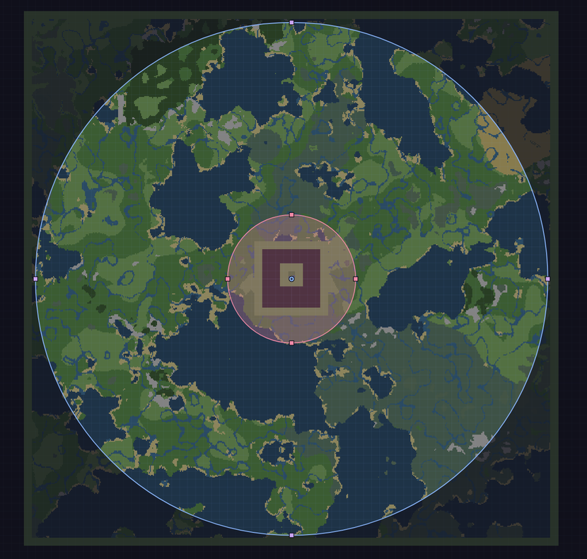

<!--
Single source for every storefront page (BuiltByBit paid + free, Modrinth, Hangar).
Never paste this file anywhere directly. Build it with
    python scripts/release/build_front_pages.py
and use the files in scripts/release/generated/ (gitignored, so build before use):
paste the two .bbcode files into BuiltByBit by hand; release.yml builds and pushes
the Modrinth and Hangar pages. CI fails if any target doesn't build (`--check`).

Markers, each alone on its line, nestable (written here without the comment
delimiters, because a closing delimiter would end this note):
  kind: promo | purchase   ... /kind   what the block IS; POLICY in the script decides
                                       which targets keep it (promo is dropped on
                                       Modrinth and Hangar)
  only: <targets>          ... /only   audience copy for the listed targets
  not: <targets>           ... /not    audience copy for every other target
  targets: bbb-pro, bbb-lite, modrinth, hangar; aliases: bbb, markdown
  {{name}} and {{jar}} expand per target (LeafRTP-Pro on bbb-pro, LeafRTP elsewhere).
Hangar does not allow paid-edition advertising: anything about paying goes in a
`kind: promo` block. The build also fails if a Modrinth or Hangar page still
mentions Pro, buying, sponsorship or a price.

Voice (RULES.md D-006): first person, plain, no sales language. One person
maintains this as a community project; write like that.
Prefer numbers and caveats over adjectives. ASCII punctuation only.
Images: local relative paths (e.g. ); build_front_pages.py
validates existence on disk and rewrites them to raw.githubusercontent.com URLs.
Doc links: relative paths (e.g. [text](../admin/COMMANDS.md#anchor)) are also
validated on disk and rewritten: published docs become dailystruggle.github.io/RTP
page URLs, anything else (code, directories, unpublished docs) becomes a GitHub URL.
Prefer these over hand-written website URLs so a renamed or deleted page fails the build.

Architecture & Layout (Invariant 3-Zone Utility Hierarchy):
To eliminate churn between beginner accessibility and engineering precision,
the document is partitioned into three non-overlapping functional zones. Do not
blur boundaries between zones when updating copy:

Section order (fixed; do not reorder per target):
  1. What it is + hero image   (what is this, can I use it)
  2. The short version: 1 headline + 5 outcome bullets; the rest sit in a
     collapsed 'More highlights' block   (why this one)
     Short-version bullets are `[**Adjective**](link): measured fact.`
     (Efficient, Fast, Distinct, Portable, ...). Keep that form; do not turn
     the labels into sentences.
  3. Zone 2: common setups, install, features summary   (how do I use it)
  4. Zone 3: performance, how it works summary, testing and quality gates   (why should I believe it)
  5. Why I made it
  6. Reference after the story: paid-listing block (BuiltByBit only), commands and permissions, configuration files, block-list grammar, FAQ, support   (look things up)
Rule: a section moves up only if the section above it answers a question the
reader asks earlier. Install steps appear once, in Install; do not repeat
them above the fold. Hero: a web editor screenshot (map, no jargon); the
spatial-memory walk image stays in Zone 3 (it reads as noise above the fold).
Use screenshots whose status pill reads LINK - CONNECTED.
Bullets anywhere on the page are a label, a link to the proof and a fact.
Detail lives behind the link; do not append a clause restating the benefit.

Zone 1: Verified Outcomes & Universal Guarantees (Above the Fold)
  - Audience: 100% of visitors (evaluators, beginners, power users).
  - Scope: Title, badges, 'What it is', platform compatibility, 'The short version'.
  - Rule: State empirical outcomes only (0 stalls, 0 failed teleports,
    5 ms median /rtp-to-arrival latency on Paper, single jar). Use the same
    measured figure everywhere it appears. Zero algorithmic exposition or
    derivations here.
  - Rule: 'What it is' defines the plugin: category (random teleport / RTP
    plugin), commands, and how it works in one plain sentence. Benefits and
    what it avoids belong in 'The short version'. No tagline or subtitle
    under the title, no download counts (the rename FAQ has that), and no
    "works with no setup" line after Install. Enforced by ZONE1_REJECTED.
  - Enforced: build_front_pages.py fails if Zone 1 uses the terms in
    ZONE1_JARGON (TP/s, MSPT, TPS, tick, main/server thread, off-tick, candidate,
    pre-filter, shuffle, ACCUMULATE/REROLL, SPI, TTL, p95/p99). Those words
    are defined in Performance; use them there. Link targets are exempt.

Zone 2: Operational On-Ramp & Zero-Friction Migration (Immediate Action)
  - Audience: Action-oriented server operators ready to deploy or switch.
  - Scope: 6-step quick-start install, /rtp config import (zero-friction switch),
    /rtp admin setup / web editor, common setups, player & admin features.
  - Rule: Maximize net utility by minimizing time-to-deployment. An admin should
    be able to get a safe, lag-free setup running without scrolling past this zone.

Zone 3: Architectural Proof & Technical Transparency (Deep Foundation)
  - Audience: Folia operators, network architects, skeptics, and engineers.
  - Scope: Full benchmark tables (harness in helpers/StressTestRTP/), scatter
    charts, spatial memory benchmarks, region-file pre-filter (.mca and .linear),
    quality gates, and test findings. The FAQ and other reference blocks sit in
    section 6, after 'Why I made it'.
  - Rule: Retain 100% mathematical and technical precision. Nothing is deleted:
    full feature lists, mechanism write-ups and the quality-gate table live in
    docs/site/features.md, how-it-works.md and quality-gates.md, and this page
    keeps a short summary plus a relative link to each. Edit the moved text in
    the docs page, not here. Benchmarks, caveats and the test findings stay on
    this page. Commands/permissions sit in section 6 until docs/admin/COMMANDS.md
    covers every command and permission in that block (it lacks several).
    Head-to-head competitor comparisons live strictly in the Performance section.

Listing metadata (for the marketplace form fields, not emitted):
  Paid BuiltByBit title:  "LeafRTP-Pro"   tagline: "Off-tick Random Teleportation engine"
  Free title:             "LeafRTP"       tagline: "Off-tick random teleport engine with spatial memory"
  (Modrinth's short description still reads "Fast Random Teleportation for everyone,
   configurable and extensible" - replace it there with the free tagline above.)

Reviewer notes (read before reviewing the Performance section):
  - LeafRTP's shipped defaults (refill `period: 20`, ready queue 50, backlog
    1,000, pause on low TPS) are sized for typical usage rates. They do not
    change per-teleport cost or how the plugin performs; they only cap how
    fast input is accepted. The benchmark config lifts that cap so the
    harness can find the break point. Do not report the bench tuning as an
    unfair advantage or a hidden disclosure problem.
  - The Folia numbers reproduce on the current build. Long runs always span
    several builds; do not ask for every run to be on one build.
  - Spacing: the pass threshold is 48 blocks; the closest measured pair was
    70 blocks. Both figures are true; use them together.

Private / Author notes:
  - Run a future memory leak test using the behaviour leak fuzzer (`scripts/bench_fuzz.py`) on LeafRTP only, on Folia/Paper, to evaluate long-duration heap bounds. Competitor leak runs are out of scope.
-->

# {{name}}: Random Teleport

<!-- only: markdown -->

<!-- /only -->

## What it is

**{{name}} is a random teleport (RTP) plugin.** `/rtp` or `/wild` sends a player to a random safe spot inside a region you set. It finds and checks spots ahead of time, reading the world files on disk, and keeps a queue of checked spots ready.

I've worked on it in my own time since 2021. The benchmarks and the test harness are in the repo, and every number on this page can be rerun from them.

One jar for Paper and Spigot (1.18+), Folia (1.21.11+), Fabric (1.20.1 and 1.21+, needs Fabric API) and NeoForge (1.21.1+), up to 26.3. It also loads on Velocity for `/rtp` across a network.

*Drawing where players land, in the browser editor (`/rtp editor`).*

<!-- only: bbb-pro -->
<!-- kind: promo -->
This listing is how you pay for support. The code is the same as the [free download](https://modrinth.com/plugin/leafrtp) and all of it is MIT licensed. Paying doesn't unlock anything in the plugin; details are in [What paying gets you](#what-paying-gets-you) below.
<!-- /kind -->
<!-- /only -->
<!-- only: bbb-lite -->
<!-- kind: promo -->
There is also a paid LeafRTP-Pro listing on BuiltByBit. It is the same code, and nothing in the plugin is locked. Paying gets you priority support, and a patch release when a bug you report needs one.
<!-- /kind -->
<!-- /only -->
<!-- only: hangar -->
On Folia, spots are checked against the world files on disk first, nothing waits for a chunk to load, and only the final block check runs on the region's own thread.
<!-- /only -->

### The short version

**5 ms median from `/rtp` to arrival over 4,194 paced teleports (Paper).**

- [**Efficient**](https://dailystruggle.github.io/RTP/admin/configuration/PERFORMANCE/): the server stayed at full speed through all 4,194 paced teleports, at up to 20 a second.
- [**Fast**](#performance): 40 teleports per second on Paper and 180 per second on Folia, at full server speed.
- [**Distinct**](../site/how-it-works.md#spacing-between-players): across two Paper 26.2 runs of 4,096 teleports, no two landings were within 48 blocks (closest pair: 70); random picks put about 80 pairs that close in each run.
- [**Portable**](https://dailystruggle.github.io/RTP/admin/MIGRATION/#migrating-from-another-rtp-plugin): `/rtp config import` reads your BetterRTP, JustRTP or EzRTP config, previews it, and never overwrites without `overwrite=true`.
- [**One jar**](https://dailystruggle.github.io/RTP/admin/QUICK_START/): the same core on Paper, Spigot, Folia, Fabric and NeoForge, and on Velocity for `/rtp` across a network.

<b>More highlights</b>

- [**Peak throughput**](#performance): 249.7 teleports per second peak on Folia.
- [**Web workspace**](https://dailystruggle.github.io/RTP/admin/WEB_EDITOR_GUIDE/): draw region borders on a map in your browser (`/rtp editor`). No inbound port needed.
- [**Action engine**](https://dailystruggle.github.io/RTP/admin/ACTIONS/): Scripted teleports that start from a trigger, like stepping into a zone or queueing for a duel.
- [**Custom terrain**](../site/how-it-works.md#region-file-pre-filter): Spots are read from the region files on disk, including Iris, Terra, datapack and upgraded worlds.
- [**Claim checks**](https://dailystruggle.github.io/RTP/admin/CLAIM_PLUGIN_COMPATIBILITY/): 16 claim plugins on Bukkit / Paper / Folia plus FTB Chunks and Open Parties and Claims on Fabric / NeoForge, and the teleport is refused if a check cannot answer. Optional PvP combat-tag check.

Benchmark comparisons and hardware metrics are in [Performance](#performance).

## Common setups

These work without extra plugins:

- [**Spawn portals & launch pads**](https://dailystruggle.github.io/RTP/admin/ACTIONS/): Step-in trigger zones over portal frames or launch pads run teleports, with an optional countdown hologram and effects.
- [**First-join random spawn**](https://dailystruggle.github.io/RTP/admin/RECIPES/#rtp-on-first-join-random-spawn-for-new-players): Grant `rtp.onevent.firstjoin` to send new players to random spots on login. A reserve cache keeps a destination ready.
- [**Survival and resource worlds**](https://dailystruggle.github.io/RTP/admin/configuration/REGIONS/#spacing-repeats-and-worst-case-by-mode): Players start far from each other's bases: across two Paper 26.2 runs of 4,096 teleports, no two landings were within 48 blocks (closest pair: 70).

More setups: [Features](../site/features.md#common-setups), [recipes](../admin/RECIPES.md), [actions guide](../admin/ACTIONS.md).

---

## Install

**Requirements:** Paper or Spigot 1.18+, Folia 1.21.11+, Fabric 1.20.1 or 1.21+, or NeoForge 1.21.1+, up to 26.3. Java 17+ (Minecraft itself needs Java 21 from 1.20.5 and Java 25 on 26.x).

Nightly CI boots 1.21.11 and 26.3. I take bug reports from 1.21.11 to the latest release; older versions should run, but fixes there are best effort. Folia is the exception: it is experimental and only its current builds are maintained, so Folia older than 1.21.11 is not supported and can crash without RTP's involvement. Exact per-version status is in the [support matrix](https://github.com/DailyStruggle/RTP/blob/V3/docs/dev/SUPPORT_MATRIX.md).

1. Drop `{{jar}}` into `plugins/` (or `mods/`).
2. Type `/rtp`. With the bundled GUI addon, regular players see a picker listing only the regions they have permission to use, while the admin panel and map visualization links are gated behind `rtp.admin` (OP) and hidden from regular players. To make bare `/rtp` teleport straight away while keeping `/rtp gui` available, set `openOnBareRtp: false` in `addons/guimenu.yml` (or toggle it in `/rtp admin setup`).

That's enough to run. When you're ready to configure regions and settings, pick either self-contained setup path:

- **Browser map workspace (`/rtp editor`):** Opens your config and world map in the browser with no inbound port needed. Draw region borders on the map, edit settings with each key's docs beside it, and review a diff before applying ([web workspace guide](../admin/WEB_EDITOR_GUIDE.md)).
- **In-game guided wizard (`/rtp admin setup`):** Walks through world layout, gameplay presets, region radius (via clickable presets or Anvil input), performance profile, and addon toggles (`openOnBareRtp`, claim checks, effects), then previews the diff before writing ([quick-start guide](../admin/QUICK_START.md)).

After sizing your regions, run `/rtp scan start` to pre-check the terrain, and run a stress test if you expect heavy traffic.

**Other ways to customize (optional):**
- **One-line commands or YAML files:** `/rtp config regions default shape.radius=10km`, or edit `plugins/RTP/` directly (`radius: 10km`, `teleportCooldown: 30s`).
- **Switching from another rtp plugin:** `/rtp config import` finds the old plugin's folder in `plugins/` on its own (or point it anywhere with `path=<dir>`), then previews the translated config and permissions; add `overwrite=true` to write them ([switching guide](https://dailystruggle.github.io/RTP/admin/MIGRATION/#migrating-from-another-rtp-plugin)).

(Advanced database, network proxy, and cache tuning: see the [admin guide](https://dailystruggle.github.io/RTP/FOR_SERVER_ADMINS/).)

---

## Features

- **Setting it up:** web editor, in-game admin book, chat wizard, `/rtp config import`, `/rtp scan`, live map visualizations, 11 languages.
- **For players:** `/rtp` and `/wild`, region, world and biome picks, `/rtp back`, menus, per-player queues, effects, landing platforms.
- **Gameplay and worlds:** any number of regions in six shapes, arrival schematics, auto-RTP on events, Vault pricing, an optional combat-tag check.
- **Actions:** step-in wilderness portals, launch pads, party and team wilderness scatter, and claim or faction anchor teleports (plus optional 1v1/2v2 duel queues and KOTH templates in the action addon).
- **Claims and safety:** 16 claim plugins on Bukkit-family servers plus FTB Chunks and Open Parties and Claims on Fabric and NeoForge, and a configurable block safety filter.
- **Networks and developers:** cross-server `/rtp` over Velocity; `rtp-api` addons, SPI-swappable parts, PlaceholderAPI, bStats.

More: [Features](../site/features.md). Commands and permissions are in the collapsed block near the end.

---

## Performance

I compare throughput under load, latency from `/rtp` to arrival, and tick stability. On Paper, world ticking runs on a single main thread, while on Folia, world ticking is distributed across independent regional worker threads. LeafRTP checks candidates against region files (`.mca` and `.linear`) off-tick and keeps a queue of verified destinations, avoiding synchronous chunk loading and main-thread stalls.

<!-- only: bbb -->
Both LeafRTP downloads are built from the same code, and the LeafRTP rows apply to either.
<!-- /only -->

**Paper 26.2 & Folia 26.2 Performance Under Load (Linux Threadripper 7970X, 48 bot clients, 16k radius):**

These are snapshots of each plugin under one harness on my hardware. The other plugins make different trade-offs, and most don't aim for 100+ TP/s.

| Plugin | Paper safe max | Paper peak | Folia safe max | Folia peak |
|---|---|---|---|---|
| **LeafRTP** | **40 TP/s** (MSPT 45 ms, min TPS 19.2) | **103.3 TP/s** | **180 TP/s** (MSPT < 50 ms) | **249.7 TP/s** (19.0 avg TPS) |
| HuskHomes | 40 TP/s (MSPT 46 ms, min TPS 16.4) | 46.0 TP/s | 60 TP/s | 60.0 TP/s |
| JakesRTP | 20 TP/s (MSPT 44 ms, min TPS 18.4) | 86.6 TP/s (TPS < 5) | - | Not loaded (no Folia support declared) |
| BetterRTP | 20 TP/s (MSPT 43 ms, min TPS 16.2) | 39.5 TP/s (2% failed) | - | Did not complete on this rig |
| JustRTP | 20 TP/s (MSPT 40 ms, min TPS 19.5) | 25.7 TP/s | 10 TP/s | 18.7 TP/s |
| EzRTP | 5 TP/s (MSPT 24 ms, min TPS 20.0) | 8.5 TP/s | < 20 TP/s | 19.7 TP/s |

In the Paper columns, MSPT is the highest per-run p95 at the safe-max stage, and min TPS is the lowest 10 s average in any of those runs.

<b>Method, rig and terms</b>

Most of an rtp plugin's work happens inside server API calls, so a profiler lists it under generic chunk functions. The public harness in [`helpers/StressTestRTP/`](https://github.com/dailystruggle/RTP/tree/V3/helpers/StressTestRTP) attributes it back to the plugin. Rig: AMD Ryzen Threadripper 7970X (32 cores / 64 threads, 128 GB RAM, NVMe), Ubuntu 24.04 LTS, Java 25, 16 GB heap, 48 scripted bot clients (`devstack/clients/bench-swarm.js`). On Paper, the server ran under realtime scheduling (`SCHED_FIFO`, priority 10) with only the plugin under test loaded, and restarted before every run.

Each Paper run steps through 60 s stages at 5, 10, 20, 40, 80, 160 and 320 teleports per second and stops after two failed stages in a row. The other plugins' Paper rows pool 4 runs each from 2026-10-17; LeafRTP's pool 2 runs of the 3.3.0 build (`20261018-022257`, `20261018-023204`). The Folia columns come from separate Folia ramps, and they reproduce on the current build. Each plugin ran on the latest version it supported at the time of the run, with cooldowns, delays and countdowns zeroed and its queue on at its default size where it has one.

The other plugins ran at their documented defaults, because I can't tune settings their authors don't document. LeafRTP's shipped refill, queue and backlog settings (refill every 20 ticks, a 50-spot ready queue, a 1,000-spot backlog, a pause when server speed drops) are sized for typical player traffic, and all they do is limit how fast new requests are taken in. The bench config lifts that limit so the harness can find the break point: refill every tick (`period: 1`) with no pause, a 10-spot ready queue and no backlog ([config and the full list of changes](https://github.com/dailystruggle/RTP/tree/V3/helpers/StressTestRTP/bench-config/paper-26.2)). The cost of each teleport is the same either way.

Terms used on this page: **TP/s** is teleports per second. **TPS** is server ticks per second; 20 is full speed and the most it can reach, and normal variation measures a little under it. **MSPT** is milliseconds per tick; above 50 ms the server falls below 20 TPS and players feel lag. A **lag spike** is a tick over 50 ms. **Off-tick** work runs off the server's main tick thread, so it doesn't stall the game loop. A **ready queue** is a stock of spots checked in advance, so most `/rtp` calls are answered without a live check. A **chunk ticket** is a hold that keeps one chunk (a 16 x 16 block column) loaded until the hold is released. **Rejection sampling** picks a random spot, checks it, and draws again on failure, with no cap on retries. **REROLL** (the default) and **ACCUMULATE** are two selection modes: `REROLL` skips known-bad chunks and draws again, at one in-memory check per known-bad chunk, and `ACCUMULATE` draws only from chunks not known to be bad, so every pick is a guaranteed O(1) ([spacing notes](https://dailystruggle.github.io/RTP/admin/configuration/REGIONS/#spacing-repeats-and-worst-case-by-mode)). **Safe max** is the highest stage a plugin passed in every run, with the same rule on Paper and Folia: it delivered at least 95% of the requested rate, MSPT p95 stayed at or under 50 ms, and at most 1% of teleports failed. **p95 / p99** is the time that 95% / 99% of teleports came in under.

- **Paper vs. Folia:** Paper places every arriving player on one main thread, so no plugin here gets much past 40 TP/s at 20 TPS. Above its safe max on Paper, LeafRTP still completed every teleport: 21,924 of 21,924 in the 80 and 160 TP/s stages, delivering up to 103.3 TP/s while the server slowed to about 9-10 TPS (MSPT p95 88-105 ms). Folia spreads that work across region threads, and LeafRTP reached 180 TP/s at 19.6 regional TPS (198 ms median latency), peaking at 249.7 TP/s.

<b>Latency at equal load (Paper 26.2, p50 / p99 ms)</b>

**Latency at equal load:** time from `/rtp` to arrival, pooled over each plugin's Paper runs. Each cell is p50 / p99 in milliseconds ([full table with p95](https://github.com/dailystruggle/RTP/blob/V3/helpers/StressTestRTP/RESULTS.md#paper-262-linux-realtime---latency-at-5-to-40-tps)).

| Plugin | 5 TP/s | 10 TP/s | 20 TP/s | 40 TP/s |
|---|---|---|---|---|
| **LeafRTP** | 5 / 6 | 5 / 6 | 5 / 7 | 158 / 285 |
| JakesRTP [1] | 0 / 13 | 3 / 26 | 4 / 23 | 4 / 24 (MSPT p95 77-118 ms) |
| HuskHomes | 221 / 517 | 224 / 426 | 275 / 474 | 568 / 1,574 |
| BetterRTP | 156 / 709 | 199 / 806 | 199 / 815 | 510 / 4,323 (127 failed) |
| EzRTP | 154 / 905 | failed (619 of 2,396) | - | - |
| JustRTP | 367 / 2,471 | 473 / 2,480 | 476 / 2,477 | failed (25.5 of 40 TP/s delivered) |

`-` means no result in the pooled runs. For LeafRTP at 5, 10 and 20 TP/s the max was 58 ms over 4,194 teleports, and its MSPT p95 was 21-37 ms per run. [1] JakesRTP had the lowest median at those rates, but its MSPT p95 reached 77-118 ms at 40 TP/s. At 40 TP/s LeafRTP's ready queue runs out in this config, so those teleports wait on a live selection.

<b>What I changed on each plugin so they do the same job</b>

Every plugin used the same 1,024 to 16,384 block circle, with cooldowns, delays and countdowns off. These changes make the work comparable; none of them tune for speed.

| Plugin | Change | Why |
|---|---|---|
| EzRTP | Water landings off | By default it can land on water and add ice under the player, which accepts spots the others reject |
| EzRTP | Biome checks on (`plugins/EzRTP/rtp.yml`) | Without them it skipped placement checks and reported 29.47 TP/s it wasn't earning (run `20261006-135938`) |
| EzRTP | Run through `forcertp` | Skips its cooldown and limit checks; it also ships a 5 s countdown |
| BetterRTP | `MaxRadius: 17408` | Its circle formula cuts `MinRadius` off the outer edge, so 16384 would only reach 15,360 blocks |
| BetterRTP | Radius checked on the landing scatter | It reverts config edits on shutdown |
| HuskHomes | Centered on `/spawn` | It has no center setting |
| All | Command checked with `/<plugin>:rtp <TAB>` | When two plugins register `/rtp`, the prefixed command can reach the wrong one; this voided one earlier run set |

Source and the rest of the controls: [`PRE_WRITEUP.md`](https://github.com/dailystruggle/RTP/blob/V3/helpers/StressTestRTP/PRE_WRITEUP.md), sections 3, 6 and 7.

Full benchmark tables, methodology, and per-run analyses: [`helpers/StressTestRTP/`](https://github.com/dailystruggle/RTP/tree/V3/helpers/StressTestRTP).

**Where each plugin lands players (Paper 26.2, 4,096 teleports):**

*Where each plugin landed 4,096 players in the Paper 26.2 run (`20261008-003310`), every one set to the same 1,024 to 16,384 block circle around 0,0. The green box under each panel is the LeafRTP region shape that gives the same distance-from-center spread, so any of these distributions is a config change in LeafRTP. Each config is replayed through LeafRTP's own shape code over the same terrain: LeafRTP and BetterRTP match CIRCLE, EzRTP and HuskHomes match CIRCLE_NORMAL, and JustRTP and JakesRTP match the spiral power curve.*

<b>Benchmark caveats and additional runs</b>

**Caveats.** The region-file check only works on terrain that exists; any plugin has to generate a chunk that was never generated. The Linux stress test used 48 idle bots with server view distance capped at 2: real connections and chunk sends, with nobody moving or building. Hardware, view distance, world state (how much of it is unsafe, whether it's pregenerated) and other plugins will move the numbers. The other plugins update often; if a number here is out of date, open a GitHub issue with a repro or a doc link and I'll correct it. The harness measures dispatch-to-arrival latency, per-attempt cost, and success rate as defined above; it does not measure claim-plugin compatibility or safety rules.

Full methodology, per-run analyses, and the runs not shown here (equalized-radius Folia, pinned-heap GC profiling, the wide-radius single-plugin run): [`helpers/StressTestRTP/`](https://github.com/dailystruggle/RTP/tree/V3/helpers/StressTestRTP). Video of `/rtp` on a custom world generator: [youtu.be/V0NyNK9JydM](https://youtu.be/V0NyNK9JydM).

---

## How it works

- **Spatial memory:** biomes and invalid chunks (with cause and TTL) are remembered at chunk resolution across restarts.
- **Region-file pre-filter:** candidates are read from `.mca` and `.linear` region files and rejected off-tick.
- **Pre-verified cache:** safe destinations wait in background queues; on Paper the median from `/rtp` to arrival was 5 ms in the paced benchmark.
- **Spacing:** a keyed shuffle of the region.

Details, derivations and charts: [How it works](../site/how-it-works.md). Spacing statistics: [Spacing between players](../site/how-it-works.md#spacing-between-players).

<b>How I test it, and what the tests have found</b>

A plugin can pass one of these tools and fail another.

| Tool | What it drives | What it catches |
|---|---|---|
| Stress harness (`helpers/StressTestRTP/`) | Scripted bot clients that join like players, in closed-loop, open-loop and paced modes, with spark and JFR attached | Throughput ceiling, MSPT and ticks over 50 ms, chunks and CPU per teleport, and which thread pays for them |
| Behavior fuzzer (`scripts/bench_fuzz.py`) | Seeded bot programs: `/rtp`, move, quit, rejoin under a new name, die, console `reload`. Coverage-guided search, automatic replay and shrinking | Memory the server still holds after a full GC, scored against a control run with no rtp plugin. Every plugin gets the same seeds, bots and server |
| Jazzer targets | The Anvil chunk and column readers, the LZ4 decoder, the NBT readers and the Redis (RESP) reply parser; only the two Anvil readers have real-region seeds | Crashes and unexpected exceptions on malformed input; failing inputs are saved as reproducers |
| Spacing simulations | Landing coordinates from real stress runs and from the shape models | Repeats, clustering and distance to the nearest earlier landing |
| Safety and mutation tests | One test per safety prohibition, plus weekly PIT on the teleport pipeline and three other `rtp-core` packages | Rules that must never break, and tests that wouldn't notice a broken rule |

What they found:

- **Retained player sessions (fuzzer).** LeafRTP kept a disconnected player's objects alive through its last-teleport records. The fuzzer flagged it and it reproduced on replay; it is fixed in 3.3.0 and covered by a regression test. The latest 3.3.0 run retained 0 players across 86 episodes, including config reloads. The run found nothing within its budget, which doesn't rule a leak out.
- **Main-thread chunk load on arrival (spark).** A profile of the Paper stress run put 14.1 s of a 115.7 s phase (about 3.4 ms per teleport) in the arriving player's first tick loading its landing chunk synchronously. The cause was the arrival chunk ticket being released before the player's own ticket held it. The fix keeps the ticket through the first ticks. A later spark profile of the Linux 100 TP/s run (`20261009-085505`, 5.8k teleports per profile window) shows `Entity.isInWall` at 0.02-0.03 s of 59.5 s on the server thread, with no chunk load under it.
- **Repeats under spacing (simulation).** Modeling consecutive landings showed that with `expand: false` a used chunk can come up again under "ACCUMULATE" mode due to continuously shifting offsets. This is disclosed in [the region spacing notes](https://dailystruggle.github.io/RTP/admin/configuration/REGIONS/#spacing-repeats-and-worst-case-by-mode). Both obvious fixes were tested and ruled out.
- **Harness errors.** An overnight driver loaded the wrong plugin set for four Linux rows, so they measured a server without the plugin. I caught it on inspection and threw those rows out.
- **Fuzzer scoring noise.** An object count the control run lacks can score as a leak while retained memory matches the control. I read verdicts against bytes retained and replay every candidate before trusting it.

I reproduce every finding from a recorded seed before counting it. The fuzzer method, limits and run logs are in [`LEAK_FUZZING.md`](https://github.com/dailystruggle/RTP/blob/V3/helpers/StressTestRTP/LEAK_FUZZING.md).

<b>Testing and quality gates</b>

- [**Safety rules are tests**](../dev/TRACEABILITY.md): one per prohibition, S-001 to S-007.
- [**Mutation tested**](https://github.com/DailyStruggle/RTP/blob/V3/.github/workflows/mutation-testing.yml): weekly over four `rtp-core` packages; a shard fails below 60%.
- [**Coverage ratchet**](../site/quality-gates.md): floors only go up; changed lines need 80%.
- [**Stable API**](../site/quality-gates.md): japicmp against 3.2.1; removals need two minor versions of deprecation.
- [**No shaded dependencies**](../site/how-it-works.md#no-shaded-dependencies)
- [**Seeded reproduction**](https://github.com/dailystruggle/RTP/blob/V3/helpers/StressTestRTP/LEAK_FUZZING.md): a bug counts once it replays from a recorded seed; rows from a broken harness are dropped.
- [**ADRs**](../adr/README.md): decisions are written down; AI works inside seams I designed, and I review it.

---

## Why I made it

I started this project for the challenge of solving a hard problem. Every time a player ran `/rtp`, people wrote "LAG" in chat. I thought "the problem is with pure rejection sampling. This seems solvable if I can figure out an efficient memory system". After watching 3Blue1Brown videos, I set out to prove mathematically that spatial memory could fix that, using a custom space-filling curve to spread candidates evenly without rerolling.

I built the rest in stages:
- **v1:** Proved the math. Built the space-filling spiral to map 2D territory uniformly, so picks don't duplicate or clump and no player positions need tracking.
- **v2:** Tackled initial SPI models and platform compatibility, though latency degraded significantly in the process.
- **v3:** Rebuilt so one core runs on every platform. Switched from chunk forceloading to ticketing, added explicit task tracking and cleanup so nothing leaks, split features into modular SPIs, made it testable without a server, and set rules for AI tooling: I design the seams and make the decisions recorded in the ADRs, and AI writes code inside those seams (repetitive wrappers, platform APIs I didn't know well, unit tests, devstack YAML) that I review before it lands.
- **3.3.0:** Added static analysis, fuzzing, mutation testing and CPU and memory profiling, and used them to remove the bottlenecks behind the benchmark numbers above.

Architecture decisions, benchmarks, and design history are recorded in the [Architecture Decision Records](https://dailystruggle.github.io/RTP/adr/) and [Why LeafRTP Exists](https://dailystruggle.github.io/RTP/site/why/). [AI Usage](https://github.com/DailyStruggle/RTP/blob/V3/docs/dev/AI_USAGE.md) covers what AI tooling writes here and what I don't use it for: system design, code review and git operations.

<!-- only: bbb-pro -->
<!-- kind: promo -->
---

## What paying gets you

Same code, config and commands as the free download, under the same MIT license. Nothing in the plugin is locked. Most of the development has been on my own dime, and paying helps fund it:

| This listing | Free download |
|---|---|
| Priority on my support queue | Community support, best effort |
| A patch release when a bug you report needs one | Updates when I choose to publish them |

Both downloads are built from the same code under the same version numbers. What this listing adds is a promise: if you hit a bug, I fix it and ship you the patch here. The free download gets updates because I want to put them out, not because it's owed them. A native BungeeCord proxy adapter is planned; for now BungeeCord networks use plugin messaging on the backend.

Switching between the free download and this one is a jar swap. Config, data files and commands stay the same.
<!-- /kind -->
<!-- /only -->

---

<b>Commands, permissions, configuration files</b>

**Commands** (aliases: `/rtp`, `/wild`):

| Command | Description | Permission |
| --- | --- | --- |
| `/rtp` / `/wild` | Random teleport to the default region for your current world (or the GUI picker, if that addon is installed) | `rtp.use` |
| `/rtp region=<name>` | Teleport to a named region | `rtp.region` / `rtp.regions.*` |
| `/rtp world=<world>` | Teleport within a specific world | `rtp.world` / `rtp.worlds.*` |
| `/rtp player=<name>` | Teleport another player | `rtp.other` |
| `/rtp biome=<biome>` | Teleport to a chosen biome | `rtp.biome` / `rtp.biome.*` |
| `/rtp action <name> [player]` | Trigger a scripted action, arena, or matchmaking duel | `rtp.action` / `rtp.action.<name>` |
| `/rtp action cancel [action]` | Leave a matchmaking queue or cancel an action entry | `rtp.action.cancel` |
| `/rtp back` | Return to where you were before the last `/rtp` | `rtp.back` |
| `/rtp centerx=<x> centerz=<z> radius=<r>` | One-off overrides for this call; units allowed (`radius=10km`) | `rtp.params` |
| `/rtp menu` | Player book menu | `rtp.use` |
| `/rtp gui` | Open the menu a GUI addon bound to `/rtp`; without one, a plain teleport | `rtp.gui` |
| `/rtp admin` | Operator book menu | `rtp.menu.admin` |
| `/rtp editor [local\|trust\|untrust\|apply]` | Web editor link, offline copy, browser trust and revocation (`untrust key=<prefix\|all>`), token apply | `rtp.editor` |
| `/rtp clear <cache\|cooldown\|queue\|limit\|invuln>` | Clear location caches, cooldowns, queues, use limits or invulnerability | `rtp.admin` |
| `/rtp info` | Operator diagnostics | `rtp.info` |
| `/rtp reload [file]` | Reload all configuration, or one file | `rtp.reload` |
| `/rtp config <file> <key>=<value> [...]` | Set one or more keys in a file (dotted for nested keys, e.g. `/rtp config regions default shape.radius=10km`), save, then reload | `rtp.config` + `rtp.update` |
| `/rtp config <file> view\|viewraw` | Open a config file as a book menu, or print its raw YAML to chat | `rtp.config` |
| `/rtp config <regions\|worlds> add=<name>\|remove=<name>` | Create or delete a region or world file (`default` can't be removed) | `rtp.config` |
| `/rtp config import [source] [path=<dir>] [overwrite=true]` | Translate another rtp plugin's config (auto-detected, or any folder via `path=`); never overwrites without `overwrite=true` | `rtp.config` |
| `/rtp config import permissions [source] [apply=true]` | Dry-run the LuckPerms commands that copy BetterRTP, JustRTP or EzRTP nodes onto `rtp.*`; `apply=true` runs them | `rtp.config` |
| `/rtp config language <locale>` | Switch config files and messages to a bundled locale, then reload | `rtp.config` |
| `/rtp admin setup <world\|gameplay\|perf\|preview\|confirm>` | Guided first-time setup from preset configs | `rtp.admin.setup` |
| `/rtp scan start\|pause\|resume\|reset\|cancel` | Offline spatial memory pregeneration (was `/rtp fill` in 2.x) | `rtp.scan` |
| `/rtp visualization [held\|export <type>]` | Render live held map charts or export high-resolution PNG/BMP diagnostic images | `rtp.admin` |

**Permissions** (full set in `plugin.yml`):

| Permission | Default | Grants |
| --- | --- | --- |
| `rtp.use` | `true` | Use `/rtp` and `/wild` |
| `rtp.see` | `true` | Tab-complete `/rtp` |
| `rtp.free` | `op` | Skip the Vault charge |
| `rtp.params` | `op` | Per-call overrides (`centerx=`, `centerz=`, `radius=`) |
| `rtp.personalqueue` | `false` | Reserve a per-player pre-warmed location |
| `rtp.onevent.*` | `false` | Auto-RTP on join / firstjoin / respawn / changeworld / move / teleport |
| `rtp.back` | `op` | `/rtp back` |
| `rtp.editor` | `op` | `/rtp editor` and its subcommands |
| `rtp.gui` | `op` | `/rtp gui` |
| `rtp.action` | `op` | `/rtp action <name>`; each action also checks `rtp.action.<name>` (or the permission set in its file) |
| `rtp.action.cancel` | `op` | `/rtp action cancel` for your own entries; `rtp.action.cancel.other` for other players and session IDs |
| `rtp.update` | `op` | Setting keys with `/rtp config <file> <key>=<value>`; granted by `rtp.config` |
| `rtp.servers.*` | `true` | Cross-server destinations in network mode (was `op` before 3.3.0) |
| `rtp.admin` | `op` | `/rtp clear`, plus `rtp.reload`, `rtp.config`, `rtp.scan`, `rtp.info` and `rtp.menu.admin` |
| `rtp.admin.setup` | `op` | `/rtp admin setup` wizard |
| `rtp.*` | `op` | Everything |

**Configuration files** under `plugins/RTP/`. Every file reloads at runtime (`/rtp reload`) and accepts human units like `10km` or `30s`. Most servers only edit the core files:

| File | Controls | Example keys |
| --- | --- | --- |
| `config.yml` | Delays, cooldowns, move-cancel distance | `teleportDelay`, `teleportCooldown`, `cancelDistance` |
| `definitions/regions/<name>.yml` | Shape, radius, center, price, permissions | `shape.name`, `shape.radius`, `price`, `requirePermission` |
| `safety.yml` | Invulnerability, landing platforms, PvP check | `invulnerabilityTime`, `platformRadius`, `pvpCheckEnabled` |
| `advanced/blocks.yml` | Unsafe blocks (lava, water), air blocks and block tags | `unsafeBlocks`, `airBlocks` |
| `economy.yml` | Vault pricing and cancellation refunds | `price`, `refundOnCancel` |
| `definitions/actions/<name>.yml` | Portals, party spacing, and arena bounds | `minSeparation`, `confinement.damage` |

(Advanced database, network proxy, custom biomes, and message templates come with working defaults. See the [full configuration guide](https://dailystruggle.github.io/RTP/admin/configuration/CONFIGURATION/) for details.)

**Soft dependencies (all optional):** Vault (for the economy charge), PlaceholderAPI, and the claim, combat-tag and hologram plugins listed above. PaperLib is no longer needed.

<b>Block-list token grammar (advanced/blocks.yml)</b>

Six token shapes can be mixed freely in `unsafeBlocks` and `airBlocks` (`advanced/blocks.yml`):

- **Plain material:** `LAVA`, `MAGMA_BLOCK`.
- **Material + state predicate:** `OAK_SLAB[waterlogged=true]`. Multiple predicates AND together: `OAK_SLAB[waterlogged=true,type=top]`.
- **Numeric range predicate:** `WATER[level>=5]`, `LIGHT[level<8]`. Fails open on a missing or non-numeric value.
- **Vanilla block tag:** `#minecraft:leaves`, `#minecraft:fire`, `#minecraft:campfires`. Expanded from the server's live block-tag registry when the config loads; datapack and modded tags work too.
- **Tag + state predicate:** `#minecraft:slabs[waterlogged=true]`.
- **Wildcard + state predicate:** `*[waterlogged=true]`: one line instead of listing every waterloggable block.

Unknown tags and properties fail open: a config written for a newer MC version still loads on an older one. Malformed tokens are never silent: `[WARNING] [safety.yml] rejected unsafe-blocks token '<token>': <reason>` (the log prefix still names `safety.yml`, where these lists used to live). Block states are only read when a token needs them, and plain-material configs cost nothing extra. On an older install, lists kept in `safety.yml` are moved into `advanced/blocks.yml` on load, and plain-material entries keep working unchanged.

<b>FAQ</b>

**Q: Will players land on top of each other or in each other's bases?**
A: Rarely, and no player positions are tracked. In two Paper 26.2 runs of 4,096 teleports each, no spot repeated, no two landings were within 48 blocks and the closest pair was 70 blocks apart; that is a measured result, not a guaranteed minimum. The default `REROLL` mode doesn't repeat a spot until the shuffle has cycled; on `ACCUMULATE` a used spot can come up again at about the random-pick rate. See [Spacing between players](../site/how-it-works.md#spacing-between-players).

**Q: How does it avoid lagging the server?**
A: Most `/rtp` calls are served from a queue of locations checked before anyone typed the command. The queue refills off the main thread: it skips ground it has already rejected and checks the rest against the region files before loading any chunk. Details are in [How it works](../site/how-it-works.md).

**Q: Is it complicated to set up?**
A: No. Pick either the browser map workspace (`/rtp editor`) or the in-game guided wizard (`/rtp admin setup`): both configure your worlds, region radii (by dragging the border on the map, clicking a preset, or typing a distance in an Anvil prompt), and presets with a diff preview before anything is written. You can also set a radius with one command (`/rtp config regions default shape.radius=10km`) or in the in-game book (`/rtp admin`). If you are migrating from another plugin, `/rtp config import` finds its folder and translates your existing files, with a preview before anything is written.

**Q: How is the web editor secured? Does it open ports on my server?**
A: Not to the outside. The hosted editor needs no inbound port: it connects outbound over TLS to an ephemeral WebSocket relay. Local mode (`/rtp editor local`) binds a token-authenticated socket on `127.0.0.1` only, which nothing outside the machine can reach. All messages require RSA-2048 signatures with strictly increasing sequence counters and single-use, expiring trust nonces.

**Q: Why is it called "LeafRTP" now instead of just "RTP"?**
A: "RTP" is the generic name for random teleport, and the old name was just the function. That worked for years with older search and word of mouth (passing 400k downloads under that name), but current search and marketplace indexes lump it in with every other random-teleport plugin, command and forum thread, and it stopped showing up. "LeafRTP" is a name that points at this plugin. The `/rtp` command, `rtp-api`, config paths and data files stay exactly as they were, and nothing changes for existing installs.

**Q: Does it work on Folia?**
A: Yes, on Folia 1.21.11 and newer. Folia is experimental and only its current builds are maintained, so older Folia builds aren't supported; they can crash on their own. How it loads chunks there is under [Chunk loading, by platform](../site/how-it-works.md#chunk-loading-by-platform). In the Folia benchmarks it had 0 watchdog stalls.

**Q: How do I set up teleportation between worlds?**
A: Resolution order: the player's current world (or the `world=` parameter) -> that world's target region -> the region's target world. See [World configuration](../admin/configuration/WORLDS.md).

**Q: Do you support triangle / diamond region shapes?**
A: Use the `Polygon` shape. A triangle is a 3-vertex polygon and a diamond is a rotated square.

**Q: Do I need Chunky or another pre-generator?**
A: No, but they work well together. `/rtp scan` walks a region off-tick, verifies safety and generates chunks that aren't on disk yet while recording which sectors are unsafe. Run Chunky first if you want the whole map on disk up front; scan then reads those chunks through the region-file pre-filter.

**Q: Iris / Terra / custom datapack generators, or a world upgraded from an older version?**
A: Yes. Region files are read directly: modded and namespaced IDs are kept, and `/rtp biome=<x>` matches what's on disk. Plugins that use the live noise-map lookup get this wrong after a version migration. Chunks that were never populated fall back to a live load.

**Q: What about the Linear (.linear) region format?**
A: Yes, with no setup. LeafRTP reads Anvil (`.mca`) and Linear (`.linear`, v1 and v2) region files directly. On Linear servers (such as Leaves, Gale, LinearPaper, or Fabric with the Linear Region Format mod) it uses the Zstandard library the server already has, so the jar bundles no extra libraries. It checks that decompressor once at startup and checks each file's header and bounds as it reads. If Zstandard is missing or a file is damaged, that spot is checked through the server's normal async chunk load instead.

**Q: I'm on NeoForge.**
A: There's a native NeoForge adapter for 1.21.x / 26.x running the same core as every other platform. I test it less than the Bukkit family and Fabric, and broader testing on the 26.x carrier is still ongoing. If you hit something there, it goes to the front of my list.

**Q: I'm on Forge.**
A: Run Arclight or Mohist and use this jar. A native Forge adapter isn't planned.

**Q: Memory and MSPT: should I worry?**
A: In the paced Paper benchmark (598 teleports at 5 per second across 2 runs), MSPT p95 was 21.2-21.3 ms per run and TPS stayed at or above 19.98. At 40 per second it was 42.6-45.2 ms, with TPS at or above 19.19. Those runs recorded no idle baseline, so this is the whole server's tick time with 48 bots online, not LeafRTP's share of it. Locations kept in the hot queue hold chunk tickets so arrival doesn't wait on chunk loading, and `MemoryTracker` makes sure those tickets are released. Under heap pressure (old-generation use at or above `maxHeapPercent`, 85% by default; on a JVM with no separate old-generation pool and under 512 MB free, total heap use counts too) background filling pauses and the held tickets are dropped back to cold storage, which frees the pinned chunks right away.

**Q: Can I use ItemsAdder, Oraxen, Nexo, or CustomModelData in the GUI menu?**
A: Yes. Icons in `guimenu.yml` take `ia:<id>`, `oraxen:<id>`, `nexo:<id>`, `hdb:<id>`, `head:<player>`, `base64:<hash>` and `<MATERIAL>:<cmd>`. Most of the item plugins behind these prefixes are paid and closed source, so CI can't run them; those hooks are tested against stubs and open-source stand-ins, and support for them is best effort. If the item plugin is missing or its API changes, the icon falls back to a vanilla material. See [Custom Item & Menu Integration](https://dailystruggle.github.io/RTP/admin/CUSTOM_ITEMS/).

<!-- only: bbb-pro -->
<!-- kind: promo -->
**Q: Should I pay for this or use the free download?**
A: The free one works exactly the same. Pay if you want priority support and a fix for the problems you report, or if it has saved you enough lag and setup time that you want it to keep being maintained.
<!-- /kind -->
<!-- /only -->

**Q: How do I report a bug?**
A: Open a GitHub issue with your server version, LeafRTP version, platform, the relevant config files and the error from the log. The [admin guide](https://dailystruggle.github.io/RTP/FOR_SERVER_ADMINS/) has a full reproduction template. I take reports for Minecraft 1.21.11 through the latest release; on older versions it should still run, and I'll look when I can.

<b>Support</b>

<!-- not: bbb-pro -->
Support is me, in my spare time, so it's best effort.

- For config questions, try the [web workspace](../admin/WEB_EDITOR_GUIDE.md) first (`/rtp editor`), or open a thread in the [**LeafCraft Plugin Support** Discord `#support` Forum](DISCORD_LAYOUT.md) where the doc and `[RTP bit]` bot answers common setup questions right away. I help with bugs and anything still unclear after that.
- A bug report in GitHub Issues or the Discord `#support` Forum needs: `/version`, `/rtp version`, `/rtp test` output, `config.yml`, `definitions/regions/`, `safety.yml`, `advanced/blocks.yml`, and the server log uploaded to `mclo.gs`. If something's missing I'll ask for it.
- "It doesn't work" isn't something I can act on. Tell me what you did, what you expected, and what happened instead.
- There's no guaranteed response time. Safety bugs (bad landings, chunk leaks, claim bypasses) get looked at first.
- Feature requests go in GitHub Discussions or the Discord `#support` Forum first.
<!-- /not -->
<!-- only: bbb-pro -->
<!-- kind: promo -->
Support comes from me, the person who wrote the code.

- Tickets from this listing and `@Pro Supporter` threads in the [**LeafCraft Plugin Support** Discord `#support` Forum](DISCORD_LAYOUT.md) (tagged `💎 Pro Priority` automatically) go ahead of free-download tickets. A confirmed bug that blocks you gets a patch release here.
- Response time: 24-72 h on weekdays. Safety bugs go first regardless.
- Bug reports with `/version`, `/rtp version`, `/rtp test` output, configs and an `mclo.gs` log link get fixed fastest. Most setup questions are answered right away by the `#support` Forum bot or the admin guide.
- Feature requests go in GitHub Discussions or the Discord `#support` Forum.
<!-- /kind -->
<!-- /only -->

---

## Links

- [**Documentation site**](https://dailystruggle.github.io/RTP/): every doc in one searchable place
- [**Admin and configuration guide**](https://dailystruggle.github.io/RTP/FOR_SERVER_ADMINS/): install, configure, command reference
- [**Discord `#support` Forum**](DISCORD_LAYOUT.md): interactive setup help, `[RTP bit]` log triage, and community channels
- [**Addon / API developer guide**](https://dailystruggle.github.io/RTP/FOR_ADDON_DEVELOPERS/): `rtp-api` and examples
- [**Changelog**](https://github.com/dailystruggle/RTP/blob/V3/CHANGELOG.md)
- [**Source on GitHub**](https://github.com/dailystruggle/RTP): issues, contributions, the benchmark harness
<!-- only: bbb-pro -->
- [**Free download**](https://modrinth.com/plugin/leafrtp)
<!-- /only -->
