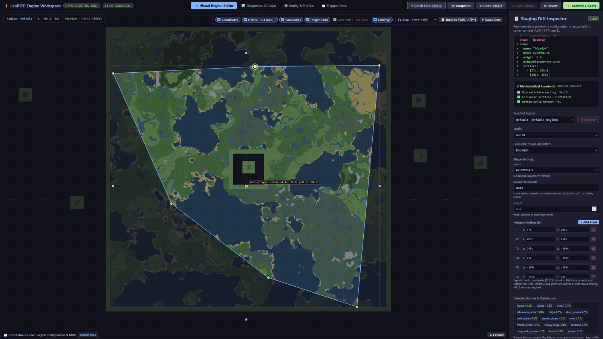
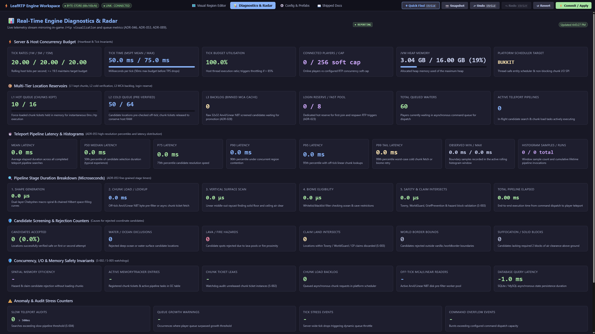
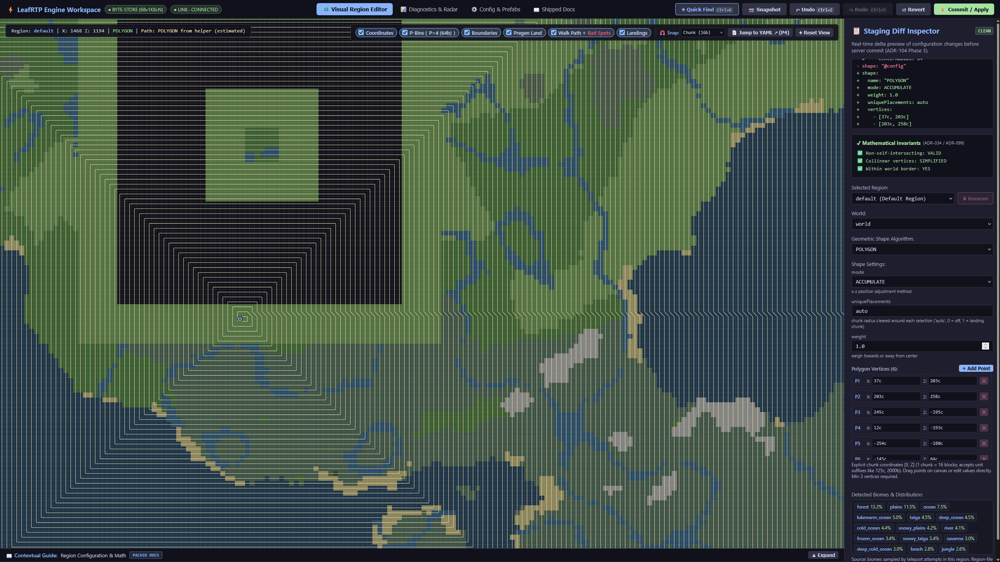
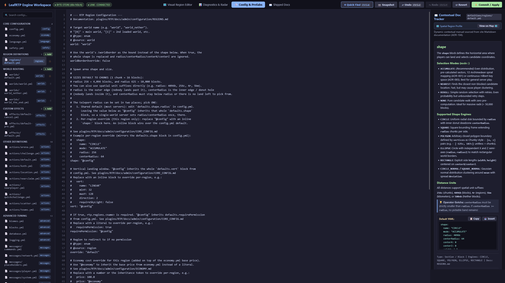
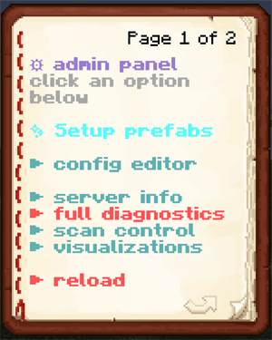
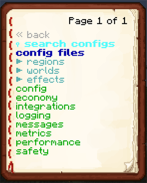
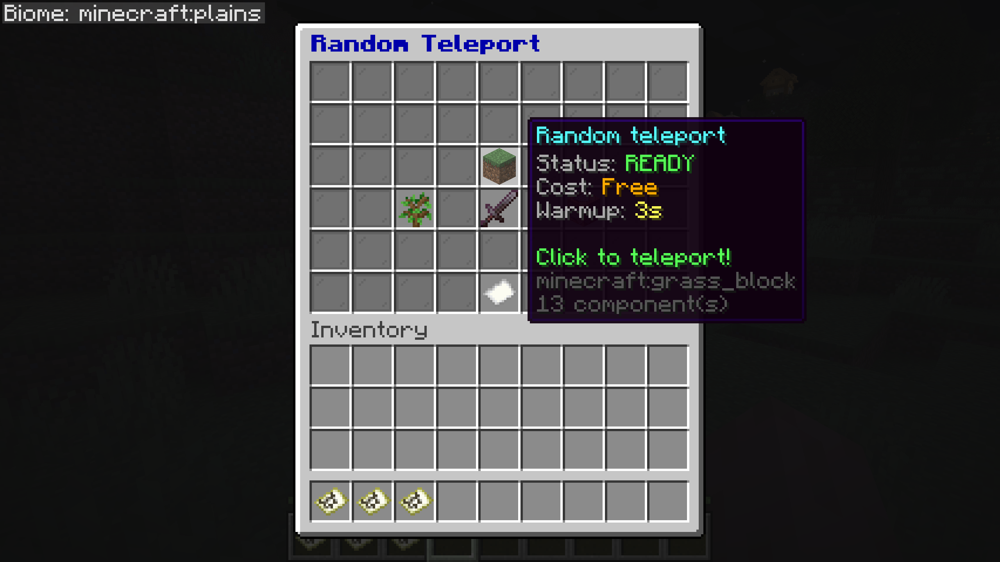
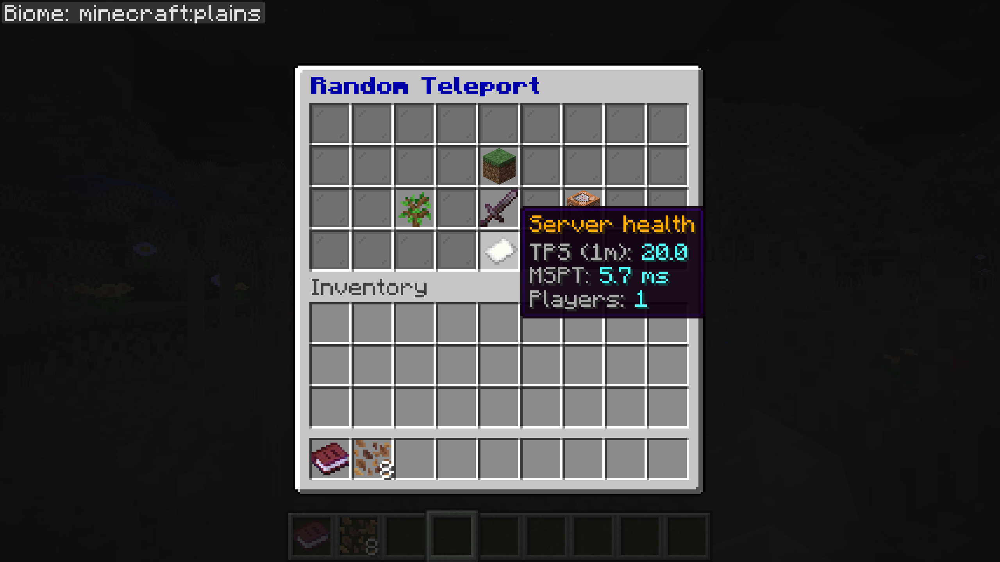

# Features

Everything LeafRTP does, by audience. The short version is on the project page; this is the full list.

## Common setups

These work without extra plugins:

- [**Spawn portals & launch pads**](https://dailystruggle.github.io/RTP/admin/ACTIONS/): Step-in trigger zones over portal frames or launch pads run teleports, with an optional countdown hologram and effects.
- [**Group & party scatter**](https://dailystruggle.github.io/RTP/admin/ACTIONS/): The bundled `scatter.yml` action sends queued parties or teams into the wilderness at least `minSeparation` blocks apart.
- [**Near-player & claim anchors**](https://dailystruggle.github.io/RTP/admin/ACTIONS/): Bundled `nearplayer.yml` and `nearclaim.yml` actions land players safely near teammates or outside town, claim, and faction perimeters (`anchor: entity`, `anchor: claimboundary`, `anchor: faction`) without inline claim-plugin overhead.
- [**First-join random spawn**](https://dailystruggle.github.io/RTP/admin/RECIPES/#rtp-on-first-join-random-spawn-for-new-players): Grant `rtp.onevent.firstjoin` to send new players to random spots on login; the login reserve cache keeps a destination pre-warmed so arrival is quick.
- [**Sky drops**](https://dailystruggle.github.io/RTP/admin/configuration/REGIONS/): A `Fixed` vertical adjustor at Y=250+ pairs with a slow-falling potion effect for aerial parachute drops.
- [**Survival and resource worlds**](https://dailystruggle.github.io/RTP/admin/configuration/REGIONS/#spacing-repeats-and-worst-case-by-mode): In two Paper 26.2 runs of 4,096 teleports each, no two landings were within 48 blocks and the closest pair was 70 blocks apart, without tracking players. The default `REROLL` mode doesn't repeat a spot until the shuffle has cycled; on `ACCUMULATE` a used spot can come up again at about the random-pick rate.
- [**Optional duel & KOTH templates**](https://dailystruggle.github.io/RTP/admin/ACTIONS/): The action addon also ships optional `challenge.yml`, `arena.yml`, `teams.yml`, and KOTH templates that queue players for 1v1 duels or 2v2 squad battles in temporary bounded areas with countdowns and automatic border cleanup.

## Setting it up

All configuration routes edit the same files, accept human units (`radius: 10km`, `teleportCooldown: 30s`), and hot-reload via `/rtp reload`.

- [**Web Workspace**](https://dailystruggle.github.io/RTP/admin/WEB_EDITOR_GUIDE/) (`/rtp editor`): Browser admin with no port forwarding. Drag region boundaries on a map and search YAML by intent with live setting docs beside each key. A diagnostics tab shows live tick, queue and latency stats.
- [**In-Game Admin Book**](https://dailystruggle.github.io/RTP/admin/configuration/IN_GAME_CONFIG/#1-the-interactive-admin-panel-rtp-admin) (`/rtp admin`): Clickable operator book for inspecting queues and reloading configs in game.
- [**Chat Wizard**](https://dailystruggle.github.io/RTP/admin/QUICK_START/#guided-setup-rtp-admin-setup) (`/rtp admin setup`): 60-second guided questionnaire configuring worlds, gameplay presets, region radius (via clickable presets or Anvil input), performance profiles, and addon toggles with automatic backups.
- [**Config & Permission Import**](https://dailystruggle.github.io/RTP/admin/MIGRATION/#migrating-from-another-rtp-plugin) (`/rtp config import`): Detects other rtp plugins' folders automatically, or takes any folder with `path=<dir>`. Maps worlds, radii, shapes, cooldowns, delays, prices, database, effects and portal zones; anything it can't map is listed as a warning. Dry-runs the LuckPerms commands for BetterRTP, JustRTP and EzRTP nodes.
- [**Spatial Pregeneration**](https://dailystruggle.github.io/RTP/admin/configuration/TTL/) (`/rtp scan`): Checks region files off-tick ahead of time, recording biomes, invalidity causes, and claims at chunk resolution.
- [**Live Visualizations**](https://dailystruggle.github.io/RTP/admin/configuration/IN_GAME_CONFIG/#c-diagnostics--monitoring) (`/rtp visualization`): Renders boundaries, biome layouts, and candidate heatmaps onto held in-game maps.
- [**Engine Diagnostics**](https://dailystruggle.github.io/RTP/admin/QUICK_START/#diagnostics-rtp-info) (`/rtp info`): Live queue depth, latency percentiles, and per-region generation rates.
- **11 languages** (`/rtp config language <locale>`): Config files and messages in German, Spanish, French, Italian, Japanese, Korean, Dutch, Polish, Portuguese, Russian and Chinese. Some keys are still in English; translations are welcome.

*Any boundary shape: a six-vertex polygon, with a diff of the staged change and validity checks.*

*Diagnostics tab: tick budget, queue depth per tier, and pipeline latency percentiles.*

<b>More web editor screenshots</b>

*Region editor: polygon boundaries over the terrain, with landing candidate previews.*

*Settings editor with each setting's description alongside and a diff of staged changes.*

 

*`/rtp admin`: the operator book and its config file list.*

## For players

- **`/rtp` and `/wild`**: teleport to the world's default region, or pick a region, world or biome (`/rtp region=<name>`, `/rtp biome=<biome>`). `/rtp back` returns players to their prior location.
- **Menus & custom items**: `/rtp menu` opens an interactive player book on Paper, Folia, Fabric and NeoForge (chat pages on Spigot) for teleporting or picking a region, world or biome. The bundled GUI addon adds a chest-based destination picker with barrier indicators for blocked destinations, customizable hover lore, and prefix routing for custom items (`ia:`, `oraxen:`, `nexo:`, `hdb:`, Base64 heads, and CustomModelData; see [item compatibility](https://dailystruggle.github.io/RTP/admin/CUSTOM_ITEMS/)).
- **Per-player queues** (`rtp.personalqueue`): personal reserve queues alongside the shared queue, so a surge doesn't delay a player who has one reserved.
- **Effects**: particles, sounds, fireworks, potions, titles, action bar notices, console or player commands, and holograms on every teleport phase, each controlled by `rtp.effect.<stage>.*` permissions. Holograms use the 1.19.4+ text display entity directly; DecentHolograms and HolographicDisplays are supported if present.
- **Landing platforms & safety**: temporary landing platforms decay automatically so nobody drops into ocean, void or open air, paired with a post-teleport invulnerability window, cancel on movement or damage, countdown holograms and warmup messages.

*The GUI addon's chest menu (Paper 26.2): the teleport tile shows status, cost and warmup before you click; the other tiles pick a region, biome or special teleport.*

<b>Server health tile</b>

*The same menu's server health tile: TPS, MSPT and player count.*

## Gameplay and worlds

- **Regions**: any number per world with customizable shape (Square, Circle, Ellipse, Rectangle, Polygon), radius, center, inner spawn-exclusion radius, vertical bounds, world override, required permission, and price. Vertical adjustors (Linear, Jump, Fixed) for sky islands, void worlds, aerial parachute drops, and Nether ceilings. A world's `override` key (`definitions/worlds/<name>.yml`) routes Nether or End teleports to designated safe worlds.
- **Arrival schematics**: drop a Sponge `.schem` named after a region into `plugins/RTP/advanced/schematics/` and every teleport into that region pastes it centered on the landing spot. Decoded in-house, no WorldEdit needed, and claim-aware.
- **Auto-RTP on events**: join, first join, respawn, world change, move, and teleport (`rtp.onevent.*`). A login reserve cache keeps destinations ready so join-time teleports are served from the queue.
- **Economy**: charge per `/rtp` through Vault, per-region pricing, refund on cancel, and `rtp.free` permission bypass.
- **PvP / combat-tag check**: off by default; refuses or delays `/rtp` for players who recently dealt or took PvP damage. Includes built-in tracking or hooks into PvPManager, CombatLogX, or Simple Combat Log if installed.
- **Command blocks and console**: the same command parser handles player, console, and command-block callers.

## Action engine: wilderness portals, party scatter & anchor teleports

Built for survival SMP mechanics first, with optional scripted templates in the action addon:

- **Step-in wilderness portals & launch pads**: Configurable trigger zones over portal frames, pressure plates, or launch pads with countdown holograms, particles, and sounds.
- **Party & team wilderness scatter**: Sends a queued party or team out into the wild together while guaranteeing at least `minSeparation` blocks between landings.
- **Claim, faction & teammate anchor teleports**: Land players relative to teammates (`anchor: entity`) or just outside town, claim, or faction perimeters (`anchor: claimboundary`, `anchor: faction`).
- **Event scripts**: Trigger console commands, titles, sounds, or potion effects on entry, arrival, boundary exit, or completion.
- **Optional 1v1/2v2 duel queues & KOTH templates**: The action addon also includes optional scripted templates (`/rtp action challenge <player>`, `arena.yml`, `teams.yml`, KOTH) for temporary bounded duels with countdowns and automatic border cleanup.

*Templates and configuration options: [Actions guide](https://dailystruggle.github.io/RTP/admin/ACTIONS/).*

## Claims and safety

- **Claim plugins**: 16 on Bukkit / Paper / Folia through the bundled claim addon (GriefDefender, GriefPrevention, Lands, WorldGuard, TownyAdvanced, SaberFactions, FactionsBridge, HuskClaims, HuskTowns, PlotSquared, RedProtect, CrashClaim, KingdomsX, Residence, UltimateClaims, MinePlots), plus FTB Chunks and Open Parties and Claims on Fabric / NeoForge. Claim checks run in the async pipeline, off the teleport tick. You can add your own through `RegionVerifierRegistry` with one lambda.
- **Claim and faction anchors**: an action can land players relative to their own town, claim or faction land (`anchor: claimboundary`, `anchor: faction`). Towny, GriefPrevention and SaberFactions / FactionsUUID boundaries are supported directly; others plug in through `ClaimBoundaryProvider`. The anchor stays put while it's inside the claim and is recomputed at most once per cooldown.
- **Safety filter**: the block lists in `advanced/blocks.yml` (`unsafeBlocks`, `airBlocks`) take plain materials, block-state predicates (`OAK_SLAB[waterlogged=true]`), numeric ranges (`WATER[level>=5]`), vanilla and datapack block tags (`#minecraft:leaves`) and wildcards (`*[waterlogged=true]`). Grammar is in the details below.

<b>Block-list token grammar (advanced/blocks.yml)</b>

Six token shapes can be mixed freely in `unsafeBlocks` and `airBlocks` (`advanced/blocks.yml`):

- **Plain material:** `LAVA`, `MAGMA_BLOCK`.
- **Material + state predicate:** `OAK_SLAB[waterlogged=true]`. Multiple predicates AND together: `OAK_SLAB[waterlogged=true,type=top]`.
- **Numeric range predicate:** `WATER[level>=5]`, `LIGHT[level<8]`. Fails open on a missing or non-numeric value.
- **Vanilla block tag:** `#minecraft:leaves`, `#minecraft:fire`, `#minecraft:campfires`. Expanded from the server's live block-tag registry when the config loads; datapack and modded tags work too.
- **Tag + state predicate:** `#minecraft:slabs[waterlogged=true]`.
- **Wildcard + state predicate:** `*[waterlogged=true]`: one line instead of listing every waterloggable block.

Unknown tags and properties fail open: a config written for a newer MC version still loads on an older one. Malformed tokens are never silent: `[WARNING] [advanced/blocks.yml] rejected unsafe-blocks token '<token>': <reason>`. Block states are only read when a token needs them, and plain-material configs cost nothing extra. On an older install, lists kept in `safety.yml` are moved into `advanced/blocks.yml` on load, and plain-material entries keep working unchanged.

## Networks

- **Cross-server `/rtp`**: Velocity, over proxy-direct, SQL or Redis. Tested nightly on the in-repo devstack: 2 Velocity proxies, 2 lobbies and 4 backends (Paper, Folia, Fabric, NeoForge) behind Redis.

## For developers

- **API and addons**: `rtp-api` (pre / mid / post teleport hooks, region verifiers, config, scheduling) and `effects-api`. A third-party addon needs only `rtp-api` and loads through a `ServiceLoader` SPI; an addon built on `rtp-api` alone runs on Spigot, Paper, Folia, Fabric and NeoForge. The bundled addons (GUI picker, claim integrations, Countdown reference, scripted actions) also use `rtp-core` internals. They unpack into `plugins/RTP/addons/` on first run; delete one from that folder to turn it off. Their source, and the Rift warmup-effect addon's, is under `addons/` as a starting point.
- **Swappable parts**: server backend, economy, location validity, shapes, world border, PvP checks, region file format and commands can all be replaced through SPI.
- **PlaceholderAPI**: queue depth (total / public / personal), last-teleport coordinates, player status.
- **bStats**: on by default; anonymous usage counts help me decide which platforms to spend time on.
