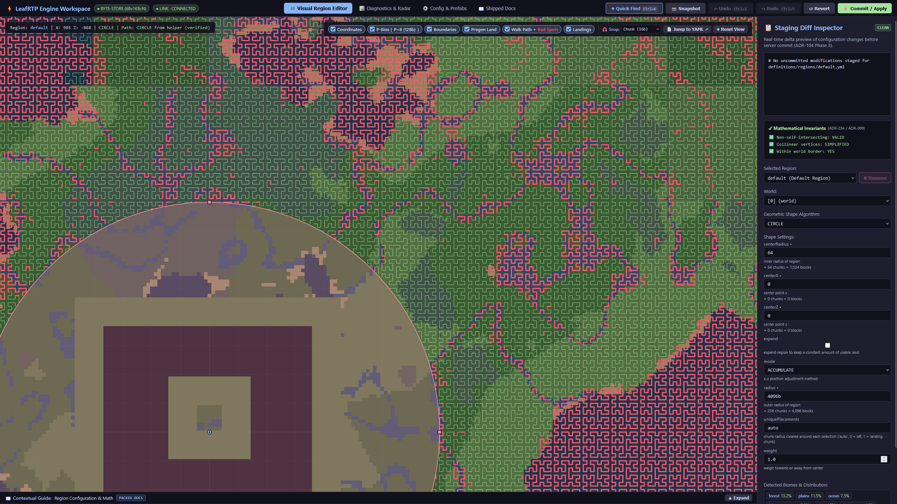
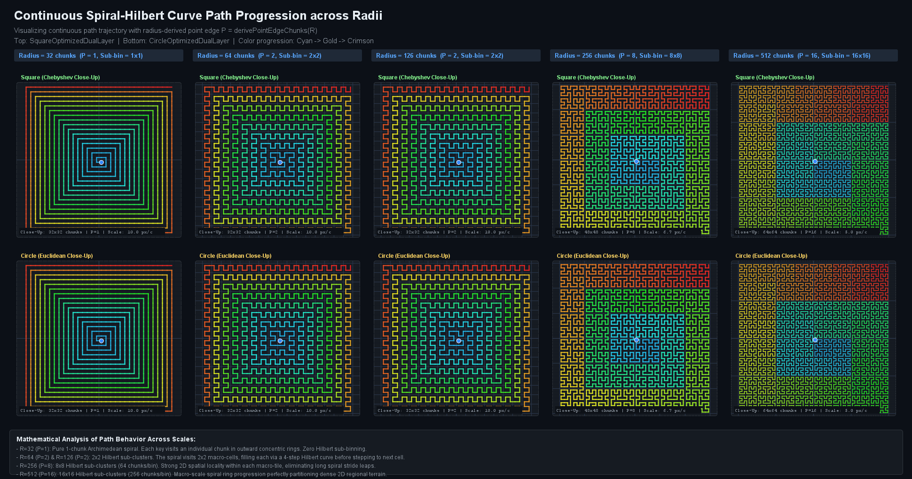
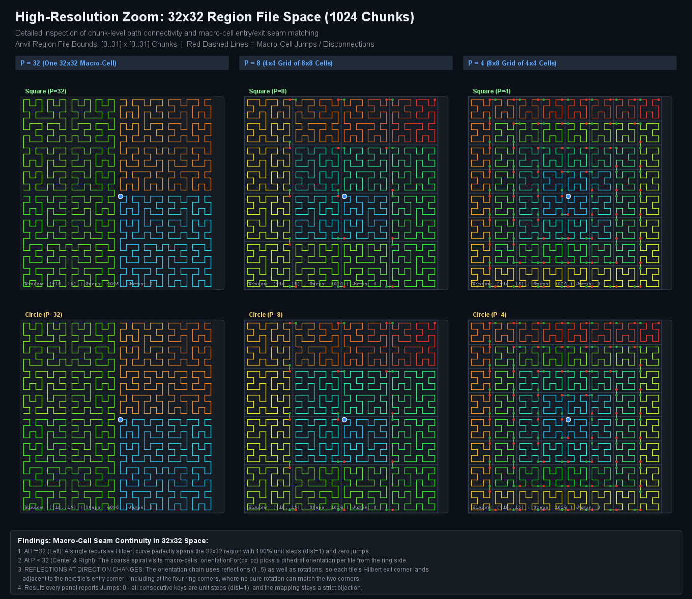
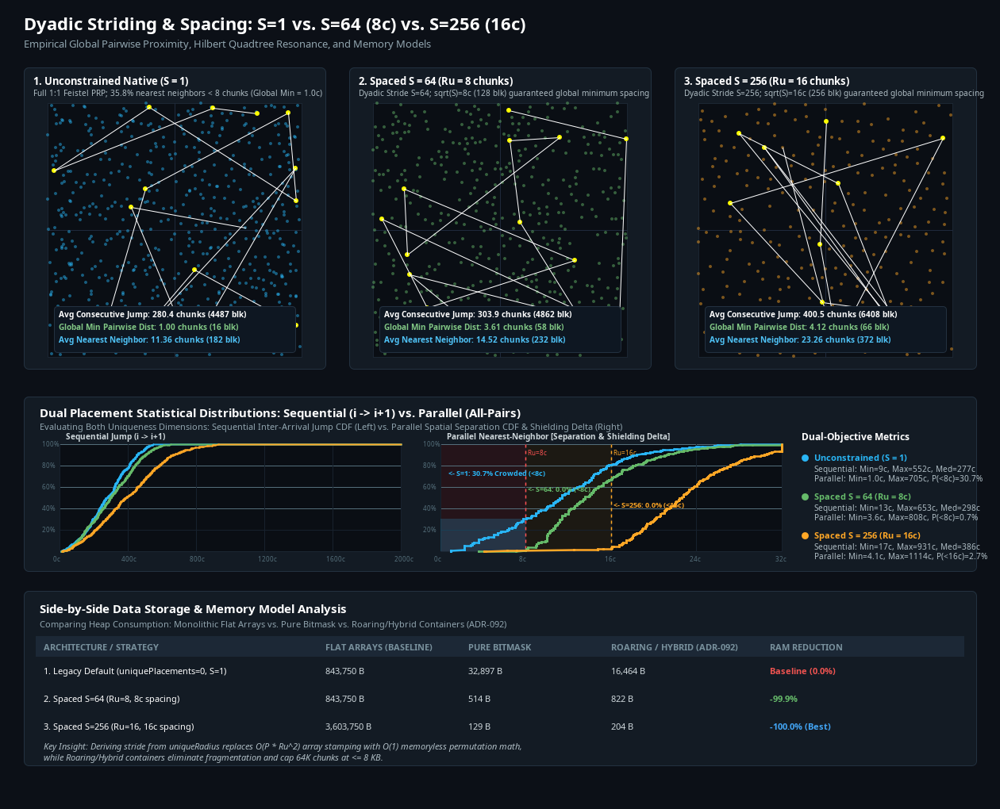
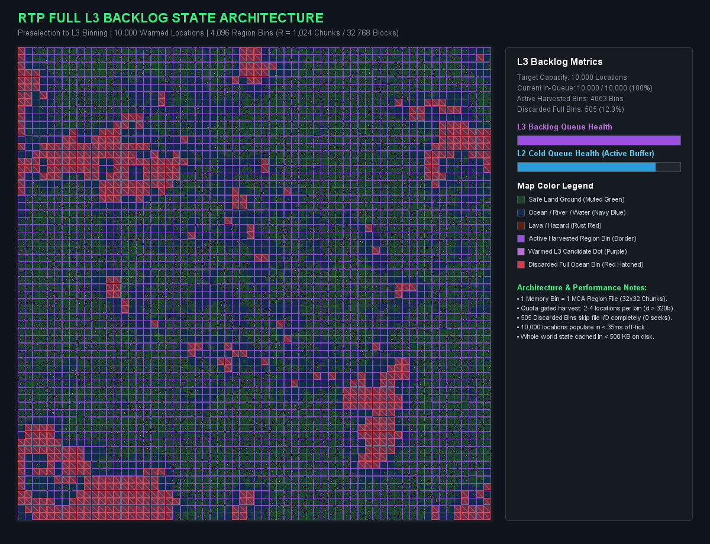

# How it works

The mechanisms behind the benchmark numbers. Measured results are in the [stress harness](https://github.com/DailyStruggle/RTP/tree/V3/helpers/StressTestRTP); derivations are in [Why LeafRTP exists](why.md).

## Spatial memory

About 35-65% of typical Minecraft terrain is ocean, lava or void. LeafRTP remembers biomes and invalid chunks (with cause and TTL) at chunk resolution across server restarts so it doesn't check the same dead ground twice. Operations like `/rtp biome=<biome>` resolve directly from memory without chunk loading. Locations are mapped in constant time, and `/rtp scan` pregenerates spatial memory off-tick. Mathematical derivations and distribution benchmarks: [Why LeafRTP exists](https://dailystruggle.github.io/RTP/site/why/).

*The order `/rtp scan` walks a region in, with rejected spots in red; they are stored with their cause and TTL.*

## Region-file pre-filter

A region-file pre-filter reads biome and block data directly from `.mca` (Anvil) and `.linear` (Linear v1/v2) region files on disk. Unloaded candidates are checked and rejected off-tick without chunk loading. The files hold the actual terrain, so custom generators (Iris, Terra, datapacks) and edited ground are checked as they are. Dynamic binding connects to the host server's Zstandard decompressor on Linear worlds with zero added dependencies, and a startup canary test verifies decoder health before candidates are probed. When the pre-filter cannot answer (unpopulated chunk, unknown format, or missing host decompressor), it falls back to the server engine's async chunk API within a strict tick budget.

## Pre-verified cache

Safe destinations are verified in advance and held in background queues. Answering `/rtp` serves an already-checked coordinate without waiting for chunk generation; on Paper the median from command to arrival was 6 ms in the paced benchmark. Automatic sweeps release chunk tickets from abandoned teleports, so nothing stays force-loaded past its reservation window.

## Spacing between players

Destinations come from a keyed shuffle of the region, and no player coordinates are tracked. On the default 16,384-block circle, spots drawn back to back sit one bin (512 blocks) apart, and closer where the spiral turns its corners. In the paced Paper 26.2 run (4,096 teleports at 16k radius) no spot repeated, no two landings were within 48 blocks (random picks put 81 pairs that close) and the closest pair was 70 blocks apart, so `/rtp` spam is a poor way to find someone's base. That is a measured result, not a minimum. The default `REROLL` mode doesn't repeat a spot until the shuffle has cycled; on `ACCUMULATE` with `expand: false`, a used spot can come up again at about the random-pick rate (around 0.1% of landings in simulation). Each region shuffle uses a random seed generated at startup, so players can't predict landing spots from the world seed. Full spacing statistics and repetition rules: [Regions guide](https://dailystruggle.github.io/RTP/admin/configuration/REGIONS/#spacing-repeats-and-worst-case-by-mode).

## No shaded dependencies

I don't shade libraries. The SQL connection pool, Redis client, cross-server messaging, bStats and region-file reader are written in-house on plain Java, so there are no library version conflicts. The hosted web workspace connects outward to an ephemeral relay (like spark and LuckPerms), so it needs no inbound port. Local editor mode (`/rtp editor local`) binds a token-gated socket on `127.0.0.1` only. The proxy-direct network transport opens a TCP listener on the Velocity proxy (`127.0.0.1` by default) only if you choose that transport.

## Maps and image exports

LeafRTP includes a standalone map renderer (`maps-api`) that generates live in-game maps and high-resolution diagnostic images without main-thread chunk I/O:

- **High-resolution image exports** (`/rtp visualization export <type>`): Exports standalone PNG and BMP image files to `plugins/RTP/charts/` (biomes, hazards, heatmaps, pipeline composites).
- **Combined diagnostic chart** (`/rtp visualization export comprehensive`): One panel with biome layouts, hazard overlays, candidate markers, and player spread metrics.
- **Held in-game maps** (`/rtp visualization`): Real-time biome layouts, rejected terrain, and candidate heatmaps on held Minecraft map items.
- **External web maps (planned)**: Dynmap, BlueMap and Pl3xMap support is proposed in [ADR-086](https://github.com/DailyStruggle/RTP/blob/V3/docs/adr/ADR-086-external-web-map-integration.md); no web-map integration ships yet.

## Chunk loading, by platform

- **Paper** and forks such as Purpur and Pufferfish: `World#getChunkAtAsync`; falls back to a main-thread load only if async loading returns no chunk.
- **Folia**: Pre-filter runs before the Region Scheduler; rejected candidates never hop a thread. Safe candidates load through Folia's async API and teleport through the Entity Scheduler.
- **Spigot** (and Arclight / Mohist): Region-file pre-filter off-tick. Throughput is capped by Spigot's chunk generator, and unreadable candidates cost one on-tick chunk load.
- **Fabric** and **NeoForge**: In-tree adapters running the same core engine.

<b>Charts: how LeafRTP avoids clumping and base hunting</b>

These charts come from the visualizer test fixtures in `rtp-core`, which assert candidate distribution and spacing on real terrain:

**Coverage across radii.** The selector fills regions from small 32-chunk zones up to 512-chunk ones without clustering at the center or thinning out at the edge.

**Local stepping.** Zoomed into a single 32x32 Anvil region file (1,024 chunks), candidates are checked chunk by chunk with no jumps, so disk reads stay local.

**Player separation (simulation).** In the 600-placement simulation in [Shape Algorithm Verification](https://dailystruggle.github.io/RTP/site/shape-algorithms/) (`DownsamplingSideBySideBenchmarkTest`, 256-chunk square), unconstrained picks (stride S=1) put 35.8% of arrivals within 8 chunks of an earlier one. Stride S=64 (8-chunk exclusion) brought that to 0%, and stride S=256 (16-chunk exclusion) kept every arrival at least 16 chunks from the rest. These strides apply only with `uniquePlacements` and `expand: true`; the shipped default is `expand: false`.

**Pre-screened candidates.** In a 32,768-block world with 10,000 cached candidates, ocean-only region files are discarded directly from the map header without reading chunk data from disk. Candidates are spread evenly across all viable land.

*For the derivations, algorithm benchmarks and unit test code, see [Shape Algorithm Verification](https://dailystruggle.github.io/RTP/site/shape-algorithms/) and [Why LeafRTP Exists](https://dailystruggle.github.io/RTP/site/why/).*

