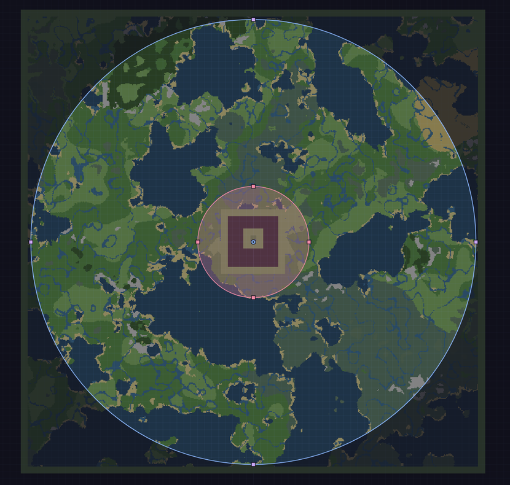
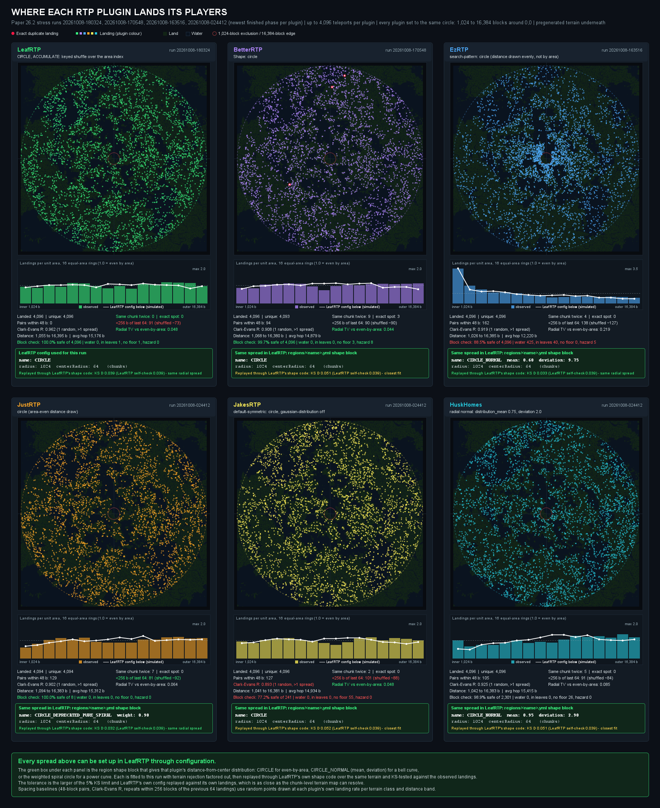

<!--
Single source for every storefront page (BuiltByBit paid + free, Modrinth, Hangar).
Never paste this file anywhere directly. Build it with
    python scripts/release/build_front_pages.py
and use the files in scripts/release/generated/ (gitignored, so build before use):
paste the two .bbcode files into BuiltByBit by hand; release.yml builds and pushes
the Modrinth and Hangar pages. CI fails if any target doesn't build (`--check`).

Markers, each alone on its line, nestable (written here without the comment
delimiters, because a closing delimiter would end this note):
  kind: promo | purchase   ... /kind   what the block IS; POLICY in the script decides
                                       which targets keep it (promo is dropped on
                                       Modrinth and Hangar)
  only: <targets>          ... /only   audience copy for the listed targets
  not: <targets>           ... /not    audience copy for every other target
  targets: bbb-pro, bbb-lite, modrinth, hangar; aliases: bbb, markdown
  {{name}} and {{jar}} expand per target (LeafRTP-Pro on bbb-pro, LeafRTP elsewhere).
Hangar does not allow paid-edition advertising: anything about paying goes in a
`kind: promo` block. The build also fails if a Modrinth or Hangar page still
mentions Pro, buying, sponsorship or a price.

Voice (RULES.md D-006): first person, plain, no sales language. One person
maintains this as a community project; write like that.
Prefer numbers and caveats over adjectives. ASCII punctuation only.
Images: local relative paths (e.g. ); build_front_pages.py
validates existence on disk and rewrites them to raw.githubusercontent.com URLs.
Doc links: relative paths (e.g. [text](../admin/COMMANDS.md#anchor)) are also
validated on disk and rewritten: published docs become dailystruggle.github.io/RTP
page URLs, anything else (code, directories, unpublished docs) becomes a GitHub URL.
Prefer these over hand-written website URLs so a renamed or deleted page fails the build.

Architecture & Layout (Invariant 3-Zone Utility Hierarchy):
To eliminate churn between beginner accessibility and engineering precision,
the document is partitioned into three non-overlapping functional zones. Do not
blur boundaries between zones when updating copy:

Section order (fixed; do not reorder per target):
  1. What it is + hero image   (what is this, can I use it)
  2. The short version: 1 headline + 5 outcome bullets; the rest sit in a
     collapsed 'More highlights' block   (why this one)
     Short-version bullets are `[**Adjective**](link): measured fact.`
     (Efficient, Fast, Distinct, Portable, ...). Keep that form; do not turn
     the labels into sentences.
  3. Zone 2: common setups, install, features summary   (how do I use it)
  4. Zone 3: performance, how it works summary, testing and quality gates   (why should I believe it)
  5. Why I made it
  6. Reference after the story: paid-listing block (BuiltByBit only), `## Commands, configuration, and FAQ` heading over everyday commands/permissions/config files, FAQ, support   (look things up)
Rule: a section moves up only if the section above it answers a question the
reader asks earlier. Install steps appear once, in Install; do not repeat
them above the fold. Hero: a web editor screenshot (map, no jargon); the
spatial-memory walk image stays in Zone 3 (it reads as noise above the fold).
Use screenshots whose status pill reads LINK - CONNECTED.
Bullets anywhere on the page are a label, a link to the proof and a fact.
Detail lives behind the link; do not append a clause restating the benefit.
Shallow-AST & Search Indexing Rules (ADR-130, enforced by check_shallow_ast_sections):
  - `
` and `---` do not open heading scopes in DOM/Markdown ASTs;
    `## Testing and quality gates` and `## Commands, configuration, and FAQ`
    must be explicit `## ` headings so `
` blocks never inherit
    `## How it works`, `## Why I made it`, or `## What paying gets you`.
  - `### The short version` must lead with ease of use (`Easy`) and landing
    safety (`Safe`) alongside speed (`Fast`), migration (`Portable`), and
    platform coverage (`One jar`), rather than stacking multiple benchmark
    throughput bullets above the fold.
  - Lead sentences carry highest passage weight (Hoare precondition slot):
    `## How it works` must open with a lead sentence stating that the pipeline
    runs automatically in the background behind standard `CIRCLE`/`SQUARE`
    radii.
  - Keep secondary benchmark tables, fuzzer/Jazzer post-mortems, and low-level
    crypto/GC/curve jargon out of `FRONT_PAGE.md` (link to `docs/site/` and
    `helpers/StressTestRTP/`); `
` blocks are indexed at full document
    weight by search engines.
  - Setup FAQ answers must state positive setup options (`CIRCLE`, `radius`,
    `/rtp editor`) without negated curve/spiral jargon.

Zone 1: Verified Outcomes & Universal Guarantees (Above the Fold)
  - Audience: 100% of visitors (evaluators, beginners, power users).
  - Scope: Title, badges, 'What it is', platform compatibility, 'The short version'.
  - Rule: State empirical outcomes only (0 stalls, 0 failed teleports,
    5 ms median /rtp-to-arrival latency on Paper, single jar). Use the same
    measured figure everywhere it appears. Zero algorithmic exposition or
    derivations here.
  - Rule: 'What it is' defines the plugin: category (random teleport / RTP
    plugin), commands, and how it works in one plain sentence. Benefits and
    what it avoids belong in 'The short version'. No tagline or subtitle
    under the title, no download counts (the rename FAQ has that), and no
    "works with no setup" line after Install. Enforced by ZONE1_REJECTED.
  - Enforced: build_front_pages.py fails if Zone 1 or Listing metadata uses the
    terms in ZONE1_JARGON (TP/s, MSPT, TPS, tick, main/server thread, off-tick,
    candidate, pre-filter, shuffle, ACCUMULATE/REROLL, SPI, TTL, p95/p99,
    space-filling, spiral, Hilbert, curve, L1/L2/L3, radix). Those words are
    defined in Performance / How it works; use them there. Link targets are exempt.

Zone 2: Operational On-Ramp & Zero-Friction Migration (Immediate Action)
  - Audience: Action-oriented server operators ready to deploy or switch.
  - Scope: 3-step quick-start install, /rtp config import (zero-friction switch),
    /rtp admin setup / web editor, common setups, player & admin features.
  - Rule: Maximize net utility by minimizing time-to-deployment. An admin should
    be able to get a safe, lag-free setup running without scrolling past this zone.
    Enforced by check_zone2_onramp (no curve/spiral/Hilbert jargon, dotted CLI
    config paths, or stress-harness commands in Zone 2).

Zone 3: Architectural Proof & Technical Transparency (Deep Foundation)
  - Audience: Folia operators, network architects, skeptics, and engineers.
  - Scope: Full benchmark tables (harness in helpers/StressTestRTP/), scatter
    charts, spatial memory benchmarks, region-file pre-filter (.mca and .linear),
    quality gates, and test findings. The FAQ and other reference blocks sit in
    section 6, after 'Why I made it'.
  - Rule: Retain 100% mathematical and technical precision. Nothing is deleted:
    full feature lists, mechanism write-ups and the quality-gate table live in
    docs/site/features.md, how-it-works.md and quality-gates.md, and this page
    keeps a short summary plus a relative link to each. Edit the moved text in
    the docs page, not here. Benchmarks, caveats and the test findings stay on
    this page. Everyday commands/permissions sit in section 6 with a link to
    docs/admin/COMMANDS.md for the full reference.
    Head-to-head competitor comparisons live strictly in the Performance section.

Listing metadata (for the marketplace form fields, not emitted):
  Paid BuiltByBit title:  "LeafRTP-Pro"   tagline: "Fast Minecraft random teleport (/rtp & /wild) plugin and mod for Paper, Folia, Fabric, NeoForge & Velocity"
  Free title:             "LeafRTP"       tagline: "Fast Minecraft random teleport (/rtp & /wild) plugin and mod for Paper, Folia, Fabric, NeoForge & Velocity"
  (Modrinth's short description still reads "Fast Random Teleportation for everyone,
   configurable and extensible" - replace it there with the free tagline above.)

Reviewer notes (read before reviewing the Performance section):
  - LeafRTP's shipped defaults (refill `period: 20`, ready queue 50, backlog
    1,000, pause on low TPS) are sized for typical usage rates. They do not
    change per-teleport cost or how the plugin performs; they only cap how
    fast input is accepted. The benchmark config lifts that cap so the
    harness can find the break point. Do not report the bench tuning as an
    unfair advantage or a hidden disclosure problem.
  - The Folia numbers reproduce on the current build. Long runs always span
    several builds; do not ask for every run to be on one build.
  - Spacing: the pass threshold is 48 blocks; the closest measured pair was
    70 blocks. Both figures are true; use them together.

Private / Author notes:
  - Run a future memory leak test using the behaviour leak fuzzer (`scripts/bench_fuzz.py`) on LeafRTP only, on Folia/Paper, to evaluate long-duration heap bounds. Competitor leak runs are out of scope.
-->

# {{name}}: Random Teleport

<!-- only: markdown -->

<!-- /only -->

## What it is

**{{name}} is a random teleport (RTP) plugin.** Drop the jar in and the default region works out of the box: `/rtp` or `/wild` sends a player to a random safe spot, and you can resize borders visually on a browser map (`/rtp editor`) or through the in-game setup wizard (`/rtp admin setup`). It finds and checks spots ahead of time, reading the world files on disk, and keeps a queue of checked spots ready.

I've worked on it in my own time since 2021. The benchmarks and the test harness are in the repo, and every number on this page can be rerun from them.

One jar for Paper and Spigot (1.18+), Folia (1.21.11+), Fabric (1.20.1 and 1.21+, needs Fabric API) and NeoForge (1.21.1+), up to 26.3. It also loads on Velocity for `/rtp` across a network.

*Drawing where players land, in the browser editor (`/rtp editor`).*

<!-- only: bbb-pro -->
<!-- kind: promo -->
This listing is how you pay for support. The code is the same as the [free download](https://modrinth.com/plugin/leafrtp) and all of it is MIT licensed. Paying doesn't unlock anything in the plugin; details are in [What paying gets you](#what-paying-gets-you) below.
<!-- /kind -->
<!-- /only -->
<!-- only: bbb-lite -->
<!-- kind: promo -->
There is also a paid LeafRTP-Pro listing on BuiltByBit. It is the same code, and nothing in the plugin is locked. Paying gets you priority support, and a patch release when a bug you report needs one.
<!-- /kind -->
<!-- /only -->
<!-- only: hangar -->
On Folia, spots are checked against the world files on disk first, nothing waits for a chunk to load, and only the final block check runs on the region's own thread.
<!-- /only -->

### The short version

**Ready on first start, with a visual browser map (`/rtp editor`), 18+ claim integrations, and 5 ms median `/rtp` response (Paper).**

- [**Easy**](https://dailystruggle.github.io/RTP/admin/WEB_EDITOR_GUIDE/): draw region borders on a map in your browser (`/rtp editor`), run the 60-second `/rtp admin setup` wizard, or edit two distance settings (`radius` and `centerRadius`).
- [**Safe**](https://dailystruggle.github.io/RTP/admin/CLAIM_PLUGIN_COMPATIBILITY/): checks solid ground, slopes, hazards, and 16 claim plugins on Bukkit / Paper / Folia plus FTB Chunks and Open Parties and Claims on Fabric / NeoForge before teleporting.
- [**Fast**](#performance): 5 ms median from `/rtp` to arrival on Paper from a queue of pre-checked spots, up to 40 teleports per second on Paper and 180 per second on Folia at full server speed.
- [**Portable**](https://dailystruggle.github.io/RTP/admin/MIGRATION/#migrating-from-another-rtp-plugin): `/rtp config import` reads your BetterRTP, JustRTP or EzRTP config, previews it, and never overwrites without `overwrite=true`.
- [**One jar**](https://dailystruggle.github.io/RTP/admin/QUICK_START/): the same core on Paper, Spigot, Folia, Fabric and NeoForge, and on Velocity for `/rtp` across a network.

<b>More highlights</b>

- [**Distinct**](../site/how-it-works.md#spacing-between-players): spreads players evenly across the region so landings stay far apart without tracking player coordinates.
- [**Custom terrain**](../site/how-it-works.md#region-file-pre-filter): spots are read from the world files on disk, including Iris, Terra, datapack and upgraded worlds.
- [**Action engine**](https://dailystruggle.github.io/RTP/admin/ACTIONS/): step-in wilderness portals, launch pads, party scatter, and claim or teammate teleports.
- [**Self-checking**](https://dailystruggle.github.io/RTP/admin/configuration/BIT/): `/rtp reload` and `/rtp test` verify config files, region settings, and claim hooks before applying changes.

Benchmark comparisons and hardware metrics are in [Performance](#performance).

## Common setups

These work without extra plugins:

- [**Spawn portals & launch pads**](https://dailystruggle.github.io/RTP/admin/ACTIONS/): Step-in trigger zones over portal frames or launch pads run teleports, with an optional countdown hologram and effects.
- [**First-join random spawn**](https://dailystruggle.github.io/RTP/admin/RECIPES/#rtp-on-first-join-random-spawn-for-new-players): Grant `rtp.onevent.firstjoin` to send new players to random spots on login. A reserve cache keeps a destination ready.
- [**Survival and resource worlds**](https://dailystruggle.github.io/RTP/admin/configuration/REGIONS/): Players land far apart across the world border without clumping near spawn, with separate regions or radii per world (Overworld, Nether, End, or resource worlds).

More setups: [Features](../site/features.md#common-setups), [recipes](../admin/RECIPES.md), [actions guide](../admin/ACTIONS.md).

---

## Install

**Requirements:** Paper or Spigot 1.18+, Folia 1.21.11+, Fabric 1.20.1 or 1.21+, or NeoForge 1.21.1+, up to 26.3. Java 17+ (Minecraft itself needs Java 21 from 1.20.5 and Java 25 on 26.x).

1. Drop `{{jar}}` into `plugins/` (Spigot, Paper, Folia, Velocity, BungeeCord) or `mods/` (Fabric, NeoForge) and start the server.
2. Type `/rtp` (or `/wild`).
3. **Optional - adjust borders or settings:** Most servers only change how far players go (`radius: 4096b` and `centerRadius: 1024b` in `definitions/regions/default.yml`). Run `/rtp editor` to drag region borders on a browser map ([web workspace guide](../admin/WEB_EDITOR_GUIDE.md)), `/rtp admin setup` for the 60-second in-game wizard (worlds, radius presets, gameplay profile, and whether bare `/rtp` opens the GUI picker or teleports immediately; [quick-start guide](../admin/QUICK_START.md)), or `/rtp config import` to migrate from BetterRTP, JustRTP, or EzRTP ([switching guide](https://dailystruggle.github.io/RTP/admin/MIGRATION/#migrating-from-another-rtp-plugin)).

(Advanced database, network proxy, and cache tuning: see the [admin guide](https://dailystruggle.github.io/RTP/FOR_SERVER_ADMINS/).)

---

## Features

- **Setting it up:** web editor, in-game admin book, chat wizard, `/rtp config import`, `/rtp scan`, live map visualizations, 11 languages.
- **For players:** `/rtp` and `/wild`, region, world and biome picks, `/rtp back`, menus, per-player queues, effects, landing platforms.
- **Gameplay and worlds:** any number of regions in six shapes, arrival schematics, auto-RTP on events, Vault pricing, an optional combat-tag check.
- **Actions:** step-in wilderness portals, launch pads, party and team wilderness scatter, and claim or faction anchor teleports (plus optional 1v1/2v2 duel queues and KOTH templates in the action addon).
- **Claims and safety:** 16 claim plugins on Bukkit-family servers plus FTB Chunks and Open Parties and Claims on Fabric and NeoForge, and a configurable block safety filter.
- **Networks and developers:** cross-server `/rtp` over Velocity; `rtp-api` addons, pluggable modules, PlaceholderAPI, bStats.

More: [Features](../site/features.md). Commands and permissions are in the collapsed block near the end.

---

## Performance

I measure throughput under load, response time from `/rtp` to arrival, and server speed stability. LeafRTP checks spots against region files (`.mca` and `.linear`) in the background and keeps a queue of verified destinations ready, so `/rtp` answers in about 5 ms on Paper without loading chunks on the main thread.

<!-- only: bbb -->
Both LeafRTP downloads are built from the same code, and the LeafRTP rows apply to either.
<!-- /only -->

**Paper 26.2 & Folia 26.2 Performance Under Load (Linux Threadripper 7970X, 48 bot clients, 16k radius):**

These are snapshots of each plugin under one harness on my hardware, using the same 1,024 to 16,384 block circle with cooldowns and delays turned off. The other plugins make different trade-offs, and most don't aim for 100+ teleports per second.

| Plugin | Paper safe max | Paper peak | Folia safe max | Folia peak |
|---|---|---|---|---|
| **LeafRTP** | **40 TP/s** (MSPT 45 ms, min TPS 19.2) | **103.3 TP/s** | **180 TP/s** (MSPT < 50 ms) | **249.7 TP/s** (19.0 avg TPS) |
| HuskHomes | 40 TP/s (MSPT 46 ms, min TPS 16.4) | 46.0 TP/s | 60 TP/s | 60.0 TP/s |
| JakesRTP | 20 TP/s (MSPT 44 ms, min TPS 18.4) | 86.6 TP/s (TPS < 5) | - | Not loaded (no Folia support declared) |
| BetterRTP | 20 TP/s (MSPT 43 ms, min TPS 16.2) | 39.5 TP/s (2% failed) | - | Did not complete on this rig |
| JustRTP | 20 TP/s (MSPT 40 ms, min TPS 19.5) | 25.7 TP/s | 10 TP/s | 18.7 TP/s |
| EzRTP | 5 TP/s (MSPT 24 ms, min TPS 20.0) | 8.5 TP/s | < 20 TP/s | 19.7 TP/s |

**Safe max** is the highest stage a plugin passed in every run while delivering at least 95% of the requested rate, keeping tick time (MSPT p95) at or under 50 ms, and failing at most 1% of teleports. On Paper at 5, 10 and 20 teleports per second, LeafRTP's median time from `/rtp` to arrival was **5 ms** (p99: 6-7 ms). The benchmark-only config lifts the default intake cap for the stress harness (`period: 1`) so it can find each plugin's ceiling (keep the shipped defaults on live servers).

Full latency tables, per-plugin setup controls, hardware rig details, and benchmark caveats: [`RESULTS.md`](https://github.com/dailystruggle/RTP/blob/V3/helpers/StressTestRTP/RESULTS.md), [`PRE_WRITEUP.md`](https://github.com/dailystruggle/RTP/blob/V3/helpers/StressTestRTP/PRE_WRITEUP.md), and [`helpers/StressTestRTP/`](https://github.com/dailystruggle/RTP/tree/V3/helpers/StressTestRTP). Video of `/rtp` on a custom world generator: [youtu.be/V0NyNK9JydM](https://youtu.be/V0NyNK9JydM).

**Where each plugin lands players (Paper 26.2, 4,096 teleports):**

*Where each plugin landed 4,096 players in the Paper 26.2 run (`20261008-003310`), every one set to the same 1,024 to 16,384 block circle around 0,0. Out of the box, LeafRTP uses a standard `CIRCLE` or `SQUARE` with an even spread across the region (you only configure a block radius like `radius: 5000b`), so players don't cluster near the center or the outer border.*

---

## How it works

All four stages run automatically in the background behind a standard `CIRCLE` or `SQUARE` region and block radius (`radius` and `centerRadius`), with no manual tuning:

- **Spatial memory:** biomes and unsafe chunks (such as ocean or lava) are remembered across restarts so the server never re-checks known bad ground.
- **Region-file pre-filter:** spots are read directly from `.mca` and `.linear` world files on disk and filtered off the main thread before loading a chunk.
- **Pre-verified queue:** safe destinations wait in background queues; on Paper the median time from `/rtp` to arrival was 5 ms in the paced benchmark.
- **Even player spacing:** locations are drawn in a shuffled order across the region so players spread out without tracking player coordinates.

Details, diagrams and charts: [How it works](../site/how-it-works.md) and [Spacing between players](../site/how-it-works.md#spacing-between-players).

---

## Testing and quality gates

Every release is checked automatically before it ships, and includes built-in checks you can run on your server:

- [**Built-in config & server checks**](https://dailystruggle.github.io/RTP/admin/configuration/BIT/): `/rtp reload` and `/rtp admin setup` validate YAML files before applying them, and `/rtp test` checks region selection, claim hooks, and teleport safety in game.
- [**Safety rule suite**](../dev/TRACEABILITY.md): dedicated automated tests enforce every safety rule (no unsafe blocks, no leaked chunk tickets, no claim bypasses, no main-thread chunk loading, and no silent teleport failures).
- [**Stress & memory testing**](https://github.com/dailystruggle/RTP/blob/V3/helpers/StressTestRTP/LEAK_FUZZING.md): scripted 48-bot stress runs and long-running memory checks verify that disconnected players, chunk tickets, and config reloads clean up cleanly.
- [**Coverage & API stability**](../site/quality-gates.md): over 650 JUnit test classes, binary API compatibility checks against prior releases, and zero shaded library conflicts.

Full test matrix, coverage floors, and bug post-mortems: [Testing and quality gates](../site/quality-gates.md).

---

## Why I made it

I started this project because every time a player ran `/rtp` on a busy server, people wrote "LAG" in chat. Most random teleport plugins pick a random spot, load the chunk right then, and try again if it lands in an ocean. I wanted a plugin that remembers which chunks are unsafe, spreads players evenly across the map without clumping, and keeps safe spots ready ahead of time - while keeping setup as simple as setting a `CIRCLE` or `SQUARE` radius (or dragging a border on the `/rtp editor` map).

I built the rest in stages:
- **v1:** Built the spatial memory and even-spread region selector so picks don't repeat bad ground or clump together, without tracking player positions.
- **v2:** Added multi-platform support and modular addons, though teleport response time dropped along the way.
- **v3:** Rebuilt so one jar runs across Paper, Spigot, Folia, Fabric, NeoForge and Velocity, with background region-file checks, automatic chunk cleanup, the browser map editor (`/rtp editor`), and guided in-game setup (`/rtp admin setup`). Additional rules were set for AI tooling: I design the architecture and record the decisions in the ADRs, and AI writes code inside those boundaries (adapters, unit tests, devstack configs) that I review before it lands.
- **3.3.x:** Added built-in config self-tests (`/rtp test`), automatic background pacing, slope and hill checks, and the reproducible benchmark suite above.

Design history, math derivations, and architecture decisions are recorded in [Why LeafRTP Exists](https://dailystruggle.github.io/RTP/site/why/) and the [Architecture Decision Records](https://dailystruggle.github.io/RTP/adr/). [AI Usage](https://github.com/DailyStruggle/RTP/blob/V3/docs/dev/AI_USAGE.md) covers what AI tooling writes here and what I don't use it for: system design, code review and git operations.

<!-- only: bbb-pro -->
<!-- kind: promo -->
---

## What paying gets you

Same code, config and commands as the free download, under the same MIT license. Nothing in the plugin is locked. Most of the development has been on my own dime, and paying helps fund it:

| This listing | Free download |
|---|---|
| Priority on my support queue | Community support, best effort |
| A patch release when a bug you report needs one | Updates when I choose to publish them |

Both downloads are built from the same code under the same version numbers. What this listing adds is a promise: if you hit a bug, I fix it and ship you the patch here. The free download gets updates because I want to put them out, not because it's owed them. A native BungeeCord proxy adapter is planned; for now BungeeCord networks use plugin messaging on the backend.

Switching between the free download and this one is a jar swap. Config, data files and commands stay the same.
<!-- /kind -->
<!-- /only -->

---

## Commands, configuration, and FAQ

Everyday commands, core permissions, configuration files, common operator questions, and support channels:

<b>Commands, permissions, configuration files</b>

**Everyday commands** (aliases: `/rtp`, `/wild`; see the [Full Command & Permission Reference](https://dailystruggle.github.io/RTP/admin/COMMANDS/)):

| Command | Description | Permission |
| --- | --- | --- |
| `/rtp` / `/wild` | Random teleport to the default region for your current world (or the GUI picker, if that addon is installed) | `rtp.use` |
| `/rtp back` | Return to where you were before the last `/rtp` | `rtp.back` |
| `/rtp editor [local\|trust\|untrust\|apply]` | Web editor link, offline copy, browser trust and revocation, token apply | `rtp.editor` |
| `/rtp admin setup <world\|gameplay\|perf\|preview\|confirm>` | Guided first-time setup from preset configs | `rtp.admin.setup` |
| `/rtp admin` | Operator book menu | `rtp.menu.admin` |
| `/rtp config import [source] [path=<dir>] [overwrite=true]` | Translate another rtp plugin's config (auto-detected, or any folder via `path=`); never overwrites without `overwrite=true` | `rtp.config` |
| `/rtp info` | Operator diagnostics | `rtp.info` |
| `/rtp reload [file]` | Reload all configuration, or one file | `rtp.reload` |

**Core permissions** (full set in the [Full Command & Permission Reference](https://dailystruggle.github.io/RTP/admin/COMMANDS/#full-permission-reference) and `plugin.yml`):

| Permission | Default | Grants |
| --- | --- | --- |
| `rtp.use` | `true` | Use `/rtp` and `/wild` |
| `rtp.free` | `op` | Skip the Vault charge |
| `rtp.back` | `op` | `/rtp back` |
| `rtp.editor` | `op` | `/rtp editor` and its subcommands |
| `rtp.admin.setup` | `op` | `/rtp admin setup` wizard |
| `rtp.admin` | `op` | `/rtp clear`, plus `rtp.reload`, `rtp.config`, `rtp.scan`, `rtp.info` and `rtp.menu.admin` |

**Configuration files** under `plugins/RTP/`. Every file reloads at runtime (`/rtp reload`) and accepts human units like `10km` or `30s`. Most servers only edit the core files:

| File | Controls | Example keys |
| --- | --- | --- |
| `config.yml` | Delays, cooldowns, move-cancel distance | `teleportDelay`, `teleportCooldown`, `cancelDistance` |
| `definitions/regions/<name>.yml` | Shape, radius, center, price, permissions | `shape.name`, `shape.radius`, `price`, `requirePermission` |
| `safety.yml` | Invulnerability, landing platforms, PvP check | `invulnerabilityTime`, `platformRadius`, `pvpCheckEnabled` |
| `advanced/blocks.yml` | Unsafe blocks (lava, water), air blocks and block tags | `unsafeBlocks`, `airBlocks` |
| `economy.yml` | Vault pricing and cancellation refunds | `price`, `refundOnCancel` |
| `definitions/actions/<name>.yml` | Portals, party spacing, and arena bounds | `minSeparation`, `confinement.damage` |

Block-list token grammar (`unsafeBlocks` and `airBlocks` in `advanced/blocks.yml`): see [Safety configuration - Block Filters](../admin/configuration/SAFETY.md#block-filters-advancedblocksyml) and [Features - Claims and safety](../site/features.md#claims-and-safety).

(Advanced database, network proxy, custom biomes, and message templates come with working defaults. See the [full configuration guide](https://dailystruggle.github.io/RTP/admin/configuration/CONFIGURATION/) for details.)

**Soft dependencies (all optional):** Vault (for the economy charge), PlaceholderAPI, and the claim, combat-tag and hologram plugins listed above. PaperLib is no longer needed.

<b>FAQ</b>

**Q: Will players land on top of each other or in each other's bases?**
A: Rarely, and no player positions are tracked. Locations are drawn from a shuffled order across the region so spots don't repeat until the region has cycled. In two Paper 26.2 runs of 4,096 teleports each, no spot repeated, no two landings were within 48 blocks and the closest pair was 70 blocks apart; that is a measured result, not a guaranteed minimum. See [Spacing between players](../site/how-it-works.md#spacing-between-players).

**Q: How does it avoid lagging the server?**
A: Most `/rtp` calls are served from a queue of locations checked before anyone typed the command. The queue refills off the main thread: it skips ground it has already rejected and checks the rest against the region files before loading any chunk. Details are in [How it works](../site/how-it-works.md).

**Q: Is it complicated to set up?**
A: No. The default region is a standard circle (`CIRCLE`) with two distance settings (`radius: 4096b` and `centerRadius: 1024b` in `definitions/regions/default.yml`), and all selection and safety checks run automatically in the background. Pick either the browser map workspace (`/rtp editor`) or the in-game guided wizard (`/rtp admin setup`): both configure your worlds, region radii (by dragging the border on the map, clicking a preset, or typing a distance in an Anvil prompt), and presets with a diff preview before anything is written. You can also set a radius with one command (`/rtp config regions default shape.radius=10km`) or in the in-game book (`/rtp admin`). If you are migrating from another plugin, `/rtp config import` finds its folder and translates your existing files, with a preview before anything is written.

**Q: How is the web editor secured? Does it open ports on my server?**
A: Not to the outside. The hosted editor needs no inbound port or firewall change: your server connects outward over HTTPS/TLS, and you approve browser sessions from the server console or with a one-time trust token. Local mode (`/rtp editor local`) binds to `127.0.0.1` only for offline editing on the same machine.

**Q: Why is it called "LeafRTP" now instead of just "RTP"?**
A: "RTP" is the generic name for random teleport, and the old name was just the function. That worked for years with older search and word of mouth (passing 400k downloads under that name), but current search and marketplace indexes lump it in with every other random-teleport plugin, command and forum thread, and it stopped showing up. "LeafRTP" is a name that points at this plugin. The `/rtp` command, `rtp-api`, config paths and data files stay exactly as they were, and nothing changes for existing installs.

**Q: Does it work on Folia?**
A: Yes, on Folia 1.21.11 and newer. Folia is experimental and only its current builds are maintained, so older Folia builds aren't supported; they can crash on their own. How it loads chunks there is under [Chunk loading, by platform](../site/how-it-works.md#chunk-loading-by-platform). In the Folia benchmarks it had 0 watchdog stalls.

**Q: How do I set up teleportation between worlds?**
A: Resolution order: the player's current world (or the `world=` parameter) -> that world's target region -> the region's target world. See [World configuration](../admin/configuration/WORLDS.md).

**Q: Do you support triangle / diamond region shapes?**
A: Use the `Polygon` shape. A triangle is a 3-vertex polygon and a diamond is a rotated square.

**Q: Do I need Chunky or another pre-generator?**
A: No, but they work well together. `/rtp scan` walks a region in the background, verifies safety and generates chunks that aren't on disk yet while recording which areas are unsafe. Run Chunky first if you want the whole map on disk up front; scan then reads those chunks directly from the region files.

**Q: Iris / Terra / custom datapack generators, or a world upgraded from an older version?**
A: Yes. Region files are read directly: modded and namespaced IDs are kept, and `/rtp biome=<x>` matches what's on disk. Plugins that use the live noise-map lookup get this wrong after a version migration. Chunks that were never populated fall back to a live load.

**Q: What about the Linear (.linear) region format?**
A: Yes, with no setup. LeafRTP reads both standard Anvil (`.mca`) and Linear (`.linear`, v1 and v2) region files directly using the compression library your server already includes, so the jar bundles no extra libraries. If a file cannot be read directly, that spot is checked through the server's normal async chunk load instead.

**Q: I'm on NeoForge.**
A: There's a native NeoForge adapter for 1.21.x / 26.x running the same core as every other platform. I test it less than the Bukkit family and Fabric, and broader testing on the 26.x carrier is still ongoing. If you hit something there, it goes to the front of my list.

**Q: I'm on Forge.**
A: Run Arclight or Mohist and use this jar. A native Forge adapter isn't planned.

**Q: Memory and server load: should I worry?**
A: No. With the default settings, background queue checks use a few milliseconds per second while keeping destinations ready. If server speed drops or free memory runs low, background filling pauses automatically and any chunks held for the ready queue are released right away ([performance guide](https://dailystruggle.github.io/RTP/admin/configuration/PERFORMANCE/)).

**Q: Can I use ItemsAdder, Oraxen, Nexo, or CustomModelData in the GUI menu?**
A: Yes. Icons in `guimenu.yml` take `ia:<id>`, `oraxen:<id>`, `nexo:<id>`, `hdb:<id>`, `head:<player>`, `base64:<hash>` and `<MATERIAL>:<cmd>`. Most of the item plugins behind these prefixes are paid and closed source, so CI can't run them; those hooks are tested against stubs and open-source stand-ins, and support for them is best effort. If the item plugin is missing or its API changes, the icon falls back to a vanilla material. See [Custom Item & Menu Integration](https://dailystruggle.github.io/RTP/admin/CUSTOM_ITEMS/).

<!-- only: bbb-pro -->
<!-- kind: promo -->
**Q: Should I pay for this or use the free download?**
A: The free one works exactly the same. Pay if you want priority support and a fix for the problems you report, or if it has saved you enough lag and setup time that you want it to keep being maintained.
<!-- /kind -->
<!-- /only -->

**Q: How do I report a bug?**
A: Open a GitHub issue with your server version, LeafRTP version, platform, the relevant config files and the error from the log. The [admin guide](https://dailystruggle.github.io/RTP/FOR_SERVER_ADMINS/) has a full reproduction template. Nightly CI boots 1.21.11 and 26.3, and I take reports for Minecraft 1.21.11 through the latest release; on older versions it should still run, and I'll look when I can (exact per-version status is in the [support matrix](../dev/SUPPORT_MATRIX.md)).

<b>Support</b>

<!-- not: bbb-pro -->
Support is me, in my spare time, so it's best effort.

- For config questions, try the [web workspace](../admin/WEB_EDITOR_GUIDE.md) first (`/rtp editor`), check the [admin guide](https://dailystruggle.github.io/RTP/FOR_SERVER_ADMINS/), or open a thread in the `LeafCraft Plugin Support` Discord `#support` Forum (or GitHub Discussions). I help with bugs and anything still unclear after that.
- A bug report in GitHub Issues or the `#support` Forum needs: `/version`, `/rtp version`, `/rtp test` output, `config.yml`, `definitions/regions/`, `safety.yml`, `advanced/blocks.yml`, and the server log uploaded to `mclo.gs`. If something's missing I'll ask for it.
- "It doesn't work" isn't something I can act on. Tell me what you did, what you expected, and what happened instead.
- There's no guaranteed response time. Safety bugs (bad landings, chunk leaks, claim bypasses) get looked at first.
- Feature requests go in GitHub Discussions first.
<!-- /not -->
<!-- only: bbb-pro -->
<!-- kind: promo -->
Support comes from me, the person who wrote the code.

- Tickets from this listing (BuiltByBit tickets or `#support` Forum threads opened with the `@Pro Supporter` role in `LeafCraft Plugin Support`) go ahead of free-download tickets. A confirmed bug that blocks you gets a patch release here.
- Response time: 24-72 h on weekdays. Safety bugs go first regardless.
- Bug reports with `/version`, `/rtp version`, `/rtp test` output, configs and an `mclo.gs` log link get fixed fastest. Most setup questions are answered right away in the [web workspace](../admin/WEB_EDITOR_GUIDE.md) (`/rtp editor`), the [admin guide](https://dailystruggle.github.io/RTP/FOR_SERVER_ADMINS/), or the `#support` Forum.
- Feature requests go in GitHub Discussions.
<!-- /kind -->
<!-- /only -->

---

## Links

- [**Documentation site**](https://dailystruggle.github.io/RTP/): every doc in one searchable place
- [**Admin and configuration guide**](https://dailystruggle.github.io/RTP/FOR_SERVER_ADMINS/): install, configure, command reference
- [**Addon / API developer guide**](https://dailystruggle.github.io/RTP/FOR_ADDON_DEVELOPERS/): `rtp-api` and examples
- [**Changelog**](../../CHANGELOG.md)
- [**LeafSleep (`OnePlayerSleep`)**](https://github.com/DailyStruggle/OnePlayerSleep): multi-loader and cross-server sleep voting (`/sleep` & `/ops`) with population curves, tug-of-war cancel voting, and Phantom rest reset
- [**LeafTreeGen**](https://github.com/LeafCraftDev/LeafTreeGen): procedural custom biome trees baked into native vanilla jigsaw worldgen datapacks
- [**Source on GitHub**](https://github.com/dailystruggle/RTP): issues, contributions, the benchmark harness
<!-- only: bbb-pro -->
- [**Free download**](https://modrinth.com/plugin/leafrtp)
<!-- /only -->
